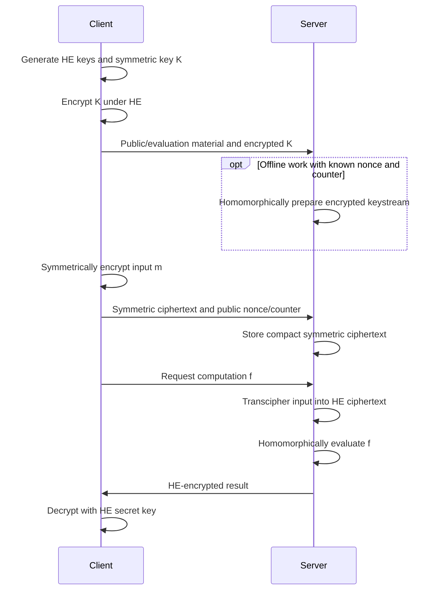

---
# Summary

**The HHE Land** is a survey and experimental comparison of hybrid homomorphic encryption (HHE), by Hossein Abdinasibfar, Camille Nuoskala, and Antonis Michalas. It formalizes a common HHE interface, compares HE-friendly cipher designs, benchmarks PASTA, HERA, and Rubato, and organizes their known cryptanalytic threats.

**Central trade-off:** Clients upload compact symmetric ciphertexts, while the server pays to convert them into HE ciphertexts before computation. The best choice depends on data semantics, packing, setup amortization, and the required attack model.

Section, figure, and table references refer to the linked 43-page PDF.

## 1. Problem

Direct HE encryption is expensive for constrained clients and produces large ciphertexts that are costly to transmit and store.

HHE combines:

- A symmetric cipher for inexpensive client-side data encryption.
- HE encryption of the symmetric key.
- Server-side homomorphic evaluation of symmetric decryption, called **transciphering**, **decompression**, or **Decomp**.

The transformed ciphertext encrypts the original data under HE. The server can then evaluate the requested function without receiving either secret key.

**Sources:** §1, §4, Figures 3–4.

## 2. Main Contribution

1. A six-algorithm HHE definition that separates symmetric-key encapsulation from data encryption.
2. A design survey covering SPN-based and register/filter-permutator approaches, with detailed treatment of PASTA, HERA, Rubato, and Elisabeth.
3. A common Go/Lattigo implementation of PASTA, HERA, and Rubato with separately executable client and server components.
4. Measurements of latency, allocated bytes, and allocation counts for encryption, key operations, and transciphering.
5. An IND-CPA definition and a claimed composition theorem for HHE.
6. A taxonomy of algebraic, differential, linear, and LWE-related attacks, plus research directions concerning parameters, packing, communication, and energy costs.

This is a systematization and benchmarking paper; it does not introduce a new symmetric cipher.

**Sources:** §1.1, §4–8.

## 3. Main Techniques

| Technique | Purpose |
| --- | --- |
| HE-encrypted symmetric key | Lets the server evaluate decryption without learning the key |
| Low-depth nonlinear layers | Reduce the cost of homomorphic cipher evaluation |
| Strong linear mixing | Provides diffusion while controlling expensive HE operations |
| Public nonce-dependent computation | Moves key-independent work outside the encrypted circuit |
| Packing and coefficient/slot conversions | Amortize work across many data elements |
| Offline keystream generation | Prepares data-independent encrypted work before ciphertext arrival |
| Noisy symmetric encryption | Trades exact recovery for lower-complexity designs in approximate applications |
| TFHE look-up-table evaluation | Supports filter functions through programmable bootstrapping |

**Sources:** §2–4, §5.2.

## 4. Threat Model and Assumptions

### Basic setting

A client holds private data and the HE secret key. A server stores symmetric ciphertexts, receives the HE-encrypted symmetric key and public evaluation material, and performs transciphering and computation.

The confidentiality model gives an adversary the HE public key, evaluation key, and encrypted symmetric key. It also provides encryption, decompression, and evaluation oracles with the provenance restrictions in Figure 9.

### Security assumptions

Theorem 1 states that HHE is IND-CPA secure if both its underlying HE and symmetric encryption schemes are IND-CPA secure.

This is a conditional claim: the concrete symmetric cipher, parameters, nonce handling, HE parameters, and exposed evaluation material must satisfy the required assumptions. The paper separately surveys attacks against those concrete components.

### Limits of the model

- The HHE game does not establish authenticated encryption or verifiable server computation.
- Physical fault injection and other stronger implementation attacks require separate treatment.
- §6.1 discusses IND-CPAD for approximate HE but uses ordinary IND-CPA for the HHE definition and theorem.
- Rubato deliberately introduces error; its output must be interpreted under an approximate correctness requirement.

**Sources:** §6.1–6.3, Figures 6–9, Theorem 1.

## 5. Important Qualifications

### Exact and approximate schemes serve different tasks

PASTA targets integer arithmetic over a prime field. HERA uses a real-to-finite-field framework to obtain CKKS ciphertexts. Rubato adds Gaussian noise and is unsuitable when exact data recovery is required.

A faster approximate configuration does not automatically replace an exact one.

### HHE shifts costs to the server

Compact stored inputs become HE ciphertexts during processing. The returned result is also an HE ciphertext, so HHE does not automatically solve client download and final decryption costs.

Key generation and encapsulation can be material costs even when repeated symmetric encryption is inexpensive.

### Memory allocation is not peak memory

The experiments report total heap bytes allocated per operation and the number of allocations. These are not measurements of maximum simultaneously resident memory. Table 5's very large allocation totals should not be read as required RAM capacities.

### Benchmarks depend on packing, parameters, and implementation

The experiments use different ring dimensions and plaintext moduli across configurations. Their full-coefficient measurements do not hold useful input size, precision, and data semantics constant across all schemes.

Elisabeth is described but not benchmarked because the selected Lattigo version lacked TFHE support. The paper's discussion of its relative performance relies on prior work.

### Reported attacks have distinct prerequisites

A published attack against a cipher instance under fault injection or a particular data model is not automatically a passive break of every deployment. Table 6 summarizes literature claims; it is not a uniform experimental security test.

Rubato's resistance to the surveyed SASTA-style fault attack does not imply resistance to every attack. §6.3 also reports a separate noise-handling and linearization attack against Rubato.

**Sources:** §4.5, §5, §6.3, Table 6, §7.2, §8.

## 6. Evaluation Setup

| Item | Setting |
| --- | --- |
| Language | Go 1.21.5 |
| HE library | Lattigo 5.0.2 |
| Implemented ciphers | PASTA, HERA, Rubato |
| Execution | Single-threaded |
| Client | Intel Core i5-9300H, 2.40 GHz, 16 GB RAM |
| Server | Intel Core i7-8700, 3.20 GHz, 64 GB RAM |
| Claimed security target | 128 bits for the selected parameter sets |
| Metrics | Time/op, allocated bytes/op, allocations/op |
| Symmetric microbenchmark | Keystream generation and encryption of 128 plaintext elements |
| Full HHE benchmark | Random vectors of size $N$ under each configuration |

### Representative results

Table 5 reports the following times. These are selected configurations, not equal-precision or equal-vector-length comparisons.

| Configuration | $\log_2 P$ | $\log_2 N$ | KeyGen (s) | Encap (s) | Enc (s) | Decomp (s) |
| --- | --- | --- | --- | --- | --- | --- |
| PASTA P3-1614 | 16 | 14 | 0.040 | 0.027 | 3.791 | 780.667 |
| PASTA P4-1614 | 16 | 14 | 0.041 | 0.025 | 1.245 | 1747.364 |
| HERA H5-2516 | 25 | 16 | 1.076 | 8.646 | 0.578 | 165.193 |
| Rubato R5-2616 | 26 | 16 | 1.081 | 9.247 | 0.819 | 91.767 |

Here $P$ and $N$ follow Table 3's plaintext-modulus and ring-dimension notation. Evaluation-key generation is a separate cost: approximately 7.29 s for P3-1614, 26.49 s for P4-1614, and 111 s for the two listed HERA/Rubato configurations.

### Findings supported by the experiments

- PASTA has cheaper HE key generation and symmetric-key encapsulation.
- HERA and Rubato have substantially faster transciphering than PASTA in this implementation.
- HERA has the lowest full-vector symmetric-encryption time among the listed HERA/Rubato variants.
- Reducing cipher rounds does not guarantee a faster complete configuration: Rubato variants also change key and block sizes.
- PASTA P4-6016 ran out of memory; its server results are omitted.

The paper attributes HERA/Rubato's transciphering advantage to circuit depth and encoding/packing techniques. The measurements cover the HHE preparation and conversion stages, rather than a complete application workload with an evaluated function and result delivery.

**Sources:** §5–5.2, Tables 3–5. Implementation URL provided by the paper: https://github.com/hosseinabdinf/HHELand.

---
# Main Scheme

## Generic HHE Framework and Cipher Designs

### 1. Notation

| Symbol | Meaning |
| --- | --- |
| $m$ | Client plaintext |
| $K$ | Symmetric secret key |
| $pk,sk,evk$ | HE public, secret, and evaluation keys |
| $c_K$ | HE encryption of $K$ |
| $c_m$ | Symmetric encryption of $m$ |
| $c_m^{\mathrm{HE}}$ | Transciphered HE encryption of $m$ |
| $f$ | Requested computation |
| $c_f$ | HE encryption of the computed result |
| $\lambda,\mu$ | HE and symmetric security parameters |
| $\nu,j$ | Public nonce and block counter |

### 2. Key Generation and Encapsulation

Generate the HE keys:

$$
(pk,sk,evk)\leftarrow\operatorname{HE.KeyGen}(1^\lambda).
$$

Generate and encapsulate a symmetric key:

$$
K\leftarrow\operatorname{SKE.Gen}(1^\mu),
\qquad
c_K\leftarrow\operatorname{HE.Enc}(pk,K).
$$

The server receives $c_K$ and the required public/evaluation material. The client retains the secret keys.

Separating this operation from message encryption makes the cost of preparing a key distinct from encrypting data under it.

**Source:** §4, Definition 4.1.

### 3. Symmetric Encryption and Storage

The client computes:

$$
c_m\leftarrow\operatorname{SKE.Enc}(K,m)
$$

and uploads it with the required public nonce/counter information.

For an additive stream-cipher formulation:

$$
c_m=m+\operatorname{KS}_K(\nu,j)\pmod p.
$$

For binary ciphers, the corresponding operation is XOR. Nonce/counter use must follow the selected cipher's requirements.

Symmetric ciphertext expansion can be close to one, but encrypted keys, nonces, and public evaluation material remain additional costs.

**Sources:** §4, §4.2, Figure 4.

### 4. Transciphering

The server evaluates symmetric decryption under HE:

$$
c_m^{\mathrm{HE}}
\leftarrow
\operatorname{HE.Eval}
\left(evk,\operatorname{SKE.Dec},(c_K,c_m)\right).
$$

The symmetric ciphertext is known to the server; the secret input to the circuit is the HE-encrypted key.

For additive encryption, this conceptually becomes:

$$
c_m^{\mathrm{HE}}
=
c_m-\operatorname{HE.Eval}
\left(evk,\operatorname{KS}_{(\cdot)}(\nu,j),c_K\right).
$$

The encrypted keystream can be prepared before the message arrives when the key and nonce/counter are already available. Subtracting it from the uploaded ciphertext forms the online phase.

The server obtains an HE ciphertext, not a decrypted plaintext.

**Sources:** Definition 4.1, §4.2, Figures 3–4.

### 5. Evaluation and Final Decryption

For several transformed inputs:

$$
c_f\leftarrow\operatorname{HE.Eval}
\left(evk,f,(c_{m_1}^{\mathrm{HE}},\ldots,c_{m_n}^{\mathrm{HE}})\right).
$$

The client decrypts:

$$
\operatorname{HE.Dec}(sk,c_f)
\approx f(m_1,\ldots,m_n).
$$

Use equality for exact constructions when their correctness conditions hold. For approximate constructions, account for encoding, cipher noise where applicable, and HE evaluation error.

**Sources:** §3–4, §4.5.

### 6. PASTA

PASTA is an arithmetic stream cipher over $\mathbb F_p$ following the Rasta design strategy. It splits the state into two branches and combines efficient nonlinear layers with affine mixing.

For branch-affine outputs $u_L,u_R$, the cross-branch mixing has the form:

$$
\begin{pmatrix}v_L\\v_R\end{pmatrix}
=
\begin{pmatrix}2I&I\\I&2I\end{pmatrix}
\begin{pmatrix}u_L\\u_R\end{pmatrix}.
$$

It uses quadratic Feistel-like S-boxes in intermediate layers and a cube S-box in its final nonlinear layer. These choices balance multiplicative complexity with diffusion and security.

The paper benchmarks three- and four-round variants using B/FV. PASTA's inexpensive key preparation is offset by high Decomp costs in the reported implementation.

**Sources:** §2.2, §4.3, Tables 3–5.

### 7. HERA

HERA combines fixed linear mixing, cube S-boxes, and a randomized key schedule. With public nonce-derived round constants $rc_{i,\nu}$, key injection is:

$$
\operatorname{KSD}_{i,\nu}(x)=x+K\odot rc_{i,\nu}.
$$

Here $\odot$ denotes componentwise multiplication. Public randomness is used in the key schedule rather than generating a fresh large random linear layer for every round.

HERA is used in the **RtF**, or real-to-finite-field, framework. It combines BFV and CKKS to encrypt real-valued data through finite-field arithmetic and produce CKKS ciphertexts for approximate computation.

**Source:** §4.4.

### 8. Rubato

Rubato follows HERA's structure but uses quadratic Feistel-like nonlinear layers, truncates the output, and adds discrete Gaussian noise to the keystream.

For the noisy keystream $ks$, encryption is:

$$
c=\lfloor\Delta m\rceil+ks\pmod q,
$$

where $\Delta$ scales real inputs to modular integers.

The deliberately noisy construction permits lower multiplicative complexity, while making exact recovery inappropriate. Its noise parameters affect both security and output accuracy.

**Source:** §4.5.

### 9. Elisabeth

Elisabeth targets TFHE using a group filter permutator. A public procedure selects and permutes key elements and adds public masks; a filter built from additions and negacyclic look-up tables produces the keystream.

The design seeks shallow, parallelizable LUT evaluation rather than optimizing the arithmetic circuit used by PASTA, HERA, and Rubato.

It is surveyed, but excluded from the paper's new benchmarks.

**Sources:** §4.6, §5.2.

### 10. Security Claims and Attack Taxonomy

| Category | Main idea | Examples discussed |
| --- | --- | --- |
| Algebraic | Express outputs as equations in secret-key variables | Linearization, Gröbner bases, GCD, guess-and-determine, cube attacks |
| Differential | Exploit structured input/output differences or injected faults | Differential, truncated, higher-order, boomerang, invariant-subspace, DFA attacks |
| Linear | Exploit biased approximations or correlations | Linear/correlation attacks, time-memory-data trade-offs, augmented-function attacks |
| LWE-related | Attack the lattice/noisy-equation components | Primal/dual lattice attacks, BKW, Arora–Ge, exhaustive search |

Table 6 distinguishes reported resistance, vulnerability, and absence of a security claim. The last category must not be interpreted as established vulnerability or resistance.

Low multiplicative complexity helps HE evaluation but can also make algebraic structure easier to exploit. Adding noise changes the attack surface and accuracy budget; it is not a universal security fix.

**Sources:** §6.3–7, Table 6.

## Protocol

**Source:** Generic workflow adapted from Figures 3–4 and Definition 4.1. Offline preparation applies when supported by the selected construction.

---
# Questions

## Points to Revisit During Proof Reading

1. **Theorem 1's game hops.** The printed proof replaces evaluated ciphertexts and the encrypted key with uniformly sampled ciphertext-space elements. Ordinary IND-CPA does not by itself establish ciphertext pseudorandomness. Also, public evaluation permits consistency checks against a claimed evaluation output. Reconcile these replacements with the actual adversarial view before relying on the printed proof. This is a proof-review concern, not a demonstrated attack on the construction.
2. **Apparent proof typos.** Game 0's prose says the adversary receives $sk$, whereas Figure 9 supplies $pk$. Claim 2 repeats the Game 0/1 advantage indices rather than the Game 1/2 indices. Read these against the formal game instead of silently adopting the prose.
3. **Evaluation-key generation and trust.** §5.2 places R&R key generation on the server because it is expensive. Determine which party supplies the secret-key-dependent inputs and how confidentiality is preserved. Timing placement alone does not specify a secure key-generation protocol.
4. **Benchmark consistency.** Some §5.2 prose memory-ratio claims do not match Table 4 directly. Prefer the raw rows and recompute ratios for explicitly selected parameter sets.
5. **Comparable application costs.** How do the schemes compare with matched input lengths, required output precision, setup amortization, and a complete evaluated workload?
6. **Rubato's security/accuracy balance.** Which concrete instances and prerequisites underlie the reported linearization attack, and how does increasing noise affect useful precision?

## Research Directions Highlighted by the Paper

- Joint parameter guidance for the symmetric and HE components.
- Compression of returned HE ciphertexts for constrained clients.
- Energy measurements comparing direct HE and HHE.
- Improved packing and LWE-to-RLWE approaches.
- Applying advances in homomorphic AES evaluation to HE-friendly ciphers.

**Sources:** §5.2, §6.2–6.3, §8.

---
# Related Topics

- [[000 - Transciphering HE]]
- [[002 - HHE Kombat - Benchmarking Hybrid Homomorphic Encryption Schemes]]
