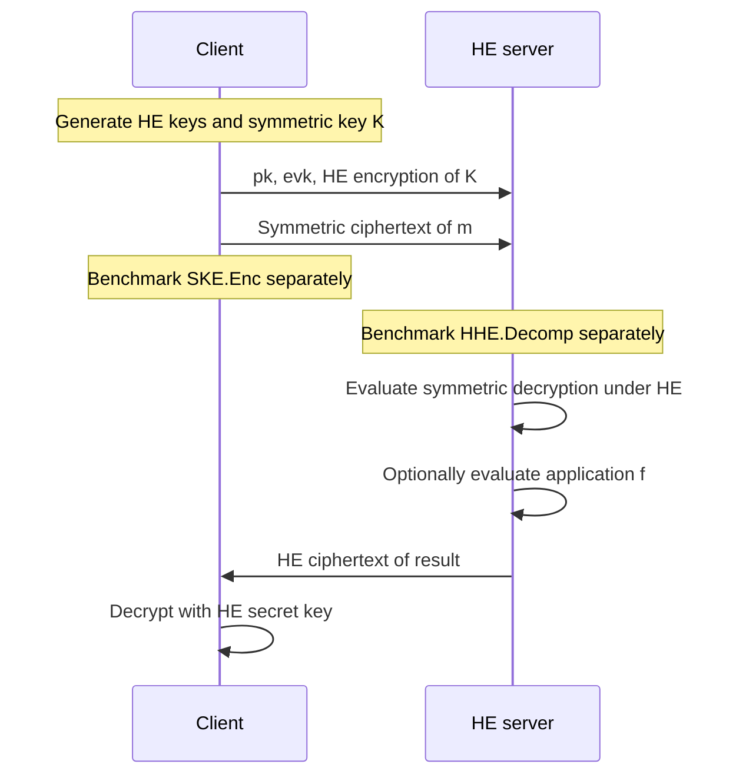

---
# Summary

Hossein Abdinasibfar, Camille Nuoskala, and Antonis Michalas benchmark **concrete HHE implementations**, covering standard AES transciphering and HE-friendly ciphers. The central result is a deployment trade-off: small-input latency, packed throughput, memory footprint, and compatibility favor different implementations. There is no universal winner.

References below use the linked 23-page PDF, particularly §§3–4 and Tables 1–16.

## 1. Problem

HHE moves symmetric decryption into an HE server to reduce the client's encryption and upload costs. Comparing proposals is difficult because available implementations differ in language, HE backend, security parameters, plaintext domain, packing, and threading. Original runtime numbers also omit memory costs or use incompatible definitions of throughput.

The paper asks which *available implementations* are useful under different client and server constraints, and supplies a common measurement environment.

## 2. Main Contribution

- A collection of **19 HHE frameworks**: 12 HE-friendly and seven standard transciphering frameworks, plus two ordinary AES implementations used as baselines (Table 1).
- **218 benchmark configurations/measurements**, comprising 84 client-side `SKE.Enc` and 134 server-side `HHE.Decomp` measurements (§3, footnote 1). These are not 218 different cipher designs.
- A language-independent measurement tool for runtime/cycle counts, computational throughput, and memory footprint. It supports C/C++, Go, Python, and Rust.
- An **HHE-128 interpretation** that separates standard AES-128, author-claimed 128-bit research ciphers, and below-128-bit reference configurations.
- Public evaluation code: [HHE-Kombat](https://github.com/hosseinabdinf/HHE-Kombat). Repository contents and benchmarks have not been independently reproduced here.

## 3. Main Techniques

| Technique | Purpose | Qualification |
| --- | --- | --- |
| One host, fixed CPU frequency, single-core process pinning | Reduce environment differences | Native multithreaded runs are separately marked |
| RDTSC-based cycle measurements | Common timing mechanism across languages | Does not remove runtime, garbage-collection, backend, or compiler differences |
| Throughput from processed bits and cycles | Account for different payload lengths | Meaningful only after checking payload representation and packing |
| Memory per processed bit | Relate footprint to workload size | Lower is better; not a rate in bits/s |
| Security-target classification | Avoid treating 80-bit configurations as HHE-128 | Research-cipher security follows authors' claims |
| Noise-budget and failure reporting | Check whether transciphered outputs remain usable | Successful decryption alone does not establish sufficient capacity for the next computation |

## 4. Threat Model and Assumptions

The generic HHE model keeps the HE secret key and symmetric key with the client. The server receives the evaluation material, an HE encryption of the symmetric key, and symmetric ciphertexts. It evaluates symmetric decryption without learning the key or plaintext.

This is a **performance study**, not a new proof of confidentiality, integrity, malicious-server security, or resistance to side channels. The paper relies on the security assumptions and parameter claims of the component constructions.

For implementation $i$, §3.2 defines:

$$
\lambda_{\mathrm{eff}}^{(i)}=
\min\{\lambda_{\mathrm{HE}}^{(i)},\mu_{\mathrm{SKE}}^{(i)}\}.
$$

A configuration enters the HHE-128 interpretation only when both component targets are at least 128 bits. Table 3 separates:

- **Standard 128-bit:** AES-based implementations, conditional on an adequately secure HE layer.
- **Claimed 128-bit:** the listed HE-friendly research designs and Transistor-128, subject to their original claims and evaluated variants.
- **Below target:** Trivium and Transistor-80; reported as references rather than evidence for 128-bit comparisons.

This classification is not an independent cryptanalysis of every research cipher, nor a proof that two security numbers completely capture composition security.

## 5. Important Qualifications

1. **Implementation comparisons are not isolated cipher comparisons.** Backend, parameters, encoding, library, language, threading, and engineering all affect the results (§3.4).
2. **Same security target does not mean identical workloads.** Exact modular arithmetic, approximate CKKS arithmetic, and TFHE encodings have different semantics. The number of elements $N$ in the tables is a workload count, not necessarily a ring dimension.
3. **Latency and throughput answer different questions.** Rubato-2's large batch has high throughput but takes about 421 seconds; Filiphat processes its much smaller workload in about 69 milliseconds.
4. **Server throughput is in bit/s.** Tables 10–14 use bit/s. Table 16 incorrectly labels the same numerical values KB/s; use bit/s when interpreting them.
5. **The memory ratio is a footprint per bit.** Smaller KB/bit is better. Several prose comparisons reverse this direction; for example, 15.48 KB/bit is much larger than the 0.0089 KB/bit BGV baseline, not more memory-efficient.
6. **Simple linear regression is a different operation.** Its HE evaluation provides context, but does not measure the same function as symmetric decryption. Comparing these directly cannot establish that one way of performing transciphering is faster than another.
7. **Correctness matters.** Table 11 explicitly marks the YuX over $\mathbb F_{2^8}$, one-instance configuration as failing; its favorable footprint must not be treated as a valid deployment result.
8. **Coverage is limited by buildability.** Some collected repositories could not be built, including an old Concrete-based FiLIP implementation and the listed FbT implementation; the PALISADE-dependent Rasta build also failed (Table 1).
9. **No observed TFHE/CKKS decryption failure is an experimental observation.** It is not a quantified global failure bound or a guarantee about arbitrary subsequent computations.
10. **The tiny AES client benchmarks do not settle optimized AES performance in general.** The reported OpenSSL/TinyAES configuration and short workloads should not be generalized to all hardware-accelerated AES deployments.

## 6. Evaluation Setup

Experiments use Ubuntu on an MNX Triton system with an **Intel Xeon Gold 6130 at 2.10 GHz and 128 GB RAM**. The paper describes a fixed CPU frequency and single-core process pinning; multithreaded cases are explicitly marked.

Memory instrumentation supports RSS from `/proc/self/statm`, live heap `Alloc`, and peak physical memory `MaxRSS` (§3.3, footnote 5). These concern live or peak footprint, not cumulative allocation. The paper does not identify one uniform indicator for every row; comparisons should retain that caveat.

Selected **single-threaded server** measurements from Tables 10–14:

| Implementation | Payload $N\cdot\log_2P$ (bits) | Decomp time (ms) | Throughput (bit/s) | Reported memory (KB) | Memory/payload (KB/bit) |
| --- | --- | --- | --- | --- | --- |
| Hippogryph, AES/TFHE-style | $16\cdot8=128$ | 5,520 | 23.2433 | 2,196 | 17.1563 |
| AES-CTR, Lattigo/CKKS | $2048\cdot128=262144$ | 1,457,943 | 180.2361 | 12,285,032 | 46.8636 |
| Filipind | $1\cdot4=4$ | 38.77 | 103.4233 | 12 | 3 |
| Filiphat | $10\cdot2=20$ | 68.58 | 292.5586 | 3,432 | 171.6 |
| Margrethe | $32\cdot8=256$ | 2,087 | 122.9700 | 1,439 | 5.6211 |
| Fasta, HElib | $5\cdot359=1795$ | 82,073 | 21.9233 | 107,976 | 60.1538 |
| Rubato-2, Lattigo | $32768\cdot64=2097152$ | 421,323 | 4,989.5059 | 32,464,256 | 15.4801 |
| Pasta4v2, SEAL | $200\cdot16=3200$ | 4,857 | 660.3780 | 54,544 | 17.0450 |
| Pasta4v2, HElib | $200\cdot16=3200$ | 15,952 | 201.0648 | 212,628 | 66.4463 |

Multithreaded Margrethe reaches **315 ms and 813.3301 bit/s**, with reported memory **34,576 KB** (Table 14). This is separate from the single-threaded Margrethe row.

For the client, Table 15 reports Hera-5 at **16,163.326 KB/s**, Rubato-2 at **10,924.129 KB/s**, and FRAST at **1,107.576 KB/s**. These are SKE encryption measurements, not server transciphering rates. Table 4's best listed HE encryption throughput is Lattigo BGV at **11,617.4910 KB/s**; HHE therefore does not automatically beat every direct-HE baseline on every metric.

---
# Main Scheme

## Generic HHE Flow and Benchmarking Method

### 1. Notation

| Symbol | Meaning |
| --- | --- |
| $K$ | Symmetric encryption key |
| $(pk,sk,evk)$ | HE public, secret, and evaluation keys |
| $c_K$ | HE encryption of $K$ |
| $c_m$ | Symmetric ciphertext of $m$ |
| $\widehat c_m$ | HE ciphertext of the recovered plaintext |
| $B=N\log_2P$ | Payload size used for throughput normalization |
| $C$, $\nu$ | Measured cycle count and CPU clock frequency |
| $M$ | Reported memory footprint, in KB |

### 2. Setup and client encryption

Definition 2.2 uses the same six-algorithm interface as HHE Land:

$$
(pk,sk,evk)\leftarrow\mathrm{HE.KeyGen}(1^\lambda),
\qquad K\leftarrow\mathrm{SKE.Gen}(1^\mu),
\qquad c_K\leftarrow\mathrm{HE.Enc}(pk,K).
$$

The client encrypts each payload using:

$$
c_m\leftarrow\mathrm{SKE.Enc}(K,m).
$$

The key ciphertext can be amortized over multiple messages under the same key, subject to the symmetric scheme's nonce and usage limits. The client retains $sk$ and $K$.

### 3. Server transciphering and application evaluation

The server uses $c_m$ as public input to a homomorphic implementation of symmetric decryption:

$$
\widehat c_m\leftarrow
\mathrm{HE.Eval}(evk,\mathrm{SKE.Dec},(c_K,c_m)).
$$

It may then evaluate an application $f$:

$$
c_f\leftarrow\mathrm{HE.Eval}
(evk,f,(\widehat c_{m_1},\ldots,\widehat c_{m_n})).
$$

The client recovers $\mathrm{HE.Dec}(sk,c_f)$. Approximate HE requires an application-specific error tolerance; the paper's generic exact-equality correctness statement should be read with this distinction in mind.

This paper benchmarks existing implementations of these steps. It does **not** introduce a new symmetric cipher or a new transciphering circuit shared by all rows.

### 4. Measurement and normalization

For each measured functionality, §3.3 defines computational throughput:

$$
T_{\mathrm{bit/s}}=\frac{B}{C}\nu.
$$

Client tables convert this rate to KB/s. For memory:

$$
R_{\mathrm{memory}}=\frac{M}{B}\quad\text{KB/bit}.
$$

The first metric is larger-is-better; the second is smaller-is-better. Whole-batch time remains necessary for latency-sensitive applications. Tables 11–12 also report backend noise budgets, which must be considered alongside timing.

## Protocol

---
# Questions

These are review questions and checks prompted by the paper, rather than additional experimental findings.

1. **Table 16 units:** the rates match Tables 10–14 in bit/s, despite its KB/s label. Any reuse should correct the header rather than multiply these values as though they were KB/s.
2. **Memory direction:** which prose conclusions survive recomputation with smaller KB/bit treated as better? The claims about Rubato versus direct HE and some SEAL/HElib comparisons need this correction.
3. **TFHE baseline inconsistency:** Table 14 prints 214,903 ms alongside $4.50\times10^8$ cycles and 373.1419 bit/s for 80 bits. The latter two imply approximately 0.215 seconds at 2.10 GHz; the printed time implies approximately 214.9 seconds. The row requires source-code or author clarification before using its latency.
4. **Statistical robustness:** how many repetitions, warmups, and outlier rules were used? The paper does not provide confidence intervals for these rankings.
5. **Timing implementation:** what serialization and compiler barriers surround RDTSC, and how are timer frequency and memory-monitor overhead validated? Process pinning helps, but does not by itself answer these questions.
6. **Memory comparability:** which exact memory indicator and measurement interval produced each row, and do measurements include key material and runtime initialization?
7. **Application matching:** how do rankings change at matched payload sizes, output encodings, CKKS precision, post-transciphering computation, and key reuse?
8. **Correctness headroom:** which parameter sets leave enough noise budget for the intended application? Observing successful transciphering is only the first check.

---
# Related Topics

- [[000 - Transciphering HE]]
- [[001 - The hhe land - Exploring the landscape of hybrid homomorphic encryption]]
- [[004 - A Survey on Transciphering and Symmetric Ciphers for Homomorphic Encryption]]
- [[005 - SoK - FHE-Friendly Symmetric Ciphers and Transciphering]]
- [[024 - Further Improvements in AES Execution over TFHE - Towards Breaking the 1 sec Barrier]]
- [[047 - Secure and efficient transciphering for FHE-based MPC]]
