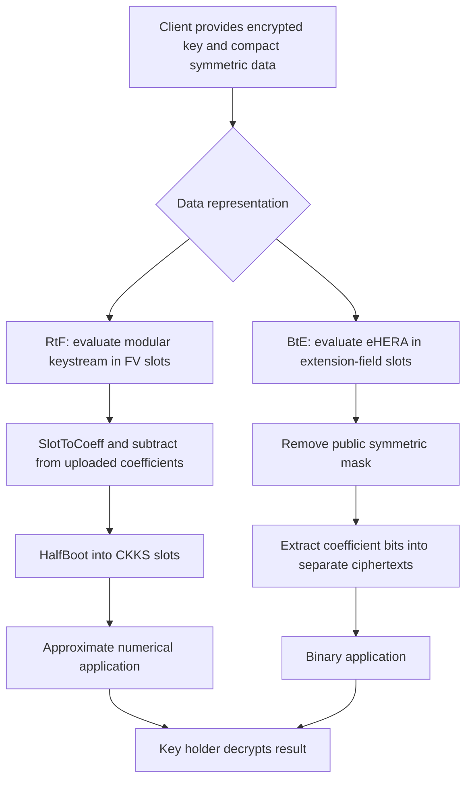

---
# Summary

Seongkwang Kim's KAIST dissertation develops **RtF** for approximate real data and **BtE** for binary data packed into extension-field slots. It instantiates these with HERA, Rubato and eHERA. The cover is dated 2022; approval/submission pages give **26 November 2021**. References below use printed pages: add 12 for PDF page numbers in the main text.

## 1. Problem
Ordinary HE imposes client encryption and upload costs. Transciphering shifts symmetric decryption to the server, but the symmetric cipher's domain must fit both the HE representation and the subsequent application. In particular, CKKS handles approximate real arithmetic, whereas symmetric encryption normally uses a finite domain. Binary BGV packing also leaves storage unused when an extension-field slot carries only one bit.

## 2. Main Contribution
- RtF: modular symmetric encryption, FV keystream evaluation, coefficient/slot transforms and a CKKS half-bootstrap (§3.1).
- HERA: fixed low-coefficient diffusion and nonce-randomized componentwise key injection (§§3.2–3.3).
- Rubato: quadratic nonlinear layers, truncation and fresh Gaussian noise for approximate recovery (§§3.4–3.5).
- BtE: evaluate a cipher in a binary extension field, then extract individual bits using linearized polynomials (§4.1).
- eHERA: a HERA variant using power maps in binary extension fields, with distinct algebraic analysis (§§4.2–4.3).
- Separate client/server implementations and comparisons (§§3.6, 4.4).

This is the thesis's historical parameter/security analysis. The separate HERA and Rubato papers have their own versions; their later results should not be substituted for these measurements.

## 3. Main Techniques
For RtF, message coefficients and modular keystream slots initially have different layouts. **FV SlotToCoeff** aligns the encrypted keystream with uploaded message coefficients. **HalfBoot** then combines modulus raising, sparse summation, CKKS CoeffToSlot and approximate modular reduction; it omits the final CKKS SlotToCoeff because the application wants slots.

HERA replaces fresh random dense matrices with fixed mixing and random round keys. Its cube costs two ciphertext multiplications along a dependency path. Rubato's triangular quadratic map costs one nonlinear multiplication layer, while truncation and noise change the attack analysis and accuracy requirements.

BtE uses Frobenius automorphisms to implement binary-linear digit extraction. In eHERA, $x^{2^\theta+1}=x^{2^\theta}x$: the first factor is a Frobenius image, so the large univariate exponent need not imply many multiplication levels.

## 4. Threat Model and Assumptions
The client/data provider keeps its symmetric key; the HE key holder keeps the HE secret key. A separate evaluator receives public/evaluation keys, encrypted symmetric keys and symmetric ciphertexts. The multi-party scenario requires that the evaluator and sufficient HE key holders do not collude (§1.2).

The cipher analyses use a secret-key model, nonce-derived XOF outputs modeled as random, and exclude related-key/known-key security. Random nonces have a birthday usage limit. Monomial survival, semi-regular polynomial systems and lattice-cost estimates are **analysis assumptions**, not reductions proving each cipher secure against every attack. Rubato's structured linearized equations are not independent uniform LWE samples merely because noise is present.

The framework does not supply authenticated input or malicious-evaluator verification. Correct nonce management, HE evaluation-key assumptions and an application-specific precision requirement remain necessary.

## 5. Important Qualifications
- **BtE is binary-to-extension-field, not BtR.** It is distinct from Boolean circuits represented as approximate reals inside CKKS.
- **Rubato noise remains in the recovered data.** The server evaluates the deterministic part of the mask; it cannot cancel fresh client noise from the key/nonce alone. Exact recovery is not promised.
- RtF setup/key encryption is excluded from the reported recurring costs. Offline keystream work still consumes server resources.
- Latency is time until the first output ciphertext; throughput is measured across the full output set. Do not derive one from the other without matching that boundary.
- Table 3.11 labels client latency “ms”, but its values and Table 3.14/introduction use microsecond-scale client latency. Quote the explicitly identified Table 3.14 units below rather than silently accepting both headers.
- The eHERA comparison's HE estimates are unequal: Table 4.10 lists roughly 100–119-bit estimates for older comparator configurations, whereas Table 4.1 lists substantially larger estimates for eHERA. The comparison is not uniform 128-bit HE security.
- The real-polynomial/gradient-descent motivation in §3.1 is not a general impossibility proof for every cipher over real encodings. Differentiability alone does not imply efficient global equation solving.
- Appendix A's branch-number result assumes the component matrix really is MDS over the selected field. Small entries alone do not establish that property.

## 6. Evaluation Setup
AMD Ryzen 7 2700X at 3.70 GHz, **one thread**, 64 GB RAM. RtF server: Go 1.16.4/Lattigo; client: C++17, GNU C++ 7.5.0 and AVX2. BtE uses HElib/BGV and BLAKE3, with separately reported SHAKE128 and AVX2 client variants.

Selected RtF comparison (Table 3.14, printed p.55):

| Framework | Expansion | Client latency | Client throughput | Server latency | Server throughput | Precision |
| --- | ---: | ---: | ---: | ---: | ---: | ---: |
| HERA | 1.24 | 1.520 µs | 25.26 MB/s | 141.58 s | 5.077 KB/s | 19.1 bits |
| Rubato | 1.26 | 4.585 µs | 31.04 MB/s | 106.4 s | 6.712 KB/s | 18.9 bits |

Both use $N=2^{16}$ and seven remaining levels in this comparison. Rubato improves throughput while its listed client latency is higher. Expansion excludes nonce amortization. The sampled data are bounded real values; these figures do not cover arbitrary input magnitude.

BtE/eHERA (Table 4.8, printed p.70):

| Variant | Claimed symmetric target | Client cycles | Client cycles/byte | Server latency | Server throughput |
| --- | ---: | ---: | ---: | ---: | ---: |
| eHERA-4 | 80 bits | 4635 | 110.4 | 48.79 s | 265.0 B/s |
| eHERA-6 | 128 bits | 6310 | 150.2 | 76.74 s | 225.0 B/s |
| eHERA-7 | 192 bits | 7152 | 170.3 | 88.61 s | 217.5 B/s |
| eHERA-8 | 256 bits | 7942 | 189.1 | 115.0 s | 178.4 B/s |

These use 16 field elements over $\mathbb F_{2^{21}}$ per stream block. Table 4.1's HE estimate for eHERA-8 is **247 bits**, so the whole system should not be called 256-bit secure from the symmetric target alone. HE setup/encrypted-key preparation are excluded. No benchmark was rerun for this note.

---
# Main Scheme
## Title
RtF modular masking followed by CKKS conversion; BtE extension-field masking followed by digit extraction.

### 1. Notation
- $K$: symmetric key; $\nu$: nonce/counter input; $z=E_K(\nu)$: deterministic keystream.
- $q$: symmetric/FV plaintext modulus; $\delta$: real-data scale; $\Delta_{FV}$: FV ciphertext scale.
- $[x]_{FV}$: FV encryption; $L=\mathrm{MixRows}\circ\mathrm{MixColumns}$.
- $\ell$: occupied slots; $e$: binary extension degree.

### 2. RtF client and offline server work
Client supplies FV-encrypted key material and encrypts real input by
$$
c=[\lfloor\delta m\rceil+z]_q.
$$
For Rubato, add fresh Gaussian error $\varepsilon$ to that expression. Choose scale/range to avoid unintended representative wraparound.

With public nonces known, the server computes $[z]_{FV}$ in SIMD slots, then applies FV SlotToCoeff. The uploaded symbols are assembled as a public coefficient polynomial $C(X)$; subtraction gives
$$
[(\Delta_{FV}C(X),0)-\mathrm{SlotToCoeff}_{FV}([z]_{FV})].
$$
Rescale to the lowest level and run HalfBoot. The result represents the approximate message in CKKS slots, with quantization, HE/conversion error and any Rubato noise. HalfBoot is a specified conversion with shared key/ring/scale choices, not an arbitrary cast between unrelated schemes.

### 3. HERA and Rubato cores
Let $A_i(x)=x+K\odot rc_i$ with XOF-derived public nonzero round multipliers. HERA starts from the public constant vector $(1,\ldots,16)$ after initial $A_0$. Ordinary rounds are
$$
R_i=A_i\circ\mathrm{Cube}\circ L,
\qquad \mathrm{Cube}(x)_j=x_j^3.
$$
The final round inserts another $L$ after Cube. Cube bijectivity requires $\gcd(3,q-1)=1$ for the chosen prime field.

Rubato replaces Cube by
$$
F(x_1,\ldots,x_n)=(x_1,x_2+x_1^2,\ldots,x_n+x_{n-1}^2),
$$
then truncates to $\ell<n$ output symbols and adds independent discrete Gaussian noise. These operations explain its lower deterministic degree and approximate-correctness trade-off; they are not a generic LWE security reduction.

### 4. BtE and eHERA
Interpret a block as $\widetilde m\in\mathbb F_{2^e}^{16}$ and encrypt
$$
c=\widetilde m+\mathrm{eHERA}_K(\nu).
$$
The server evaluates eHERA over encrypted extension-field slots and adds public $c$. Its round structure follows HERA, replacing Cube by $x\mapsto x^{2^\theta+1}$ and interpreting diffusion constants in the binary polynomial basis. The main instance uses $e=21$, $\theta=4$, exponent 17 and field polynomial $X^{21}+X^2+1$. Its characteristic-two arithmetic is not integer arithmetic modulo $2^{21}$.

For $x=\sum_{j=0}^{e-1}a_j\alpha^j$, digit extraction uses
$$
\tau_i(x)=a_i=\sum_{j=0}^{e-1}b_{i,j}x^{2^j}.
$$
Determine $b_{i,j}$ from the power-basis linear map. Frobenius automorphisms and public linear combinations yield separate ciphertexts containing bits $a_i\in\mathbb F_2$. Subsequent ciphertext multiplication now implements bitwise AND, rather than multiplication of whole extension-field elements.

## Protocol

---
# Questions
- How do later analyses change the exact historical HERA, Rubato and eHERA parameter claims?
- What input range and precision budget justify the chosen scale and Rubato noise after the full application?
- How much do setup, output-layout conversion and a matched HE security target change the comparisons?
- Can the conflicting client-latency units in Table 3.11 be reconciled with source measurements?
- How conservative are monomial-survival and semi-regularity assumptions for the actual structured equations?

---
# Related Topics
- [[000 - Transciphering HE]]
- [[032 - Transciphering Framework for Approximate Homomorphic Encryption (Full Version)]]
- [[036 - Rubato - Noisy Ciphers for Approximate Homomorphic Encryption]]
- [[005 - SoK - FHE-Friendly Symmetric Ciphers and Transciphering]]
