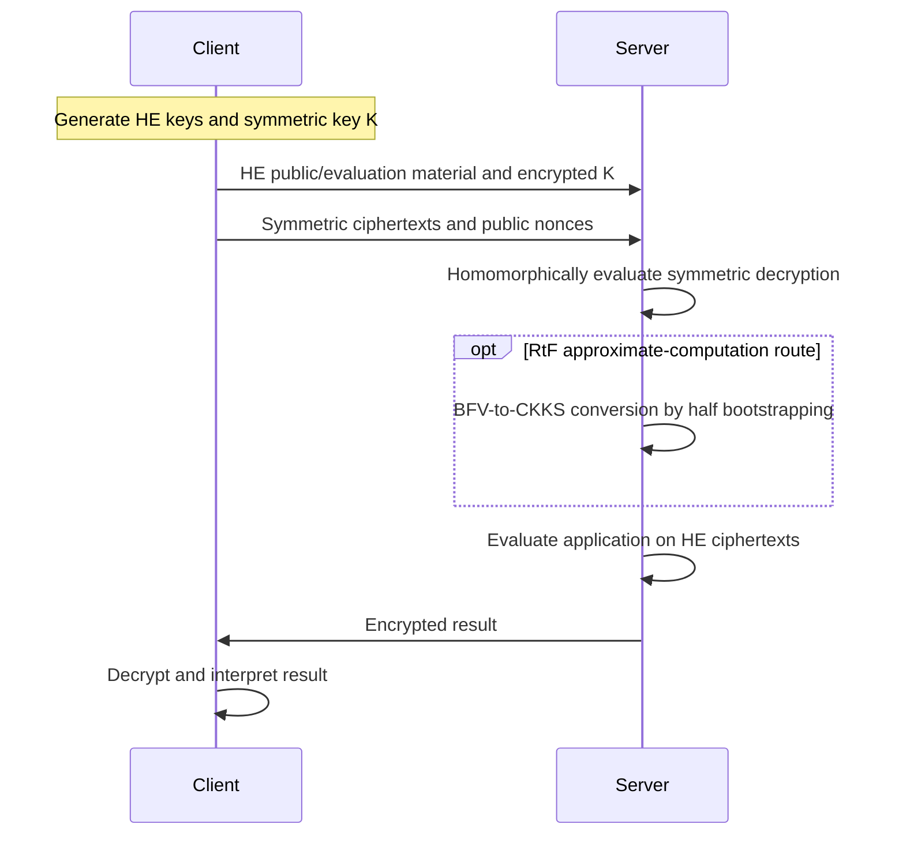

---
# Summary

Indranil Thakur, Angshuman Karmakar, Chaoyun Li, and Bart Preneel survey transciphering, with particular attention to **matching symmetric-cipher structure to the HE backend**. They organize existing HE-friendly ciphers, summarize previously published benchmarks and cryptanalysis, and identify three deployment gaps: suitable well-analyzed ciphers, input authentication, and verification of outsourced computation.

The local PDF has 35 pages. Its version-history box dates the manuscript to **18 December 2024**, while this vault catalogs its ePrint entry under 2025. The technical discussion below follows that local version, rather than assuming coverage of later results.

## 1. Problem

Direct HE encryption can impose substantial computation and ciphertext expansion on constrained clients. Transciphering replaces bulk client-side HE encryption with symmetric encryption, then requires the server to evaluate symmetric decryption under HE.

A cipher that is fast on ordinary hardware need not be fast inside HE. Binary multiplicative depth, gate count, arithmetic degree, bootstrapping cost, and packing interact differently across BGV/BFV, TFHE, and CKKS. The survey organizes these design choices and the security trade-offs introduced by minimizing nonlinearity.

## 2. Main Contribution

- A description of exact transciphering and the **Real-to-Finite-field (RtF)** route to approximate CKKS computation (§3.1).
- A backend-oriented taxonomy of HE-friendly ciphers (§4, Table 1).
- A summary of design rationale and known attacks, with cipher details in Appendix B and attack terminology in Appendix C.
- A comparison of **benchmarks taken from earlier papers**, grouped by backend (§5, Tables 2–4).
- Five research problems covering applications, authenticated encryption, verification, cryptanalysis, and platform-aware cipher design (§§3 and 6).

This is a survey, not a new cipher construction or an independently rerun common-platform benchmark.

## 3. Main Techniques

| HE target | Important design costs | Families emphasized in the survey |
| --- | --- | --- |
| BGV/BFV | Multiplicative depth and count; suitable plaintext domain; SIMD packing | LowMC, Rasta/Agrasta, Dasta, Masta, Pasta, Fasta, Chaghri |
| TFHE-style schemes | Gate or programmable-bootstrapping cost; filter evaluation; message encoding | Trivium, Kreyvium, FLIP, FiLIP, Elisabeth |
| CKKS via RtF | Efficient finite-field keystream generation plus conversion to approximate arithmetic | Hera, Rubato |

For Boolean circuits, the survey uses three metrics: total AND count, AND count per encrypted bit, and AND depth (§4). These are related but distinct: low depth can reduce required HE parameters, while low count can reduce evaluation work. They do not fully account for rotations, public-matrix generation, memory movement, or application conversion costs.

## 4. Threat Model and Assumptions

The baseline client/server setting protects client data from a server that possesses symmetric ciphertexts and an HE encryption of the symmetric key. The client retains the decryption keys. Confidentiality depends on the security and valid parameterization of both encryption layers.

The survey distinguishes three goals:

1. **Confidentiality:** hide the client's plaintext and symmetric key during outsourcing.
2. **Input authenticity/integrity:** detect tampering with submitted data, potentially through authenticated transciphering (§3.3).
3. **Correct computation:** allow the client to verify that the server evaluated the intended function (§3.4).

The first goal does not imply the other two. The basic protocol assumes correct server execution for correctness; malicious behavior requires an additional verification mechanism. The survey discusses verifiable HE and proof systems, but does not supply a complete efficient verified-transciphering construction.

## 5. Important Qualifications

- **Research-cipher status matters.** LowMC revisions, early FLIP, some Agrasta instances, Elisabeth-4, and Chaghri illustrate why a low-cost nonlinear layer needs substantial cryptanalysis. An attack on a particular instance or reduced-round variant is not automatically an attack on every family member.
- **Exact and approximate correctness differ.** RtF encodes real data in a finite domain, performs exact symmetric decryption there, and converts to CKKS. It does not turn a finite-field cipher into a secure cipher over unbounded real numbers.
- **Public randomness is not free in ordinary execution.** Rasta-like designs make large parts of the circuit independent of the secret key, reducing homomorphic depth; generation and application of public matrices can still dominate client or server work.
- **Same-library benchmarks remain conditional.** The source experiments can differ in hardware, library version, encoding, parameter set, workload, and security assumptions. The survey's tables do not establish a universal cross-paper ranking.
- **Returned ciphertexts remain a separate cost.** §3 mentions dimension reduction as a way to reduce the final response; it is not an automatic property of every listed HHE implementation.
- **Input authentication does not prove the requested computation.** A valid authentication check alone does not show that a malicious server used the correct function or returned a fresh result.
- **Several background claims need narrower readings.** The manuscript's statement that plaintext must occupy only a constant coefficient does not describe general SIMD-packed RLWE encryption. Its claim that Boolean ciphers require BGV/BFV plaintext modulus two is too strong: Boolean gates can be represented over other moduli, with conversion and efficiency consequences.
- **Real-polynomial heuristics are not impossibility proofs.** §3.1 motivates avoiding low-degree real-valued ciphers using equation solving and gradient descent. Differentiability alone does not establish efficient global key recovery for every polynomial system.

## 6. Evaluation Setup

§5 assembles results from the original literature. It does not introduce one new machine and execution harness shared by all rows.

**Table 2: SEAL-based BGV/BFV comparison, reported 128-bit settings.** The two columns measure HE encryption of a symmetric key and decompression of one block; they are different operations.

| Cipher | HE encryption of symmetric key (s) | Decompression (s) |
| --- | --- | --- |
| LowMC | 1.75 | 613.9 |
| Rasta-6 | 1.42 | 88.5 |
| Kreyvium | 1.84 | 412.8 |
| FiLIP-1280 | 16.7 | 1251.6 |
| Pasta-3 | 0.017 | 9.28 |
| Masta-4 | 0.058 | 54.2 |
| Hera | 0.051 | 16.6 |

**Table 3: TFHE-rs results cited from the Trivium/Kreyvium paper.** Keep startup, steady-state latency, and the table's transciphering measurement separate.

| Cipher | Warm-up (ms) | Latency (ms) | Throughput (bit/s) | Transciphering (ms) |
| --- | --- | --- | --- | --- |
| Trivium | 2259 | 121 | 529 | 259 |
| Kreyvium | 2883 | 150 | 427 | 291 |

Trivium has an 80-bit key; these two rows should not be interpreted as identical 128-bit symmetric-security targets.

**Table 4: selected RtF comparison, as reproduced in the survey.** Rubato and Hera use $N=2^{16}$ and batch length $2^{16}$.

| Framework | Ciphertext expansion | Client latency (µs) | Client throughput (MB/s) | Server latency (s) | Server throughput (KB/s) | Precision (bits) |
| --- | --- | --- | --- | --- | --- | --- |
| RtF-Rubato | 1.26 | 4.585 | 31.04 | 106.4 | 6.712 | 18.9 |
| RtF-Hera | 1.24 | 1.520 | 25.26 | 141.58 | 5.077 | 19.1 |

The server throughput improvement is about 32.2%; client throughput improves about 22.9%. Rubato's listed client latency is nevertheless higher, so improved throughput must not be restated as improved latency. Precision and expansion also differ.

---
# Main Scheme

## Exact Transciphering and RtF Conversion

### 1. Notation

| Symbol | Meaning |
| --- | --- |
| $H,S$ | Homomorphic and symmetric encryption schemes |
| $(pk_H,sk_H)$ | HE key pair; evaluation material is implicit in the survey diagrams |
| $K$ | Symmetric secret key |
| $m_i,c_i$ | Plaintext and its symmetric ciphertext |
| $x=H.Enc(pk_H,K)$ | HE-encrypted symmetric key |
| $z_i$ | HE ciphertext of recovered plaintext |
| $\nu,i$ | Public nonce and counter for a keystream generator |

### 2. Exact client/server framework

The client generates the keys and sends:

$$
x\leftarrow H.Enc(pk_H,K),\qquad
c_i\leftarrow S.Enc(K,m_i).
$$

The server evaluates:

$$
z_i\leftarrow H.Eval(S.Dec,(x,c_i)),
\qquad
y\leftarrow H.Eval(f,(z_1,\ldots,z_n)).
$$

The client decrypts $y$ with $sk_H$. In the survey's Figure 5, the server additionally encrypts the public symmetric ciphertexts before evaluation; concrete implementations may instead inject these as plaintext constants when the HE interface permits it.

For a binary stream cipher, the essential operation is:

$$
c_i=m_i\oplus z_i^{\mathrm{stream}},
\qquad
\widehat m_i=c_i\oplus
H.Eval(\mathrm{StreamGen},(x,\nu,i)).
$$

A public nonce/counter can allow the server to precompute the encrypted keystream before receiving the corresponding payload. Safe nonce and key-usage rules still apply.

### 3. RtF for approximate computation

The survey's Figure 6 uses a modular stream cipher, BFV, and CKKS:

1. Represent the real data by an appropriate finite-domain encoding; encrypt the symmetric key under BFV.
2. The server homomorphically generates the modular keystream under BFV.
3. Subtract this encrypted keystream from the public modular ciphertext, producing a BFV encryption of the encoded message.
4. Apply the RtF conversion, described as **half bootstrapping**, to obtain a CKKS ciphertext.
5. Evaluate the real-valued application in CKKS and return the encrypted result.

At the modular decryption step:

$$
c_i=[\operatorname{Encode}(m_i)+s_i(K,\nu)]_t,
\qquad
\widehat{\operatorname{Encode}(m_i)}
=[c_i-\widehat{s_i}]_t.
$$

The conversion must handle the modular representative, scaling, packing, and CKKS approximation error. It is not a generic cast between two unrelated ciphertext types. The underlying RtF paper specifies those details.

### 4. Cipher-design patterns surveyed

**Rasta:** Appendix B.4 expresses each public affine layer as:

$$
A_{j,\nu,i}(u)=M_{j,\nu,i}u\oplus rc_{j,\nu,i},
$$

with matrices and constants derived from the public nonce and counter. The nonlinear layer is:

$$
S(u)_j=u_j\oplus u_{j+2}\oplus u_{j+1}u_{j+2},
$$

where indices are modulo the state size. Composing public affine layers with these low-degree nonlinear layers reduces key-dependent depth, at the cost of public randomness and its processing.

**Filter permutators:** Appendix B.2 gives the FiLIP-style keystream equation:

$$
s_i=F\bigl(P_i(S_i(K))\oplus w_i\bigr).
$$

Here $S_i$ selects a key subset, $P_i$ permutes it, and $w_i$ whitens it; all three derive from public pseudorandom generation. The static encrypted key avoids a long key-dependent state-update chain. Elisabeth generalizes the additions and filter to an additive group.

**Hera:** Appendix B.6 uses nonce-derived public round constants to form componentwise round keys $K\odot rc_j$, with modular linear mixing and a cubic nonlinear layer. Randomizing the key schedule reduces the need to regenerate full random linear layers.

**Rubato:** Appendix B.7 replaces the cubic layer with a quadratic Feistel-type transformation, truncates the output, and adds discrete Gaussian noise. Its displayed nonlinear map is:

$$
F(u_1,\ldots,u_n)=
(u_1,u_2+u_1^2,\ldots,u_n+u_{n-1}^2)\pmod q.
$$

The noise helps frustrate exact algebraic modeling but affects the recoverable precision. It does not replace a concrete attack analysis for the chosen modulus and variant.

## Protocol

---
# Questions

1. **Attack scope:** which exact LowMC version, Chaghri modification, Elisabeth instance, or Rubato modulus is under discussion? The survey reports several broken variants, not one uniform security verdict.
2. **Rubato parameters:** §4.3.2 reports attacks below claimed security for five of six family members under certain modulus conditions. Which concrete parameter sets in an intended implementation satisfy those conditions?
3. **Authentication versus verification:** how will an encrypted authentication decision be enforced, and how will the client verify the requested application rather than only input validity?
4. **Representation cost:** when a Boolean cipher is evaluated for an integer-valued application, what is the cost of unpacking, reconstructing words, or switching schemes?
5. **Cipher specification checks:** Appendix B.1's brief Kreyvium register description should be checked against the original specification before implementation. This survey is a map to the primary papers, not an implementation-ready specification.
6. **Matched benchmarks:** how do the Table 2 results change for equal application payloads, precision, key amortization, and remaining depth? Library identity alone does not fix these variables.
7. **Research directions:** the survey calls for application-level benchmarks, efficient AEAD under approximate HE, verification that exploits transciphering structure, further algebraic/statistical cryptanalysis, and hardware-aware designs.

---
# Related Topics

- [[000 - Transciphering HE]]
- [[001 - The hhe land - Exploring the landscape of hybrid homomorphic encryption]]
- [[002 - HHE Kombat - Benchmarking Hybrid Homomorphic Encryption Schemes]]
- [[005 - SoK - FHE-Friendly Symmetric Ciphers and Transciphering]]
- [[010 - E2E near-standard and practical authenticated transciphering]]
- [[032 - Transciphering Framework for Approximate Homomorphic Encryption (Full Version)]]
- [[036 - Rubato - Noisy Ciphers for Approximate Homomorphic Encryption]]
