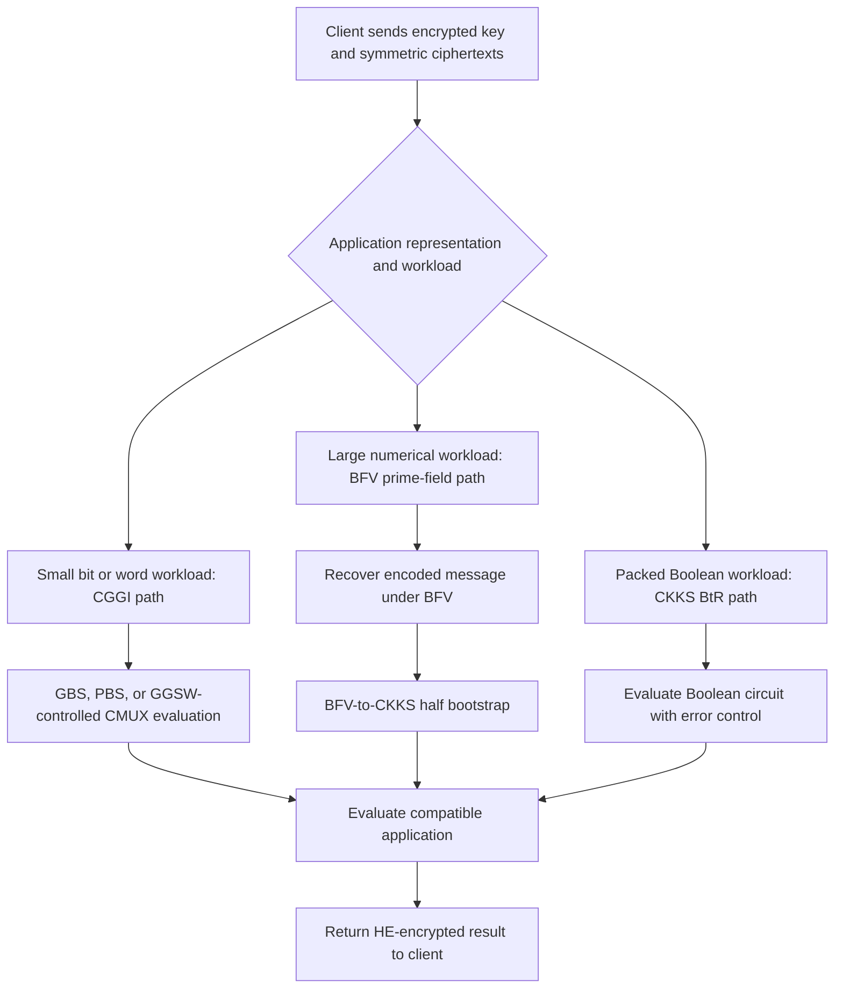

---
# Summary

Chao Niu, Benqiang Wei, Zhicong Huang, Zhaomin Yang, Cheng Hong, Meiqin Wang, and Tao Wei systematize **the compatibility between symmetric ciphers, transciphering methods, and the application that follows**. They survey more than 20 designs/methods and run their own experiments, including end-to-end chi-square testing and ResNet-20 inference.

Their main conclusion is that **data shape matters**: small workloads can favor CGGI/TFHE-style evaluation, while packed prime-field methods perform well for larger numerical workloads. AES remains a practical compatibility option when its client efficiency and security maturity outweigh its greater server cost.

Section and table references refer to the local 32-page PDF. The manuscript's first-page publication fields are placeholders; the vault's public ePrint link identifies the source.

## 1. Problem

Transciphering reduces bulk upload expansion by sending symmetric ciphertexts and an HE-encrypted symmetric key. This shifts the cost of symmetric decryption to the server.

Selecting a cipher alone is insufficient. A fast transciphering circuit can leave data in an inconvenient domain, consume the application's noise budget, require expensive conversion, or impose a large setup key. The paper asks which **cipher–HE-method combination** fits an application's message size, representation, and subsequent computation.

## 2. Main Contribution

- Four symmetric-cipher categories: HE-friendly binary ciphers, prime-field ciphers, standard ciphers, and extension-field ciphers (§3.1).
- A method taxonomy distinguishing older approaches, CGGI-based evaluation, Real-to-Finite-field (RtF), and Binary-to-Real (BtR) (§3.2).
- A survey of design/security trade-offs, including gate count, lookup-table evaluation, key formats, randomized matrices, and algebraic attacks (§4).
- Common-host single-threaded transciphering experiments, rough setup-key estimates, client encryption measurements, and two end-to-end applications (§5).
- Open-source examples: [awesome-transciphering](https://github.com/AntCPLab/awesome-transciphering). These experiments have not been independently rerun here.

## 3. Main Techniques

| Method | Representation and useful operations | Main cost/trade-off |
| --- | --- | --- |
| CGGI/TFHE-style | Bits or small words; gate, programmable, and circuit bootstrapping | Small-input latency; limited SIMD-style batching in the evaluated methods |
| RtF | Symmetric arithmetic modulo a finite-domain modulus; BFV decryption followed by CKKS conversion | Efficient packed numerical processing; conversion and precision costs |
| BtR | Bits encoded as approximate real values in CKKS slots | Packed Boolean evaluation; bit cleanup and bootstrapping costs |
| GGSW-controlled LUT/CMUX | Encrypted key bits directly control table selection | Avoid repeated expensive bootstrapping at the cost of larger key material |
| Row packing | Same position from many blocks occupies one packed ciphertext | High batch throughput; large first-batch latency and memory |

The paper emphasizes that **XOR is not automatically free**. Low-AND-depth designs may contain many XORs that are expensive under the selected CGGI representation. The full evaluation strategy matters more than one circuit metric.

## 4. Threat Model and Assumptions

The baseline is a client with private data and keys, and a server with an HE encryption of the symmetric key. The server should compute without learning the key or plaintext. Component encryption assumptions and correct parameterization are inherited from the original constructions.

§5 states that tested cipher settings aim at at least 128-bit security according to their original papers and that broken early designs are excluded. **Table 2 nevertheless includes Trivium**, whose security is described in §4.1.1 as 80 bits. That row should be treated as a lower-security reference rather than a matched 128-bit comparison.

The paper discusses attacks on specific variants, including Elisabeth-4, early FLIP, LowMC instances, and prime-field constructions. It does not provide fresh security proofs or independently validate every claimed security level.

§4.4 discusses authenticated transciphering, encrypted validity flags, interactive checks, and signing submitted ciphertexts. These are alternative protocol choices with different assumptions; an input signature does not by itself prove the correctness of the server's HE computation.

## 5. Important Qualifications

1. **Raw transciphering and application timing have different scope.** Table 2's prime-field measurements exclude BFV-to-CKKS conversion; Table 3 includes the application path. One-time setup is excluded from Table 2, whereas offline and online transciphering work are included.
2. **Warm-up is treated differently in latency and throughput.** Stream-cipher latency includes producing the initial 128-bit output; sustained Trivium/Kreyvium throughput excludes warm-up (§5.1).
3. **Packing changes the unit of comparison.** A prime-field slot can carry more information than one binary CKKS slot, but a two-bit application value may underuse that capacity.
4. **Setup keys are substantial.** The table's key-size column roughly includes encrypted symmetric keys and evaluation keys, not merely the original secret-key bytes. Selected arithmetic configurations require gigabytes of setup material.
5. **Key compression moves costs.** FRAST's 11.8/460 MB entry distinguishes compressed GLWE and expanded GGSW key formats. Server expansion and its time must be considered separately.
6. **Client Rubato overhead is implementation-dependent.** This paper's Gaussian sampling measurements differ sharply from HHE Kombat's later client results. They should not be combined into one implementation-independent ranking.
7. **Security statements need concrete attack scope.** The paper characterizes a Rubato attack in terms of non-prime moduli; the other survey discusses more specific modulus conditions. Neither brief summary replaces the original attack's parameter analysis.
8. **Some background generalizations are too broad.** CBC encryption is sequential, but CBC *decryption* can evaluate block-cipher decryptions in parallel when all ciphertext blocks are available; the blanket incompatibility claim in §2.2 needs this distinction. LowMC's fixed public matrices should also be distinguished from Rasta's nonce-dependent matrices.
9. **Noise addition alone is not a generic security proof.** The paper describes Rubato using an LWE analogy, but the security of the complete construction still requires its specific design assumptions and cryptanalysis.

## 6. Evaluation Setup

The experiments use an **Intel Xeon at 2.70 GHz with 256 GB RAM**, with reported results collected using **one thread** (§5). Arithmetic experiments use the same polynomial degree and modulus chain, with $\log_2(QP)\leq1555$, targeting at least 128-bit HE security (§5.1).

Selected **Table 2** server results; throughput is **KB/s**, latency is **ms**, and setup-key size is **MB**:

| Cipher and method | Latency (ms) | Throughput (KB/s) | Key size (MB) |
| --- | --- | --- | --- |
| Kreyvium-13 / CGGI | $2.63\times10^5$ | $5.21\times10^{-4}$ | 10.7 |
| FiLIP-TX(16384,144) / CMUX | $2.86\times10^3$ | $5.46\times10^{-3}$ | 215 |
| Margrethe(2048,308) / CMUX | $1.08\times10^3$ | $1.45\times10^{-2}$ | 128 |
| FRAST(40,128) / PBS | $4.20\times10^3$ | $3.72\times10^{-3}$ | 11.8 / 460 |
| AES(10,128) / CGGI-CBS | $1.43\times10^5$ | $1.09\times10^{-4}$ | 1500 |
| HERA(5,16,16,28-bit) / BFV | $1.38\times10^5$ | 25.95 | 2251 |
| Rubato(2,64,60,25-bit) / BFV | $1.48\times10^5$ | 81.07 | 3451 |
| AES-CTR / CKKS | $2.53\times10^7$ | 0.02 | 3387 |

The prime-field rows here are **leveled measurements without BFV-to-CKKS conversion**. The AES-CKKS implementation is the authors' Lattigo implementation of E2E's method, since the original code was unavailable. These numbers therefore do not reproduce the original E2E machine and implementation verbatim.

**Table 3: end-to-end application time, in seconds.**

| Cipher | Chi-square | ResNet-20 |
| --- | --- | --- |
| Pasta(4,64,32,33-bit) | 3990 | 2570 |
| HERA(5,16,16,28-bit) | 1570 | 1220 |
| Rubato(5,16,12,26-bit) | 1450 | 1170 |
| Rubato(3,36,32,25-bit) | 1250 | 1200 |
| Rubato(2,64,60,25-bit) | 1170 | 1230 |
| AES-CTR(10,128) | 50600 | 26300 |

The chi-square workload has **200 individuals × 16,384 SNPs**, each encoded with two information bits, about 800 KB total. The CNN evaluates **ResNet-20 on CIFAR-10**, with $32\times32\times3$ values represented as 32-bit floats, 12 KB per image. Polynomially approximated ReLU and BFV-to-CKKS conversion narrow the end-to-end gap relative to isolated transciphering.

**Table 4 uses cycles/byte, not KB/s.** Lower is better. Selected reported values are AES-SW 116 C/B, HERA 511 C/B, Pastav2(4,64,32,33-bit) 1460 C/B, and Kreyvium 3290 C/B. AES-SW uses Tiny-AES-C without AES-NI. These client figures should not be read as server rates.

---
# Main Scheme

## Matching Cipher Representation to the Application

### 1. Notation

| Symbol | Meaning |
| --- | --- |
| $K,\widehat K$ | Symmetric key and its HE encryption |
| $S_{ij}$ | Element $i$ of symmetric ciphertext block $j$ |
| $b,N$ | Elements per block and number of parallel blocks |
| $z(K,\nu)$ | Keystream generated under key $K$ and public nonce/counter data $\nu$ |
| $\widehat m$ | HE ciphertext of the transciphered plaintext |
| GBS, PBS, CBS | Gate, programmable, and circuit bootstrapping |
| CMUX | Encrypted conditional selection, typically with a GGSW control |

### 2. Offline/online transciphering

The client sends $\widehat K$ during setup. For a stream cipher or a block cipher in CTR mode:

$$
c=m\oplus z(K,\nu).
$$

The server can precompute the HE-encrypted keystream from $\widehat K$ and public $\nu$ before receiving $c$:

$$
\widehat z\leftarrow\operatorname{HE.Eval}
(\operatorname{StreamGen},(\widehat K,\nu)).
$$

The online step combines $c$ with $\widehat z$ to obtain $\widehat m$. Arithmetic stream ciphers use modular addition/subtraction instead of XOR. Offline preprocessing reduces arrival-to-result latency but remains part of the total server work measured in the paper.

### 3. Row-packed SIMD execution

For $N$ blocks, transpose the $N$ vectors of length $b$ into $b$ vectors of length $N$:

$$
\mathbf v_i=(S_{i0},S_{i1},\ldots,S_{i,N-1}),
\qquad 0\leq i<b.
$$

Each position $i$ is processed across many independent blocks by the same homomorphic operation. This is the paper's selected packing strategy (§2.2). It increases throughput when batches fill the available slots, but can involve many large ciphertexts and substantial batch latency.

### 4. CGGI path: exploit encrypted lookup tables

- A Boolean gate implementation can use gate bootstrapping, but high XOR counts are costly.
- PBS evaluates a small-domain function while refreshing its output; processing a whole small word can amortize this work across several bits.
- GGSW-encrypted key bits can select branches of a CMUX lookup tree without bootstrapping each Boolean gate.
- Some designs, notably optimized filter-permutator evaluations, can use this structure to avoid bootstrapping in the keystream-evaluation path.
- AES has intermediate values that must be converted/refreshed between lookup stages; circuit bootstrapping can become the dominant cost.

These are different implementation paths, not a promise that every cipher can use all optimizations simultaneously.

### 5. RtF path: prime-field decryption followed by CKKS

For an encoded numerical message:

$$
c=[\operatorname{Encode}(m)+z(K,\nu)]_p,
\qquad
\widehat{\operatorname{Encode}(m)}
=[c-\widehat z]_p.
$$

Evaluate the arithmetic keystream in BFV, remove the mask, and apply the prescribed BFV-to-CKKS half-bootstrap conversion. The application then operates in approximate numerical arithmetic. Large prime-field slots improve useful throughput only when the actual data representation uses that capacity.

### 6. BtR path: Boolean circuits inside CKKS

Represent bits $x,y\in\{0,1\}$ by CKKS slots with small approximation errors. The paper describes:

$$
x\land y=xy,
\qquad
x\oplus y=(x-y)^2.
$$

These equalities hold for exact Boolean inputs; approximate execution accumulates error. Cleanup by suitable step-function approximations or bootstrapping is therefore needed. The paper notes XBOOT's later use of lazy reduction to reduce XOR cost, without benchmarking it as the Table 2 AES-CTR implementation.

## Protocol

---
# Questions

1. **Security matching:** Table 2 contains Trivium despite the text's blanket claim that tested ciphers meet 128-bit security. Keep that row separate when comparing against 128-bit candidates.
2. **Precision and useful payload:** how many of a prime-field slot's bits contribute useful application information, and how much error is acceptable after conversion and inference?
3. **Setup amortization:** how many messages are processed per encrypted key, and what server memory/expansion time is required for GGSW keys? Table 2's one-time-cost exclusion is important for short sessions.
4. **Client-table arithmetic:** the Rubato-2 row reports $1.48\times10^7$ cycles and $7.89\times10^5$ cycles/byte. Check the measured byte count against the reported $(r,t,m,p)$ and output size before reusing this rate; the displayed quantities do not make the normalization obvious.
5. **Maturity versus speed:** are the exact FiLIP filtering parameters, Rubato modulus, or modified cipher instances covered by the cited cryptanalysis? Masta-6 is explicitly a custom version used to study matrix scale, not a separately established standard parameter set.
6. **Authenticated protocol choice:** when would signing uploaded ciphertexts meet the same goal as AE, and when would origin privacy, key management, replay handling, or a malicious evaluator require a different construction?
7. **Crossover point:** §6 suggests a scale of several KB between small and large workloads. That is an experimental guideline, not a universal threshold independent of hardware, batching, or latency requirements.

---
# Related Topics

- [[000 - Transciphering HE]]
- [[002 - HHE Kombat - Benchmarking Hybrid Homomorphic Encryption Schemes]]
- [[004 - A Survey on Transciphering and Symmetric Ciphers for Homomorphic Encryption]]
- [[010 - E2E near-standard and practical authenticated transciphering]]
- [[020 - XBOOT - Free-XOR Gates for CKKS with Applications to Transciphering]]
- [[032 - Transciphering Framework for Approximate Homomorphic Encryption (Full Version)]]
- [[047 - Secure and efficient transciphering for FHE-based MPC]]
