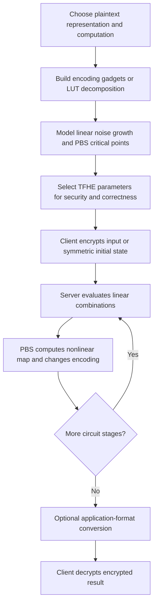

---
# Summary

**Nicolas Bon's doctoral thesis**, defended on **14 November 2025**, develops TFHE operations that better match the representation and noise constraints of a computation. Its central thread is using **odd plaintext moduli and intermediate encodings** to reduce costly programmable bootstrappings while retaining efficient linear operations.

The thesis has several distinct contributions: Boolean-function evaluation with $p$-encodings, the Hippogryph AES implementation, Transistor transciphering, decomposition of large lookup tables, and the ORPHEUS parameter-selection framework. It should be read as a collection of related constructions, rather than one new HHE protocol.

References below use **printed chapter/page numbers**. In the local 178-page PDF, printed page 1 is PDF page 25; for the main chapters, add 24 to locate the PDF page.

## 1. Problem

TFHE provides inexpensive linear operations and a relatively low-latency programmable bootstrapping (PBS), but three constraints make efficient applications difficult:

1. **Negacyclicity:** blind rotation operates in $\mathbb Z_q[X]/(X^N+1)$, so a half-turn negates the accumulator. Classical padding-bit encodings restrict how linear operations may wrap around the torus.
2. **Representation mismatch:** bitwise XOR is cheap in a binary representation, whereas nonlinear byte substitutions are often better handled as lookup tables on small words. Moving between representations can dominate the computation.
3. **Parameter selection:** security, failure probability, plaintext precision, circuit noise growth, and machine-specific runtime must be optimized together.

Transciphering adds another requirement: the symmetric cipher must be efficient *under TFHE*, not merely on the client's ordinary CPU.

## 2. Main Contribution

| Chapter | Contribution | Relationship to the vault's individual papers |
| --- | --- | --- |
| 3 | Odd-modulus accumulators that avoid a dedicated padding bit | Foundation for the encoding-based constructions |
| 4 | Boolean $p$-encodings, gadget search, circuit decomposition, primitive evaluations | Optimized Homomorphic Evaluation of Boolean Functions |
| 5 | Hippogryph: combine nibble-based S-box evaluation with binary AES linear layers | Further Improvements in AES Execution over TFHE |
| 6 | Transistor: $\mathbb F_{17}$ stream cipher and noise-aware TFHE implementation | Transistor paper; thesis includes only a security overview |
| 7 | Large-LUT decomposition into small PBS operations and products | Additional thesis contribution |
| 8 | ORPHEUS: parameter-space reduction and hardware/library-specific cost prediction | Additional thesis contribution |

Chapters 1–2 provide background, including LWE/GLWE, key switching, GGSW external products, blind rotation, and security-model limitations. Appendix A expands the parameter-selection noise formulas and cost model.

## 3. Main Techniques

- **Odd-modulus encoding:** the occupied message regions and their negacyclic counterparts do not coincide; a tailored accumulator compensates for sign changes (Chapter 3).
- **Set-valued encodings:** a Boolean output can correspond to several residues. If residues reachable for different outputs do not overlap, a weighted ciphertext sum already determines the function's output (Chapter 4).
- **PBS as both computation and recoding:** one PBS maps the intermediate residue to a canonical encoding for the next operation.
- **Hybrid Boolean/arithmetic AES:** tree-based and multi-value lookup evaluation for SubBytes, binary encoding for XOR-heavy steps, and dedicated conversions between them (Chapter 5).
- **Silent LFSRs:** compute each LFSR output as a public linear combination of the *unchanged* encrypted initial state, avoiding cumulative state-update noise (Chapter 6).
- **Randomized LUT decomposition:** construct reusable derived variables and solve a finite-field linear system to express the target table using small operators (Chapter 7).
- **Constrained parameter search:** estimate security/noise requirements, reduce the candidate grid, and rank candidates with a profiled runtime model (Chapter 8).

## 4. Threat Model and Assumptions

The homomorphic operations inherit TFHE's assumptions for the selected LWE/GLWE parameters, evaluation keys, and secret distributions. Most measurements target **128-bit estimated security**. These concrete estimates depend on the lattice estimator and attack models; they are not unconditional lower bounds.

For transciphering, the client keeps its master/HE secret keys and the server receives encrypted symmetric key material and evaluation keys. The constructions do not by themselves prove a malicious server's correct execution, authenticate arbitrary uploaded data, or prevent side channels.

§1.4 emphasizes that ordinary CPA security does not cover unrestricted decryption feedback. Later chapters therefore report different **per-bootstrap failure targets**, including $2^{-40}$ and $2^{-128}$. Reducing a failure probability addresses one attack surface; it is not by itself a proof of complete CPAD or verified-CCA security.

Transistor has an additional symmetric-security claim: **128-bit security**, with at most **$2^{31}$ digits per IV** and **$2^{128}$ digits in total per key** (§6.2.1). Chapter 6 summarizes attack arguments; the full Transistor article contains the detailed cryptanalysis.

ORPHEUS's noise reasoning uses a Gaussian model. Its debugging probes serialize secret keys and ciphertexts so they can be decrypted for noise measurement (§8.3); that instrumentation belongs in a trusted development environment, not on a server that must remain ignorant of the key.

## 5. Important Qualifications

1. **One PBS per function is conditional.** A suitable small-modulus gadget need not exist. Large or difficult Boolean functions require a graph of smaller gadgets; the circuit partitioning uses heuristics, not a proven globally optimal compiler.
2. **Odd modulus removes a padding restriction, not noise growth.** Linear operations still amplify error, and accumulator windows still impose correctness bounds.
3. **Representation conversion has a real cost.** The benefit of a faster nonlinear layer must exceed the cost of decomposition/recomposition and any additional evaluation material.
4. **AES timings exclude key expansion in the main comparison.** Hippogryph assumes the eleven encrypted AES-128 round keys are already available. §5.6.2 separately mentions a homomorphic key-expansion implementation, without including it in the headline times.
5. **Thread count and failure targets must stay attached to timings.** Hippogryph's 32 s single-core, 4.6 s laptop, and 1.1 s server results use different parallelism. The 463 s result uses a much smaller failure target.
6. **Thunderbird is an exception to the common-host comparison.** Table 5.3 uses its published 46 s timing. The author's partial reconstruction ran in 60 s but could not reproduce one improved circuit-bootstrapping component correctly (§5.6.1).
7. **Transistor's “no setup” means no homomorphic cipher warm-up.** Key generation, upload, and state wrapping still exist. The compact 784-byte wrapped state excludes the megabytes of TFHE evaluation keys.
8. **F17 throughput and binary payload throughput differ.** Table 6.3 counts $\log_2 17$ bits per output digit. Embedding four-bit nibbles reduces useful rate by $4/\log_2 17$; conversion to another HE plaintext representation can add a PBS per digit.
9. **LUT-decomposition generation is expensive preprocessing.** It requires truth-table-size linear algebra. Experiments reach 14 input bits; the approach is not demonstrated as practical for arbitrary 24-bit tables (§7.4).
10. **WoP-PBS comparisons are partly model-based.** The thesis translates another work's cost model into estimated runtime using a classical PBS baseline. Those curves are not all direct runs of the competing implementation.
11. **ORPHEUS optimizes within its model and search ranges.** Approximate security curves, Gaussian noise formulas, omitted small terms, and a trained runtime model limit an unqualified claim of global optimality.
12. **Measured noise is not an empirical observation of $2^{-128}$ failures.** The parameter experiments measure variances and infer tail probabilities; 500 runs cannot directly validate such a rare-event rate.

## 6. Evaluation Setup

The thesis uses **different machines for different chapters**:

| Contribution                 | Environment                                                                     | Important scope                                                                                            |
| ---------------------------- | ------------------------------------------------------------------------------- | ---------------------------------------------------------------------------------------------------------- |
| Chapter 4 Boolean primitives | Intel Core i5-1245U, stated 4.4 GHz, 16 GB RAM                                  | Default estimated security 128 bits and per-PBS error $2^{-40}$; some full-primitive results are estimates |
| Chapter 5 AES                | Intel Core i7-12700H, 64 GiB, Ubuntu 22.04.2 LTS                                | Common-host single-core comparisons, except published Thunderbird row                                      |
| Chapter 5 parallel AES       | Laptop with six cores; Threadripper PRO 7995WX server using 32 cores            | Within-block parallelism, rather than merely processing independent blocks                                 |
| Chapter 6 Transistor         | Intel Core i5-1245U, stated 4.4 GHz                                             | Reported implementation does not exploit the possible 16-way PBS parallelism                               |
| Chapters 7–8 server          | AMD Ryzen Threadripper PRO 7995WX, 96 cores, up to 5.4 GHz, reported 528 GB RAM | LUT experiments and ORPHEUS profiling                                                                      |
| Chapter 8 laptop             | Intel Core i7-10870H at 2.2 GHz, eight cores, 8 GB RAM                          | Separate machine-specific runtime model                                                                    |

### Hippogryph AES-128 (Table 5.4)

| Machine | Cores | Per-bootstrap failure target | Time per AES evaluation (s) |
| --- | --- | --- | --- |
| Laptop | 1 | $2^{-40}$ | 32 |
| Laptop | 1 | $2^{-128}$ | 463 |
| Laptop | 6 | $2^{-40}$ | 4.6 |
| Server | 32 | $2^{-40}$ | 1.1 |

These results are homomorphic AES evaluations with encrypted round keys available, not an end-to-end network/application benchmark. The §5.6.2 state-and-round-key storage estimate also excludes other working buffers and evaluation keys; it is not a measured peak-process-memory figure.

### Transistor (Tables 6.2–6.4)

| Failure target | One PBS (ms) | One round (ms) | Throughput (bit/s, F17 information measure) | Compressed BSK | Compressed KSK |
| --- | --- | --- | --- | --- | --- |
| $2^{-40}$ | 11.9 | 195 | 83.84 | 6.5 MB | 49 KB |
| $2^{-128}$ | 15.28 | 251 | 65.10 | 12.7 MB | 82 KB |

A round evaluates 16 S-box PBS operations and emits four F17 digits. The standard compressed encrypted initial LFSR state has size:

$$
128+(64+32)\cdot64=6272\text{ bits}=784\text{ bytes}.
$$

### Large lookup tables and ORPHEUS

Chapter 7 tests random tables with 4–14 input bits, using chunk sizes $s=2,4,16$ embedded in fields with $p=3,5,17$. It targets $2^{-40}$ error and reports an advantage for 6–10-bit precisions over the compared alternatives (§7.4), subject to the competing-runtime estimation described above.

Chapter 8 reports an average runtime-prediction error of about **4.3%** for its demonstrated model, using a training subset of 50 configurations (§8.2.2). Table 8.2 averages timings and noise measurements over **500 runs**. For the server's six-bit case, the listed runtime falls from **67.4 ms** with the compared tfhe-rs parameters to **60.9 ms** with ORPHEUS parameters; these rows have different inferred error probabilities. Appendix A.3 reports six-bit runtime **125.6 ms** for a generated configuration targeting $2^{-128}$.

---
# Main Scheme

## Odd-Modulus Encoding and TFHE Evaluation Pipeline

### 1. Notation

| Symbol | Meaning |
| --- | --- |
| $p,q$ | Plaintext and ciphertext moduli; $q$ is commonly $2^{32}$ or $2^{64}$ |
| $R_q$ | Negacyclic polynomial ring $\mathbb Z_q[X]/(X^N+1)$ |
| $c=(\mathbf a,b)$ | LWE ciphertext with phase $b-\langle\mathbf a,\mathbf s\rangle$ |
| $E$ | Set-valued encoding of a logical value into residues modulo $p$ |
| $\nu$ | Norm of a public linear-combination coefficient vector in parameter selection |
| PBS | Programmable bootstrapping |
| MVB | Multi-value bootstrapping: several outputs share a blind rotation |
| TBM | Tree-based method for lookup evaluation on several small limbs |

### 2. TFHE encryption and bootstrapping foundation

A scalar LWE ciphertext encodes $m\in\mathbb Z_p$ as:

$$
b=\langle\mathbf a,\mathbf s\rangle+
\left\lfloor\frac{qm}{p}\right\rceil+e\pmod q.
$$

The client rounds the phase to decode the message. The server can add ciphertexts and multiply them by public integers, but these operations increase noise.

PBS conceptually proceeds through modulus switching, blind rotation of a programmed accumulator, sample extraction, and a key switch to return to the desired LWE key/dimension. The key-switch position can be arranged differently around the loop. Blind rotation uses encrypted key bits to perform CMUX-controlled polynomial rotations.

Because $X^N=-1$, a rotation by $N$ flips the accumulator sign. Chapter 3 builds accumulators for **odd $p$** whose occupied message windows remain compatible with this relation. This permits modular wraparound without reserving a padding bit; rounding and noise margins remain essential.

### 3. Boolean gadgets from set-valued encodings

For a Boolean function $f:\{0,1\}^{\ell}\to\{0,1\}$, select input encodings $E_i$ and define:

$$
P_b=\left\{
\left[\sum_{i=1}^{\ell}\gamma_i\right]_p:
\gamma_i\in E_i(x_i),\ f(x_1,\ldots,x_\ell)=b
\right\}.
$$

The key requirement is **$P_0\cap P_1=\varnothing$**. Then the homomorphic sum determines which Boolean output is encoded. One PBS can recode that output to a canonical encoding for the next gadget (§4.3).

With canonical inputs $E_i(0)=\{0\}$ and $E_i(1)=\{d_i\}$, gadget construction becomes a constraint problem:

$$
f(\mathbf u)\ne f(\mathbf v)
\ \Longrightarrow\
\sum_i(u_i-v_i)d_i\not\equiv0\pmod p.
$$

The thesis gives an exact backtracking search, reductions of its search space, and a faster sieving heuristic (§4.4). Larger circuits are partitioned into a DAG of valid gadgets (§4.5). The graph search trades PBS count, PBS precision, encoding switches, and parallel depth.

A simple independently checked illustration is AND modulo three: use weights $(1,1)$, so false outputs reach residues $\{0,1\}$ and the true output reaches $\{2\}$. This illustrates the condition, without asserting that one small encoding works for arbitrary functions.

### 4. Hippogryph: switch representations across AES layers

Each AES round follows this representation strategy (§5.5):

1. **SubBytes:** represent a byte by two four-bit limbs, each embedded canonically in $\mathbb Z_{17}$. Use tree-based lookup evaluation, sharing first-stage work with MVB.
2. **Decomposer:** extract each nibble's four bits and cast them to binary encoding, sharing work through MVB.
3. **Linear AES circuit:** implement ShiftRows by ciphertext reordering and MixColumns/AddRoundKey through XOR circuits. Under binary encoding, XOR uses homomorphic addition.
4. **Recomposer:** use one recoding PBS per bit and linear combinations to rebuild nibbles for the next round.

Odd output modulus is crucial for the recomposition argument: two is invertible modulo $p$, allowing the required affine transformation of a negacyclic Boolean output. The minimal odd modulus carrying a nibble is 17. The manuscript's printed recomposition formulas have inconsistencies noted below; this description follows the stated algorithmic structure rather than treating those formulas as executable pseudocode.

### 5. Transistor: stream generation with silent LFSRs

Transistor uses:

- a 16-digit nonlinear FSM over $\mathbb F_{17}$;
- a length-64 key-schedule LFSR $K$;
- a length-32 whitening LFSR $W$;
- an AES-like SubDigits/ShiftRows/MixColumns structure;
- a filter extracting FSM positions 4, 6, 12, and 14 under the thesis's numbering.

Client-side SHAKE128 derives the initial LFSR states from the master key and IV. Those states are HE-encrypted and sent to the server; **SHAKE is not evaluated homomorphically**. The FSM begins at zero.

Using $\mathbf k_{t+1}$ for the next 16 key-LFSR digits, the thesis writes the FSM recurrence as:

$$
X_{t+1}=\operatorname{SD}\bigl(
\mathbf k_{t+1}+\operatorname{MC}(\operatorname{SR}(X_t))
\bigr).
$$

The filtered digits are whitened with the corresponding $W$ output to produce the stream. The client adds that stream to its F17-encoded plaintext; the server generates its HE-encrypted counterpart and subtracts it from the public ciphertext.

A silent LFSR evaluates an output directly from the encrypted initial state:

$$
\widehat u_t=\sum_j a_{t,j}\widehat u_{0,j}.
$$

Only the coefficients $a_{t,j}$ are updated in the clear. Centered F17 representatives keep them in $[-8,8]$, bounding the contribution of fresh encryption noise instead of allowing repeated encrypted updates to accumulate error.

The MDS matrix has squared row norm seven, so the linear layer limits noise growth between successive S-box PBS operations. Sixteen such PBS operations produce four stream digits: **four PBS per digit**, before optional output-format conversion.

### 6. Large LUTs as small-field operations

Chapter 7 embeds small input limbs into an odd prime field and builds a chain of derived variables of the form:

$$
x_{n+j}=\psi_j\left(\sum_i\alpha_{j,i}x_i\right).
$$

Each such atomic function costs a small-domain PBS. It then seeks a decomposition of the target output:

$$
f(\mathbf x)=\sum_{i=0}^{t-1}
\left(\sum_j\beta_{i,j}x_j\right)
\left(\sum_k d_{i,k}x_k\right).
$$

To find coefficients, evaluate candidate derived variables on every possible input, construct the resulting linear system, and solve it over the field. A full-row-rank system supports every target output vector of that size. Sampling continues if the candidate matrix lacks the needed rank.

More precisely, the chain and the coefficients $d_{i,k}$ are sampled and fixed first; the system is then **linear in the unknown $\beta_{i,j}$** (§7.3, printed pp. 101–103). Solving for both coefficient families simultaneously would instead be bilinear.

A product of encrypted field elements can be computed with two small PBS calls using:

$$
xy=4^{-1}\bigl((x+y)^2-(x-y)^2\bigr)\pmod p.
$$

For a chain of length $h$ and $t$ products, the single-output count is $h+2t$ PBS calls. Multiple outputs reuse the chain and previously computed products. Coefficient norms still affect the required parameters, so minimizing PBS count alone is insufficient.

### 7. ORPHEUS parameter selection

The parameter tuple includes ciphertext modulus, short LWE dimension, GLWE dimension/degree, fresh noise levels, and decomposition bases/levels for bootstrapping and key switching (§8.1.1).

The optimization loop is:

1. Profile a representative parameter subset on the intended library and machine.
2. Fit runtime using a linear model whose features count primitive operations and their parameter-dependent costs.
3. Use approximate isosecurity curves to relate dimension to minimum noise for the security target.
4. Apply the circuit's critical-noise and input/output constraints to discard infeasible candidates and bound the remaining dimension.
5. Predict runtime for the feasible grid and select the lowest predicted cost.
6. Optionally rerun the chosen pattern to measure runtime and noise.

For sector width $\tau$ and Gaussian noise standard deviation $\sigma$, the tail model is:

$$
p_{\mathrm{err}}=\operatorname{erfc}
\left(\frac{\tau}{2\sqrt2\,\sigma}\right),
\qquad
\sigma\leq
\frac{\tau}{2\sqrt2\,\operatorname{erfc}^{-1}(p_{\mathrm{err}})}.
$$

The units of $\tau$ and $\sigma$ must match. For a whole circuit, per-operation error bounds must also be combined; a single operation's target is not automatically the total execution's failure probability.

## Protocol

---
# Questions

1. **Printed gadget example:** §4.3.2's multiplexing example lists input weights $(1,1,2)$ modulo seven but output-residue sets containing 5 and 6. Those values cannot arise from that weighted sum on three bits; it also cannot distinguish all required outputs. **Independently checked correction:** for the printed $f(a,b,c)=a$ if $c=1$, and $b$ otherwise, use weights $(1,3,2)$. Exhausting all eight inputs gives precisely the printed classes $P_0=\{0,1,2,5\}$ and $P_1=\{3,4,6\}$. This is a mathematical repair, not a claim that the implementation uses those weights.
2. **Recomposer formulas:** §5.5 prints powers and affine relations that do not consistently match the canonical nibble reconstruction described in the text. Verify the exact PBS tables and affine adjustments against the Hippogryph implementation before transcribing an implementation recipe.
3. **Per-PBS versus overall correctness:** how many bootstrappings will an application execute, and what global failure probability follows? A smaller parameter target alone is not a complete CPAD security argument.
4. **LUT rank heuristic:** under what distributions and parameter slack does a full-row-rank matrix appear quickly? The thesis identifies a theoretical characterization of this success probability as future work.
5. **Parameter-model validation:** how conservative are the fitted isosecurity lines and Gaussian tail approximations? Which omitted Appendix A noise terms remain negligible for a new parameter range?
6. **Search optimality:** the critical-noise function has a minimum, rather than being globally decreasing. The dimension search must use the correct branch; extending the search ranges may change its assumptions.
7. **Timing consistency:** several Chapter 4 estimates differ between prose and summary tables. Use the explicitly identified experimental row, target failure rate, and threading scope rather than combining those figures.
8. **Bandwidth accounting:** Table 6.5's compact Transistor key entry differs slightly from §6.4.1's 784-byte derivation. Its nibble-embedding expansion prose should also be distinguished from a bit-level serialization rate; sending F17 symbols in bytes produces a different expansion.
9. **Application performance:** how much of the benefit survives output-format conversion, encrypted-key refresh/upload, and the application's own homomorphic work?

---
# Related Topics

- [[000 - Transciphering HE]]
- [[014 - Optimized Homomorphic Evaluation of Boolean Functions]]
- [[024 - Further Improvements in AES Execution over TFHE - Towards Breaking the 1 sec Barrier]]
- [[045 - Transistor - a TFHE-friendly Stream Cipher]]
- [[012 - At Last! A Homomorphic AES Evaluation in Less than 30 Seconds by Means of TFHE]]
- [[005 - SoK - FHE-Friendly Symmetric Ciphers and Transciphering]]

Implementation links given in the thesis: [Hippogryph](https://github.com/CryptoExperts/Hippogryph), [Transistor](https://github.com/CryptoExperts/Transistor/), and [ORPHEUS](https://github.com/CryptoExperts/ORPHEUS). The thesis describes ORPHEUS's public release as future work; these links are source references, not a check of their current availability.
