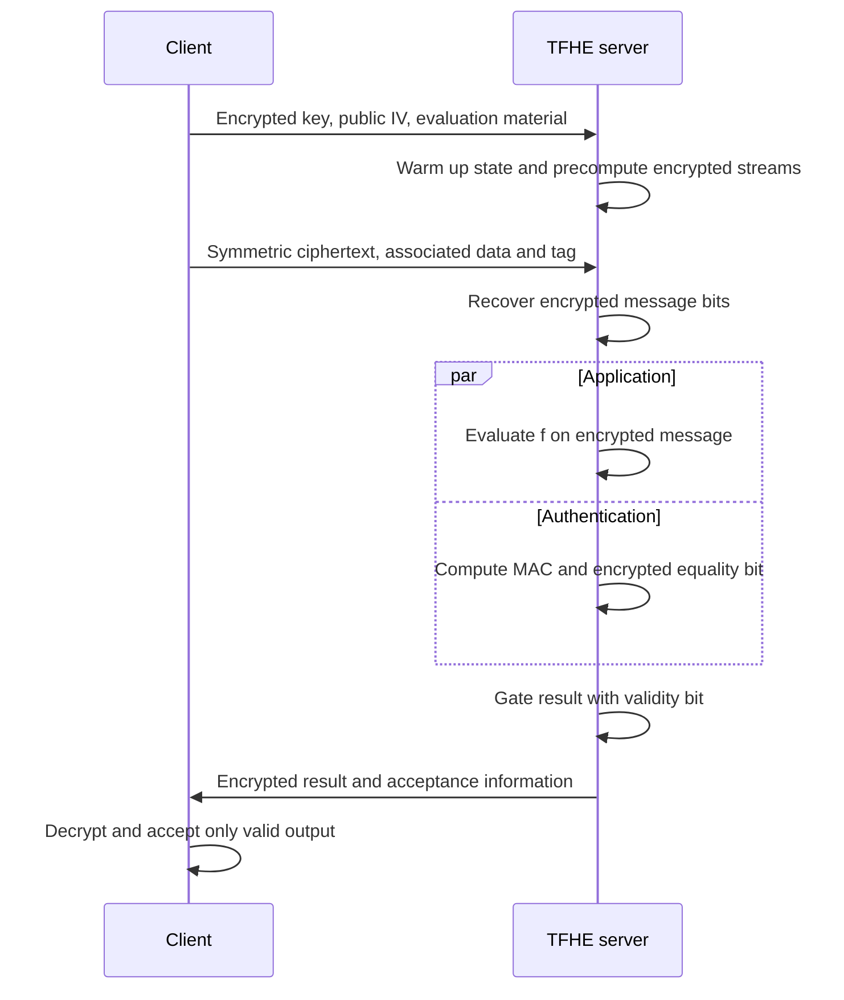

---
# Summary

Bendoukha, Boudguiga and Sirdey revisit Trivium, Kreyvium, Grain128a and Grain128-AEAD using **TFHE gate bootstrapping**, permitting long encrypted stream generation after one initialization. This is the FPS 2021 paper published in LNCS in **2022**, pp.19–33; the local PDF has 15 pages.

## 1. Problem
Leveled HE bounds stream-cipher depth, forcing frequent restarts and repeated encrypted warm-up. TFHE can refresh during execution, allowing a more natural long-lived encrypted stream state. Authentication additionally requires a decision that the server can compute but cannot decrypt.

## 2. Main Contribution
- Cingulata implementations of four existing stream ciphers (§§5–7).
- Measured warm-up and 64-bit stream-generation timings under TFHE.
- A homomorphic MAC-computation and encrypted conditional-output sketch (§6).
- Comparisons of source programs written with one-bit, eight-bit and 32-bit words.

The contribution is encrypted execution and protocol organization, not a new cipher or formal authenticated-transciphering proof.

## 3. Main Techniques
Gate bootstrapping keeps the evolving state usable without fixing a shallow whole-stream circuit. Cingulata propagates public constants, synthesizes Boolean circuits and wraps TFHE gates. Word-oriented programs exploit feedback delays and convenient software layouts, but the compiler ultimately represents them as **individual encrypted bits**.

Keystream generation is independent of the message and can run offline once the encrypted key and public IV are known. The server stores encrypted keystream for later XOR with the public symmetric ciphertext. MAC finalization depends on recovered message bits and remains online, although it may run alongside the application.

## 4. Threat Model and Assumptions
A client keeps the symmetric key and HE secret key, and supplies HE-encrypted symmetric key material and evaluation keys. The server performs the prescribed circuit without seeing message, key or encrypted validity decision.

The paper uses default TFHE parameters described as targeting 128-bit HE security. This does not raise Trivium's **80-bit symmetric key** to 128-bit security. The paper does not supply a complete per-gate/global correctness table or a malicious-evaluator proof. A server that deliberately fabricates the validity bit is outside the demonstrated correctness argument.

Nonce/IV reuse under a key must be prevented. “One warm-up” means amortization over a permitted stream/session, not permission to reuse one keystream for different messages. A generic MAC adaptation to another cipher requires its own security analysis.

## 5. Important Qualifications
- TFHE removes a fixed leveled-depth limit by paying for bootstrapping; it does not make arbitrary stream length free or eliminate cumulative failure accounting.
- Eight-/32-bit source words are **not** packed TFHE plaintext digits. True larger-domain functional bootstrapping is future work here; see the later packed-Grain paper.
- Offline work reduces arrival-to-result latency only when preprocessing and encrypted-state storage keep up with demand.
- Warm-up, stream generation and MAC evaluation are separate measurements. They are not a complete authenticated application benchmark.
- The standardization descriptions are historical competition-era wording. They should not be read as present-day status claims.
- §5.1's printed Trivium feedback uses $s_{171}$ where the conventional second-register endpoint is $s_{177}$; compare the original Trivium/Kreyvium specification before implementation. The compact Grain descriptions also do not reliably specify key/IV placement or the exact warm-up/MAC initialization boundary.
- The paper's broad security prose should not be interpreted as saying every secure symmetric/HE CPA composition is impossible. Appropriate independent-key and CPA assumptions permit the usual hybrid argument; authentication and decryption feedback are separate questions.

## 6. Evaluation Setup
Cingulata/TFHE, **one core**, Intel Xeon E3-1240 v5 at 3.50 GHz, 8 GB RAM (§7.3). Tables 1–3 use **minutes**.

| Cipher | Warm-up, bit program | Warm-up, 8-bit program | Warm-up, 32-bit program | Generate 64 bits, bit program |
| --- | ---: | ---: | ---: | ---: |
| Trivium | 4.23 | 4.64 | 4.84 | 0.29 |
| Kreyvium | 4.98 | 5.52 | 5.83 | 0.33 |
| Grain128a | 4.12 | 4.15 | 4.21 | 1.09 |
| Grain128-AEAD | 6.55 | 6.68 | 6.71 | 1.13 |

The separate 32-bit-message MAC calculation takes **0.65 / 0.66 / 0.68 minutes** for the three program widths. Trivium's stream row implies approximately $64/(0.29\cdot60)=3.68$ bits/s, excluding warm-up; this is a derived rate, not the paper's rough prose throughput for every cipher. Competitor BGV/BFV timings use different hardware, batching and historical security settings.

---
# Main Scheme
## Title
Offline TFHE stream generation with online mask removal and encrypted MAC gating.

### 1. Notation
- $[x]$: TFHE encryption of a bit/vector; $K,IV$: symmetric key and public IV.
- $z_i$: encryption-keystream bit; $ms_i$: MAC-keystream bit.
- $a_k^{(i)},r_k^{(i)}$: MAC accumulator and shift-register bits.
- $b$: encrypted tag-equality decision; NIL: reserved invalid-output encoding.

### 2. Setup and stream evaluation
Client sends $[K]$, public IV and required HE keys. Server initializes and warms the selected stream-cipher state, then evaluates its specified Boolean feedback circuit under TFHE. Bit permutations/shifts rearrange ciphertext references; encrypted Boolean gates use the selected gate-bootstrap implementation.

For payload bits,
$$
c_i=m_i\oplus z_i,\qquad [m_i]=c_i\oplus[z_i].
$$
Since $c_i$ is public relative to HE, its XOR can use a retain/complement operation under a compatible encoding. The source's word-oriented code does not change the logical cipher.

### 3. Authentication computation
The Grain discussion separates encryption and authentication stream positions. Given correctly initialized registers, its accumulator update has the form
$$
a_k^{(i+1)}=a_k^{(i)}\oplus m_i r_k^{(i)},\quad 0\le k<64,
$$
with $r_k^{(i+1)}=r_{k+1}^{(i)}$ for $k<63$ and $r_{63}^{(i+1)}=ms_i$.

These equations describe the accumulation step. A complete Grain AEAD implementation must also follow the original variant's initialization, associated-data encoding, message termination and tag rules; the paper's abbreviated description is not a replacement specification.

### 4. Encrypted acceptance
For a received public tag $\mu$ and encrypted recomputed tag $[\mu']$,
$$
[b]=\bigwedge_{j=0}^{63}(1\oplus\mu_j\oplus[\mu'_j]).
$$
Evaluate the application and select
$$
[r]=[b]\,[f(m)]\oplus(1\oplus[b])\,\mathrm{NIL},
$$
interpreted bitwise. NIL must be distinguishable from valid application outputs, or the client can instead receive a separate encrypted validity bit. This gating assumes correct circuit execution; it does not verify an adversarial server.

## Protocol

---
# Questions
- Which exact Grain variant and initialization sequence does the implementation use, given the brief prose's ambiguities?
- What total failure probability follows from long streams and MAC/application execution?
- How much encrypted-state/keystream storage is needed to sustain a target arrival rate?
- What formal authenticity claim holds for each proposed non-Grain MAC adaptation?

---
# Related Topics
- [[009 - Optimized Stream-Cipher-Based Transciphering by Means of Functional-Bootstrapping]]
- [[026 - Stream ciphers - A practical solution for efficient homomorphic-ciphertext compression]]
- [[039 - Trivial Transciphering With Trivium and TFHE]]
- [[000 - Transciphering HE]]
