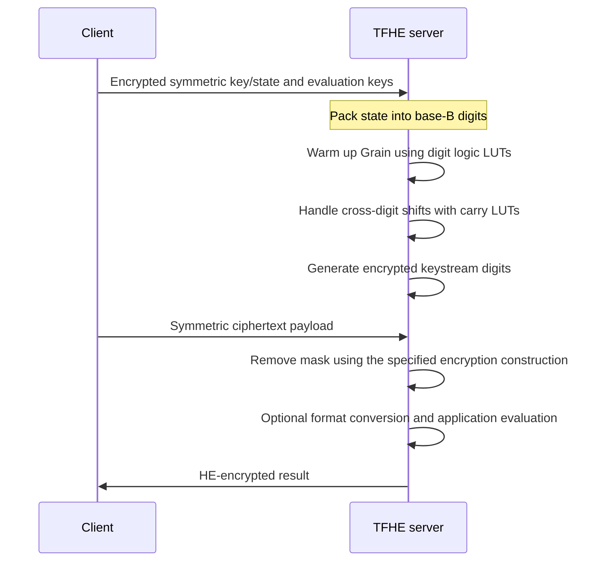

---
# Summary

Adda-Akram Bendoukha, Pierre-Emmanuel Clet, Aymen Boudguiga, and Renaud Sirdey investigate **digit-based evaluation of stream-cipher Boolean operations using TFHE functional bootstrapping**. Instead of encrypting each state bit separately, they pack two or four bits per ciphertext and use lookup tables for wordwise logic and shifts.

The case study is the warm-up circuit of **Grain128-AEAD**. The reported software results favor **base four**: 3.98 minutes versus 4.80 minutes for the paper's base-two implementation. Base 16 needs only 7,718 bootstrappings, but its larger parameters increase runtime to 11.83 minutes. Reduced bootstrap count alone is therefore insufficient to predict speed.

References use the linked 19-page PDF. The main text ends on page 16; the remaining pages are references.

## 1. Problem

A straightforward TFHE implementation represents a stream-cipher state as encrypted bits and bootstraps Boolean gates. This can make warm-up and stream generation costly even for otherwise lightweight ciphers.

TFHE's functional bootstrapping can compute an entire small-domain lookup table during a refresh. The paper asks whether **packing several bits into each state ciphertext** reduces enough operations to offset the cost of a larger message space and nontrivial cross-digit shifts.

## 2. Main Contribution

- Lookup-table implementations of bitwise operators on base-$B$ digits (§3.1).
- Encrypted byte-shift procedures that handle carries between two-bit or four-bit digits (§3.3).
- Application to a byte-oriented Grain128-AEAD state update and warm-up circuit (§4).
- Concrete TFHE parameters, bootstrap counts, runtime, and estimated failure probabilities for bases 2, 4, and 16 (§5, Table 1).
- A proposed adaptation of the message-masking step to make the final online subtraction linear (§3.4). **This adaptation changes the encryption construction and needs separate security scrutiny**, as discussed below.

## 3. Main Techniques

| Technique | Intended benefit | Additional cost |
| --- | --- | --- |
| Pack $\log_2B$ bits per ciphertext | Fewer encrypted state elements and logic operations | Larger effective input domain |
| Encode two digits by $Bx+y$ | Turn a bivariate bitwise operator into a univariate LUT | Amplifies one input's noise by $B$ |
| Repeat LUT coefficients in the accumulator | Tolerate input/rounding error | Larger input domain leaves narrower windows |
| Use carry LUTs for misaligned shifts | Implement bit shifts across digit boundaries | Additional bootstrappings absent in bitwise representation |
| Exploit trivial encrypted zeros | Skip operations whose outputs are already known | Depends on actual shift boundaries and public constants |

## 4. Threat Model and Assumptions

The baseline client encrypts data symmetrically and sends an HE-encrypted symmetric key. The server homomorphically generates the keystream and removes it without learning the underlying plaintext or key.

The TFHE parameter sets target **128-bit estimated security**, using the lattice estimator. Noise estimates rely on the independence/Gaussian-style assumptions described in §2.

Grain128-AEAD includes authentication machinery, but the paper's benchmark is the **warm-up circuit**, not a full end-to-end authenticated-decryption protocol with a malicious-server proof. It does not establish that an encrypted validity bit is correctly evaluated or enforced by an adversarial server.

The security of the modified masking rule in §3.4 does not follow merely from the security of the unmodified Grain keystream generator. Its output alphabet and masking group differ; see the explicit review concern in Questions.

## 5. Important Qualifications

1. **The fastest measured choice is base four.** Base 16 reduces operation count but loses on CPU time because its PBS parameters grow sharply.
2. **Headline speedup percentages use different baselines.** The introduction's 40% improvement and §5's comparisons with the previous work are not the direct base-four/base-two comparison in Table 1. That table gives about **17.1% shorter warm-up time**, calculated as $(4.80-3.98)/4.80$.
3. **State logic remains the target cipher's logic only when LUTs and shifts are exact.** Packing is a representation change; the separate modification of the message mask is an encryption-protocol change.
4. **Larger digits are not free packing.** The lookup address uses $B^2$ possibilities, and the implementation uses message space $2B^2$ to accommodate TFHE's sign/padding constraints.
5. **Per-operation and circuit error rates differ.** Table 1 gives single-PBS estimates around $2^{-45}$–$2^{-47}$ and warm-up estimates around $2^{-31}$–$2^{-32}$.
6. **Not every row meets the stated $2^{-32}$ circuit target.** Table 1 lists $2^{-31}$ for base two and $2^{-31.5}$ for base 16. Preserve these reported values rather than calling all three rows $2^{-32}$ configurations.
7. **The cipher's authentication feature is not fully benchmarked here.** Warm-up timings exclude a payload-length-dependent full message and MAC workflow.
8. **Cipher standardization statements are historical.** The local paper discusses Grain128-AEAD in its lightweight-competition context; that wording is not a current claim that it became the selected NIST standard.
9. **Shift pseudocode needs verification before reuse.** Direction labels, carry handling, and loop bounds in Algorithms 2–3 warrant checking against an ordinary byte implementation; this note does not treat them as validated implementation code.

## 6. Evaluation Setup

Single-core tests use an **Intel Core i7-12700H at a stated 2.60 GHz with 22 GB RAM** and the TFHE library (§5). Table 1 reports:

| Quantity | Base 2 | Base 4 | Base 16 |
| --- | --- | --- | --- |
| Ring degree $N$ | 1024 | 2048 | 65536 |
| LWE dimension $n$ | 595 | 740 | 930 |
| $\log_2 B_g$ | 5 | 11 | 32 |
| Decomposition level $\ell$ | 4 | 3 | 1 |
| Estimated security (bits) | 128 | 128 | 128 |
| Warm-up PBS count | 18,912 | 16,608 | 7,718 |
| One PBS | 13 ms | 17 ms | 92 ms |
| Warm-up time | 4.80 min | 3.98 min | 11.83 min |
| Estimated single-PBS error | $2^{-47}$ | $2^{-46}$ | $2^{-45}$ |
| Estimated warm-up error | $2^{-31}$ | $2^{-32}$ | $2^{-31.5}$ |

Relative to the paper's base-two count, base four uses about **12.2% fewer PBS operations**, and base 16 about **59.2% fewer**. These are arithmetic comparisons of Table 1, not the larger reductions claimed relative to the earlier paper's baseline.

The rounded per-PBS time multiplied by the count does not exactly reproduce every printed end-to-end time. Use the separately reported warm-up measurements when discussing latency.

---
# Main Scheme

## Packed Logic and Grain Warm-Up

### 1. Notation

| Symbol | Meaning |
| --- | --- |
| $B=2^w$ | Digit base, carrying $w$ bits |
| $d_i$ | Digit of a byte/state representation |
| $[d_i]$ | TFHE encryption of that digit |
| $\operatorname{Op}(x,y)$ | Wordwise Boolean operation on two $w$-bit digits |
| $N$ | Degree of the TFHE accumulator polynomial |
| $B_g,\ell$ | Gadget-decomposition parameters, distinct from digit base $B$ |

### 2. Evaluate a wordwise Boolean operator with one LUT

For inputs $x,y\in\{0,\ldots,B-1\}$, construct a table indexed by the concatenated digit address:

$$
T[Bx+y]=\operatorname{Op}(x,y).
$$

For commutative gates, transposing the two address digits has no effect on the table output. For arbitrary functions, the address convention must remain consistent.

Using correctly scaled ciphertext encodings, the server forms a linear combination representing $Bx+y$ and applies functional bootstrapping with the corresponding accumulator. Each table coefficient is repeated over an interval to provide tolerance to noisy addressing.

A base-four AND table has rows:

$$
\begin{aligned}
T_0&=(0,0,0,0),\\
T_1&=(0,1,0,1),\\
T_2&=(0,0,2,2),\\
T_3&=(0,1,2,3).
\end{aligned}
$$

Thus one lookup computes two AND output bits at once. Input scaling must reserve the complete address space; multiplying arbitrary ciphertext encodings modulo $B$ would not by itself preserve the $B^2$ addresses.

For independent input errors, forming $B[x]+[y]$ contributes variance proportional to:

$$
B^2V_x+V_y.
$$

Rounding/modulus-switching adds further error. Increasing $B$ simultaneously amplifies noise and narrows the lookup windows, explaining the larger parameter requirements.

### 3. Handle shifts across digit boundaries

A byte is represented by four base-four digits or two base-16 digits. Shifts by a whole digit are ciphertext permutations with inserted trivial zeros. Shifts by fewer than $w$ bits require extracting carry bits and combining neighboring digits.

For a mathematical left shift by $r<w$ bits of a little-endian base-$B$ sequence, the ordinary digit relation is:

$$
c_i=\left\lfloor\frac{2^r d_i}{B}\right\rfloor,
\qquad
d'_i=(2^r d_i-Bc_i)+c_{i-1},
$$

with zero carry at the boundary and the final overflow discarded when implementing a fixed-width logical shift. This equation states the required digit semantics; the paper supplies LUT-based procedures for its chosen representations and directions.

Carry extraction is nonlinear and uses PBS. Some retained-digit calculations can be expressed with linear operations once the carry is known; the base-16 procedure uses additional shift LUTs. Trivial zero digits simplify subsequent Boolean gates without PBS.

### 4. Apply the operators to Grain128-AEAD

§4 describes a 256-bit main state with a **128-bit LFSR** and **128-bit NFSR**, plus two 64-bit structures for authentication. The cipher has **384 warm-up rounds** in the version used here.

After warm-up, alternating output positions are used for message-encryption and MAC streams. The implementation groups state bits into digits, evaluates the same required bitwise logic through digit LUTs, and pays additional carry-handling costs for misaligned taps/shifts.

The experiments count and time the homomorphic **warm-up circuit**. They do not demonstrate an arbitrary payload length at the warm-up time alone.

### 5. Separate the proposed online masking adaptation

To avoid an additional nonlinear operation when combining the public message ciphertext with the encrypted keystream, §3.4 proposes replacing XOR by:

$$
c=[m+z]_{2B^2},\qquad [m]=c-[z]\pmod{2B^2},
$$

where $m,z$ are base-$B$ digits. The server-side subtraction is linear. **However, the mask $z$ ranges only over $B$ values rather than the whole $2B^2$ group.** Therefore this efficiency observation is not sufficient to establish confidentiality of the modified cipher; see Questions.

## Protocol

---
# Questions

1. **Security of changed masking:** §3.4 asserts that replacing XOR by addition modulo $2B^2$ has no security effect. With $m,z\in\{0,\ldots,B-1\}$, there is no wraparound and the ciphertext range depends on $m$. For example, $m=0$ gives $c\in[0,B-1]$, while $m=B-1$ gives $c\in[B-1,2B-2]$. This exposes information even with a uniform digit keystream. A separate secure masking/encoding construction is needed before adopting this optimization; the printed claim is not justified by the performance analysis. **Scope:** this counterexample concerns the modified masking rule as written on PDF pp. 12–13. It is not a break of standard Grain128-AEAD or of the digit-packing technique itself.
2. **Compatibility with AEAD:** after changing the message-masking rule, what exact ciphertext format and tag definition are used? Grain128-AEAD's original security analysis cannot simply be transferred to an altered encryption mode.
3. **Correctness target:** why are the base-two/base-16 warm-up estimates looser than the stated $2^{-32}$ target? Would requiring all rows to satisfy the same bound change their runtime ranking?
4. **Shifts:** do the printed algorithms implement both shift directions and boundary carries correctly for every byte value? Their conventions should be validated before implementation.
5. **End-to-end cost:** what are the per-payload stream generation, tag verification, output conversion, and evaluation-key memory costs beyond warm-up?
6. **Hardware extrapolation:** the conclusion suggests accelerators may favor larger bases, but this is a research direction, not a demonstrated speedup in the reported CPU experiments.

---
# Related Topics

- [[000 - Transciphering HE]]
- [[007 - Revisiting stream-cipher-based homomorphic transciphering in the TFHE era]]
- [[008 - Practical Homomorphic Evaluation of Block-Cipher-Based Hash Functions with Applications]]
- [[012 - At Last! A Homomorphic AES Evaluation in Less than 30 Seconds by Means of TFHE]]
- [[014 - Optimized Homomorphic Evaluation of Boolean Functions]]
