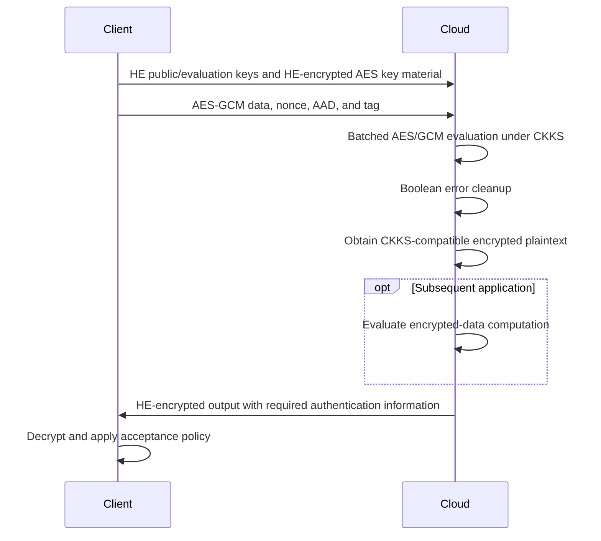

---
# Summary

This **three-page CCS 2023 poster** by Ehud Aharoni, Nir Drucker, Gilad Ezov, Eyal Kushnir, Hayim Shaul, and Omri Soceanu reports batched **AES-CTR and AES-GCM decryption under CKKS**. It uses HElayers, CryptoLab HEaaN, and a GPU, with BLEACH-style error cleanup for Boolean computations.

Its key result is AES-GCM transciphering of a **512 KiB batch** in **11.4 minutes**, or approximately **21 ms per 128-bit AES block**, as reported in Table 2. The poster's contribution paragraph rounds this to 11.5 minutes. These are the poster's measurements, not the faster figures in the longer E2E paper.

## 1. Problem

Organizations may already store data under AES-GCM and later wish to process it with HE. Uploading or retaining large HE ciphertexts increases storage and communication costs, while using only an unauthenticated transciphering mode does not preserve the input-authentication goal.

The poster explores converting standard AES-GCM-protected data directly into CKKS-compatible encrypted data, rather than requiring a new HE-friendly symmetric cipher or abandoning the input tag.

## 2. Main Contribution

- A CKKS implementation of batched AES-CTR decryption, with AES-GCM authentication support.
- An example showing that approximate HE can evaluate Boolean cryptographic operations when errors are controlled.
- CPU/GPU runtime and peak-memory measurements for a 32,768-block batch.

The poster motivates later encrypted neural-network processing, but does not report a completed end-to-end inference experiment. That broader implementation is described in the separate E2E paper.

## 3. Main Techniques

- **Bit-sliced SIMD:** 128 CKKS ciphertexts represent the AES state, with 32,768 independent blocks processed across slots.
- **Approximate Boolean circuits:** encode bits as values near zero or one, then express Boolean operations using arithmetic.
- **BLEACH cleanup:** use $h(x)=3x^2-2x^3$ to contract small errors near Boolean values.
- **GPU execution:** use an A100 to accelerate the large packed computation.

The poster does not supply the full AES circuit, GHASH implementation, cleanup schedule, or tag-failure handling algorithm.

## 4. Threat Model and Assumptions

The client keeps the HE secret key and symmetric key. The cloud receives HE public/evaluation keys, the encrypted symmetric key material, and the AES ciphertexts. It should recover HE ciphertexts of the plaintext without learning that plaintext or the AES key.

The HE context targets **128-bit security**. The poster describes AES-256 in its comparison discussion, but Table 2 does not independently label the symmetric key length for each row; do not treat this as an AES-128 table.

AES-GCM adds input-authentication functionality when implemented with correct nonce handling and tag verification. This poster does not present a formal malicious-evaluator security model or a proof of correct server execution. Authenticated input and verified HE computation are separate guarantees.

## 5. Important Qualifications

1. **Per-block timing is amortized.** The batch is available after minutes, rather than individual blocks becoming available after 7 or 21 ms.
2. **Full batches are assumed.** The 512 KiB input fills 32,768 slots across the 128 bit-position ciphertexts. Smaller inputs underuse the packing.
3. **Results are minimum times from ten repetitions.** They are not means or confidence intervals.
4. **Old comparison results use different hardware and sometimes lower security.** Table 1 explicitly warns of this. Its ranking does not isolate algorithmic improvement.
5. **The poster is not an implementation specification.** In particular, it does not explain how approximate tag validity is enforced without leaking invalid plaintext information.
6. **The longer E2E paper is a separate source.** Its faster AES results, lower memory figures, Ascon implementation, and integrated inference flow should not be attributed to this poster's experiments.
7. **Storage expansion terminology:** the paper sometimes says “compression ratio” when describing HE expansion. The relevant cost is the increased ciphertext size relative to the original payload.

## 6. Evaluation Setup

§2 uses HElayers with a **bootstrappable CryptoLab HEaaN CKKS context**, 128-bit security, 32,768 slots, depth 12, scale $2^{42}$, and 18 additional bits in the first prime. The bootstrap restores chain index 12 and requires a minimum index of 3.

| Platform | Hardware |
| --- | --- |
| CPU | Intel Xeon E5-2699 v4 at 2.20 GHz, 44 cores/88 threads, 750 GB RAM |
| GPU | NVIDIA A100 SXM4, 80 GB GPU memory; AMD EPYC 7763 host at 2.45 GHz, 64 cores/128 threads |

The GPU experiment uses one CPU host thread through `OMP_NUM_THREADS=1`. Each result is the minimum of ten measured runs.

**Table 2:** 512 KiB payload, 128-bit AES blocks.

| Mode | Device | Batch latency (min) | Amortized time (ms/block) | Reported peak memory (GB) |
| --- | --- | --- | --- | --- |
| AES-CTR | CPU | 31 | 56.7 | 127.62 |
| AES-CTR | GPU | 4 | 7.3 | 60.10 |
| AES-GCM | GPU | 11.4 | 21 | 65.10 |

For example, $4\cdot60/32768\approx0.00732$ seconds per block explains the CTR amortization. It does not imply a four-minute run on every payload size or a 7.3 ms single-block latency.

---
# Main Scheme

## Batched AES-GCM-to-CKKS Conversion

### 1. Notation

| Symbol | Meaning |
| --- | --- |
| $K$ | Symmetric AES key |
| $\widehat K$ | HE-encrypted AES key material |
| $(A,N,C,T)$ | AEAD associated data, nonce, ciphertext, and tag |
| $\widehat m$ | CKKS-encrypted recovered plaintext |
| $h(x)$ | BLEACH cleanup polynomial |

### 2. Setup and symmetric upload

The client generates the symmetric and HE keys, then uploads the necessary HE public/evaluation keys and HE-encrypted AES key material. It stores or sends AES-GCM ciphertexts instead of bulk HE ciphertexts.

This reduces per-message upload expansion, while the encrypted key/evaluation material remains a setup cost.

### 3. Homomorphic decryption

The cloud evaluates the symmetric processing using $\widehat K$. For AES-CTR, the core relationship is:

$$
C_i=m_i\oplus\operatorname{AES}_K(\operatorname{counter}_i).
$$

It homomorphically generates the AES keystream and XORs it with the public ciphertext to produce $\widehat m_i$. AES-GCM additionally requires authentication computation. The poster reports that functionality without detailing its GHASH circuit or rejection protocol.

For ideal bits, arithmetic can implement:

$$
x\land y=xy,\qquad x\oplus y=(x-y)^2.
$$

CKKS introduces error, so these are implemented on approximately Boolean values. Cleanup satisfies:

$$
h(0)=0,\quad h(1)=1,\quad h'(0)=h'(1)=0,
$$

which explains why it suppresses small first-order deviations near valid bits. The poster cites BLEACH for the detailed analysis.

### 4. Application computation and return

Once converted, the server can evaluate a CKKS-compatible application and return the HE-encrypted result. The client decrypts with its HE secret key and applies the required authentication acceptance policy.

This final application stage is the intended use case; the table measures symmetric decryption/transciphering, rather than a complete neural-network pipeline.

## Protocol

---
# Questions

1. What precise ciphertext/key preparation and tag-checking stages are included in Table 2's reported latency?
2. How are invalid tags handled under approximate arithmetic, and what exact plaintext-release policy is intended? The poster does not specify this; the E2E paper studies it more closely.
3. Which symmetric-key configuration applies to every reported row? The comparison prose says AES-256, while Table 2 leaves that column implicit.
4. What are the memory breakdown and complete modulus/ring parameters required to reproduce the measurements?
5. How much capacity remains for an application after the tag computation and representation conversion? Motivating a DNN use case is distinct from benchmarking it here.

---
# Related Topics

- [[000 - Transciphering HE]]
- [[010 - E2E near-standard and practical authenticated transciphering]]
- [[016 - High-Throughput AES Transciphering using CKKS - Less than 1ms]]
- [[020 - XBOOT - Free-XOR Gates for CKKS with Applications to Transciphering]]
