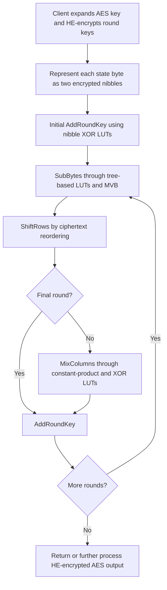

---
# Summary

Daphné Trama, Pierre-Emmanuel Clet, Aymen Boudguiga, and Renaud Sirdey implement **AES-128 using TFHE programmable lookup tables over encrypted nibbles**. The design combines a tree-based multi-input lookup method with multi-value bootstrapping (MVB), and rewrites ordinary AES operations to use a small lookup-oriented instruction set.

The most important qualification is the title's timing: **Table 5's 28.73-second result is an extrapolation for a hypothetical i7 server**, not a measurement on that machine. Actual reported measurements include **270 seconds on one laptop thread**, **54.31 seconds on six laptop threads**, and **36.39 seconds on 16 AMD-server threads**.

References below use the linked 22-page PDF. §§2–5 contain the construction and experiments; the main text ends on page 20.

## 1. Problem

AES is useful for compatible transciphering, but direct homomorphic execution is expensive. Its S-box naturally fits a lookup table, whereas two-input XOR and finite-field multiplication require an evaluation strategy suited to TFHE.

Using one ciphertext per byte would reduce the number of operations but require expensive high-precision bootstrapping. Splitting each byte into small limbs permits smaller parameters at the cost of additional table-evaluation steps. The paper studies this trade-off.

## 2. Main Contribution

- Rewrite constant multiplications in AES into unary byte lookup tables, eliminating log-table additions, explicit modulo, and encrypted branching (§4.1).
- Evaluate S-boxes, constant finite-field products, and XOR through one generic LUT operator (§4.2).
- Combine tree-based lookup evaluation with MVB to reduce repeated blind rotations (§§2.5–2.6).
- Compare bases 4, 8, 16, and 256, finding **base 16** most effective in the reported implementation.
- Implement the resulting AES-128 computation in TFHElib and parallelize within the AES state using OpenMP (§5).

The symmetric primitive remains AES; the work changes its homomorphic implementation rather than introducing a new cipher.

## 3. Main Techniques

| Technique | Effect |
| --- | --- |
| Two encrypted nibbles per byte | Keep bootstrapping precision small |
| Unary constant-product LUTs | Replace general field arithmetic with a precomputed function |
| Tree-based lookup | Evaluate functions of several encrypted limbs without one huge combined input space |
| MVB | Share a blind rotation across several table evaluations on the same input |
| Homomorphic packing key switch | Assemble intermediate table entries into an encrypted lookup structure |
| OpenMP over independent state bytes | Reduce single-block latency through within-round parallelism |

## 4. Threat Model and Assumptions

The intended transciphering setting gives the server an HE encryption of AES key material, not the AES or HE secret key in plaintext. Confidentiality depends on AES, TFHE's LWE assumptions and concrete parameters, and the surrounding encryption mode.

The evaluated TFHE parameters target **at least approximately 128-bit security** according to the lattice estimator. The selected base-16 parameter set reports **$2^{-23}$ error probability for an MVB evaluation** (§5.1). That is a local operation target, not a proof of $2^{-23}$ failure probability for a complete AES run or arbitrary application.

The paper benchmarks AES evaluation. It does not provide AEAD authentication, malicious-server verifiability, replay protection, or a complete secure data-release protocol. A raw AES block evaluation is a building block; application security also requires a suitable mode and nonce policy.

## 5. Important Qualifications

1. **The sub-30-second figure is extrapolated.** The authors did not have the hypothetical i7-based server. Table 5 transfers an observed AMD-server parallel speedup to the laptop's sequential timing.
2. **Key expansion is excluded.** The client generates all eleven AES-128 round keys and HE-encrypts them before server evaluation (§3).
3. **Latency is not amortized throughput.** The within-block TFHE timing should not be directly ranked against a packed BGV implementation's amortized cost without considering batch size and output capacity.
4. **MVB is not “many complete bootstraps for free.”** It shares the costly blind rotation, then still needs polynomial multiplications, extraction, and key switching, with associated noise.
5. **Bootstrap counts do not fully predict time.** Smaller bases increase table-tree size, while larger bases require slower parameters. Table 3 explicitly shows nonlinearity between counts and measured runtime.
6. **A functional-bootstrap error can produce a low-noise wrong result.** Correct parameterization must bound the noisy lookup address before blind rotation, not only the output noise.
7. **The notation $q=32$ in §5.1 denotes the discretized plaintext torus size for base 16.** It is not the large ciphertext arithmetic modulus commonly denoted $q$ in other FHE papers.
8. **The abstract is broader than the measured table.** Preserve the measured/extrapolated distinction when citing the title or comparing later work.

## 6. Evaluation Setup

The implementation uses **TFHElib** with a custom tree/MVB LUT operator and **OpenMP**.

Selected base-16 parameters (§5.1, Table 1):

| Parameter | Value |
| --- | --- |
| LWE dimension $n$ | 1024 |
| Polynomial degree $N$ | 2048 |
| Gadget base $B_g$ | 256 |
| Gadget level $\ell$ | 3 |
| Key-switch base $B_{KS}$ | 1024 |
| Key-switch precision $t$ | 2 |
| Discretized plaintext torus size | 32, with 16 usable digit values |
| Reported MVB error target | $2^{-23}$ |

**Table 3: operation timing in the basis-selection benchmark.**

| Digit base | One bootstrap | Complete byte LUT evaluation |
| --- | --- | --- |
| 256 | 1.5 s | 1.5 s |
| 16 | 0.029 s | 0.3 s |
| 8 | 0.015 s | 1.4 s |
| 4 | 0.007 s | 2.0 s |

**Table 5: complete AES evaluation.**

| Environment | Threads | Time | Evidence type |
| --- | --- | --- | --- |
| Intel i7-12700H laptop, 64 GiB, Ubuntu 22.04.2 LTS | 1 | 270 s | Measured |
| Same laptop | 6 | 54.31 s | Measured |
| AMD EPYC 7702P server, Ubuntu 20.04.6 LTS | 1 | 342 s | Measured |
| Same AMD server | 16 | 36.39 s | Measured |
| Hypothetical i7 server | 16 | 28.73 s | Extrapolated |

The AMD server has 64 physical cores; the reported parallel run uses 16 threads. The extrapolated result applies its approximately 9.4-fold speedup to the faster laptop core's sequential run.

Table 4 gives **608 bytewise XOR operations and 448 unary byte LUT operations** for a full AES-128 evaluation. With the selected base-16 decomposition and MVB accounting, it reports **4,224 bootstrapping operations**.

---
# Main Scheme

## AES as a Nibble-Level Lookup Program

### 1. Notation

| Symbol | Meaning |
| --- | --- |
| $m=m_0+16m_1$ | Byte decomposed into low/high nibbles |
| $([m_0],[m_1])$ | TFHE-encrypted byte representation |
| $B,d,d'$ | Digit base, input digit count, output digit count |
| $T_a$ | Public lookup table for multiplication by constant $a$ in AES's field |
| $v_0,v_i$ | Common and table-specific factors for MVB |

### 2. Rewrite AES operations into LUTs

AES uses fixed field multipliers rather than arbitrary secret multipliers. For each needed constant $a$:

$$
T_a[b]=a\cdot b\quad\text{in }\mathbb F_{2^8},
\qquad T_a[0]=0.
$$

Hardcoding these tables avoids the ordinary software implementation's logarithm tables, log addition, reduction modulo 255, and conditional handling of zero. The field uses the AES polynomial $X^8+X^4+X^3+X+1$.

The encryption-side constants include 2 and 3; the discussed inverse-side constants also include hexadecimal 9, b, d, and e. The evaluated round structure follows AES encryption, including the last round without MixColumns.

SubBytes is already a public byte table. ShiftRows merely reorders encrypted bytes. AddRoundKey and MixColumns use the encrypted XOR operator and the appropriate constant-product tables.

### 3. Decompose each byte into two nibbles

Store $m_0,m_1\in\{0,\ldots,15\}$ separately. For an eight-bit-to-eight-bit table $T$, split its output:

$$
T^{lo}[u]=T[u]\bmod16,
\qquad
T^{hi}[u]=\left\lfloor T[u]/16\right\rfloor.
$$

Evaluate both tables on the two encrypted input nibbles to obtain the output byte. The input remains two encrypted limbs; it is not combined into one high-precision ciphertext requiring a 256-value PBS.

### 4. Tree-based multi-input lookup

For a two-limb input:

1. For each possible value of one digit, construct the corresponding unary table in the other digit.
2. Evaluate those unary tables under encryption using the first selector.
3. Pack the resulting encrypted entries into an encrypted accumulator using a functional key switch.
4. Use the second encrypted digit to select the final entry.

The general method extends to $d$ input digits, recursively reducing a tree of tables. It uses small-domain bootstrappings at the cost of additional levels and encrypted intermediate tables. Input-digit ordering must match the original table; §2.5's printed selector indices should be checked when implementing it.

For XOR, each pair of nibbles uses a public $16\times16$ table:

$$
([a_0],[a_1])\oplus([b_0],[b_1])=
([a_0\oplus b_0],[a_1\oplus b_1]).
$$

This is a nontrivial homomorphic table evaluation in the paper's nibble encoding, not a free ciphertext sum.

### 5. Share blind rotation with MVB

For table-accumulator polynomials $P_i$, the method factors:

$$
P_i=v_0v_i\pmod{X^N+1},
$$

using the identity:

$$
(1+X+\cdots+X^{N-1})(1-X)=2\pmod{X^N+1}.
$$

Perform one blind rotation on the common factor, then multiply the rotated encrypted polynomial by each public table-specific factor. Subsequent extraction and switching yield the separate outputs. This reduces repeated blind rotations for many tables indexed by the same encrypted input.

The paper's operation-count convention gives:

$$
N_{\mathrm{classic}}=d'\sum_{i=0}^{d-1}B^i,
\qquad
N_{\mathrm{MVB}}=d'\left(1+\sum_{i=0}^{d-2}B^i\right).
$$

The terms describe its table-tree/MVB accounting. Their runtime also depends on the public polynomial multiplications and parameter sizes.

### 6. Execute and parallelize AES

The client prepares encrypted round keys. The server performs the initial AddRoundKey, nine full rounds, and a final round without MixColumns.

Within each stage, independent byte operations are parallelized. Rounds themselves remain dependent. The measured implementation parallelizes state-byte work; further parallelism across the two output digits of a table is proposed as future work.

In a CTR transciphering application, this AES *encryption* circuit can generate encrypted counter-mode keystream blocks, which are then combined with public symmetric ciphertexts. That surrounding dataflow is distinct from the standalone AES evaluation timed here.

## Protocol

---
# Questions

1. **Headline citation:** cite 36.39 s as the measured 16-thread AMD result and 28.73 s as extrapolated. The abstract/title must not erase this distinction.
2. **Global failure probability:** how should the reported MVB error estimate compose across the full 4,224-operation AES computation and an application afterward?
3. **Table ordering:** §2.5 uses inconsistent digit/selector indices in its description. A concrete implementation should validate lookup addressing on all inputs before relying on the pseudocode.
4. **Setup and memory:** what are the complete encrypted-round-key, bootstrapping-key, packing-key, and temporary-buffer sizes? These are not supplied as a full peak-memory benchmark here.
5. **Mode and authentication:** which AES mode surrounds the block computation, and where are nonce checks, tag checks, and output acceptance enforced?
6. **Future optimization:** the proposed 32-core digit-level parallelism, alternative AES instruction schedule, and full-torus/WoP-PBS changes are not the measured Table 5 implementation.

---
# Related Topics

- [[000 - Transciphering HE]]
- [[006 - Development of Optimized Operations for Homomorphic Cryptography]]
- [[009 - Optimized Stream-Cipher-Based Transciphering by Means of Functional-Bootstrapping]]
- [[014 - Optimized Homomorphic Evaluation of Boolean Functions]]
- [[024 - Further Improvements in AES Execution over TFHE - Towards Breaking the 1 sec Barrier]]
