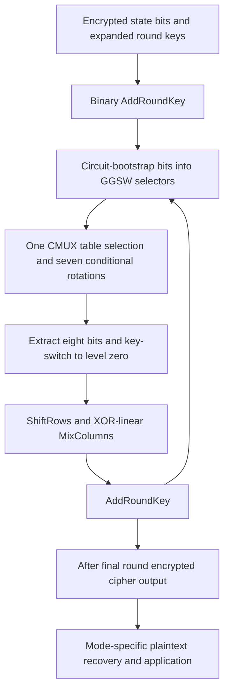

---
# Summary

Wei, Wang, Li, Liu and Lu introduce **Fregata**, a TFHE evaluation framework combining binary linear operations, mixed-packed S-box lookup and circuit bootstrapping. The local source is the 21-page ISC 2023 proceedings paper, pp.392–412.

## 1. Problem
AES's S-box suits LUT evaluation, but applying programmable bootstrapping to every XOR is expensive. A binary encoding makes XOR cheap, while CMUX-based S-boxes need GGSW selector ciphertexts. The main problem is efficient conversion between the ciphertext forms required by those two stages.

## 2. Main Contribution
- Mixed horizontal/vertical packing of an 8-to-8 S-box into two ring ciphertexts.
- An **eight-CMUX** lookup for all eight output bits (§4.1).
- PBSmanyLUT-based circuit bootstrapping to share blind rotation across gadget-level outputs (§4.2).
- AES and SM4 implementations in TFHEpp (§§4–6).

Measured one-thread results are **86 s per AES-128 block** and **78 s per SM4 block**. The roughly **9 s** parallel figure is an expectation in §6.2, despite stronger abstract wording.

## 3. Main Techniques
Binary bits use torus phases zero and one-half, so additions implement XOR with noise growth. Circuit bootstrapping converts each noisy LWE bit into a GGSW control for cheaper leveled CMUX evaluation.

The S-box's $256\cdot8=2048$ output bits occupy two polynomials of degree 1024. One selector chooses a polynomial; the other seven rotate within it. Sample extraction recovers eight output LWE bits, followed by key switching back to the small parameter level. PBSmanyLUT shares the expensive blind rotation inside circuit bootstrapping; private functional key switching completes GGSW formation.

## 4. Threat Model and Assumptions
The circuit evaluates AES/SM4 on encrypted state and expanded round-key material. The selected LWE/RLWE parameters are estimated above 128-bit security (§6.1). Security of a complete transciphering deployment also depends on the symmetric mode, nonce usage and HE evaluation-key assumptions.

This is a block-cipher evaluation paper. It adds neither authenticated encryption nor a proof against malicious server execution. The source gives noise-variance formulas, but no complete whole-cipher failure target accompanying every benchmark. Format conversion and noise refresh must both remain correct.

## 5. Important Qualifications
- **The 9 s result is not a reported measured parallel run.** §6.2 says the authors “expect” it on the hypothetical i7-server from the prior AES paper. The abstract/contribution section should not override that experimental qualification.
- The algorithm inputs are **expanded encrypted round keys**. The block timings do not include a homomorphic key schedule, client upload or application processing.
- “Levels” 0/1/2 refer to different parameter/key domains, not three AES multiplication-depth levels.
- CMUX lookup assumes GGSW input selectors are already available. Circuit bootstrapping supplies them and dominates runtime.
- “Free XOR” means ciphertext addition with growing noise. In SM4, the recurrent Feistel branches require extra identity bootstrapping after each round (§5).
- The quoted 73× SM4 latency ratio compares 78 s with an approximately 95-minute **batched** BGV evaluation on different hardware. It is not a matched throughput comparison; the older BGV run processes 360 blocks together.
- Historical “state of the art” claims apply to this source's date, not every later AES implementation.

## 6. Evaluation Setup
TFHEpp, C++, Ubuntu 20.04, Intel Core i5-12500, reported 15.3 GB RAM, one CPU thread. §6.2 says experiments run 1000 times and report average latency; dispersion is not provided.

| Parameter domain | Dimension | Noise standard deviation | Gadget base / levels |
| --- | --- | --- | --- |
| Level 0 LWE | 635 | $2^{-15}$ | — |
| Level 1 ring | 1024 | $2^{-25}$ | $2^6$, 3 |
| Level 2 ring | 2048 | $2^{-44}$ | $2^9$, 4 |
| Key switch 1→0 | — | — | $2^2$, 7 |
| Private key switch 2→1 | — | — | $2^3$, 10 |

Source: Table 1. These are linked parameter sets and should not be mixed independently.

| Circuit | Measured total | Circuit bootstrapping | S-box LUT | Identity key switch | Extra identity bootstrap |
| --- | ---: | ---: | ---: | ---: | ---: |
| AES-128 | 86 s | 84.48 s | 18.48 ms | 1.42 s | — |
| SM4 | 78 s | 68.11 s | 15.59 ms | 1.43 s | 8.1 s |

Tables 2–4. Component values are reproduced as printed and rounded; they do not sum exactly to every rounded total. AES uses 160 S-boxes, SM4 128. The roughly 9 s parallel AES number is an extrapolation, not another measured row. No implementation benchmark was rerun here.

---
# Main Scheme
## Title
Binary AES linear layers connected to a mixed-packed S-box by circuit bootstrapping.

### 1. Notation
- $[b]_0$: small-dimension binary LWE ciphertext, ideal phase $b/2$.
- $C_i$: GGSW encryption of input bit $b_i$.
- $d_0,d_1$: degree-1024 ring ciphertexts packing the public S-box table.
- $\operatorname{CMUX}(C,d_1,d_0)$: encrypted selection of $d_b$.

### 2. Circuit-bootstrap input bits
For each byte's eight LWE bits, use PBSmanyLUT to produce the needed gadget-scaled outputs with one shared blind rotation per bit. Apply the affine offsets required by binary negacyclicity and private functional key switching to form a GGSW selector. This is a refresh/conversion step, not a direct arithmetic multiplication of message bits.

### 3. Mixed-packed S-box
For little-endian byte $b=\sum_{i=0}^7 2^i b_i$, select
$$
ACC\leftarrow\operatorname{CMUX}(C_7,d_1,d_0).
$$
For $i=0,\ldots,6$, apply
$$
ACC\leftarrow\operatorname{CMUX}(C_i,X^{-8\cdot2^i}ACC,ACC).
$$
The two table polynomials must encode the correct output placement and negacyclic signs. Extract coefficients 0 through 7 and key-switch them to level 0. One initial selection plus seven conditional rotations gives **eight CMUX operations per byte**, after selector preparation.

### 4. AES round execution
Perform initial AddRoundKey, then nine rounds of SubBytes, ShiftRows, MixColumns and AddRoundKey; the final round omits MixColumns. ShiftRows permutes bit ciphertexts. Multiplication by 2 and 3 in AES's byte field is an XOR/rewiring circuit, so MixColumns remains binary-linear. For column-major byte index $i$, the source's ShiftRows permutation $i\mapsto5i\bmod16$ implements the required row shifts.

In CTR transciphering, evaluate forward AES on distinct public counters to obtain encrypted keystream, then XOR public symmetric ciphertext bits. Direct block decryption requires the appropriate inverse cipher circuit; the timed forward AES algorithm is not itself a full mode specification.

### 5. SM4 adaptation
Use the SM4 S-box table and its 32-round Feistel recurrence. Preserve all four state words, apply the specified XOR/rotation linear layer, and refresh the recurrent output with identity bootstrapping each round to control accumulated branch noise. Reverse output word order at the end, as required by SM4.

## Protocol

---
# Questions
- What measured parallel latency replaces the abstract's hypothetical-server estimate?
- What global error probability follows from all circuit bootstraps and recurrent linear combinations?
- How large are the expanded round-key, private-switch and bootstrapping keys in a complete deployment?
- How does a same-host, equal-batch SM4 comparison change the quoted speedup?

---
# Related Topics
- [[012 - At Last! A Homomorphic AES Evaluation in Less than 30 Seconds by Means of TFHE]]
- [[015 - Refined TFHE Leveled Homomorphic Evaluation and Its Application]]
- [[021 - Homomorphic Evaluation of the SM4]]
- [[040 - Thunderbird - Efficient Homomorphic Evaluation of Symmetric Ciphers in 3GPP by combining two modes of TFHE]]
- [[000 - Transciphering HE]]
