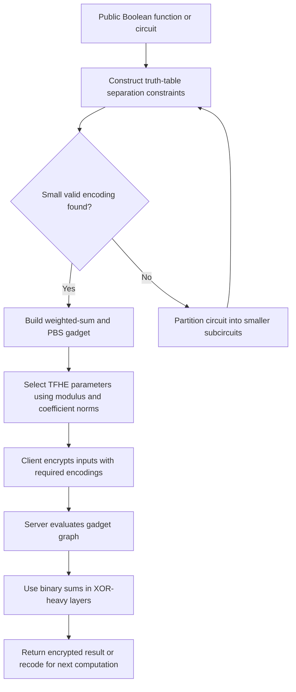

---
# Summary

Nicolas Bon, David Pointcheval, and Matthieu Rivain introduce **$p$-encodings**, an intermediate layer between Boolean values and TFHE ciphertexts. A suitable weighted sum of encoded inputs can identify the output of a multi-input Boolean function, after which **one programmable bootstrapping (PBS)** recodes that result for the next stage.

The benefit is fewer bootstrappings than a gate-by-gate circuit. The limitation is equally important: efficient encodings need not exist for a chosen small modulus or large function. The paper therefore supplies encoding-search algorithms and a heuristic circuit decomposition, and demonstrates these on SIMON, Trivium, Keccak, Ascon's S-box, and AES.

References use the linked 40-page PDF. Its principal technical content is in §§3–7; the main text ends on page 37. This is the primary article underlying Chapter 4 of Nicolas Bon's thesis.

## 1. Problem

Straightforward TFHE Boolean evaluation bootstraps after each gate. A single LUT over all input bits instead reduces the number of operations but makes the required precision grow exponentially with input count.

The paper searches for a middle ground: exploit the fact that a function needs to distinguish its **output classes**, not every input separately. Multiple inputs producing the same Boolean output may safely map to the same intermediate residue.

A second obstacle is TFHE's negacyclic blind rotation. Classical padding-bit encodings constrain modular wraparound and can force extra refreshes. The paper uses odd plaintext moduli and tailored accumulators to remove that padding restriction.

## 2. Main Contribution

- Formal definitions of set-valued $p$-encodings and function-evaluation gadgets (§3).
- Reductions from general encodings to canonical weighted inputs, followed by an exact backtracking search and a faster sieving heuristic (§4).
- A method to partition arbitrary Boolean circuits into evaluable gadget subcircuits (§5).
- Odd-modulus PBS accumulator construction, parameter-selection adaptations, and a modified tfhe-rs implementation (§6).
- Primitive case studies and timing/count comparisons, explicitly separating several measured results from full-primitive estimates (§7).

## 3. Main Techniques

| Technique | Role |
| --- | --- |
| Disjoint output-residue sets | Preserve the function output without encoding every input tuple uniquely |
| Weighted ciphertext sum | Compute the intermediate residue with inexpensive linear operations |
| One PBS recoding | Restore a convenient output encoding and nominal noise |
| Odd plaintext modulus | Avoid a dedicated padding bit in the nonlinear gadget layer |
| Binary/odd-modulus alternation | Use binary encoding for cheap XOR layers and odd moduli for nonlinear layers |
| Truth-table difference constraints | Convert encoding search into modular linear non-equalities |
| Circuit DAG decomposition | Extend the method when one small gadget cannot handle the whole function |

## 4. Threat Model and Assumptions

The framework evaluates public Boolean functions on encrypted inputs without the evaluator learning the inputs. It inherits TFHE's security assumptions and selected LWE/GLWE parameters. The experiments target **128-bit estimated HE security**; most use a **$2^{-40}$ per-bootstrap failure target**.

This is an evaluation/compilation method, not a new authenticated-encryption protocol or a proof of malicious-server correct execution. A cryptographic primitive benchmark does not establish the security of every mode that might use that primitive.

Some benchmark assumptions differ from transciphering: §7.1 treats the SIMON key as plaintext. Trivium's underlying symmetric key is 80 bits even though the HE layer targets 128 bits. Neither case should be described as a complete matched 128-bit HHE benchmark.

## 5. Important Qualifications

1. **“One PBS” requires a valid gadget.** For a fixed small $p$, there may be no weights separating the output classes. Increasing $p$ slows PBS, and large truth tables make search expensive.
2. **The graph partition is heuristic.** Smallest modulus for one search instance is distinct from smallest total runtime or globally optimal circuit decomposition.
3. **Cheap linear operations still amplify noise.** Parameters depend on the norm of the coefficients, not only on the number of PBS calls.
4. **Odd modulus does not remove all errors.** Rounding into the discretized torus and drift during modulus switching must remain within the accumulator's windows.
5. **Binary encoding has special conversion constraints.** Casting from full-torus $p=2$ must respect negacyclicity of the output mapping; arbitrary Boolean-to-odd-field recoding is not automatically one unconstrained PBS.
6. **Per-PBS error is not whole-circuit error.** A long computation requires composition of the local correctness bounds and consideration of decryption feedback.
7. **Estimated full primitives remain estimates.** The paper marks full Trivium warm-up, Keccak, and Ascon totals with a star; they are extrapolated from implemented building blocks.
8. **The local manuscript has internal inconsistencies.** Its multiplexing example's weights are invalid as printed, and some summary timings disagree with prose. These issues should be preserved as review observations rather than silently copied into a specification.

## 6. Evaluation Setup

The implementation is a modified **tfhe-rs** library with a modified **concrete-optimizer**. Experiments use a **12th-generation Intel Core i5-1245U**, stated frequency **4.4 GHz**, and **16 GB RAM** (§7). The paper describes ten CPU cores; actual parallelism varies by experiment.

The parameters in Table 3 use ciphertext modulus **$q=2^{32}$**, target 128-bit estimated security, and $2^{-40}$ per-PBS error. Selected operations:

| PBS configuration | Use | Reported time |
| --- | --- | --- |
| $p=9$, coefficient-norm class 2 | SIMON/Trivium gadget | 9.5 ms |
| $p=3$ or binary conversion configuration | Keccak and recoding | 5.25 ms |
| $p=17$, norm class 5 | Ascon output functions | 18 ms |
| $p=11$, norm class 4 | AES nonlinear gadget | 17 ms |

The “norm class” is $\lceil\log_2\lVert\mathbf d\rVert\rceil$ in the paper, not an additional plaintext bit count.

**AES results from §7.5 and Table 6:**

| Configuration | AES-128 time | Evidence |
| --- | --- | --- |
| One thread, per-PBS target $2^{-40}$ | 135 s | Measured implementation |
| One thread, target adjusted to $2^{-23}$ | 103 s | Measured implementation |
| Two specialized parameter/key sets, $2^{-40}$ | 105 s | Theoretical timing |

The design uses **36 PBS calls per S-box**, then 128 bit recodings per round: $16\cdot36+128=704$ per round and **7,040 calls** across ten rounds, under its accounting. Table 4 splits this into 5,760 nonlinear PBS calls and 1,280 recodings.

Other results should retain their scope: §7.1 reports about **41 s sequential and 13 s parallel SIMON**, while Table 6 prints 10 s for its own full-SIMON row. §7.3's full Keccak estimate is 6.6 min in prose but 8.8 min in Table 6; Ascon's full-hash estimate is 89 s in prose versus 92 s in the table. These are unresolved source discrepancies, not one interchangeable measured result.

---
# Main Scheme

## Weighted Encodings and One-PBS Gadgets

### 1. Notation

| Symbol | Meaning |
| --- | --- |
| $f:\{0,1\}^{\ell}\to\{0,1\}$ | Target Boolean function |
| $E_i(0),E_i(1)\subseteq\mathbb Z_p$ | Input encoding's two residue classes |
| $d_i$ | Canonical weight, with $E_i(0)=\{0\}$ and $E_i(1)=\{d_i\}$ |
| $P_b$ | Residues reachable when the correct output is $b$ |
| $\Gamma$ | Gadget specifying input/output encodings and moduli |
| $G$ | Directed acyclic graph of gadget subcircuits |

### 2. Construct disjoint output classes

Define:

$$
P_b=\left\{
\left[\sum_{i=1}^{\ell}\gamma_i\right]_p:
\gamma_i\in E_i(x_i),\ f(\mathbf x)=b
\right\}.
$$

Require:

$$
P_0\cap P_1=\varnothing.
$$

For odd $p$, this separates the Boolean outputs without the even-modulus negacyclicity restriction. The input tuple need not be recoverable from the sum; only the output must be unambiguous.

The server adds correctly encoded ciphertexts:

$$
c_{\mathrm{sum}}=\sum_i c_i.
$$

It then applies a PBS whose lookup maps every residue in $P_0$ to the chosen encoding of zero and every residue in $P_1$ to the chosen encoding of one. Unreachable residues can be assigned arbitrary LUT entries, provided the noise analysis prevents accidental access to an unintended sector.

### 3. Find weights through modular constraints

For canonical inputs, a candidate vector $\mathbf d$ works exactly when:

$$
f(\mathbf u)\ne f(\mathbf v)
\ \Longrightarrow\
(\mathbf u-\mathbf v)\cdot\mathbf d\not\equiv0\pmod p.
$$

Build one constraint for each pair of truth-table rows with different outputs, remove duplicates/opposites, and search incrementally for the weights. At each depth, remove values forbidden by constraints involving the already assigned prefix; backtrack when none remain (§4.3).

Restricting to prime moduli allows a nonzero first weight to be normalized to one by multiplying by its inverse. This is a search-space reduction under that restriction, not a statement that the best useful application modulus must be prime. The paper's SIMON gadget uses the composite modulus nine.

The sieving heuristic instead samples integer weights, evaluates all constraint dot products, and finds candidate moduli dividing none of them. It gives a feasible upper bound, without the exact search's minimality guarantee (§4.5).

### 4. An explicit validated nonlinear gadget

For the SIMON/Trivium function:

$$
f(b_0,b_1,b_2,b_3,b_4)=
(b_0b_1)\oplus b_2\oplus b_3\oplus b_4,
$$

§7.1 uses $p=9$ and weights:

$$
\mathbf d=(1,1,2,2,2).
$$

The reachable classes are:

$$
P_0=\{0,1,4,5,8\},\qquad
P_1=\{2,3,6,7\}.
$$

A weighted ciphertext sum followed by a PBS mapping these two classes to the next canonical encoding evaluates all five inputs at once. These sets have been checked against all 32 Boolean input tuples when preparing this note.

### 5. Switch encodings and build larger circuits

Within an odd modulus, affine transformations can adjust encodings inexpensively when the images remain disjoint. Multiplication by a nonzero field element is bijective, while scalar multiplication amplifies error. General supported recodings use PBS.

For large circuits, §5 constructs a graph whose nodes are one-output subcircuits with valid gadgets. It bounds search arity (experimental bound ten) and candidate modulus (31), favors shared/intermediate wires, samples valid graph decompositions, and retains a small graph. Independent nodes can execute in parallel; minimizing parallel depth is a different objective from minimizing total PBS calls.

### 6. Alternate binary and nonlinear layers

In a binary encoding, ciphertext addition represents XOR. Keccak and AES therefore retain binary encoding across XOR-heavy linear layers and switch to an appropriate odd modulus only for nonlinear operations.

For AES, the Boyar–Peralta S-box circuit has a linear input layer, a nonlinear middle layer, and a linear output layer. The authors decompose the middle layer into **36 gadgets with $p=11$**. Outputs return to binary encoding so ShiftRows, MixColumns's XOR circuit, AddRoundKey, and the S-box's linear parts can use cheap operations. A recoding layer prepares inputs for the next nonlinear stage.

This differs from the all-nibble-LUT approach: it attacks the Boolean circuit's nonlinear core rather than evaluating the byte S-box as one large table.

## Protocol

---
# Questions

1. **Invalid multiplexing example:** §3.2 (PDF p. 11) prints weights $(1,1,2)$ modulo seven for selecting $a$ or $b$ based on $c$. The sum is at most four, while the printed output classes contain five and six. Moreover, $a=1,b=0,c=0$ and $a=0,b=1,c=0$ have the same sum but different required outputs. **Independent correction:** use weights $(1,3,2)$ for $f(a,b,c)=a$ if $c=1$, and $b$ otherwise. Checking all eight inputs gives the printed $P_0=\{0,1,2,5\}$ and $P_1=\{3,4,6\}$. Thus the example is repairable; its printed weights fail the criterion, while the general gadget method remains valid. This repair does not verify the implementation's actual weights.
2. **Search minimality:** which moduli and encoding classes are exhaustively searched? Theorem 1's optimality wording should stay within the implemented search family; the application uses composite moduli too.
3. **Noise at fan-out:** when one ciphertext contributes through multiple paths, are correlated error contributions correctly represented rather than treated as independent fresh noises?
4. **Benchmark discrepancies:** why do the SIMON, Keccak, and Ascon totals differ between prose and Table 6? Use a reproducible specific implementation before quoting one as definitive.
5. **Transciphering overhead:** what additional costs arise from encrypted round keys, nonce processing, final plaintext-mask removal, and output representation? The primitive evaluation alone does not settle full HHE throughput.
6. **Compiler objective:** would optimizing measured runtime, coefficient norms, and key material jointly yield a different graph from minimizing node count or parallel depth?

---
# Related Topics

- [[000 - Transciphering HE]]
- [[006 - Development of Optimized Operations for Homomorphic Cryptography]]
- [[012 - At Last! A Homomorphic AES Evaluation in Less than 30 Seconds by Means of TFHE]]
- [[024 - Further Improvements in AES Execution over TFHE - Towards Breaking the 1 sec Barrier]]
- [[039 - Trivial Transciphering With Trivium and TFHE]]
