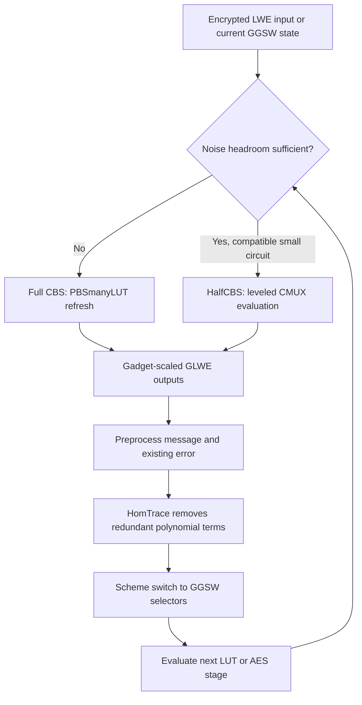

---
# Summary

Ruida Wang, Jincheol Ha, Xuan Shen, Xianhui Lu, Chunling Chen, Kunpeng Wang, and Jooyoung Lee refine **TFHE's leveled homomorphic evaluation (LHE)** by reducing the cost of circuit bootstrapping and separating conversion from noise refresh where possible.

The central correction is that **homomorphic trace amplifies input error as well as the message**. The paper patches a previous NTT-based workflow, develops a power-of-two/FFT version with explicit floating-point-error control, and introduces **HalfCBS**, which converts ciphertext formats without refreshing noise. Applications include AES-128 evaluation in about **11.5 seconds** and integer-input LUT evaluation.

References use the linked 25-page PDF. §§3–5 contain the constructions and results; Appendices A–I give parameters, algorithms, error analyses, and benchmark details.

## 1. Problem

TFHE can evaluate a circuit using frequent programmable bootstrapping, or use inexpensive CMUX-based leveled evaluation between refreshes. The latter requires **GGSW selector ciphertexts**, so moving from ordinary LWE outputs back to GGSW inputs can become the bottleneck.

A prior trace-based circuit-bootstrap design improves asymptotic cost but amplifies the bootstrap's error by the ring degree $N$. Its concrete NTT arithmetic is also comparatively costly at the required modulus sizes. Integer inputs add further bit-extraction and precision demands.

The paper asks how to reduce conversion overhead without overlooking noise, floating-point error, or the depth required by the next circuit.

## 2. Main Contribution

- A corrected/patched **NTT-based CBS** workflow that preprocesses both message and existing error before applying trace (§3.1).
- An **FFT-based CBS** construction for power-of-two ciphertext moduli, using modulus switching/raising instead of an unavailable modular inverse (§3.2).
- **Split FFT** to reduce floating-point convolution errors that trace would otherwise amplify.
- **HalfCBS** and a flexible LHE schedule: avoid a full noise refresh when the current ciphertext has enough headroom (§4.1).
- An AES implementation using keyed S-box tables, merged LUT work, and hybrid HalfCBS/CBS rounds (§4.2).
- An integer-input LHE method integrating extraction/refresh, masked multi-bit extraction, and higher-precision trace conversion (§5).

Implementation references supplied by the paper: [refined-tfhe-lhe](https://github.com/KAIST-CryptLab/refined-tfhe-lhe), its [error-analysis directory](https://github.com/KAIST-CryptLab/refined-tfhe-lhe/tree/main/error_analysis), and [NTT CircuitBootstrap](https://github.com/LightFHE/CircuitBootstrap). These links are source references; the implementations were not rerun here.

## 3. Main Techniques

| Technique | Purpose | Cost/limitation |
| --- | --- | --- |
| Preprocess before HomTrace | Prevent multiplication of the existing PBS error by $N$ | Does not remove trace/key-switching error itself |
| Modulus switch to $q/N$, then lift back | Emulate division by $N$ in the FFT setting | Adds rounding noise |
| Split FFT | Keep the high part exact with very small modeled failure probability | Extra polynomial work and split-parameter selection |
| HalfCBS | Preserve composable GGSW representation without a PBS refresh | Noise accumulates; cannot replace every CBS indefinitely |
| Keyed S-box tables | Absorb AddRoundKey into lookup evaluation | Larger encrypted table/key material |
| Masked multi-bit extraction | Extract several useful selector bits per blind rotation | Output bits use a modified representation; LUTs must be adjusted |
| Temporary higher GLWE dimension | Reduce conversion noise for integer-input evaluation | Two additional GLWE key switches and key material |

## 4. Threat Model and Assumptions

The paper improves **evaluation algorithms** for a server processing encrypted inputs. It inherits the chosen TFHE/LWE/GLWE assumptions and does not add input authentication, malicious-server verification, or side-channel resistance.

Concrete parameters target at least **128-bit estimated security**, using binary secret keys and the lattice estimator. Appendix A provides the noise standard deviations and estimated margins.

The noise analysis uses an **independence/Gaussian or sub-Gaussian heuristic** for ciphertext errors and an estimated floating-point error model (Appendices B–C). Extremely small failure probabilities are therefore model-based tail estimates, not direct empirical observation of rare failures.

Unless otherwise stated, the paper's **failure probability denotes PBSmanyLUT's failure probability** (§2.3.1). Its AES table should not be relabeled as a formally proved total protocol failure bound.

## 5. Important Qualifications

1. **HalfCBS does not refresh noise.** It is a cheaper conversion/evaluation step. The demonstrated AES schedule uses it **only in the first round**, then uses full CBS for the remaining rounds (§4.2).
2. **LHE is still part of a bootstrappable pipeline.** “Leveled mode” describes evaluation between refreshes; it does not imply that the complete application never bootstraps.
3. **Two multi-output PBS techniques are distinct.** PBSmanyLUT uses interleaved outputs and modifies input precision/error requirements. MV-PBS factors accumulator polynomials and can amplify output noise. The paper uses both rather than treating them as interchangeable.
4. **Compressed key size is not peak memory.** Reported keys replace fresh-ciphertext masks by pseudorandom seeds; Appendix C.6 omits seed/auxiliary sizes. Expanded runtime storage can differ significantly.
5. **AVX-512 NTT timings in parentheses are estimates.** They are derived from underlying operation measurements, rather than every complete NTT algorithm being rerun with that acceleration (§3.3, Remark 1).
6. **Some competing AES results are estimates.** Table 5 marks the PBS-based methods reconstructed from building blocks with a star; those rows are not complete directly measured rival implementations.
7. **The previous WWL+ baseline is reanalyzed.** The original faster published parameters are not reused unchanged after the missing noise amplification is taken into account.
8. **Faster does not mean better for every instruction.** Table 9 reports the new generic method slower for binary AND/OR/XOR (227.05 versus 184.52 ms), while division improves substantially.
9. **LUT latency and batch throughput differ.** Table 10 compares this work's single-input CPU latency with large-batch results from other schemes/hardware. Those are different deployment trade-offs.
10. **Approximate model-based bounds need parameter-specific checks.** Neither increasing circuit depth nor changing FFT decomposition bases is safe without recomputing all relevant error terms.

## 6. Evaluation Setup

The benchmark host is an **Intel Core i9-11900K at 3.50 GHz with 32 GB RAM**, supporting AVX-512 (§3.3). FFT implementations use **TFHE-rs**; NTT implementations use **OpenFHE**. The FFT ciphertext modulus is **$2^{64}$**; the NTT blind-rotation modulus is a **54-bit prime**.

### CBS comparison (Table 3)

| Method/configuration | Latency (ms) | Compressed key size (MB) | Reported maximum CMUX depth |
| --- | --- | --- | --- |
| TFHEpp CBS | 63.46 | 1359.43 | 61 |
| Patched NTT-CMux2 | 95.03; estimated accelerated 39.05 | 30.57 | 413 |
| FFT-CMux2 | 18.57 | 40.92 | 2102 |
| FFT-CMux3, with split FFT | 20.62 | 40.92 | 21296 |

Maximum depths use the paper's noise/next-bootstrap model, not a claim that any arbitrary circuit of that gate count has the same error behavior.

### AES evaluation (Table 5)

| Method | Time (s) | Compressed key size (MB) | Listed PBS failure estimate |
| --- | --- | --- | --- |
| Thunderbird baseline | 55.0 | 734.40 | Not listed |
| LHE, Set-I | 12.7 | 19.36 | $2^{-34.86}$ |
| Flexible LHE, Set-I | 11.5 | 23.46 | $2^{-34.86}$ |
| LHE, Set-II | 19.4 | 37.83 | $2^{-368.33}$ |
| Flexible LHE, Set-II | 15.8 | 41.93 | $2^{-129.75}$ |

The approximately **4.8× faster and 31.3× smaller key** headline compares flexible Set-I with the listed Thunderbird baseline. Set-II is a different correctness/performance trade-off. The manuscript's introduction gives the more precise AES time as 11.53 s; Table 5 rounds it to 11.5 s.

### Integer-input/LUT results (Tables 7–9)

For base-16, four-bit inputs, the improved extraction/conversion with two-bit extraction takes **56.12 ms**, versus **418.40 ms** for the compared BBB+ method; listed key sizes are **49.33 MB** and **170.01 MB**. The supported depths also differ.

General integer-LHE lookup timing is **112.74 ms for an 8-to-8 LUT** and **227.05 ms for a 16-to-8 LUT** (Table 8). An eight-bit division instruction is compared at **4801.05 ms versus 227.05 ms**, a **21.15×** improvement; the old processor timing is estimated from its building blocks (Table 9 and Appendix F).

---
# Main Scheme

## Refined Trace-Based CBS and Flexible LHE

### 1. Notation

| Symbol | Meaning |
| --- | --- |
| $R_{q,N}$ | $\mathbb Z_q[X]/(X^N+1)$ |
| LWE, GLWE | Scalar and polynomial ciphertext forms |
| GLev | Vector of GLWE encryptions of a message at gadget scales |
| GGSW | Matrix form enabling an external product/CMUX selector |
| Refr., Conv. | Noise refresh and ciphertext-format conversion |
| HomTrace | Homomorphic ring-trace evaluation |
| $V_{pbs},V_{ms},V_{tr},V_{ss}$ | PBS, modulus-switch, trace, and scheme-switch error variances |

### 2. Why trace needs preprocessing

The trace in the power-of-two cyclotomic ring satisfies:

$$
\operatorname{Tr}\left(\sum_{i=0}^{N-1}\mu_iX^i\right)=N\mu_0.
$$

HomTrace computes this using a logarithmic chain of automorphisms and key switches. It removes nonconstant message terms but also multiplies the constant input error by $N$.

The older workflow programs the message scale with $N^{-1}$, but that does not scale down the error generated during PBS. The paper's correction preprocesses the **entire ciphertext** after PBS so the message and existing error are both handled.

For prime $q$ with invertible $N$, multiply by $N^{-1}\bmod q$ before trace. Trace then restores the message scale and existing constant error while introducing its own evaluation noise. The patched pipeline is:

$$
\mathrm{LWE}
\xrightarrow{\mathrm{PBSmanyLUT}}
\mathrm{GLev}(m+\text{redundant terms})
\xrightarrow{N^{-1}\text{ preprocessing}}
\mathrm{GLev}
\xrightarrow{\mathrm{HomTrace}}
\mathrm{GLev}(m)
\xrightarrow{\mathrm{SchemeSwitch}}
\mathrm{GGSW}(m).
$$

Theorem 3.1 bounds the resulting variance by:

$$
V_{cbs}\leq V_{pbs}+\frac N2V_{tr}+V_{ss}.
$$

The removed factor is the older method's **$N^2V_{pbs}$** contribution (Appendix H). The remaining trace term can still be significant.

### 3. Extend the preprocessing to FFT/power-of-two moduli

When $q$ and $N$ are powers of two, $N^{-1}\bmod q$ does not exist. Instead:

1. Switch the ciphertext modulus from $q$ to $q/N$, reducing message and existing noise scales by $N$.
2. Interpret the resulting coefficients back modulo $q$ by modulus raising.
3. Apply trace; the additional multiple of $q/N$ becomes a multiple of $q$ and disappears.

Before trace, the phase has the form:

$$
\frac{\mu}{N}+E_{ms}+\frac qN U.
$$

After trace, its relevant constant contribution becomes:

$$
\mu_0+N e_{ms}+E_{tr}\pmod q.
$$

Theorem 3.2's variance bound is:

$$
V_{cbs}\leq
V_{pbs}+N^2V_{ms}+\frac N2V_{tr}+V_{ss},
$$

where FFT errors must be included in the relevant terms. The complete workflow outputs GGSW ciphertexts; the theorem's printed output-type wording differs from that workflow.

### 4. Control FFT error through splitting

Split a large polynomial operand into low/high parts:

$$
G=G_0+2^bG_1,\qquad
FG=FG_0+2^bFG_1.
$$

Choose $b$ so the high-part convolution is exact with a sufficiently small modeled rounding-failure probability, while the lower part's error is reduced. The paper targets split-FFT failure much below the PBS failure target and lists estimates below $2^{-256}$ for the used configurations (Appendix B).

This addresses floating-point approximation in the polynomial implementation; it does not remove cryptographic encryption noise.

### 5. HalfCBS converts without refreshing

Full CBS begins with a PBS refresh. HalfCBS replaces that stage with leveled CMUX evaluation of the desired gadget-scaled outputs, then runs preprocessing, trace, and scheme switching (Algorithm 3).

$$
\mathrm{GGSW}(m)
\xrightarrow{\text{CMUX circuit for }L}
\mathrm{GLev}(L(m)+\cdots)
\xrightarrow{\text{preprocess, trace, switch}}
\mathrm{GGSW}(L(m)).
$$

Its error depends on the input/circuit error rather than being reset. A flexible LHE schedule chooses HalfCBS only while enough noise margin remains, then returns to full CBS.

For AES, the demonstrated schedule uses HalfCBS once in the first round. The authors absorb AddRoundKey into encrypted keyed S-boxes,

$$
S_k(x)=S(x\oplus rk),
$$

and use expanded lookup outputs to precompute field-multiplication work for the linear layer. This reduces additions and noise, at the cost of encrypted table material. The description and Appendix D.1 distinguish cheap binary XOR from addition at smaller gadget scales, where the same operation is no longer automatically XOR.

### 6. Integer inputs: masked extraction and higher-precision conversion

For a $\tau$-bit group, extract its most significant bit unchanged and mask each other bit with that bit:

$$
m'_{\tau-1}=m_{\tau-1},\qquad
m'_j=m_j\oplus m_{\tau-1}\quad(j<\tau-1).
$$

This is an invertible public change of representation. Modify the evaluated LUT so it maps the masked selectors to the original intended output. Combining PBSmanyLUT and MV-PBS obtains these useful selector bits with fewer blind rotations.

Where ordinary trace conversion lacks precision, switch to a larger GLWE dimension, preprocess and trace there, then switch back before producing the GGSW output (Algorithm 7). The extra key-switch errors and costs are explicitly included in the analysis.

## Protocol

---
# Questions

1. **Probability scope:** how do the local PBSmanyLUT estimates combine across all AES rounds and repeated application calls? Table 5 should not be relabeled as a complete adversarial security guarantee.
2. **Noise-model assumptions:** how conservative is the independent Gaussian/FFT model for the exact implementation and secret distribution? Empirical agreement of variances does not directly validate extremely small tail estimates.
3. **Notation consistency:** Theorem 3.2 says GLWE in its output sentence, while the CBS workflow ends in GGSW. Appendix C.3 also describes functional keyswitching too broadly as handling arbitrary Lipschitz functions; the displayed linear-decryption argument requires appropriate linearity. Verify these details before treating the manuscript as executable specification.
4. **Hybrid schedule:** can additional HalfCBS rounds be used after retuning parameters, and what are the resulting global error and memory costs? The reported implementation demonstrates only the stated first-round use.
5. **Key accounting:** does a deployment's serialized payload include all encrypted keyed tables, seeds, metadata, and expansion buffers in addition to the reported compressed key count?
6. **Fair comparison:** separate measured CPU results, accelerated NTT estimates, building-block reconstructions, and third-party GPU batching figures when reusing a headline speedup.
7. **Application format:** which post-transciphering operations fit within the remaining noise budget and ciphertext representation? Fast AES evaluation alone does not measure end-to-end analytics.

---
# Related Topics

- [[000 - Transciphering HE]]
- [[012 - At Last! A Homomorphic AES Evaluation in Less than 30 Seconds by Means of TFHE]]
- [[014 - Optimized Homomorphic Evaluation of Boolean Functions]]
- [[024 - Further Improvements in AES Execution over TFHE - Towards Breaking the 1 sec Barrier]]
- [[040 - Thunderbird - Efficient Homomorphic Evaluation of Symmetric Ciphers in 3GPP by combining two modes of TFHE]]
- [[053 - Designing a universal homomorphic instruction set and applications to transciphering with TFHE]]
