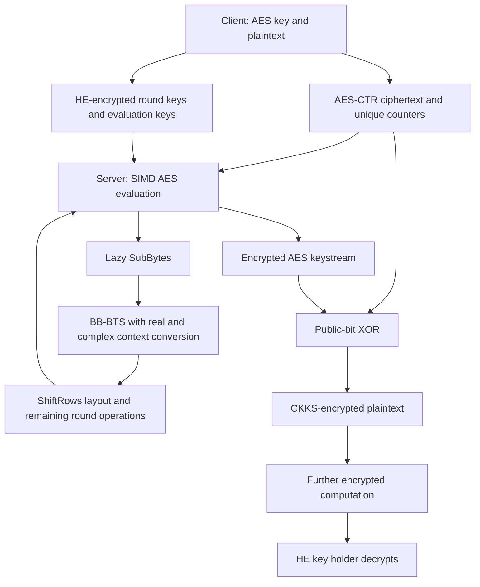

---
# Summary
## 1. Problem
AES is attractive for transciphering because clients can use a standard, hardware-accelerated cipher. Its bit operations are expensive in CKKS: Boolean arithmetic consumes levels, approximate errors need correction, and bootstrapping dominates runtime. SIMD throughput also drops sharply when the batch does not fill the available slots.

This paper studies AES-128 in CTR mode, producing CKKS encryptions of the plaintext. It optimizes both large batches and smaller batches; these are different operating points.

## 2. Main Contribution
- Switch between standard CKKS and conjugate-invariant CKKS (CI-CKKS) to use both real and imaginary coordinates efficiently, while evaluating suitable parts of the circuit over real messages.
- Apply context conversion inside bit bootstrapping (BB-BTS), especially the trigonometric evaluation used to recover bits.
- Reduce expensive relinearization/rescaling operations in SubBytes from 247 to 99 using lazy evaluation.
- Pack bytes across fewer ciphertexts for smaller batches, and fuse the layout changes needed by ShiftRows with BB-BTS output processing.
- Demonstrate 32.52 seconds for a batch of $2^{15}$ AES blocks: **0.99243 ms per block amortized**, calculated from the displayed total, or approximately 15.74 KiB/s. This is not sub-millisecond single-block latency.

## 3. Main Techniques
### Context conversion
Standard CKKS carries complex slots; CI-CKKS carries real slots in a conjugate-invariant ring. Two real vectors can be represented as the real and imaginary components of one complex vector, then converted into the appropriate real context for computation. The conversion involves ring embeddings/projections, masks, automorphisms and key switching; it is not a free reinterpretation.

For the large-batch AES circuit, conversion reduces the number of input ciphertexts from 128 to 64. Operations inside a real context can then use this layout. Arbitrary nonlinear functions cannot be evaluated independently on $x$ and $y$ simply by evaluating the same polynomial on $x+iy$; the conversions are essential.

### BB-BTS and error cleaning
BB-BTS packs bits into small integers, refreshes the CKKS ciphertext, and extracts refreshed bits using roots of unity and interpolation. The proposed conversion is used around the real-valued cosine and sine computations in this procedure.

Boolean operations use arithmetic identities such as
$$
\operatorname{AND}(x,y)=xy,\qquad
\operatorname{XOR}(x,y)=(x-y)^2
$$
for ideal bits. The cleaning polynomial
$$
h(x)=3x^2-2x^3
$$
contracts sufficiently small errors near 0 and 1. These identities require error management for approximate inputs.

### Lazy SubBytes
Each S-box output bit is a multilinear polynomial in eight input bits. Shared products are computed in a balanced structure, and relinearization/rescaling is delayed where intermediate values do not require it immediately. The multiplicative depth of the balanced monomials is three; this is not an assertion that an arbitrary degree-255 univariate polynomial has depth three.

### Packing and ShiftRows
Byte-wise packing distributes byte bits over eight ciphertexts while using real and imaginary slots. BB-BTS output rotations, masks and additions prepare the ShiftRows layout. Some batch layouts avoid masking, which changes the depth and explains why parameters vary with batch size.

## 4. Threat Model and Assumptions
The usual transciphering setting is assumed: the server receives AES ciphertexts and HE encryptions of the secret AES round-key material, and evaluates decryption without learning the key or plaintext. The result remains encrypted for the HE key holder.

The paper reports HE parameters estimated at 128-bit security using the lattice estimator, including dense/sparse secret settings and evaluation-key machinery. AES-128 provides the symmetric primitive. These parameter estimates do not independently establish security of every surrounding service protocol.

CTR requires unique counter blocks under each AES key. The construction does not add authentication, malicious-server correctness proofs, or an authenticated-decryption protocol. CKKS output is approximate; the reported error is an empirical average, not a worst-case correctness bound for every slot.

## 5. Important Qualifications
- **Throughput versus latency:** the title refers to amortized cost at the largest batch. The measured total time there is 32.52 s. The smallest reported batch is 512 blocks (8 KiB), not one block.
- The 1.58× comparison with XBOOT uses the authors' GPU port of XBOOT on the same machine. It is not a direct ratio against the original CPU timings.
- The low-latency 1.86 s result combines XBOOT's free-XOR/BinBoot approach with this paper's optimizations; it is distinct from the paper's original 2.67 s circuit.
- For 512 blocks, the circuit is evaluated primarily in the complex context, applying context conversion within bootstrapping. The high-throughput CI circuit is not the best configuration at every batch size.
- Key generation is on the CPU and excluded from the GPU evaluation described here. The AES evaluation uses pre-generated round-key material; timings should not be treated as complete client setup plus online evaluation.
- No complete communication/memory budget or authenticated application benchmark accompanies the main throughput table.
- Table 5's unit “ms” denotes amortized milliseconds per block. Table 6 gives seconds for the entire batch: $1000\cdot32.52/32768=0.992431640625$ ms/block, which rounds to Table 5's 0.99 ms. The abstract separately says 0.994 ms; that small discrepancy is not exactly reproduced by the displayed batch total and should not be presented as the same arithmetic result.

## 6. Evaluation Setup
C++ HEaaN implementation; one Intel Xeon Gold 6542Y CPU thread and one NVIDIA GeForce RTX 4090 GPU. Computation is on the GPU except key generation. Reported timings average 100 runs (§6).

Main parameter sets have ring degree $N=2^{16}$, dense/sparse secret Hamming weights $(256,32)$, and maximum $\log_2(PQ)$ of 1589, 1581 and 1441 for Param A, B and C. Gadget ranks are 3, 4 and 2 respectively; base prime size is 38 bits. The XBOOT comparison sets use $N=2^{15}$ and different modulus chains. See Table 1 for the operation-specific prime chains rather than mixing their entries across sets.

| AES blocks | Data | Total latency, ours | Amortized ours | Amortized XBOOT |
|---:|---:|---:|---:|---:|
| $2^{15}$ | 512 KiB | 32.52 s | 0.99 ms | 1.57 ms |
| $2^{14}$ | 256 KiB | 17.77 s | 1.09 ms | 1.57 ms |
| $2^{13}$ | 128 KiB | 9.28 s | 1.13 ms | 1.87 ms |
| $2^{12}$ | 64 KiB | 5.74 s | 1.40 ms | 1.58 ms |
| $2^{11}$ | 32 KiB | 3.41 s | 1.67 ms | 1.99 ms |
| $2^{10}$ | 16 KiB | 3.20 s | 3.13 ms | 2.25 ms |
| $2^9$ | 8 KiB | 2.67 s | 5.21 ms | 3.62 ms |

Source: Tables 5–6. Param A is used for exponents 15, 13, 11 and 10; Param B for 14 and 12; Param C for 9. XBOOT also changes parameters by batch size. The hybrid XBOOT-based 512-block circuit takes 1.86 s, separately from this table.

Per-round breakdown for the large-batch real-context circuit (Table 2): SubBytes 0.898 s, ShiftRows 0.009 s, MixColumns 0.213 s, AddRoundKey 0.035 s, cleaning 0.081 s, BB-BTS 2.172 s, conversion 0.113 s. BB-BTS accounts for 61.5%. This is a representative round breakdown, not a claim that ten identical rounds sum exactly to the whole AES timing; the last AES round has no MixColumns and boundaries differ.

Ablations: BB-BTS 2.594 → 2.172 s; SubBytes 1.23 → 0.898 s with 247 → 99 relinearization/rescaling operations (Tables 3–4). Reported mean absolute output errors are approximately $2^{-19.3}$, $2^{-19.9}$ and $2^{-20.1}$ for A, B and C.

---
# Main Scheme
## Title
Context-converted CKKS AES-CTR transciphering with lazy SubBytes and byte-wise SIMD packing.

### 1. Notation
- $K$: AES-128 key; $RK_r$: AES round keys.
- $U_i$: distinct public CTR input blocks, incorporating nonce and counter.
- $M_i,C_i\in\{0,1\}^{128}$: plaintext and symmetric ciphertext blocks.
- $[x]$: CKKS encryption of an encoded bit/vector; equality below denotes ideal-message behavior, with implementation error tracked separately.
- $R_N=\mathbb Z[X]/(X^N+1)$; the CI subring contains elements invariant under $X\mapsto X^{-1}$.

### 2. Client encryption and key preparation
Expand $K$ into the AES round keys and provide their HE-encrypted representation, together with required HE evaluation/conversion keys. Encrypt each data block by
$$
Z_i=\operatorname{AES}_K(U_i),\qquad C_i=M_i\oplus Z_i.
$$
Send $C_i$ and the counter information. Round-key encryption/setup is amortized across data under the same key, subject to secure counter management.

### 3. Homomorphic AES evaluation
1. Encode public $U_i$ and arrange encrypted round-key bits in the selected SIMD layout.
2. Apply initial AddRoundKey.
3. Evaluate SubBytes using shared multilinear products and lazy relinearization/rescaling.
4. Refresh/extract bits with BB-BTS, using real/complex conversions around suitable operations.
5. Apply ShiftRows through output placement, rotations and masks as required by the batch layout.
6. Evaluate MixColumns and AddRoundKey, with cleaning/error control at the chosen circuit boundaries. Omit MixColumns in the final AES round.
7. Obtain encrypted keystream bits $[Z_i]$.

The detailed circuit schedule depends on the parameter/layout configuration. BB-BTS and context conversion change representations; they are not additional AES transformations.

### 4. Conversion mechanism
To illustrate CI → standard CKKS, a CI ciphertext at degree $2N$ is embedded into the standard degree-$2N$ ring, masked to combine real vectors into complex slots, and key-switched to an embedded degree-$N$ key. An automorphism and summation make the ciphertext projectable to degree $N$. The reverse direction embeds into degree $2N$, changes key, masks/scales, combines with its conjugate, and returns to the CI representation. See §4 for the precise encoding, automorphism and key domains; the scaling factors must be retained.

Inside BB-BTS, refreshed packed integers are mapped to roots
$$
\zeta_t^m=\exp(2\pi i m/t)
 =\cos(2\pi m/t)+i\sin(2\pi m/t),
$$
and interpolation recovers output bits. Context conversion allows the trigonometric work to use real-message computation before recombination in the complex context.

### 5. Recover an HE plaintext
For a public ciphertext bit $c\in\{0,1\}$,
$$
[m]=c+(1-2c)[z]
$$
implements $m=c\oplus z$ ideally. The encrypted plaintext can subsequently enter a CKKS application, with suitable packing and precision handling. Only the authorized HE key holder decrypts the final result.

## Protocol

---
# Questions
- What are the complete evaluation/conversion key sizes and peak GPU memory requirements at each batch size?
- What maximum-slot error and failure probability can be established beyond the reported average precision?
- How much setup and round-key encryption cost remains when keys change frequently?
- How does the approach compose with authenticated decryption and a concrete downstream application?
- At which batch sizes does layout conversion outweigh the gain on other GPU architectures?

---
# Related Topics
- [[010 - E2E near-standard and practical authenticated transciphering]]
- [[000 - Transciphering HE]]
- CKKS / CI-CKKS context conversion
- Bootstrapping bits and small integers
- XBOOT and free-XOR evaluation
- AES-CTR and SIMD packing
