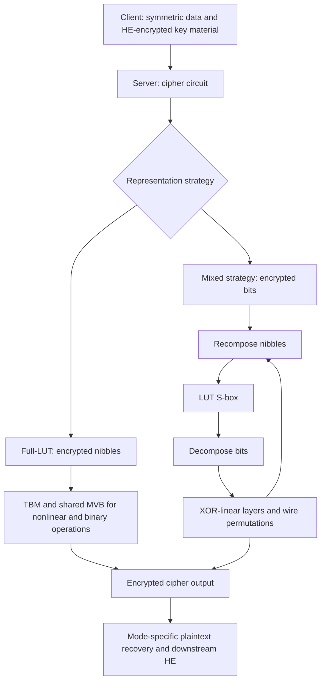

---
# Summary
## 1. Problem
Does AES give the best transciphering performance among established block ciphers? The answer depends on both the cipher and the encrypted representation. This paper compares AES, CLEFIA, PRESENT, PRINCE, SIMON and SKINNY using a common TFHE integer/LUT framework, then estimates the effect of a mixed Boolean/integer approach.

## 2. Main Contribution
A comparative implementation study, an operation-count cost model, and design guidelines for TFHE-friendly block ciphers. This is not a new secure block cipher or a universal ranking across HE schemes.

The local PDF is the 23-page IACR Communications in Cryptology journal version, Vol. 2, No. 4, DOI [10.62056/avom-4tw9](https://doi.org/10.62056/avom-4tw9), received 6 October 2025 and accepted 2 December 2025. [[017 - AES Is Not Enough - the Block Ciphers Zoo Goes Homormorphic]] is the closely related 22-page version by the same authors. The main methods and comparison table overlap, so these are not independent experimental evidence. The journal text explicitly exempts PRINCE from its standardization criterion and supplies a [source-code link](https://github.com/daphnetrm/Running-Standard-Block-Ciphers-with-TFHE) in §5; the code has not been independently rerun here.

## 3. Main Techniques
### Full-LUT representation
Represent a byte as two separately encrypted nibbles, $x=16h+l$. Unary 4-bit substitutions need one programmable bootstrap. Binary nibble operations and 8-bit substitutions use the tree-based method (TBM), with multi-value bootstrapping (MVB) sharing blind rotations across outputs.

For a single binary nibble LUT, the optimized cost is **2 blind rotations (BR) + 1 packing key switch (KS)**. For $k$ LUTs sharing the first selector, it is $(k+1)$ BR + $k$ KS. An 8-bit S-box producing two output nibbles costs 3 BR + 2 KS.

The counted KS is a **TLWE-to-TRLWE packing key switch**, not every ordinary key switch inside TFHE. Treating all key switches as equal would invalidate the cost model.

### Hippogryph representation
Use bit ciphertexts for XOR-linear layers and nibble ciphertexts for LUT-based S-boxes. TFHE addition implements XOR in the chosen binary encoding, with noise accumulating until refresh. Decomposing one nibble into four bits costs 1 BR through MVB; recomposing four bits costs 4 BR. Bit permutations are wire rearrangements, while conversions are paid operations.

### Cipher-specific optimizations
- **CLEFIA:** fuse S-box outputs with subsequent constant field multiplications in shared LUTs; use Boolean linear layers in the Hippogryph estimate.
- **PRESENT:** its 4-bit S-box is cheap, but pLayer crosses nibble boundaries and forces decomposition/recomposition in a nibble implementation; 31 rounds accumulate cost.
- **PRINCE:** precombine round constants, keys and whitening where consecutive XORs permit; compute nibble masks with shared MVB for its binary matrix layer.
- **SIMON:** rotations by multiples of four are ciphertext reordering in nibble form; rotations by one or two bits need real computation. Boolean encoding is a much better fit for this AND/XOR cipher, so a bad full-LUT result does not make SIMON intrinsically HE-unfriendly.
- **SKINNY:** binary MixColumns is inexpensive; the 4-bit and 8-bit S-box variants have substantially different costs. Two 64-bit evaluations are compared against one 128-bit evaluation.

## 4. Threat Model and Assumptions
Standard transciphering confidentiality: the server evaluates a symmetric cipher with an HE-encrypted secret key. The paper studies circuit performance, not a complete authenticated protocol or malicious-server verification mechanism.

Security properties differ across the compared block sizes and key variants. Producing 128 output bits using two 64-bit blocks does **not** turn a 64-bit block cipher into a 128-bit block cipher or equalize birthday-bound data limits. Key schedules are not included as homomorphic online computation; client precomputation is used.

The hypothetical **Unicorn** is explicitly a performance sketch with **no symmetric-security claim**. Its assumed ten rounds must not be read as a cryptanalytically justified parameter choice.

## 5. Important Qualifications
- Full-LUT timings are measured; Hippogryph timings are estimates from BR/KS counts and primitive costs. They are not a second fully implemented benchmark suite.
- Results use TFHElib and one core. The cited 32-second Hippogryph AES result uses another implementation; this comparison's AES estimate is 84 seconds.
- Table 1 normalizes runtime to 128 output bits, but its operation counts are per cipher execution for the 64-bit ciphers. Do not multiply counts and runtime inconsistently.
- **The PDF has unresolved arithmetic/count discrepancies.** PRINCE's section gives 720 KS but Table 1 gives 1220; CLEFIA's section gives 4240 BR/2624 KS versus 5120/2848 in the table; SIMON gives 13056 BR/4352 KS versus 18496/4080. PRESENT's section gives 3968 BR/288 KS versus 4496/992, and its displayed round-cost expression does not sum to the stated count. SKINNY's Hippogryph per-round derivations also do not directly reproduce the table's totals. The table below reproduces reported runtimes, not a reconciliation of those counts.
- The end of the SKINNY discussion says two 64-bit executions outperform one “64-bit” execution; context indicates a comparison with the **128-bit variant**.
- The journal version **explicitly identifies PRINCE as an exception to its standardization criterion** (§1, footnote 3, PDF p. 3). Its inclusion should not be reported as an overlooked standardization claim. The introduction also lists PASTA among stream ciphers; its modular-symbol output should be distinguished from a bitstream when comparing payloads.
- The local appendix's $2^{-23}$ error figure is for **one MVB tree evaluation**, not a demonstrated whole-cipher failure probability.

## 6. Evaluation Setup
Single core of an Intel Core i7-12700H laptop, 64 GiB RAM, Ubuntu 22.04.2, TFHElib (§5). Primitive estimates are approximately 0.03 s/BR and 0.07 s/packing KS.

| Cipher | Block bits | Executions for 128 output bits | Measured full-LUT | Estimated Hippogryph |
|---|---:|---:|---:|---:|
| AES | 128 | 1 | 260 s | 84 s |
| PRINCE | 64 | 2 | 210 s | 70 s |
| PRESENT | 64 | 2 | 408 s | 179 s |
| SKINNY-128 | 128 | 1 | 480 s | 335 s |
| SKINNY-64 | 64 | 2 | 298 s | 180 s |
| CLEFIA | 128 | 1 | 353 s | 77 s |
| SIMON | 128 | 1 | 840 s | Not estimated |
| Unicorn, hypothetical | 128 | 1 | 93 s, estimated | 58 s, estimated |

Source: Table 1, PDF p.19. **Unicorn is estimated in both columns.** Under these specific methods, PRINCE leads the tested ciphers; CLEFIA also beats AES in the Hippogryph estimate. This ranking is not an equal-security deployment recommendation.

Appendix A parameters: TLWE dimension $n=1024$, torus modulus $q=2^{32}$, ring degree $N=2048$, gadget level $l=3$, $B_g=256$, packing decomposition $B_{KS}=1024,t=2$, plaintext modulus $r=32$; TRLWE standard deviation $9.6\times10^{-11}$ and TLWE standard deviation $6.5\times10^{-8}$.

---
# Main Scheme
## Title
Compile standard block-cipher rounds to nibble LUTs, or alternate nibble S-boxes with Boolean linear layers.

### 1. Notation
- $[x]$: TLWE encryption of a nibble or bit in the appropriate encoding.
- $S$: the actual cipher's S-box; $x=16h+l$ for an 8-bit input.
- $N_{BR},N_{KS}$: blind rotation and packing-key-switch counts.
- $DC,RC$: nibble-to-bit decomposition and bit-to-nibble recomposition.

### 2. Generic transciphering wrapper
Client encrypts data symmetrically and provides an HE encryption of the necessary round-key material. Server evaluates the corresponding cipher circuit, retaining encrypted plaintext. In a CTR application it evaluates the forward block cipher on public counter inputs to recover encrypted keystream; a direct block-decryption application requires the actual inverse circuit. The measured primitive costs alone do not specify every mode's complete decryption protocol.

### 3. Full-LUT S-box and linear operations
Construct the two tables
$$
S_H(h,l)=\left\lfloor S(16h+l)/16\right\rfloor,\qquad
S_L(h,l)=S(16h+l)\bmod16.
$$
Evaluate both using a shared-selector TBM/MVB call to obtain $[S_H],[S_L]$. Binary XORs are also LUTs in the nibble framework. Fuse public constant multiplications with S-box LUTs where the cipher's operation order permits.

MVB factors test polynomials in the negacyclic ring:
$$
(1+X+\cdots+X^{N-1})(1-X)=2\pmod{X^N+1}.
$$
A common accumulator is blind-rotated once; multiplication by each output-specific public polynomial produces the separate LUT outputs. Sharing BR does not eliminate output processing, noise growth or packing KS.

### 4. Mixed Boolean/integer evaluation
For each nonlinear layer, recompose bit ciphertexts into nibbles, evaluate the S-box LUTs, then decompose the results. Evaluate XOR-linear operations by native additions and permutations by rearranging bit ciphertexts, subject to noise control. Repeating this schedule avoids expensive binary-nibble LUTs for every XOR but introduces conversion costs.

A coarse sequential model is
$$
T\approx N_{BR}\,t_{BR}+N_{KS}\,t_{KS}.
$$
It omits smaller operations and implementation effects; use it for estimates, and retain the PDF's count inconsistencies rather than presenting it as an exact timing identity.

## Protocol

---
# Questions
- Can the authors' code reconcile the operation counts in the cipher sections with Table 1?
- Does an implemented mixed-encoding benchmark preserve the predicted ranking under a common whole-cipher failure target?
- How do equal security targets, data limits, key scheduling and mode selection affect the practical comparison?
- What additional conversion cost is needed for the actual downstream arithmetic or Boolean application?
- Can a secure block cipher achieve the Unicorn sketch's costs after cryptanalysis determines its required rounds?

---
# Related Topics
- [[017 - AES Is Not Enough - the Block Ciphers Zoo Goes Homormorphic]]
- [[012 - At Last! A Homomorphic AES Evaluation in Less than 30 Seconds by Means of TFHE]]
- [[014 - Optimized Homomorphic Evaluation of Boolean Functions]]
- [[024 - Further Improvements in AES Execution over TFHE - Towards Breaking the 1 sec Barrier]]
- [[000 - Transciphering HE]]
