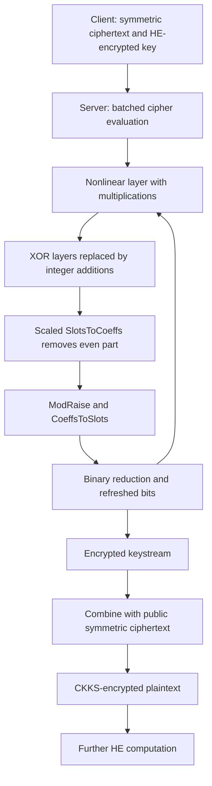

---
# Summary
## 1. Problem
CKKS can evaluate Boolean circuits by representing bits as approximate real values, but BLEACH-style XOR, $(x-y)^2$, consumes a multiplication and a level. XOR-heavy symmetric ciphers therefore lose much of their apparent advantage over arithmetic-friendly designs. XBOOT asks whether parity reduction can be absorbed into bootstrapping instead.

## 2. Main Contribution
XBOOT replaces XOR gates by additions over the integers and delays reduction modulo two. Carefully chosen scales inside SlotsToCoeffs make the even part overflow modulo the base ciphertext modulus, leaving parity for binary bootstrapping to refresh. XOR thus consumes zero multiplication depth locally; bootstrapping and scale management remain essential costs.

Applications include AES-128-CTR and Rasta-6. AES needs three multiplication levels per round instead of nine in the compared BLEACH circuit. The largest AES configuration processes 256 KiB in 236 s using 64 threads, or 14.4 ms per block amortized. Rasta processes a batch of $2^{14}$ 351-bit blocks in 303 s.

## 3. Main Techniques
### Deferred parity reduction
Any integer polynomial implementing a Boolean circuit modulo two preserves the intended Boolean answer in its least significant bit. Consequently, additions and multiplications can be interleaved before reduction, provided intermediate magnitude and approximation errors remain controlled:
$$
\left(\sum_i x_i\right)\left(\sum_j y_j\right)\bmod2
=\left(\bigoplus_i x_i\right)\land\left(\bigoplus_j y_j\right).
$$
This does not justify applying an ordinary Boolean cleanup polynomial directly to unreduced integers.

### Scale-aware SlotsToCoeffs
Let $m=b+2I'$ coefficientwise after the appropriate homomorphic linear transform. At the bottom modulus, arrange scale $\Delta_0=q_0/2$. Then
$$
\Delta_0m\bmod q_0
=\left(\frac{q_0}{2}b+q_0I'\right)\bmod q_0
=\frac{q_0}{2}b\bmod q_0.
$$
The necessary factor $q_0/(2\Delta_{StC})$ is distributed across the factorized SlotsToCoeffs matrices. This is a specific scale/modulus schedule, not a property of an arbitrary unmodified CKKS bootstrap.

After modulus raising and CoeffsToSlots, the normalized slots are approximately $b/2+I$. Extract the real part and evaluate a polynomial approximation to
$$
f_{Bin}(x)=\tfrac12(1-\cos(2\pi x)).
$$
For integer $I$ and bit $b$, this maps $I+b/2$ to $b$, with a locally flat derivative that helps suppress small errors.

### Shared monomials for AES S-boxes
Recursively split eight input bits into groups and form all nonconstant multilinear monomials. There are 255 such monomials, eight already supplied as inputs; the construction uses **247 multiplications at depth three**. Each S-box output combines them with precomputed integer coefficients. This count concerns the explicit shared-monomial construction, not a proof of a universal lower bound for every possible AES circuit.

### BatchXBOOT
Pack two real ciphertext messages into real and imaginary parts of one complex ciphertext, share SlotsToCoeffs/modulus raising/CoeffsToSlots, then extract each real vector and evaluate its own binary reduction. This replaces 128 single AES bootstraps by 64 BatchXBOOT calls per round. It does not halve every part of the bootstrap.

## 4. Threat Model and Assumptions
The server receives symmetric ciphertexts, public nonce/counter inputs and HE-encrypted symmetric round keys. It computes encrypted keystream, then recovers an HE-encrypted plaintext. The HE key holder can decrypt results. Confidentiality relies on the symmetric primitive and the selected CKKS/evaluation-key assumptions. Parameter sets are estimated at 128-bit security, including the sparse-secret encapsulation context.

AES-CTR requires unique counter inputs under the same key. The paper is not an authenticated-transciphering construction, a proof of malicious-server correctness, or an application access-control protocol.

Bootstrapping is approximate. A 128-bit cryptanalytic security target must not be confused with its numerical error or failure probability. Table 1 studies interpolation intervals with tail probabilities around $2^{-16}$ for the stated event; it is not a claim of whole-circuit failure below $2^{-128}$.

## 5. Important Qualifications
- “Free XOR” means addition instead of ciphertext multiplication and no local multiplication depth. Additions, error growth, magnitude bounds, matrix transforms and eventual bootstrapping still cost resources.
- BLEACH's $3x^2-2x^3$ cleanup assumes values near bits and cannot clean unreduced integers. XBOOT relies on parity bootstrapping for this purpose.
- AES round-key expansion and HE setup are outside the homomorphic online cipher circuit. Keystream generation can run offline once nonce/counters are known, but its 236 s batch cost still exists.
- Table 3 compares published numbers from different machines/libraries, rather than rerunning every scheme on the XBOOT host. Its starred 0.95 s TFHE comparator additionally applies a hypothetical 4× adjustment from a 16-thread result to 64 threads. It is not a measured 64-thread result.
- The Rasta BLEACH baseline is **estimated, not implemented**. Its bound counts only a cited relinearization cost, assumes ideal division by 64, and does not establish an end-to-end measured speedup.
- Reported numerical accuracy is mean absolute error. This alone does not establish a maximum error for all output bits or applications.
- The paper quotes a BLEACH average bias of $1.16\times2^{-10}$; do not substitute it for the much smaller error reported in a different experiment/version of the E2E paper.
- Appendix A returns encrypted numerator and denominator for Pearson's statistic; **the client performs division after decryption**. This is not fully homomorphic division.

## 6. Evaluation Setup
Lattigo v6; Intel Xeon Platinum 8369B, 64 cores at 2.50 GHz, 128 GB RAM. XBOOT transciphering results use 64 threads. The paper provides [implementation code](https://github.com/AntCPLab/xboot-ckks-transciphering); these notes do not independently rerun it.

| Configuration | Ring degree | Dense/sparse secret weights | $\log_2(QP)$ | Levels per round | Batch | Latency | Amortized cost |
|---|---:|---|---:|---:|---:|---:|---:|
| AES-13 | $2^{14}$ | 256 / 16 | 433 | 3 | $2^{13}$ AES blocks | 153 s | 18.7 ms/block |
| AES-14 | $2^{15}$ | 256 / 32 | 829 | 3 | $2^{14}$ AES blocks | 236 s | 14.4 ms/block |
| Rasta-14 | $2^{15}$ | 256 / 32 | 830 | 2 | $2^{14}$ 351-bit blocks | 303 s | 18.5 ms/block |

Source: Tables 2–4. AES-14 gives about 1.08 KiB/s; Rasta about 2.32 KiB/s. Small-batch AES-13 reduces total latency but worsens amortized cost.

The compared BLEACH AES result is 1200 s for $2^{15}$ blocks (37 ms/block), giving roughly 5× latency and 2.5× amortized improvements. The batch sizes differ. The estimated BLEACH Rasta result exceeds 16124 s for $2^{15}$ blocks, or 0.49 s/block; the estimate is described explicitly in §6.3.

Mean absolute AES output errors: $1.2\times2^{-13}$ for AES-13 and $1.1\times2^{-19}$ for AES-14 (§6.4).

The GWAS demonstration uses 64 individuals and 16384 SNPs each, SNP values in $\{0,1,2\}$: 236 s transciphering, then 2.9 s for encrypted statistic components, with reported 17-bit accuracy. Distinguish that application from the larger cohorts in other papers.

---
# Main Scheme
## Title
Deferred modulo-two reduction inside CKKS bootstrapping, applied to AES-CTR and Rasta.

### 1. Notation
- $[x]$: CKKS encryption of approximate message $x$.
- $q_0$: bottom ciphertext modulus; $\Delta_{StC}$: input scale for SlotsToCoeffs.
- $m=b+2I'$: unreduced integer vector with desired parity $b$.
- $K,RK_r$: symmetric key and AES round keys; $U_i$: unique public counter block.

### 2. XBOOT primitive
1. Accept a ciphertext of bounded integers plus sufficiently small error.
2. Apply scaled SlotsToCoeffs with cumulative scaling factor $q_0/(2\Delta_{StC})$, reaching scale $q_0/2$ and modulus $q_0$.
3. Allow reduction modulo $q_0$ to remove the even part.
4. Raise the modulus and apply CoeffsToSlots.
5. Extract the real component by $(ct+\operatorname{conj}(ct))/2$.
6. Evaluate the binary-reduction polynomial approximation to obtain refreshed approximate bits at a usable higher modulus.

Keep the paper's matrix, scale, error and interpolation-interval requirements. Replacing only the XOR gates without changing bootstrapping is insufficient.

### 3. AES-CTR evaluation
Client computes
$$
C_i=M_i\oplus\operatorname{AES}_K(U_i)
$$
and supplies HE-encrypted expanded round keys. AES inputs use a 32-bit nonce and a 96-bit counter in the described layout. Each of 128 state-bit ciphertexts carries one bit position across $N/2$ AES blocks.

Initial whitening with a public input must produce genuine approximate bits before entering the first S-box; public-bit XOR is affine. For each of nine full AES rounds:
1. Evaluate SubBytes with the shared monomials, consuming three multiplication levels.
2. Rearrange ciphertext indices for ShiftRows.
3. Evaluate MixColumns' XOR-linear bit circuit with additions over integers.
4. Add round-key ciphertexts, again deferring parity reduction.
5. Apply BatchXBOOT to recover refreshed bits.

The final round omits MixColumns and also ends with parity bootstrapping. For public ciphertext bits $c$, recover plaintext by the affine XOR
$$
[m]=c+(1-2c)[z],
$$
where $[z]$ encrypts the AES keystream bit.

### 4. Rasta evaluation
For public nonce/counter-dependent affine maps $A_j$, evaluate
$$
Z=K\oplus(A_r\circ\chi\circ A_{r-1}\circ\cdots\circ\chi\circ A_0)(K).
$$
The nonlinear layer has coordinates
$$
\chi(x)_i=x_i\oplus x_{i+2}\oplus(x_{i+1}\land x_{i+2}),
$$
with indices modulo the state size. Replace XOR by addition. The nonlinear layer consumes one ciphertext multiplication level; the public binary matrix operation consumes another level in this implementation. XBOOT reduces the resulting integers to bits between layers/rounds as scheduled. Different blocks' public matrices are batched into plaintext slot vectors; generating and storing them is a separate practical cost.

### 5. GWAS statistic components
For cohort size $n$, disease indicators $y$, and allele counts $s$:
$$
n_{11}=y^Ts,\quad r_1=2y^Ty,\quad c_1=\sum_i s_i,
$$
$$
A=2n(2n\,n_{11}-c_1r_1)^2,\qquad
B=c_1(2n-c_1)r_1(2n-r_1).
$$
The server returns $[A],[B]$; the client decrypts and computes $\chi^2=A/B$, provided the denominator is nonzero. This final disclosure and division are part of the application boundary.

## Protocol

---
# Questions
- What whole-batch correctness bound follows from the interpolation-tail and approximation errors across all rounds?
- How large may intermediate integers grow before the selected scale schedule loses the necessary precision?
- What is the total key material, public-matrix memory and setup time for AES versus Rasta?
- How does the same implementation compare on identical hardware against other bootstrapping strategies?
- Can a downstream application tolerate the maximum bit-to-number conversion error, rather than only its average?

---
# Related Topics
- [[010 - E2E near-standard and practical authenticated transciphering]]
- [[016 - High-Throughput AES Transciphering using CKKS - Less than 1ms]]
- [[027 - Rasta - A cipher with low ANDdepth and few ANDs per bit]]
- [[000 - Transciphering HE]]
- BLEACH, binary bootstrapping and sparse-secret encapsulation
