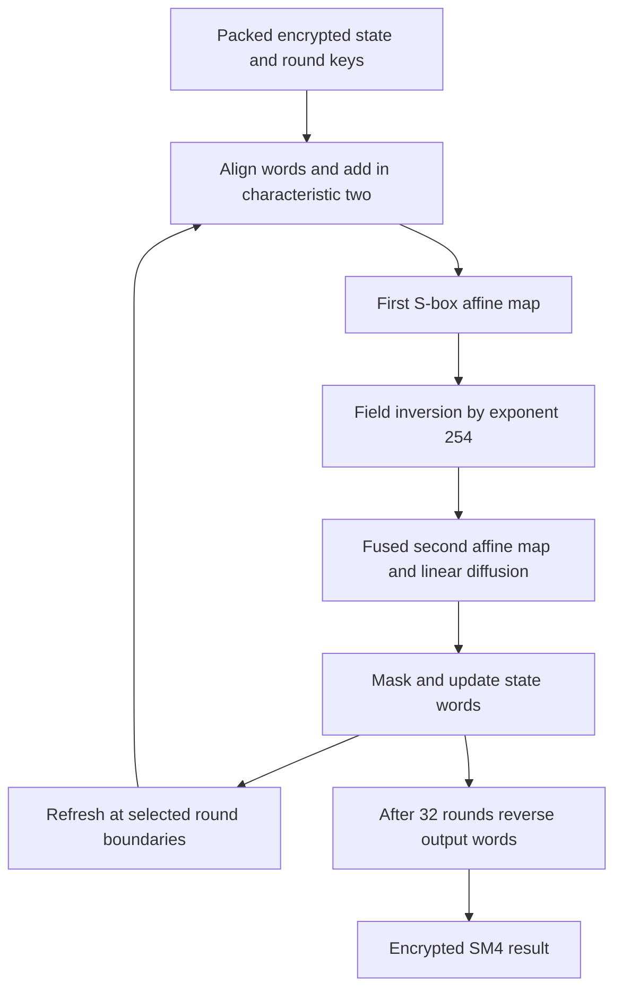

---
# Summary
## 1. Problem
Evaluate all 32 rounds of the standard 128-bit SM4 block cipher under BGV. Its byte S-boxes and long round dependency chain create substantial depth, while its word rotations must be implemented over a byte-packed HE layout.

## 2. Main Contribution
A HElib implementation with two configurations: one uses four refresh points during evaluation, while the other uses a much larger leveled parameter set without bootstrapping. The paper adapts the AES field-inversion method to SM4 and combines the S-box's second affine map with the linear diffusion layer.

This is a seven-page implementation report dated **25 October 2020**, not a modern TFHE benchmark.

## 3. Main Techniques
- Pack bytes in slots; combine the three preceding words and the encrypted round key through additions in characteristic two.
- Express each binary affine byte map as a linearized polynomial $\delta+\sum_{j=0}^{7}\gamma_j\beta^{2^j}$. Frobenius powers are implemented through automorphisms.
- Compute inversion by $x^{254}$ in $\mathbb F_{2^8}$, extending the inversion map by $0\mapsto0$.
- Split SM4's 32-bit linear diffusion map into $8\times8$ binary blocks and implement the resulting byte transformations and permutations.
- Merge the second S-box affine map with diffusion to avoid redundant linear work.

## 4. Threat Model and Assumptions
The computation keeps state and round-key material encrypted under BGV. The abstract claims approximately 128-bit security. The report does not give a complete modulus/noise/security-estimation table sufficient to independently reproduce that claim from $m,p,d$ alone.

It evaluates a block-cipher circuit. It does not provide an authenticated mode, malicious-server verification, or a complete client/server security proof. SM4 encryption and decryption use the same round structure with reversed round-key order; a transciphering deployment must select the appropriate mode and key order.

## 5. Important Qualifications
- **Batch time is not single-block latency.** Bootstrapping evaluates 360 blocks together; the leveled variant evaluates 480 blocks.
- The abstract rounds the first runtime to about 1.5 hours; §2.4 reports **1 hour 35 minutes**. Use the latter when deriving amortized cost.
- Three ciphertexts each with 1920 slots produce 360 blocks total. The no-bootstrap configuration uses one ciphertext with 7680 slots. Slots have extension degree 24, and bytes occupy the embedded byte field; slot count is not a bit count.
- The four bootstrapping points are after rounds **9, 15, 21 and 27**. This is not bootstrapping after every round.
- The notation “$\gg2$” in the inversion chain denotes the relevant field/Frobenius transformation in context, not an ordinary bitwise right shift on the encoded byte.
- The report lists limited timing methodology and no per-component runtime, explicit thread count, key-size accounting or measured whole-circuit failure rate. The host has four cores; that alone does not establish four-thread execution.

## 6. Evaluation Setup
HElib on a MacBook Pro, macOS Catalina, 2.4 GHz quad-core Intel Core i5, 16 GB RAM. [Implementation referenced by the paper](https://github.com/xueyumusic/homosm4); not independently rerun here.

| Configuration | Plaintext characteristic | Cyclotomic index $m$ | Slot degree $d$ | Slots per ciphertext | Batch | Reported total time |
|---|---:|---:|---:|---:|---:|---:|
| Bootstrapping | 2 | 53261 | 24 | 1920 | 3 ciphertexts, 360 SM4 blocks | About 95 min |
| No bootstrapping | 2 | 266305 | 24 | 7680 | 1 ciphertext, 480 SM4 blocks | About 6 h |

Source: §§2.3–2.4. Approximate derived amortized times are 15.8 s/block and 45 s/block respectively; these are calculations from coarse reported totals, not separately measured single-block latencies.

---
# Main Scheme
## Title
Byte-packed BGV evaluation of SM4 with affine–inversion–affine S-boxes and fused linear diffusion.

### 1. Notation
- $X_i\in\{0,1\}^{32}$: state words; $rk_i$: 32-bit round keys.
- $[x]$: BGV encryption in the selected packed byte representation.
- $\tau$: four parallel SM4 byte S-boxes.
- $\operatorname{ROL}_j$: 32-bit cyclic rotation by $j$ bits.

### 2. Round recurrence
For $i=0,\ldots,31$:
$$
T_i=X_{i+1}\oplus X_{i+2}\oplus X_{i+3}\oplus rk_i,
$$
$$
X_{i+4}=X_i\oplus L(\tau(T_i)),
$$
$$
L(B)=B\oplus\operatorname{ROL}_2(B)\oplus\operatorname{ROL}_{10}(B)
\oplus\operatorname{ROL}_{18}(B)\oplus\operatorname{ROL}_{24}(B).
$$
Output $(X_{35},X_{34},X_{33},X_{32})$. For decryption reverse the round-key order. Round-key derivation is not detailed as an online homomorphic component in this report.

### 3. Homomorphic S-box
Using the paper's chosen byte basis and affine constants:
$$
S(x)=A_2\big((A_1x+C_1)^{254}\big)+C_2.
$$
The underlying irreducible polynomial is
$$
u^8+u^7+u^6+u^5+u^4+u^2+1.
$$
Matrix bit ordering and constants must match the PDF/specification; an arbitrary AES byte basis cannot be substituted silently.

For the transformed byte $c$, use the addition chain
$$
c^2,\quad c^3=c\,c^2,\quad c^{12}=(c^3)^4,\quad
c^{14}=c^{12}c^2,\quad c^{15}=c^{12}c^3,\quad
c^{240}=(c^{15})^{16},\quad c^{254}=c^{240}c^{14}.
$$
This uses four non-Frobenius field multiplications, with multiplication depth three along the longest dependency chain; automorphisms and affine operations still carry their own HE cost.

### 4. Packed state update
Arrange the four state words as bytes in each block's slot group. The paper uses offsets 4, 8 and 12 to align words. Compute the nonlinear function in the last four-byte position, apply the fused affine/diffusion maps, mask away invalid intermediate byte positions, and combine with the old-state alignment to obtain the next state. Byte permutations implement the cross-byte part of the linear map.

Refresh after rounds 9, 15, 21 and 27 in the bootstrapped configuration; in the leveled configuration retain enough initial noise capacity for all 32 rounds.

## Protocol

---
# Questions
- What full ciphertext modulus chains and error parameters reproduce the claimed security and correctness?
- How much time is spent in refresh, S-box evaluation and byte permutations separately?
- Does the reported runtime include key generation, data encryption and decryption, or only circuit evaluation?
- How would equal-batch and equal-memory configurations change the comparison between the two strategies?

---
# Related Topics
- [[022 - Improved Functional Bootstrapping of SM4 for Hybrid Homomorphic Encryption]]
- [[000 - Transciphering HE]]
- BGV, HElib and Frobenius automorphisms
- Byte-field S-box evaluation and SIMD packing
