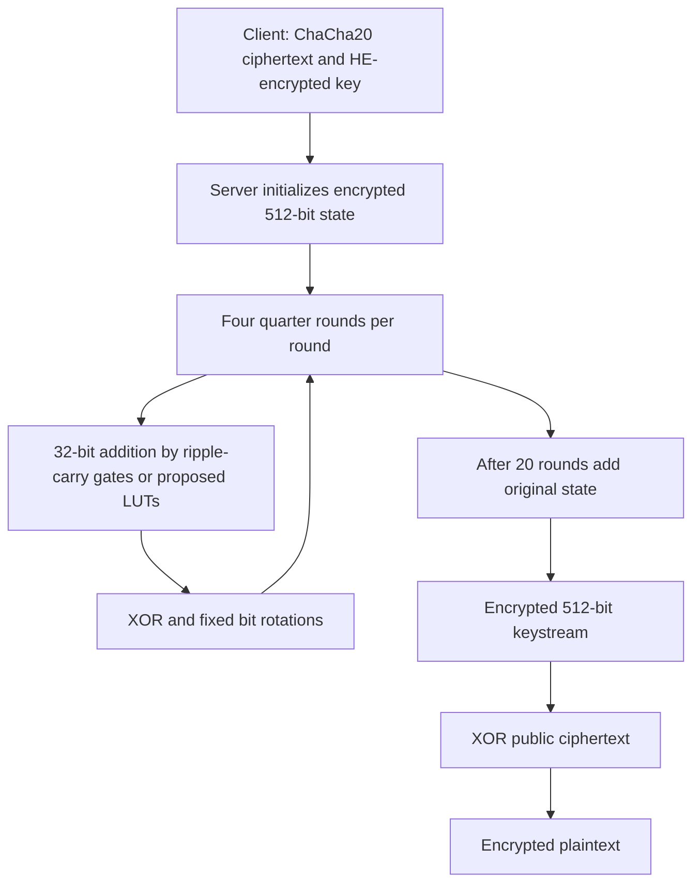

---
# Summary
## 1. Problem
ChaCha20 is a widely deployed alternative to AES, but its repeated 32-bit additions are costly under bitwise TFHE. This paper investigates whether small multi-input lookup tables and representation-aware XORs make its 512-bit keystream blocks competitive for transciphering.

## 2. Main Contribution
An implemented **bitwise baseline** and analytical proposals using 2-bit and 3-bit LUTs with multi-value bootstrapping (MVPBS). The best proposed result is **238.08 seconds per 512-bit block**, estimated from bootstrap counts and previously published unit timings. The optimized 3-LUT cipher is future implementation work, not a measured end-to-end result.

## 3. Main Techniques
- Use ripple-carry adders (RCA) for 32-bit addition modulo $2^{32}$.
- Perform fixed rotations by reordering separately encrypted bits, with no bootstrapping.
- Use a 3-input LUT to compute both sum and next-carry bits from $(x_i,c_i,y_i)$, sharing a bootstrap through MVPBS.
- Obtain a **scaled XOR** through linear operations on torus ciphertexts, then try to absorb the changed representation into the following adder's input packing.
- Distinguish the first two and last two lines of each quarter round: scaled XOR is not directly composable, so the proposed schedule still pays for two 32-bit XORs per quarter round.

## 4. Threat Model and Assumptions
Client encrypts data with ChaCha20 and supplies an HE encryption of the 256-bit key. Server generates the encrypted keystream using public nonce/counter information, then XORs it with the public symmetric ciphertext to obtain encrypted plaintext. Nonce/counter inputs must not repeat under a key.

The HE layer relies on the selected LWE/RLWE assumptions and parameters. A 256-bit symmetric key is not itself evidence that the complete HE system offers 256-bit security. The short paper does not supply a complete parameter/error table or a security proof for every proposed representation transition. No Poly1305 authentication or malicious-server verification is implemented by this construction.

## 5. Important Qualifications
- **Measured versus estimated:** the implemented binary version takes 758.29 s on the stated machine; Table 1's 704 s is the estimate $64000\times0.011$. The proposed 2-/3-LUT versions are estimates only.
- **Quarter-round typo:** the final line prints $d=(b\ll7)$; standard ChaCha20 updates **$b=\operatorname{ROL}_7(b)$**. The scheme below uses that correction.
- **Feed-forward:** the final state is added wordwise to the entire initial 512-bit state, not just to the secret key, despite the loose wording in §3.1.
- **Packing inconsistency:** §3.3 uses $x_i+2^ty_i$ with $t=2$, but the following two-input packing requires weight 2, while later steps explicitly use 2. In §3.4, step 1 again uses $2^t$ for $t=3$, whereas step 2 describes $x_i+2c_i+4y_i$. Those expressions are not equal. The free-XOR output is scaled by $2^t$, so it cannot simply be treated as an ordinary bit or a weight-2/weight-4 input without a justified conversion or appropriate full-domain LUT behavior. The optimized construction needs an implementation-level encoding check; the operation counts alone do not establish correctness.
- A usual padded TFHE PBS has negacyclic/domain restrictions; the preliminaries' statement about evaluating arbitrary LUTs abstracts these away. Resolving the scaled-XOR case must respect those restrictions.
- Table 1 throughput values are **bits/s**: $512/238.08\approx2.15$ bit/s. They must not be interpreted as kilobits/s.
- The prose says to divide latency by bits to obtain throughput; the correct formula is **bits divided by seconds**. Its numerical table follows the latter.
- The roughly 2× throughput comparison is against the selected 2023 AES full-LUT baseline, using timings sourced from that work. It is not a same-host measured comparison against every 2025 AES implementation.
- The paper's blanket description of AES-128 as “insecure” post-quantum is too broad. A key-search security target and practical attack feasibility are separate issues; no such claim is needed for its cost analysis.

## 6. Evaluation Setup
Implemented binary version: Rust/TFHE-rs; Apple M2 at 3.49 GHz, 8 GB RAM, macOS Sequoia 15.3.2. Boolean bootstrap averages 0.011 s. [Source referenced by the paper](https://github.com/gabijacob/ETC); not independently rerun here.

| ChaCha representation | Count per 512-bit block | Unit bootstrap time used | Estimated latency | Estimated throughput | Full cipher implemented? |
|---|---:|---:|---:|---:|---|
| Binary | 64000 | 0.011 s, local measurement | 704.00 s | 0.727 bit/s | Yes; measured total 758.29 s |
| 2-LUT | 37040 | 0.007 s, cited work | 259.28 s | 1.97 bit/s | No |
| 3-LUT | 15872 | 0.015 s, cited work | 238.08 s | 2.15 bit/s | No |

The selected AES 4-LUT baseline uses 4224 bootstrappings, estimated 122.50 s per 128-bit block, about 1.045 bit/s. ChaCha's estimated latency is 1.94× higher, while its block is four times larger, producing the 2.06× throughput ratio (§4, Table 1). The 3-LUT latency corresponds to only about 0.269 bytes/s.

The conclusion that 4-LUTs do not reduce counts applies to the paper's one-bit-at-a-time RCA schedule, not every conceivable chunked adder design.

---
# Main Scheme
## Title
TFHE ChaCha20 with ripple-carry addition and proposed multi-output LUT optimizations.

### 1. Notation
- $[x]$: LWE ciphertext of a bit under a specified scale.
- $q$: torus modulus; $\Delta=q/2^{t+1}$ for the padded encoding used in §3.2.
- $a,b,c,d$: 32-bit quarter-round words; additions are modulo $2^{32}$.
- $c_i$: carry into bit $i$, with $c_0=0$.

### 2. ChaCha20 quarter round
Use the standard recurrence (correcting the PDF's final-variable typo):
$$
\begin{aligned}
a&\leftarrow a+b;&d&\leftarrow\operatorname{ROL}_{16}(d\oplus a),\\
c&\leftarrow c+d;&b&\leftarrow\operatorname{ROL}_{12}(b\oplus c),\\
a&\leftarrow a+b;&d&\leftarrow\operatorname{ROL}_{8}(d\oplus a),\\
c&\leftarrow c+d;&b&\leftarrow\operatorname{ROL}_{7}(b\oplus c).
\end{aligned}
$$
Twenty rounds apply four quarter rounds each, alternating column and diagonal arrangements: **80 quarter rounds total**. Add the original state wordwise to the final working state to produce a 512-bit keystream block.

### 3. Bitwise baseline
For every bit position:
$$
s_i=x_i\oplus y_i\oplus c_i,
$$
$$
c_{i+1}=(x_i\land y_i)\lor(c_i\land(x_i\oplus y_i)).
$$
The baseline counts five bootstrapped gates per bit, 160 per 32-bit addition, and 32 per word XOR. Each quarter round costs $4(160+32)=768$. Feed-forward adds $16\times160=2560$, giving
$$
80\times768+2560=64000.
$$
This count follows the reported unoptimized schedule, including gates a specialized implementation might omit at boundary bits or for public state words.

### 4. Proposed LUT adders
For ordinary input-bit encodings, a 3-input index can be packed as
$$
u_i=x_i+2c_i+4y_i\in\{0,\ldots,7\}.
$$
A multi-output LUT returns
$$
f_s(u_i)=(x_i+y_i+c_i)\bmod2,\qquad
f_c(u_i)=\lfloor(x_i+y_i+c_i)/2\rfloor.
$$
This gives 32 MVPBS calls per 32-bit addition under the proposed cost model. Each quarter round then counts $4\times32+2\times32=192$ calls, and feed-forward costs 512, giving
$$
80\times192+512=15872.
$$
The 2-LUT proposal uses three calls per bit except the last carry, giving $31\times3+2=95$ per addition, $4\times95+64=444$ per quarter round, and $80\times444+16\times95=37040$ total. These are **proposed counts conditional on correct representation transitions**, including the unresolved scaled-XOR packing described above.

### 5. Scaled XOR mechanism and boundary
If two input ciphertexts encrypt bits with scale $\Delta$, their coefficientwise sum multiplied by $2^t$ has ideal phase
$$
2^t\Delta(x+y)=\frac q2(x+y)\pmod q.
$$
For equal bits the phase is zero; for unequal bits it is $q/2$. Thus it carries a parity bit **at a different scale/encoding**, and the noise is multiplied by $2^t$. This identity is valid, but the result is not automatically a standard small-domain PBS input. Do not infer a complete composable adder from this identity alone.

### 6. Plaintext recovery
Once standard-encoded encrypted keystream bits are available, combine them with public ciphertext bits. Public-bit XOR can be implemented by retaining or complementing the encrypted bit under the selected encoding. The result remains encrypted for downstream computation.

## Protocol

---
# Questions
- How should the conflicting $2^t$, 2 and 4 packing weights be reconciled in a working 2-/3-LUT implementation?
- Which PBS variant handles the scaled XOR's two half-torus positions, at what additional cost and error?
- Do measured optimized runtimes preserve the estimate when MVPBS extraction and representation conversions are included?
- How do carry-lookahead or chunked adders change latency and parallelism?
- What complete HE parameters and whole-cipher failure target accompany a reproducible comparison?

---
# Related Topics
- [[020 - XBOOT - Free-XOR Gates for CKKS with Applications to Transciphering]]
- [[012 - At Last! A Homomorphic AES Evaluation in Less than 30 Seconds by Means of TFHE]]
- [[000 - Transciphering HE]]
- ARX ciphers, ripple-carry adders and multi-value bootstrapping
