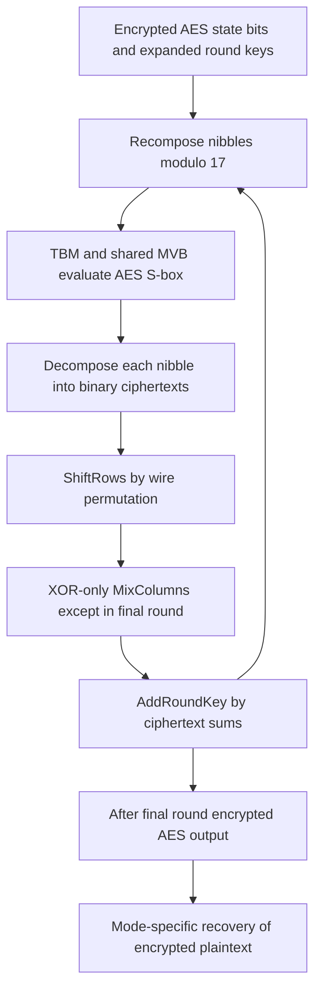

---
# Summary
## 1. Problem
AES mixes byte-oriented nonlinear substitution with bitwise XOR-linear diffusion. A pure integer/LUT TFHE implementation handles the S-box well but pays heavily for XORs; a pure Boolean implementation makes XOR cheap but needs an expensive S-box circuit. The problem is to switch representations cheaply enough to combine their strengths.

## 2. Main Contribution
**Hippogryph** alternates nibble-based LUT evaluation with binary linear computation. Its key contribution is a compatible pair of decomposition/recomposition procedures using **odd plaintext modulus 17** for nibbles and the unpadded binary encoding for bits.

The local 24-page PDF is dated **27 March 2025**. Its title is *Further Improvements in AES Execution over TFHE*; the vault filename retains the longer “Towards Breaking the 1 sec Barrier” wording. It reports **32 s single-core**, **4.6 s on six laptop cores**, and **1.1 s on 32 server cores**, for the faster $2^{-40}$ bootstrapping-failure parameter set. The stricter $2^{-128}$ set takes **463 s single-core**. It does not report a measured sub-second execution.

## 3. Main Techniques
### Two representations
- Nibbles use canonical $(16,17)$ encoding: $m\in\{0,\ldots,15\}$ is represented by residue $m\bmod17$.
- Bits use $(2,2)$ encoding: torus phases $0$ and $1/2$. Adding ciphertexts implements XOR modulo two; noise still grows.

SubBytes uses the tree-based method (TBM) on two encrypted nibbles, sharing the first-stage blind rotation through multi-value bootstrapping (MVB). ShiftRows is a wire permutation; MixColumns and AddRoundKey use Boolean XOR circuits and native ciphertext addition.

### Decomposer
For each encrypted output nibble, one MVB produces its four bit ciphertexts directly in the binary encoding. Bit extraction and modulus/encoding conversion are combined. “One MVB” means a shared blind rotation plus the necessary output processing, not four outputs at literally zero marginal cost.

### Recomposer
Unpadded binary inputs occupy antipodal torus points, so a single ordinary PBS must produce opposite output values. Odd modulus permits division by two, allowing an affine offset after PBS to turn opposite values into the desired $0$ and $2^i$ digit weights. Four such PBS operations and a sum reconstruct a nibble in modulus 17. The explicit algebra is given below.

### Why odd modulus matters
For the specified one-PBS-per-bit plus affine-linear design, reconstructing the least significant bit requires solving $2b=1\bmod p$. This requires odd $p$. The result is a restriction on that construction; it is not an impossibility theorem for every conceivable binary-to-integer conversion with even plaintext modulus.

## 4. Threat Model and Assumptions
The server evaluates AES using HE-encrypted round keys; the client may expand the AES key before encrypting all eleven round keys. Confidentiality relies on the AES key and chosen TFHE parameters/evaluation keys. The reported lattice-security target is approximately 128 bits.

The paper studies AES circuit evaluation, not a complete authenticated mode or proof of correct outsourced computation. In a CTR deployment, the server evaluates forward AES on public unique counters; inverse AES is a separate circuit choice for other modes.

The authors discuss CPAD/decryption-feedback attacks and give a stricter numerical-failure parameter set. A per-bootstrap failure target is distinct from a full protocol proof against all decryption-feedback attacks. Repeated operations and adversarial access patterns still need to be accounted for by a deployment.

## 5. Important Qualifications
- **Key expansion is excluded from the main timings.** Eleven encrypted round keys are assumed available. The authors separately implemented homomorphic key expansion and say it is about 20% faster than the main cipher, but do not include it in 32 s.
- **Same-machine exception:** the paper reruns/reconstructs earlier methods, but Thunderbird's 46 s entry remains its original published number. Their reconstruction gave 60 s and did not successfully reproduce the improved circuit-bootstrap component; theoretical speedup was used for that part. Do not call the 46 s result a measured same-machine run.
- The memory estimate of approximately **74 Mbit** counts state and encrypted round keys (roughly 1536 LWE ciphertexts at 755×64 bits). It does not establish total process memory: bootstrapping/key-switch keys, LUT accumulators, temporaries and library overhead are additional.
- Failure probabilities in Tables 2/4 are described as bootstrapping error targets. They must not be presented as automatically equal to whole-AES failure probabilities.
- The introductory claim that AES will be selected by NIST is contextual wording in the 2025 PDF, not a current-status claim in these notes.
- **Recomposer notation is inconsistent in the PDF:** the displayed intermediate map says $0\mapsto0$, $1\mapsto2^{i+1}$, whereas the intended canonical reconstruction uses digit weights $2^i$. The subsequent proof also first analyzes the least significant bit. Use the explicit, checked opposite-output-and-offset construction below rather than copying those formulas as executable instructions.
- “Free” XOR means native addition under the binary encoding, with noise growth. The reason noise remains manageable is the chosen circuit and refresh/conversion schedule, not unlimited addition capacity.

## 6. Evaluation Setup
Main host: Intel Core i7-12700H laptop, 64 GiB RAM, Ubuntu 22.04.2. Hippogryph uses a tfhe-rs fork with odd plaintext-modulus support; comparison methods also use TFHElib and TFHEpp. Parallel implementation uses Rayon. Server: AMD Ryzen Threadripper PRO 7995WX, 96 physical cores, **32 cores used** for the reported result.

| Method | Library | Single-core time | Provenance |
|---|---|---:|---|
| Full-LUT TBM | TFHElib | 270 s | Test bench |
| Boolean p-encoding | tfhe-rs | 90 s | Test bench |
| Fregata | TFHEpp | 87 s | Original implementation rerun |
| Thunderbird | TFHEpp | 46 s | Original paper; incomplete reconstruction gave 60 s |
| Hippogryph | tfhe-rs | 32 s | New implementation |

Source: Tables 1 and 3, §5.1.2. Comparing 32 s with 46 s gives 1.44×; with 60 s gives 1.88×. These are different comparison bases.

| Hippogryph setup | Cores used | Bootstrapping-failure target | AES-block time |
|---|---:|---:|---:|
| Laptop | 1 | $2^{-40}$ | 32 s |
| Laptop | 1 | $2^{-128}$ | 463 s |
| Laptop | 6 | $2^{-40}$ | 4.6 s |
| Server | 32 | $2^{-40}$ | 1.1 s |

Source: Table 4. Parallelism accelerates operations **within one AES block**; this is not a SIMD batch throughput table.

Table 2's fast set has LWE dimension 754, ring degree 1024 and GLWE dimension 1; the stricter set uses 900, 4096 and 1. The PDF specifies decomposition/noise parameters as well; keep each complete set together rather than combining dimensions from one with noise from the other.

[Hippogryph implementation](https://github.com/CryptoExperts/Hippogryph) and [comparison test bench](https://github.com/daphnetrm/Benchmark-of-AES-Evaluation-with-TFHE) are linked by the paper; neither was independently rerun for these notes.

---
# Main Scheme
## Title
Mixed binary/nibble AES evaluation with modulus-17 recomposition and shared LUT bootstrapping.

### 1. Notation
- $[b]_2$: binary LWE ciphertext with ideal normalized phase $b/2$.
- $[m]_{17}$: LWE ciphertext encoding residue $m$ at normalized phase approximately $m/17$.
- $B=16h+l$: byte split into high/low nibbles.
- $w_i=2^i$, $i=0,1,2,3$: little-endian nibble weights.

### 2. Key and state preparation
Client expands the AES-128 key into eleven round keys and supplies their bitwise HE encryptions. Initial AddRoundKey is performed on bit ciphertexts, or with public-input affine operations in a CTR wrapper. Recompose nibbles as needed before the first SubBytes layer.

### 3. Nibble S-box
Precompute the two functions
$$
S_H(h,l)=\lfloor S(16h+l)/16\rfloor,\qquad
S_L(h,l)=S(16h+l)\bmod16.
$$
Evaluate them using two TBM outputs with a shared first-stage MVB. Inputs and outputs use modulus 17. This evaluates the standard AES S-box, rather than changing AES to an arithmetic-mod-17 cipher.

### 4. Decompose to binary
For each nibble $m$, evaluate the four digit functions
$$
f_i(m)=\left(\left\lfloor m/2^i\right\rfloor\bmod2\right),
$$
with outputs encoded directly under modulus two. MVB shares the blind rotation across these outputs. The unused residue 16 is outside the valid canonical-nibble input range; accumulator completion must still be defined consistently.

### 5. Binary linear circuit
Permute bit ciphertexts for ShiftRows, apply an XOR-only MixColumns circuit, and add encrypted round-key bits. Under $[b]_2$, ciphertext addition performs XOR. Omit MixColumns in the final AES round. Recomposition refreshes/casts the bits for the next nonlinear layer.

### 6. Checked recomposition formula
For odd $p=17$, let $r=2^{-1}\bmod17=9$. To reconstruct digit weight $w_i$, use a negacyclic PBS whose two ideal output residues are
$$
g_i(0)=-w_i r\pmod{17},\qquad
g_i(1)=+w_i r\pmod{17}.
$$
These are opposite residues, as required by the two antipodal binary input positions. Add the public residue $w_i r$ afterward. The result is
$$
g_i(b_i)+w_i r=w_i b_i\pmod{17}.
$$
For example, at $i=0$ the PBS outputs 8 or 9; adding 9 produces 0 or 1 modulo 17. Sum all four weighted outputs:
$$
[m]_{17}=\sum_{i=0}^{3}[w_i b_i]_{17},\qquad
m=\sum_i2^ib_i\in\{0,\ldots,15\}.
$$
This is the algebraic form of the paper's odd-modulus recomposition idea, with its inconsistent intermediate weights made explicit. It was checked for all 16 possible nibbles; it is not a new cryptographic security proof or a reproduced TFHE experiment.

## Protocol

---
# Questions
- What is the complete peak memory footprint including evaluation keys and intermediate accumulators?
- How should per-bootstrap failure targets be budgeted for the complete cipher and repeated server queries?
- Can the inconsistent recomposition display be reconciled against the implementation's precise torus conventions?
- How does a fully reproduced same-host Thunderbird implementation change the comparison?
- How much of the large strict-parameter slowdown can be recovered by a parameter search at the same error target?

---
# Related Topics
- [[006 - Development of Optimized Operations for Homomorphic Cryptography]]
- [[012 - At Last! A Homomorphic AES Evaluation in Less than 30 Seconds by Means of TFHE]]
- [[014 - Optimized Homomorphic Evaluation of Boolean Functions]]
- [[017 - AES Is Not Enough - the Block Ciphers Zoo Goes Homormorphic]]
- [[000 - Transciphering HE]]
