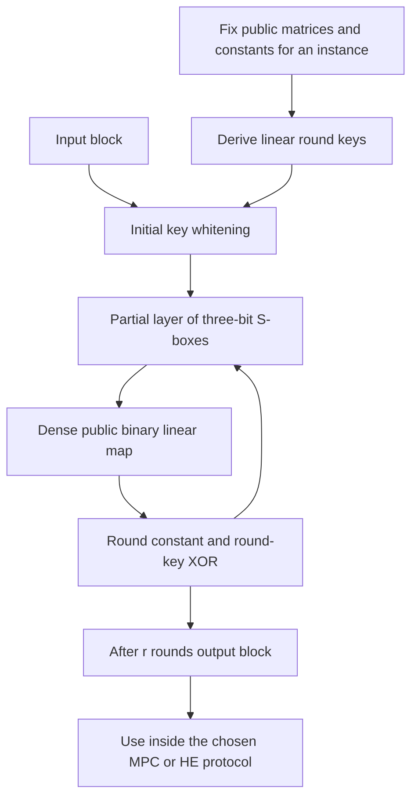

---
# Summary
## 1. Problem
Traditional block ciphers balance Boolean linear and nonlinear operations for ordinary hardware/software. In MPC, zero-knowledge proofs and many exact HE schemes, AND gates are much more expensive than XOR gates. This paper designs specifically for low **AND count** and **AND depth**, while checking whether these metrics predict real performance.

## 2. Main Contribution
**LowMC**, a parameterized SPN block-cipher family with a partial layer of small quadratic S-boxes, dense public binary diffusion matrices, affine round constants and a linear key schedule. Different instances trade round depth against total AND count and amortized cost per encrypted bit.

The local 30-page PDF is an **updated and extended version of the EUROCRYPT 2015 paper**, describing **LowMC v2**, with v0/v1 retained in appendices. Its later cryptanalysis discussion and v2 parameters must not be attributed to the original 2015 proceedings version unchanged.

## 3. Main Techniques
- Apply $m$ three-bit S-boxes to only $3m$ of $n$ state bits; leave the remaining bits unchanged in that substitution layer.
- Use a quadratic permutation with **three AND gates, all at depth one** per S-box.
- Diffuse the partially modified state using independently generated invertible $n\times n$ matrices over $\mathbb F_2$.
- Use public $n\times k$ full-rank matrices to derive round keys linearly from the $k$-bit master key.
- Choose round counts using estimates against differential/linear characteristics, boomerangs, higher-order and interpolation attacks.
- Accelerate dense linear maps with the method of the four Russians, reducing their addition count from $O(n^2)$ toward $O(n^2/\log n)$.

The headline metrics for the specified forward round circuit are
$$
\#\mathrm{AND}=3mr,\qquad \mathrm{ANDdepth}=r.
$$
The linear key schedule adds XOR work without increasing these AND metrics. This does not mean the key schedule or diffusion is costless in practice.

## 4. Threat Model and Assumptions
LowMC is a symmetric primitive intended for evaluation inside separately secure MPC/FHE/ZK protocols. A cipher's key-recovery/data-security targets, the HE security parameter and the MPC adversary model are separate choices.

The differential/linear analysis assumes independent uniformly random invertible linear layers fixed at instantiation. Concrete layers should be generated accountably, without malicious influence. The paper proposes a deterministic public generation procedure; it is not a secret keystream generator.

The evaluated MPC setting is **semi-honest GMW**. Its performance results do not measure a malicious-secure implementation. The HE experiments use **80-bit HE security**, even for a LowMC instance aimed at AES-like symmetric security.

The paper explicitly does **not** claim related-key security or justify using LowMC in keyless hash/compression settings. It also deliberately adds **no extra round security margin** beyond its attack-based estimates. These notes describe this PDF's claims, not a certification of current parameter security.

## 5. Important Qualifications
- **Version matters:** v0 omitted combined/boomerang considerations; v1's higher-order/interpolation bounds were insufficient. The local text discusses attacks and revises parameters to v2. Do not copy the faster obsolete appendix parameters as the proposed main instances.
- The statistical bound concerns the probability, over random cipher instantiation, of a **good characteristic** existing. It is not directly a bound on every differential, every linear hull, or arbitrary key recovery. The target $2^{-100}$ is an instantiation-risk threshold, not an HE failure probability.
- The algebraic-degree recurrence is an **upper bound**. Its near-tightness and sufficient diffusion are supported by heuristics and small-instance experiments, not a proof of a matching degree lower bound for all full-size instances.
- Lower AND count/depth does not always reduce elapsed time. Dense XOR layers make LowMC slower for single-block LAN MPC; reduced interaction depth helps in the WAN, and reduced communication helps large batches.
- MPC benchmarks exclude key scheduling and input expanded round keys. **HE benchmarks include homomorphic linear key derivation.** This distinction is easy to miss when comparing tables.
- The HE 854 s and 217.7 s figures are whole-batch times; 1.6945 s and 0.3629 s are amortized per-block costs. They are not single-block latencies.
- The prose around AES gate counts mixes parenthetical key-schedule S-box counts with totals that exclude scheduling. Table 2 explicitly excludes key schedules; use that boundary consistently.
- Appendix G's row-major indexing for rectangular key matrices uses the state-width stride in its displayed text; an implementation must use a consistent $n\times k$ layout and the reference implementation's conventions rather than copying that expression blindly.

## 6. Evaluation Setup
### Representative v2 circuit instances
From Table 1; $d$ is the logarithmic allowed data-complexity target, not an HE slot dimension.

| Block $n$ | S-boxes $m$ | Key $k$ | Data target $d$ | Rounds $r$ | ANDs | ANDs per bit |
|---:|---:|---:|---:|---:|---:|---:|
| 256 | 49 | 80 | 64 | 12 | 1764 | 6.89 |
| 256 | 63 | 128 | 128 | 14 | 2646 | 10.34 |
| 128 | 1 | 128 | 128 | 252 | 756 | 5.91 |
| 1024 | 10 | 128 | 128 | 92 | 2760 | 2.70 |
| 512 | 66 | 256 | 256 | 18 | 3564 | 6.96 |

These illustrate the cost trade-off; they are not interchangeable security recommendations.

### MPC
ABY/GMW with OT extension; two Intel Haswell i7-4770K machines at 3.5 GHz, 16 GB RAM each, Gigabit LAN. LAN latency 0.2 ms; WAN latency 50 ms simulated with `tc`. Precomputed round keys are inputs.

For the long-term-security single-block comparison (Table 6), total LAN times are AES 0.009 s, SIMON 0.012 s, LowMC 0.040 s; WAN times are 4.06, 6.86 and 1.49 s respectively. These block ciphers have different block sizes, so the single-call table is not an equal-bit-volume benchmark.

For **12.8 Mbit** of data (Table 7), long-term-security total LAN/WAN times are AES 102.85/202.85 s, SIMON 74.38/94.84 s, LowMC 23.70/25.29 s. Communication is 16, 13 and 1.1 GB respectively. These are MPC results, not HE transciphering rates.

### HE
BGV/HElib on Intel i7-4850HQ at 2.30 GHz; 80-bit HE security; state/key bits represented as separate HE ciphertexts carrying many blocks in SIMD slots. LowMC commit `f6a086e`, HElib commit `be9d3785e` (Table 8).

| LowMC $(n,m,r)$ | SIMD blocks | Setup | Batch evaluation | S-box time | Key schedule time | Amortized block | Amortized bit |
|---|---:|---:|---:|---:|---:|---:|---:|
| (256,63,14) | 504 | 6.7 s | 854.0 s | 605.6 s | 2.2 s | 1.6945 s | 0.0066 s |
| (128,31,12) | 600 | 11.8 s | 217.7 s | 166.9 s | 0.6 s | 0.3629 s | 0.0028 s |

The same-host AES row in Table 9 is about 3 minutes for 120 blocks, 1.5 s/block, 0.0119 s/bit, excluding its key schedule. LowMC's larger block changes per-block comparisons, so use per-bit cost as well. Other historical comparator rows use different environments.

[Reference design code](https://github.com/tyti/lowmc) and the historical [HElib implementation](https://bitbucket.org/malb/lowmc-helib) are linked by the PDF. These implementations were not independently rerun here.

---
# Main Scheme
## Title
LowMC: partial quadratic substitution, fixed public binary diffusion, affine key addition.

### 1. Notation
- $n$: block width; $k$: key width; $m$: number of three-bit S-boxes per round; $r$: round count.
- $L_t\in\mathbb F_2^{n\times n}$: invertible fixed public diffusion matrix.
- $K_t\in\mathbb F_2^{n\times k}$: fixed full-rank public key matrix.
- $c_t\in\mathbb F_2^n$: fixed public round constant.
- $S_m$: parallel S-box on $3m$ bits, identity on the rest.

### 2. Accountable instantiation
Generate the public matrices and constants once for the chosen cipher instance, rejecting noninvertible diffusion matrices and key matrices of rank below $\min(n,k)$. The proposed public bit source is the Grain 80-bit LFSR recurrence
$$
a_{i+80}=a_{i+62}\oplus a_{i+51}\oplus a_{i+38}\oplus a_{i+23}\oplus a_{i+13}\oplus a_i.
$$
Initialize $a_0,\ldots,a_{79}$ to one and discard the next 160 generated bits, $a_{80},\ldots,a_{239}$. The first bit used is therefore $a_{240}$ (Appendix G, PDF p. 30). Self-shrink subsequent bits in pairs: if the first bit is one, output the second; otherwise discard both. Appendix G specifies generation order. Once fixed, these parameters are reused for all messages; unlike Rasta, the linear matrices are not regenerated for every nonce/counter.

### 3. Encryption
Derive $rk_t=K_tK$ over $\mathbb F_2$. Start with whitening
$$
s_0=P\oplus rk_0.
$$
For $t=1,\ldots,r$:
$$
s_t=L_tS_m(s_{t-1})\oplus c_t\oplus rk_t.
$$
Return $s_r$. For a three-bit input $(a,b,c)$, the nonlinear permutation is
$$
S(a,b,c)=(a\oplus bc,\ a\oplus b\oplus ac,\ a\oplus b\oplus c\oplus ab).
$$
All three products use the original input bits, so they are parallel. With ABC interpreted in the appendix's order, the S-box maps integers $0,1,2,3,4,5,6,7$ to $0,1,3,6,7,4,5,2$; it is a permutation.

### 4. Decryption and transciphering use
Invert the key/constant additions, invert $L_t$, and apply the inverse S-box layer in reverse round order, then undo initial whitening. Do not assume the forward S-box circuit is its own inverse.

A stream-style CTR wrapper instead evaluates forward LowMC on unique public counter blocks to produce encrypted keystream, then combines it with public symmetric ciphertext. The paper benchmarks the cipher and sketches hybrid use; it does not fully specify an authenticated mode. In exact HE over characteristic two, XOR is ciphertext addition and AND is multiplication, making the forward circuit's AND-depth schedule directly relevant.

### 5. Round-count rationale and limits
The local v2 recommendation has the form
$$
r\ge\max(r_{stat},r_{bmrg},r_{deg}+r_{diff})+r_{outer},
$$
with interpolation-based outer-round allowance. Degree propagation uses
$$
d_{t+1}\le\min(2d_t,\ m+d_t,\ n/2+d_t/2),
$$
in addition to the generic permutation-degree limit. This bounds how quickly degree **can** rise; it does not prove that a chosen instance achieves the bound. Partial substitution creates both the efficiency advantage and the need for careful higher-order/interpolation analysis.

## Protocol

---
# Questions
- Which later cryptanalytic results apply to the exact parameter/version under consideration?
- How should a concrete application choose a security margin beyond the paper's minimal attack-based round estimate?
- At what size does XOR-linear work dominate AND evaluation in the intended HE/MPC backend?
- How much does a full same-security HE comparison change the reported historical speedups?
- Can structured diffusion reduce cost while retaining adequate security and accountable generation?

---
# Related Topics
- [[027 - Rasta - A cipher with low ANDdepth and few ANDs per bit]]
- [[020 - XBOOT - Free-XOR Gates for CKKS with Applications to Transciphering]]
- [[000 - Transciphering HE]]
- Partial S-box layers, multiplicative complexity and algebraic cryptanalysis
- GMW, BGV and the method of the four Russians
