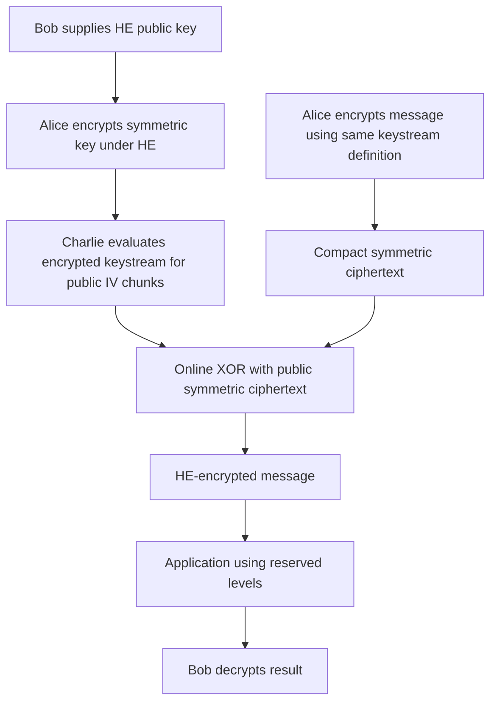

---
# Summary
## 1. Problem
Uploading directly encrypted HE data causes large communication expansion. A compact upload can instead contain an HE-encrypted symmetric key and stream-cipher ciphertext, but the server must pay to generate the encrypted keystream. This paper emphasizes separating that expensive **plaintext-independent offline work** from the inexpensive online plaintext recovery.

## 2. Main Contribution
A three-party compressed-encryption model and concrete Trivium/Kreyvium instantiations. **Kreyvium** modifies Trivium to accept a 128-bit key and 128-bit IV without adding nonlinear gates to each update. It extends the state with rotating key/IV registers that inject bits into the feedback and output functions.

The local 21-page paper corresponds to the work associated with FSE 2016; the vault's 2018 date should not be taken as the date at which its historical cryptanalysis claims were assessed. Those claims are described here as claims of this PDF, not current security recommendations.

## 3. Main Techniques
- Use additive stream encryption $C=M\oplus Z(K,IV)$ so online decompression is XOR with a precomputed HE-encrypted keystream.
- Restart a short keystream generator for successive public counter-derived IVs, keeping depth bounded per chunk instead of extending one long encrypted-state chain indefinitely.
- Exploit the long feedback delays in Trivium: three ANDs occur per clock, but their outputs take many clocks to reach subsequent nonlinear gates, so circuit depth grows much more slowly than clock count.
- Propagate public constants and public IV bits to avoid unnecessary encrypted operations.
- Evaluate SIMD instances under BGV/HElib, and use FV through the Armadillo compiler with multicore execution.
- Benchmark both minimal parameter depth and **seven extra levels**, preserving capacity for computation after decompression.

## 4. Threat Model and Assumptions
**Alice** holds data and chooses the symmetric key; **Bob** holds the HE secret key and supplies the public key; **Charlie** evaluates the decompression/application. Alice and Bob can be the same person but need not be.

Trivium has an 80-bit key/security target; Kreyvium targets 128 bits. Its design analysis examines state/key time-memory-data tradeoffs, internal-state collisions, cube attacks, conditional differential attacks and algebraic attacks. Enlarged state and continuous key injection are design arguments, not a reduction proving that Kreyvium is as secure as Trivium.

**Historical source claim (§2, PDF p. 5):** the authors identify a composition-proof gap because the adversary sees $\operatorname{HE}(K)$ in addition to the stream ciphertext, and explain why the cited CCA-secure KEM–DEM theorems do not directly apply. The paper does not provide a generic CPA proof for its practical Trivium/Kreyvium construction.

**Independent qualification:** that missing proof should not be read as a general obstruction to CPA composition. When HE keys and $K$ are generated independently, HE is IND-CPA secure including its public evaluation material, and the symmetric encryption meets its own CPA/nonce requirements, a standard encryption-of-zero hybrid handles the encrypted key. See the explicit argument in the scheme section below. PRF security **alone** says nothing about arbitrary key-dependent auxiliary information; HE IND-CPA is the additional assumption used here. This qualification supplies no new cryptanalysis of Trivium or Kreyvium and no CCA/CPAD or malicious-evaluator guarantee.

The separate exponentiation construction in Appendix D has a random-oracle proof under a special decision assumption that already includes the HE-encrypted exponent. That theorem does not prove the Trivium/Kreyvium instantiation secure.

IV/counter management must prevent keystream reuse **under the same key**. A fixed starting IV is compatible with the generic algorithm's fresh random key for each compressed encryption; reusing both key and the same IV sequence is not safe. The signature suggestion in the security discussion is an additional system mechanism, not built-in authentication.

## 5. Important Qualifications
- Expensive work can be done offline only after the necessary HE-encrypted key and public IV are available. It remains a resource cost and can still cause latency if preprocessing falls behind.
- Table 1's BGV runtimes process many SIMD generator instances together. Table 2's FV runtimes have a different evaluation/parallelization setting. Do not compare their seconds as though both represented the same number of output bits.
- **Depth is not a complete noise model.** The compared LowMC circuit theoretically has depth 12 but requires selected HE depths 13 in BGV and 14 in FV because its many additions also contribute noise.
- The LowMC comparator is the older attacked parameter set, explicitly labeled at most about 118-bit security in the PDF. It is not the revised v2 instance described in the vault's local LowMC paper.
- **Output-length notation needs care:** Propositions 1–2 and Appendix C display expressions such as $282\lfloor d/3\rfloor+81$ and $+70$. At depth 12 these give 1209 and 1198, whereas the reported usable outputs are 57 and 46 after discarding 1152 initialization clocks. Interpret usable lengths with the initialization offset; do not claim those formulas yield that many post-initialization keystream bits directly.
- Public/slot-encoded IV handling changes optimizations: depth-12 usable output is 57/46 bits for Trivium/Kreyvium in FV versus 45/42 in the BGV table. At depth 13 the respective entries are 136/125 versus 136/124.
- The pseudocode's final Kreyvium register has 44 IV bits, **66 ones and one zero**, totaling 111. The conditional-differential discussion's count of 64 forced ones does not match that initialization. The scheme below follows the explicit register lengths/pseudocode.
- Appendix D's discussion says fields of about “16000 elements” and “4 million elements”; its parameter $n$ is the **extension degree**, so $\mathbb F_{2^n}$ has $2^n$ elements. The intended representation sizes are about 16000 bits and millions of bits respectively.
- Compression ratios 1.08/1.16 for a 1 GB message are parameter-dependent examples, not universal overheads. HE key ciphertext size, batching and message length affect the ratio.

## 6. Evaluation Setup
Four AMD Opteron 6172 processors, 48 cores total, 64 GB RAM. BGV/HElib results use one core. FV/Armadillo results use either one core or all 48. Preserve the paper's different workloads and output lengths when comparing.

Selected **BGV SIMD** results from Table 1; throughput is **bits per minute**:

| Generator | Bits per instance | Used HE depth | SIMD slots | Total latency | Throughput |
|---|---:|---:|---:|---:|---:|
| Trivium-12 | 45 | 12 | 600 | 1417.4 s | 1143.0 bit/min |
| Trivium-12 | 45 | 19 | 720 | 4420.3 s | 439.8 bit/min |
| Kreyvium-12 | 42 | 12 | 504 | 1715.0 s | 740.5 bit/min |
| Kreyvium-12 | 42 | 19 | 756 | 4956.0 s | 384.4 bit/min |
| Kreyvium-13 | 124 | 13 | 682 | 3987.2 s | 1272.6 bit/min |
| Kreyvium-13 | 124 | 20 | 480 | 12450.8 s | 286.8 bit/min |

Selected **FV** results from Table 2:

| Generator | Output bits | Used HE depth | One core | 48 cores |
|---|---:|---:|---:|---:|
| Trivium-12 | 57 | 12 | 681.5 s | 26.8 s |
| Trivium-12 | 57 | 19 | 2097.1 s | 67.6 s |
| Kreyvium-12 | 46 | 12 | 904.4 s | 35.3 s |
| Kreyvium-12 | 46 | 19 | 2806.3 s | 82.4 s |
| Kreyvium-13 | 125 | 13 | 1318.6 s | 49.7 s |
| Kreyvium-13 | 125 | 20 | 3331.4 s | 97.9 s |

Depth-19/20 rows reserve seven extra levels. The FV compiler's parallel speedups are about 25–34× for these generators versus approximately 9–10× for LowMC; the authors attribute LowMC's weaker scaling to memory contention/allocation pressure.

Appendix A's FV depth-12 counts are 3237 AND / 15019 XOR for Trivium and 3311 AND / 18081 XOR for Kreyvium, after simplifications. These are not merely three times the full clock count, because public operations can be eliminated.

---
# Main Scheme
## Title
Compressed HE upload with offline Trivium/Kreyvium keystream generation and online public-ciphertext XOR.

### 1. Notation
- $(pk,sk)$: Bob's HE keys; $[x]=\operatorname{HE}_{pk}(x)$.
- $K$: Alice's symmetric key; $IV$: agreed public initialization input.
- $G(IV)$: public expansion to distinct per-chunk inputs $x_j$.
- $F_K(x_j)$: short keystream chunk of the length supported by the selected circuit depth.
- All state-update additions below are XOR; products are AND.

### 2. Upload and precomputation
Alice samples $K$ and forms
$$
Z=F_K(x_1)\Vert\cdots\Vert F_K(x_t),\qquad
C=M\oplus Z_{[0,|M|)}.
$$
Send $[K]$ and $C$, with the public IV/counter sequence agreed or transmitted. Charlie evaluates each $[F_K(x_j)]$ from $[K]$ and public $x_j$ before the data-dependent online stage. Distinct chunks can be evaluated independently.

When $C$ arrives, output
$$
[M]=[Z]\oplus C.
$$
In exact characteristic-two HE this is public-plaintext addition; it adds negligible multiplication depth. Reserve enough remaining HE capacity to evaluate the intended application, and send its result to Bob for decryption.

### 3. Kreyvium initialization
Maintain the Trivium core's registers of lengths 93, 84 and 111, indexed globally by $s_1,\ldots,s_{288}$, plus two rotating 128-bit registers $K^*,IV^*$:
$$
(s_1,\ldots,s_{93})=(K_0,\ldots,K_{92}),
$$
$$
(s_{94},\ldots,s_{177})=(IV_0,\ldots,IV_{83}),
$$
$$
(s_{178},\ldots,s_{288})=(IV_{84},\ldots,IV_{127},1^{66},0).
$$
Set $(K^*_{127},\ldots,K^*_0)=(K_0,\ldots,K_{127})$ and similarly for $IV^*$. The ordering matters: the initial injected key bit is $K_{127}$, not $K_0$.

Total state is **544 bits**. The public IV register contributes 128 public bits; the paper counts 416 potentially secret bits after initialization.

### 4. One Kreyvium clock
Using the old state throughout:
$$
t_1=s_{66}\oplus s_{93},\quad
t_2=s_{162}\oplus s_{177},\quad
t_3=s_{243}\oplus s_{288}\oplus K^*_0.
$$
After the 1152 discarded initialization clocks, output $z=t_1\oplus t_2\oplus t_3$. Then update feedback:
$$
u_1=t_1\oplus s_{91}s_{92}\oplus s_{171}\oplus IV^*_0,
$$
$$
u_2=t_2\oplus s_{175}s_{176}\oplus s_{264},\qquad
u_3=t_3\oplus s_{286}s_{287}\oplus s_{69}.
$$
Shift the first core register inserting $u_3$, the second inserting $u_1$, and the third inserting $u_2$. Rotate $K^*,IV^*$ by moving their old index-0 output to index 127, shifting all other entries down by one. Key injection into $t_3$ therefore affects **both output and feedback**; IV injection affects the first feedback equation. Omitting either changes the cipher.

### 5. Contrast with Trivium
Trivium uses an 80-bit key and IV, no extra rotating registers, and different initialization:
- first register: 80 key bits followed by 13 zeros;
- second: 80 IV bits followed by four zeros;
- third: 108 zeros followed by three ones.

Its $t_3$ has no extra key term, and $u_1$ no extra IV term. It also discards 1152 clocks. Kreyvium is not simply Trivium with a longer key placed into the same initialization.

### 6. Separate Appendix D construction
An alternative sets $F_K(h)=h^K$ in $\mathbb F_{2^n}$, deriving public $h$ values from a random IV through a random-oracle-modeled generator. Write
$$
h^K=\prod_{i=0}^{\ell_K-1}\big(h^{2^i}\big)^{K_i}.
$$
Each factor is selectable from public $1$ and $h^{2^i}$ by affine operations on $[K_i]$. A balanced tree of binary-field multiplications then has multiplicative depth at most $\lceil\log_2\ell_K\rceil$. Binary-field multiplication itself is bilinear in the represented bits, but has a large gate count.

Its decisional assumption distinguishes exponentiated random bases from random outputs **even given $[K]$**. This is stronger/more specialized than merely assuming ordinary discrete-log hardness. The authors estimate days of work for their conservative historical field parameters, despite the low depth. It is an instructive low-depth construction, not the practical benchmarked stream-cipher scheme.

### 7. Independent CPA composition check

Let $E_{pk}(K)$ be the uploaded HE ciphertext, $S_K(m_b)$ the symmetric challenge ciphertext, and $0^\ell$ a fixed dummy key-shaped message. For the basic CPA setting described above, consider:

$$
\begin{aligned}
(E_{pk}(K),S_K(m_0))
&\approx_c(E_{pk}(0^\ell),S_K(m_0))\\
&\approx_c(E_{pk}(0^\ell),S_K(m_1))\\
&\approx_c(E_{pk}(K),S_K(m_1)).
\end{aligned}
$$

The first and last hops use HE IND-CPA: the reduction samples $K$ itself and can generate the corresponding symmetric ciphertext. In the middle hop, the HE component is independent of $K$, so symmetric IND-CPA applies. For the paper's fresh-key stream wrapper, this middle step can instead follow from pseudorandom keystreams at distinct public inputs. Public decompression and evaluation can be simulated from the uploaded view and add no independent information. This is review reasoning about the basic composition, **not a proof supplied by this PDF**; decryption feedback, key-dependent setup beyond the HE assumption, and active security need their own analysis.

## Protocol

---
# Questions
- Does a concrete deployment satisfy the independent-key, HE-public-material, and symmetric nonce/security assumptions of the CPA hybrid above? Which additional guarantees are needed if decryption feedback or active attacks are allowed?
- How should IV allocation and offline inventory be managed across messages and multiple senders?
- Which maximum usable chunk lengths follow from the actual optimized circuit and HE backend, rather than a depth-only expression?
- What are the key-ciphertext size and amortization threshold for the intended message lengths?
- How much current hardware/backend improvement remains after requiring enough levels for the downstream application?

---
# Related Topics
- [[025 - Ciphers for MPC and FHE]]
- [[029 - Improved Filter Permutators for Efficient FHE - Better Instances and Implementations]]
- [[039 - Trivial Transciphering With Trivium and TFHE]]
- [[000 - Transciphering HE]]
- Offline/online transciphering, Trivium and HE security composition
