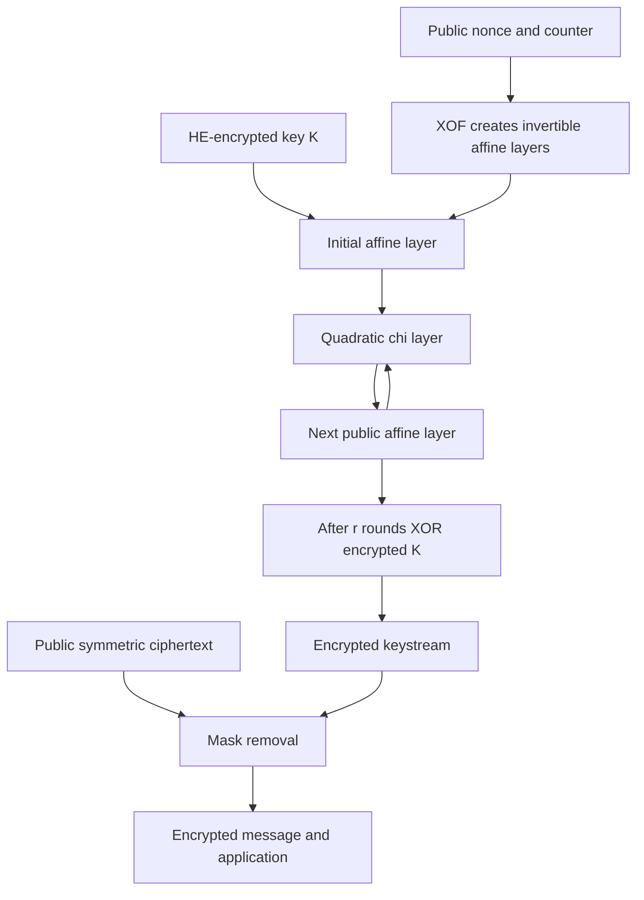

---
# Summary

Dobraunig et al. propose **Rasta**, a nonce-dependent stream-cipher design minimizing both AND depth and ANDs per output bit. Each stream block uses a fresh public affine/nonlinear permutation on the secret key, followed by key feed-forward. The local 36-page PDF is the CRYPTO 2018 version, including cryptanalytic appendices.

## 1. Problem
Low AND depth can reduce HE parameter sizes, while low AND count reduces encrypted evaluation work. Existing designs trade these metrics against one another. Rasta asks how small both can become when most of the changing cipher structure is derived from public nonce/counter data.

## 2. Main Contribution
- A family with $r$ AND levels and $r$ ANDs per output bit.
- Conservative parameter choices derived from monomial-count and linear-trail bounds (§3).
- **Agrasta**, smaller, more aggressive instances based on the attacks the authors can actually mount rather than the conservative bounds.
- HElib/BGV implementations, including configurations reserving seven further HE levels (§4).

The paper gives security evidence and parameter arguments, not a reduction to a standard hardness assumption.

## 3. Main Techniques
Generate new invertible binary matrices and affine constants for every nonce/counter pair. Alternating these maps with a full-state quadratic $\chi$ layer gives shallow nonlinearity without repeatedly exposing one fixed low-degree permutation at different secret inputs. An odd state length makes $\chi$ invertible.

Public XOF/matrix generation is outside the key-dependent nonlinear circuit, but still costs ordinary computation. Dense encrypted XOR layers are accelerated by the method of the four Russians.

## 4. Threat Model and Assumptions
The analysis considers key recovery from keystream for adversarially chosen nonce/counter pairs. An attacker can search the public XOF offline for unusually weak affine layers; the analysis explicitly considers this capability. XOF output is treated as random subject to reproducibility for repeated inputs.

Nonce/counter pairs must not repeat under a key. Related-key security is excluded; low degree makes some related-key attacks possible. The proposed data limit is approximately **$2^{s/2}/n$ stream blocks per key**, where $s$ is the target and $n$ the block width. Appendix C's 24-bit toy example gives $4096/193\approx21$ blocks, clarifying the fraction in the displayed limit.

HE confidentiality additionally relies on its selected parameters/evaluation keys. Rasta itself does not authenticate payloads or verify a server's computation.

## 5. Important Qualifications
- A key/state wider than $s$ bits is intentional: key length is not the claimed security strength.
- Two-/three-round parameter explorations are largely theoretical; the authors recommend at least four rounds because the analysis relies on diffusion.
- Agrasta's smaller parameters have a different security margin from conservative Rasta. Do not merge their claims.
- Monomial counts and sampled toy solvers support the design rationale but do not establish optimal attack costs for the full structured systems. Linear-trail bounds do not cover every linear hull.
- Public random matrices can dominate practical client cost despite adding no encrypted AND depth.
- The HE benchmark's **symmetric target and BGV estimate differ substantially**. Rows grouped under “128-bit cipher security” are not all 128-bit HE configurations.
- Trivium/Kreyvium/FLIP comparators in Tables 9–10 are extrapolated from earlier work, not all rerun on this machine.
- The source reports performance including public affine-layer generation. Key/evaluation setup and a complete downstream application are separate costs.

## 6. Evaluation Setup
HElib/BGV, state/key bits in separate ciphertexts with SIMD slots; Intel Core i7-4650U at 1.70 GHz, 8 GB RAM. Table 9 evaluates the cipher only; Table 10 reserves seven further levels.

Selected claimed-128-bit symmetric instances:

| Instance | Width | Rounds | ANDs/block | ANDs/bit |
| --- | ---: | ---: | ---: | ---: |
| Rasta | 1877 | 4 | 7508 | 4 |
| Rasta | 525 | 5 | 2625 | 5 |
| Rasta | 351 | 6 | 2106 | 6 |
| Agrasta | 129 | 4 | 516 | 4 |

Selected Table 9/10 measurements:

| Instance | Extra levels | Batch slots | Total time | Listed BGV security estimate |
| --- | ---: | ---: | ---: | ---: |
| Rasta-5, 525 bits | 0 | 330 | 464.5 s | 103.97 bits |
| Rasta-6, 351 bits | 0 | 600 | 815.0 s | 86.37 bits |
| Agrasta-4, 129 bits | 0 | 150 | 50.3 s | 117.38 bits |
| Rasta-5, 525 bits | 7 | 682 | 912.1 s | 90.39 bits |
| Rasta-6, 351 bits | 7 | 720 | 2018.6 s | 110.74 bits |
| Agrasta-4, 129 bits | 7 | 682 | 217.4 s | 127.50 bits |

These are batch latencies with different useful payloads. The source's unoptimized ordinary implementation reaches roughly 900,000–3,390,000 cycles/byte for its selected Rasta instances on an i5-4200U. This client cost motivates later linear-layer redesigns. Code reference: https://github.com/iaikkrypto/rasta; not rerun here.

---
# Main Scheme
## Title
Nonce-generated affine permutations surrounding quadratic full-state substitution.

### 1. Notation
- $K\in\mathbb F_2^n$: secret key and permutation input; $n$ odd.
- $\nu,i$: public nonce and block counter; $r$: nonlinear rounds.
- $A_{j,\nu,i}(x)=M_{j,\nu,i}x\oplus c_{j,\nu,i}$, with invertible $M_j$.
- $P_{\nu,i}$: public permutation determined by those maps.

### 2. Public instance generation
Seed the XOF with the agreed encoding of $(r,n,\nu,i)$. Generate invertible matrices and constants in the specified order. Reject singular matrices, using a common deterministic generation procedure on both parties. Invertibility prevents reduced state space and feed-forward leakage from a deficient final affine map.

### 3. Keystream generation
Apply
$$
P_{\nu,i}=A_r\circ\chi\circ A_{r-1}\circ\cdots\circ\chi\circ A_0,
$$
where indices of
$$
\chi(x)_j=x_j\oplus x_{j+2}\oplus x_{j+1}x_{j+2}
$$
are reduced modulo $n$. Form
$$
Z_i=K\oplus P_{\nu,i}(K),\qquad C_i=M_i\oplus Z_i.
$$
The feed-forward key, initial affine layer and final affine layer are part of the construction; omitting them changes the analyzed scheme. Each nonlinear layer has $n$ independent ANDs at depth one, so the stated circuit uses $rn$ ANDs and depth $r$.

### 4. Homomorphic evaluation
Client supplies encrypted key bits and compact symmetric ciphertexts. Server evaluates public affine maps by encrypted additions, $\chi$ products by HE multiplication, and the final key feed-forward. Public instance generation and encrypted keystream evaluation may precede payload arrival. XOR public $C_i$ with encrypted $Z_i$ to recover encrypted $M_i$, then spend any remaining HE capacity on the application.

## Protocol

---
# Questions
- Which later attacks affect conservative Rasta versus the exact Agrasta instance being considered?
- How do equal HE security and output-capacity requirements change these historical comparisons?
- How much matrix/XOF memory and client time can be removed without invalidating the random-layer analysis?
- What limits follow from many keys, adversarial nonce searches and the precise per-key data bound?

---
# Related Topics
- [[025 - Ciphers for MPC and FHE]]
- [[028 - Dasta – Alternative Linear Layer for Rasta]]
- [[020 - XBOOT - Free-XOR Gates for CKKS with Applications to Transciphering]]
- [[046 - Minimize the Randomness in Rasta-Like Designs - How Far Can We Go]]
- [[000 - Transciphering HE]]
