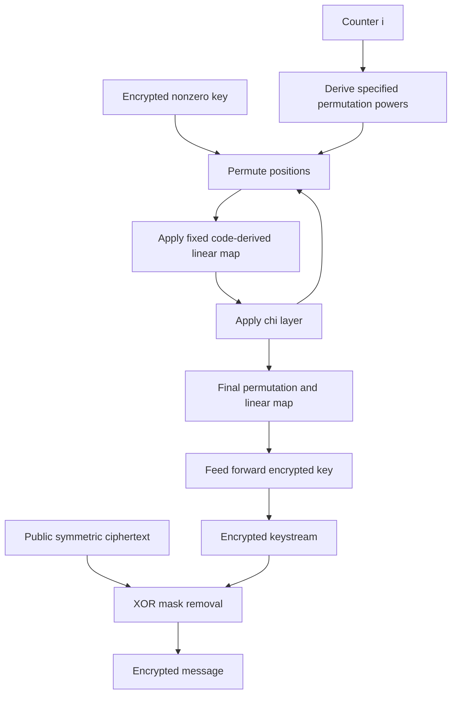

---
# Summary

Hebborn and Leander replace Rasta's newly generated affine matrices with a **fixed code-derived linear map and counter-dependent bit permutations**. Dasta retains the same AND depth and ANDs per output bit while eliminating per-block XOF/matrix generation. Source: ToSC 2020(3), pp.46–86, local 41-page PDF.

## 1. Problem
Rasta's shallow nonlinear circuit comes with expensive public matrix generation and dense XOR work. Simply replacing its random matrices by arbitrary fixed matrices invalidates the original random-layer security reasoning and may let chosen counters expose related weak instances.

## 2. Main Contribution
A deterministic family with the same principal widths/round counts as Rasta; code-based diffusion criteria; analysis of counter-permutation similarity, linear trails and probability-one subspace trails; and ordinary/HE implementation comparisons (§§3–7).

## 3. Main Techniques
Construct a systematic binary code with generator $G=(I_n\mid A)$ and set $L=A^T$. The code distance supplies a linear branch-number bound. Shortened/extended BCH codes produce concrete layers. A carefully chosen family of powers of one or two base permutations varies the effective linear maps between counters.

The improved $\chi$ input-mask correlation bound makes the required code distances attainable. Similarity analysis uses cycle lengths to bound the probability that two distinct permutations act identically on a uniform state.

## 4. Threat Model and Assumptions
The claimed stream indistinguishability advantage is bounded by $T/2^s$ for the specified counter space and data limit, as a **design claim supported by analysis**, not a reduction to an established assumption. Related-key security is not supplied. Each counter must be unique under a key; this specification uses a bounded counter rather than a freely interchangeable nonce interface.

The all-zero key is **invalid**: without round constants it produces an all-zero stream. Sample the key from the permitted nonzero space. Per-key output is bounded to roughly $2^{s/2}/n$ blocks (§3).

Similarity analysis assumes uniform-like intermediate states and strong independence across rounds. Linearization resistance assumes sufficiently rich ANFs, backed by small-state experiments. Neither assumption is a complete proof against every attack. HE additionally requires its own secure parameters and evaluation-key treatment; Dasta supplies no authentication or malicious-server verification.

## 5. Important Qualifications
- “No PRNG” concerns **per-block layer generation**. Some code-extension matrices are sampled during instantiation and then fixed.
- Permutation families and counter decomposition are part of the design. Arbitrary bit shuffles, repeated counters or a replacement matrix are not covered by the same analysis.
- BCH distance/branch-number results constrain linear trails; they do not alone bound every multi-trail attack.
- The no-nontrivial-subspace-trail result concerns the defined probability-one trail model over enough rounds. It is not a universal differential-security theorem.
- The roughly 200–400× improvement is **ordinary stream generation**. The homomorphic improvement is about 15–20%, since encrypted dense linear work remains expensive.
- Table 4's “amortized” milliseconds per encrypted bit divides one block's time by its bit count. It does not show that individual bits arrive at that latency, or establish a large SIMD-batch benchmark.
- The benchmark description lacks a complete uniform HE parameter/security/failure table. Do not infer that every row has a separately reproduced 128-bit HE estimate.

## 6. Evaluation Setup
HElib for homomorphic generation; Intel Xeon E3-1230 v6 at 3.50 GHz, 32 GB RAM. Tables 3–4 compare implementations on this host; detailed parallelism/statistical dispersion is not specified.

| Version | Width / rounds | Ordinary Rasta / Dasta (kB/s) | HE Rasta / Dasta (s/block) |
| --- | --- | ---: | ---: |
| 80-6 | 219 / 6 | 6.6 / 1291.3 | 10.83 / 8.47 |
| 80-4 | 327 / 4 | 6.3 / 1615.6 | 7.44 / 6.49 |
| 128-6 | 351 / 6 | 4.2 / 1325.5 | 15.41 / 12.07 |
| 128-5 | 525 / 5 | 3.3 / 1458.3 | 32.05 / 27.06 |

For example, $12.07/351\cdot1000\approx34.39$ ms per output bit reproduces Table 4. This is normalization of a block result. Source code: https://github.com/phil-hebborn/Dasta; not rerun here.

---
# Main Scheme
## Title
Fixed binary diffusion with code distance and counter-indexed permutation powers.

### 1. Notation
- $K\in\mathbb F_2^n\setminus\{0\}$: secret key; $i$: unused block counter.
- $P_{j,i}$: specified bit permutation for round position $j$ and counter $i$.
- $L$: fixed invertible binary linear map; $r$: nonlinear rounds.
- $\chi(x)_j=x_j+x_{j+2}+x_{j+1}x_{j+2}$, indices modulo odd $n$.

### 2. Instantiate fixed parameters
Choose the published version's code, extension matrix and base permutation cycles. For example, Dasta128-6 uses $n=351$, $r=6$, a code construction with guaranteed distance at least 45, and prescribed counter powers of a base permutation. Use the released concrete matrix; a distance bound does not uniquely specify it.

### 3. Generate stream and encrypt
Set $x=K$. For $j=0,\ldots,r-1$, compute
$$
x\leftarrow\chi(L(P_{j,i}(x))).
$$
Finish with
$$
Z_i=L(P_{r,i}(x))+K,\qquad C_i=M_i+Z_i.
$$
All additions are XOR. There are no affine round constants in the proposed Dasta construction. Each nonlinear layer uses $n$ ANDs at depth one, yielding $rn$ ANDs per stream block and depth $r$.

### 4. Similarity and diffusion checks
For a bit permutation $\pi$ on $n$ positions with $m$ cycles, a uniformly sampled $x\in\mathbb F_2^n$ satisfies
$$
\Pr[\pi(x)=x]=2^{m-n}.
$$
A power of a cycle of length $c$ splits into $\gcd(i,c)$ cycles, so
$$
\psi(\pi^i)=\sum_c(c-\gcd(i,c)).
$$
The chosen permutation families keep this measure sufficiently large across allowed counter differences. Combining probabilities across actual cipher rounds additionally uses the source's independence assumptions. The $L$ code-distance bound is invariant under input bit permutations, which permits a reusable diffusion argument.

### 5. Transciphering
The server applies the same maps to encrypted key bits. Bit permutations are wire rearrangements; the fixed $L$ is an encrypted XOR circuit; $\chi$ supplies the encrypted ANDs. Feed forward encrypted $K$, then XOR the resulting encrypted stream with public $C_i$ to recover encrypted $M_i$.

## Protocol

---
# Questions
- How robust is the similarity bound when actual intermediate states are correlated?
- Which later attacks address the exact fixed matrices and permutation families?
- How do matched HE parameters, full key memory and application headroom affect the performance gain?
- Can faster structured diffusion retain the code-distance and subspace-trail arguments?

---
# Related Topics
- [[027 - Rasta - A cipher with low ANDdepth and few ANDs per bit]]
- [[046 - Minimize the Randomness in Rasta-Like Designs - How Far Can We Go]]
- [[000 - Transciphering HE]]
