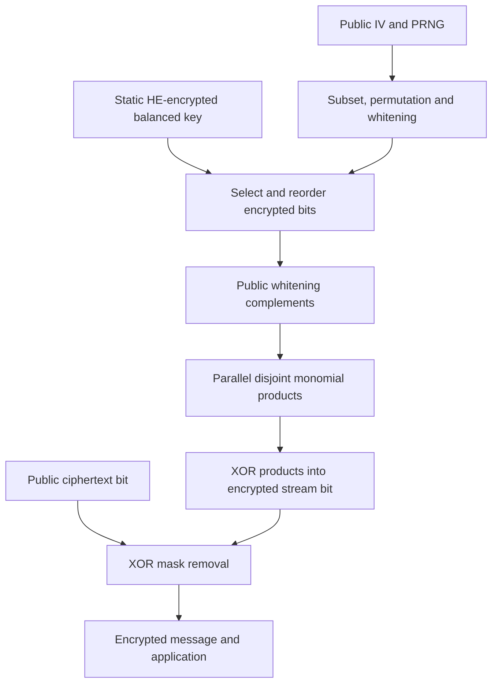

---
# Summary

Méaux, Carlet, Journault and Standaert introduce **improved filter permutators (IFPs)** and concrete **FiLIPDSM** instances. A larger static key register, public selection/permutation and public whitening make a shallow Boolean filter the entire key-dependent stream computation. The 22-page local source also argues for comparing post-transciphering noise at matched HE parameters.

## 1. Problem
Earlier FLIP instances suffered guess-and-determine attacks and restricted-input effects. Optimizing a cipher only for minimum decryptable HE latency can also leave no useful noise budget for the actual outsourced application.

## 2. Main Contribution
- Decouple key-register size $N$ from filter arity $n$ and add public input whitening (§3).
- Analyze bit-fixing descendants of filtering functions, including their probability under guessed key bits (§4).
- Instantiate filters as direct sums of disjoint monomials, FiLIPDSM (§5).
- Compare fixed-parameter output noise and separately report minimum-parameter timing (§6).

## 3. Main Techniques
The static register avoids a recurrent encrypted-state dependency. Public indexing chooses a subset and permutation of key bits; whitening complements selected bits without adding encrypted nonlinear depth. The DSM filter XORs monomials on disjoint variable sets, making degree, resiliency and descendant properties tractable.

A balanced multiplication tree evaluates a degree-$d$ monomial with $d-1$ ANDs and depth $\lceil\log_2d\rceil$. Larger register size changes attack probabilities without changing the filter's gate structure, but increases encrypted-key setup material.

## 4. Threat Model and Assumptions
The source considers a single-key setting and key-recovery/correlation/algebraic attacks, assuming unbiased public selection, permutation and whitening from the chosen PRNG. Concrete keys have weight exactly **$N/2$**. The public PRNG must follow its prescribed seeded process; adversarially supplying arbitrary filter inputs is not the analyzed model.

Security targets are conjectural estimates from attack costs and descendant criteria. The Goldreich-PRG connection is motivation, not a reduction certifying these finite parameters. HE security and evaluation-key assumptions remain separate. The construction supplies confidentiality-oriented stream masking, not authentication or malicious-server verification.

## 5. Important Qualifications
- FiLIP-1216 names the **filter arity**, not the key length: its key has 16,384 bits. FiLIP-1280 uses a 4096-bit register.
- The cost of storing an HE encryption of every key bit is much larger than the raw symmetric key. Register extension is not universally negligible for setup/upload.
- The comparison's negative noise values are **HElib log-ratio metrics**, not bits of security or decryption-failure exponents. More negative means less relative noise in this experiment.
- Fixed-parameter noise experiments and minimum-parameter latency experiments answer different questions; their figures cannot be combined into one configuration.
- The claim that a low-noise output permits more computation is meaningful, but the exact application still determines necessary operations and correctness headroom.
- The security-estimation algorithms simplify descendant families and use algebraic/correlation attack models. Their search results are not lower bounds against every possible attack or later cryptanalysis.
- Historical statements about third-generation HE incompatibility of other ciphers should not be read as universal impossibility claims for later evaluation strategies.

## 6. Evaluation Setup
HElib, Intel Core i5-4210M at 2.60 GHz (§6.2). Key schemes are compared at shared parameters in Tables 2–3, then individually minimized parameters in Table 4. Thread count and statistical dispersion are not fully specified.

| Instance | Filter variables $n$ | Key bits $N$ | Filter maximum degree | AND depth | Claimed target |
| --- | ---: | ---: | ---: | ---: | ---: |
| FiLIP-512 | 512 | 16384 | 4 | 2 | 80 bits |
| FiLIP-1216 | 1216 | 16384 | 8 | 3 | 128 bits |
| FiLIP-1280 | 1280 | 4096 | 16 | 4 | 128 bits |

In Table 3's common configuration, HElib reports 132.1-bit security, 512 slots, and fresh log-ratio −293.929:

| Cipher | First-output latency | Output log-ratio | After two extra multiplication levels |
| --- | ---: | ---: | ---: |
| Rasta-5, 525 bits | 1264.30 s | −185.885 | −148.313 |
| FiLIP-1216 | 251.28 s | −227.93 | −190.086 |
| FiLIP-1280 | 325.04 s | −208.112 | −169.011 |

Rasta yields a multi-bit block while FiLIP filters yield one bit per invocation, so this table is not an equal-output latency comparison. Table 4's separately minimized FiLIP-1216 configuration is **24.37 s**, with HElib estimate 186.3 bits and 150 slots; FiLIP-1280 is **26.59 s**, estimate 146.8 bits and 630 slots. These are historical implementation estimates, not independently reproduced current security assessments. No experiments were rerun here.

---
# Main Scheme
## Title
Static balanced key register with public subset/permutation/whitening and a DSM filter.

### 1. Notation
- $K\in\mathbb F_2^N$, $\mathrm{wt}(K)=N/2$: key.
- $S_i$: selection of $n$ distinct key positions; $P_i$: permutation; $w_i$: public whitening vector.
- $m_d$: number of disjoint degree-$d$ monomials in filter $F$.

### 2. Public schedule and masking
Initialize the prescribed public PRNG from the agreed IV. Each step generates $S_i,P_i,w_i$. Compute
$$
z_i=F(P_i(S_i(K))\oplus w_i),\qquad c_i=m_i\oplus z_i.
$$
The PRNG is ordinary public computation and is not evaluated under HE. Its required randomness and lifetime limits remain part of the construction.

### 3. DSM evaluation
For disjoint variable sets $I_{d,j}$ of size $d$,
$$
F(x)=\bigoplus_d\bigoplus_{j=1}^{m_d}\prod_{t\in I_{d,j}}x_t,
\qquad n=\sum_d d\,m_d.
$$
FiLIP-1216 uses $(m_1,m_2,m_4,m_8)=(128,64,80,80)$, giving 1216 inputs, **864 ANDs** with balanced depth three. FiLIP-1280 uses $(m_1,m_2,m_{16})=(128,64,64)$, giving 1280 inputs, **1024 ANDs** and depth four. These counts follow the ordinary disjoint-product circuit; backend timing also depends on additions, noise and key representation.

### 4. Transciphering and noise comparison
Client supplies HE-encrypted key bits and compact ciphertext bits. Server selects/reorders encrypted bits, applies public complements, evaluates $F$ and XORs public $c_i$ to obtain encrypted $m_i$. The key register is unchanged between bits, allowing independent filter evaluations.

For comparison, hold HE parameters fixed and inspect output noise plus the effect of one/two subsequent multiplication levels. Separately retune parameters if measuring the lowest possible transciphering-only latency. That retuning may change security, slots and downstream capacity.

## Protocol

---
# Questions
- What later attacks alter these exact DSM-instance claims?
- When does encrypted-key upload/storage outweigh the preserved application noise budget?
- How do the conclusions change with current parameters and the actual application's operation graph?
- Which PRNG/IV adversarial model is required for the concrete deployment?

---
# Related Topics
- [[030 - Transciphering, Using FiLIP and TFHE for an Efficient Delegation of Computation]]
- [[035 - Towards Case-Optimized Hybrid Homomorphic Encryption]]
- [[041 - Towards Practical Transciphering for FHE with Setup Independent of the Plaintext Space]]
- [[000 - Transciphering HE]]
