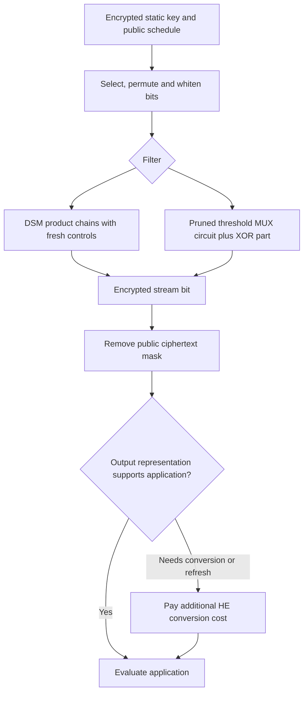

---
# Summary

Hoffmann, Méaux and Ricosset evaluate FiLIP with **leveled TGSW**, a **TGSW/ring-LWE hybrid**, and TFHE gate bootstrapping. They also give a compact circuit for symmetric Boolean filters, including FiLIP's XOR-threshold variant. The local source is the 24-page 2020 manuscript.

## 1. Problem
Second-generation HE favors low multiplication depth, but GSW-style multiplication has asymmetric noise growth. FiLIP's unchanged encrypted key provides fresh selector operands repeatedly, making it a useful test of this different cost model. A dense threshold-function ANF would be impractical to evaluate directly.

## 2. Main Contribution
- TGSW evaluation and noise bounds for DSM and XOR-threshold filters (§3).
- A one-hot Hamming-weight circuit and a pruned threshold circuit.
- Approximately 1.9 s per FiLIP-1216 output bit in the selected TGSW setup.
- A faster hybrid with about one second per bit but an output supporting only additive operations until conversion/refresh (§4.4).
- Time, encrypted-key size and measured noise comparisons.

## 3. Main Techniques
The public subset/permutation schedule and whitening leave only the filter to evaluate under HE. Order asymmetric products so a **fresh key ciphertext is the control/first operand** and the noisier accumulated result is the other operand. This avoids the multiplicative error behavior of multiplying two unrestricted noisy intermediates.

Symmetric Boolean functions depend only on Hamming weight. Dynamic one-hot indicators compute that weight using MUX gates; threshold-specific pruning avoids irrelevant outputs. This replaces the enormous ANF of majority on 63 bits with a polynomial-size circuit.

## 4. Threat Model and Assumptions
Client supplies encrypted FiLIP key bits; the server follows the public schedule to produce encrypted keystream and remove public ciphertext masks. FiLIP's symmetric-security claims are inherited from the selected instances. HE parameters target at least 128-bit estimated security.

Noise-variance bounds assume independent concentrated/subgaussian errors. The stated $2^{-128}$ decryption-failure goal is **inferred from a tail model**, not observed empirically in roughly 100 ciphertext samples. It is not a complete active-security or decryption-feedback proof. No authenticated-decryption or malicious-evaluator verification protocol is added.

## 5. Important Qualifications
- The source calls **ring-LWE ciphertexts “TLWE”**, unlike papers using TLWE for scalar torus LWE and TRLWE for the ring form. Keep that convention straight when comparing implementations.
- Table latencies are **seconds per stream bit**, not per byte or per large message.
- The fastest hybrid returns an additively homomorphic output. Its one-second result is not a freely multiplicatively composable FHE output at that cost.
- Even the chosen TGSW output has limited useful multiplication capacity: after filtering, both application operands may be noisy. Further conversion, larger parameters or bootstrapping can be necessary.
- Hundreds of MB or GB of encrypted key material are setup costs. Their feasibility depends on key reuse and server memory; raw symmetric key length is not the transmitted HE-key size.
- The BGV comparison uses earlier hardware/implementations and historical estimators. It compares different batching and output capabilities.
- §4.1's displayed $V_{max}=1/(1032B_g^2\ln2)$ agrees with the listed Set-1 value. For Set 2, $B_g=2$ gives about **$3.49\cdot10^{-4}$**, whereas prose/Table 1 print **$3.49\cdot10^{-5}$**. Retain this source inconsistency rather than treating both as the same derived bound.

## 6. Evaluation Setup
TFHE library, Intel Core i5-6600K at 3.50 GHz (§4.3); explicit RAM/thread details are not supplied for the timings. Torus arithmetic is represented with 32-bit words. Both sets use ring dimension 1024, ring-key dimension one and fresh noise $10^{-9}$:

| Set | Gadget base | Decomposition length |
| --- | ---: | ---: |
| 1 | 32 | 6 |
| 2 | 2 | 20 |

| Filter | Set-1 TGSW latency | Set-1 encrypted key | Set-2 TGSW latency | Set-2 encrypted key |
| --- | ---: | ---: | ---: | ---: |
| FiLIP-1280 | 2.2 s/bit | 200 MB | 22.7 s/bit | 800 MB |
| FiLIP-1216 | 1.9 s/bit | 800 MB | 20.0 s/bit | 2680 MB |
| FiLIP-144 | 2.5 s/bit | 800 MB | Not reported | Not reported |

Table 2 uses the source's “Mo” size label. Table 4 reports TGSW/hybrid/gate-bootstrap/BGV times of **2.2/1.2/25.8/26.7 s** for FiLIP-1280 and **1.9/1.0/22.7/24.4 s** for FiLIP-1216. The prose's 1018 ms/b figure should be read alongside these rounded hybrid rows, not as a uniform measured value for every instance.

Set-1 measured variances are $1.34\cdot10^{-10}$, $2.88\cdot10^{-10}$ and $7.19\cdot10^{-10}$ for 1280/1216/144 respectively. These are sample variance measurements, not direct validation of extremely rare failures. No benchmark was rerun here.

---
# Main Scheme
## Title
Fresh-selector TGSW filter evaluation and Hamming-weight automata.

### 1. Notation
- $K$: static FiLIP key; $x=P_i(S_i(K))\oplus w_i$: selected/whitened filter input.
- $\boxdot$: GGSW-style external product; $\boxtimes$: internal product.
- $T_{d,n}(y)=1$ when $\mathrm{wt}(y)\ge d$.
- $h_{t,j}$: indicator that the first $t$ inputs contain exactly $j$ ones.

### 2. Select inputs and evaluate DSM
Use public scheduling to obtain encrypted $x$ without updating the key register. For a DSM, compute each monomial by a chain with fresh key-derived factors in the favorable product position, then add all monomials. In the TGSW representation, integer message sums are decoded by parity as specified by the source; it is not the same encoding as every later binary TFHE gate scheme.

### 3. Evaluate threshold filters
Initialize $h_{0,0}=1$, with other indicators zero. The ideal recurrence is
$$
h_{t,j}=(1-x_t)h_{t-1,j}\oplus x_t h_{t-1,j-1}.
$$
This is a MUX controlled by fresh input $x_t$. Exactly one output indicator is one. A symmetric function is the XOR of the indicators for its accepted weights. For a threshold, collapse the accepted region and prune unused nodes, using the source's MUX/WUX construction.

FiLIP-144 evaluates
$$
F(x,y)=\bigoplus_{i=1}^{81}x_i\oplus T_{32,63}(y).
$$
Its threshold does not require explicitly enumerating all degree-32 monomials. WUX is $x_1x_3\oplus x_2$; it is used only where the threshold circuit's indicator invariant justifies it, not as a universal replacement for MUX.

### 4. Select output representation
All-TGSW evaluation preserves a GGSW-style output at substantial key size. The hybrid extracts a ring-LWE sample and uses GGSW-controlled external products, reducing work but ending in an additively homomorphic form. Gate bootstrapping instead refreshes Boolean gates at greater latency. Choose a path compatible with the following computation and include any required conversion cost.

Finally, XOR the public symmetric ciphertext bit with the encrypted filter result to obtain the encrypted message bit.

## Protocol

---
# Questions
- Which output form and noise budget does the downstream application actually need?
- Can the Set-2 maximum-variance discrepancy be reconciled with implementation parameters?
- How do correlated reused-key errors affect the variance heuristic?
- How much encrypted-key setup is amortized over the intended stream length?

---
# Related Topics
- [[029 - Improved Filter Permutators for Efficient FHE - Better Instances and Implementations]]
- [[041 - Towards Practical Transciphering for FHE with Setup Independent of the Plaintext Space]]
- [[037 - SortingHat - Efficient Private Decision Tree Evaluation via Homomorphic Encryption and Transciphering]]
- [[000 - Transciphering HE]]
