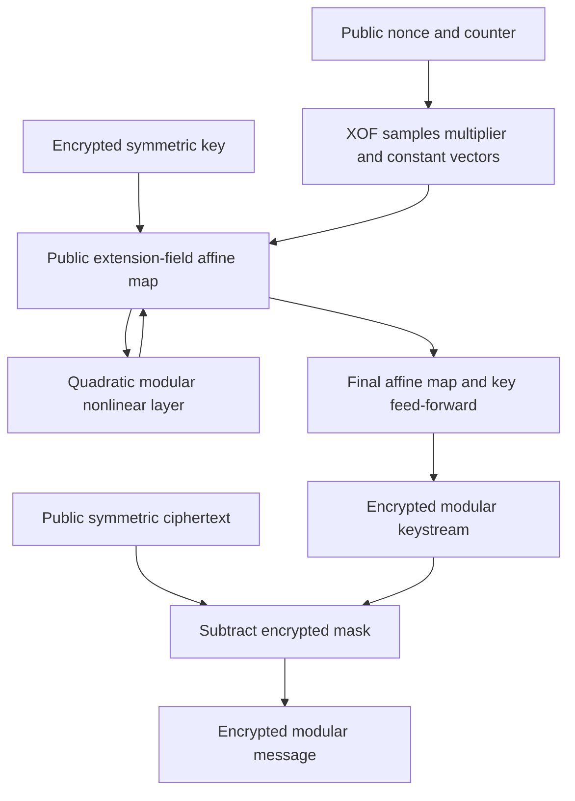

---
# Summary

Ha et al. propose **Masta**, a modular-arithmetic variant of Rasta using structured public affine maps derived from multiplication in an extension field. It targets BGV/FV packing over a prime plaintext modulus. Source: IEEE Access 8 (2020), pp.194741–194751, DOI 10.1109/ACCESS.2020.3033564. Tables stored as graphical outlines were checked visually in the local PDF.

## 1. Problem
Binary Rasta can have very low AND metrics but poor packing in common power-of-two HE rings and expensive per-block random-matrix generation. Masta seeks useful modular payload per slot and cheaper generation of invertible public maps.

## 2. Main Contribution
- Replace binary stream symbols by vectors over a prime field.
- Generate affine linear parts from multiplication by a nonzero extension-field element rather than a fully random matrix (§III).
- Use a quadratic modular analogue of Rasta's nonlinear layer.
- Implement client encryption and HElib transciphering, with both tight and extra-capacity parameters (§IV).

## 3. Main Techniques
Identify $\mathbb F_t^n$ with $\mathbb F_{t^n}$. A public multiplier $a\ne0$ induces an invertible $\mathbb F_t$-linear map; only $n$ field coefficients are needed instead of $n^2$. A binomial field polynomial makes its matrix simple to compute. Modular symbols exploit SIMD slots when $t\equiv1\pmod{2N}$ for the selected HE ring degree $N$.

The nonlinear layer remains quadratic, but arithmetic is modulo the odd prime $t$, not Boolean XOR/AND. Its properties cannot be inherited from binary Rasta merely by replacing symbols in a formula.

## 4. Threat Model and Assumptions
A client keeps symmetric and HE secret keys and gives the server an encrypted symmetric key plus compact ciphertexts. Nonce/counter pairs select public XOF-derived layers and must not repeat under a key.

The analysis models XOF outputs as independent random values and makes further assumptions on dense monomial growth and algebraic attack costs. Table 3 is a design recommendation against considered attacks, not a complete proof of security. The structured multiplication matrices are a much smaller family than all invertible matrices. Their security requires a separate argument.

The scheme provides no input authentication or malicious-evaluator verification. The local version's symmetric-security claims are historical; the note does not certify subsequent cryptanalytic status.

## 5. Important Qualifications
- The cipher's $n$ words and HE ring degree $N$ are different quantities. One modular word carries about $\log_2t$ bits.
- Selecting every multiplier coefficient nonzero, as assumed by the analysis, is stronger than simply choosing a nonzero extension-field element. Implementations must follow the actual sampling restrictions.
- The paper leaves the exact mapping from XOF bitstrings to public vectors unspecified. Interoperability needs an agreed complete encoding/sampling procedure.
- The modular nonlinear map is not asserted here to be a permutation. Stream masking does not require inverting that map.
- The large server-throughput improvement combines different packing opportunities, useful payloads and parameter choices; it is not just a constant-factor improvement to the same binary circuit.
- Client “throughput” is **cycles/byte**, so smaller is better. Server throughput is **bits/s**, so larger is better.
- Table 5(b)'s second Rasta-4 row repeats Eval **352.67 s**, while its printed affine/nonlinear times are **1481.06 + 16.58 s** and its rate is 1.31 bit/s. Those component/rate values point to about 1497.6 s, so that row needs clarification before reuse.

## 6. Evaluation Setup
C++17, GNU C++ 7.5.0, HElib 1.0.2; AMD Ryzen 7 2700X at 3.70 GHz, **single thread**, 64 GB RAM. SHAKE256 uses XKCP, with separately labeled naive/AVX2 implementations.

Selected claimed-128-bit instances at $t=65537$:

| Masta configuration | Client total, naive | Client total, AVX2/optimized | Optimized cycles/byte | HE time | HE throughput |
| --- | ---: | ---: | ---: | ---: | ---: |
| 6 rounds, 32 words | 135575 cycles | 22008 cycles | 343.88 | 137.42 s | 3815 bit/s |
| 7 rounds, 16 words | 76203 cycles | 11672 cycles | 364.75 | 95.13 s | 5511 bit/s |

Sources: visually inspected Tables 4 and 5(a). Both HE rows use $N=32768$; listed HE security estimates are 164.09 and 150.82 bits. Table 5(a)'s Rasta-5/525-bit and Rasta-6/351-bit rows instead give 1624.68/1826.01 s and 0.646/1.15 bit/s, with different slot usage and higher HE estimates. These are whole evaluated batch times, not single-message latency at matched payload.

The abstract's 505–592× client-throughput and 4792–6986× server-throughput ratios concern selected configurations in Table 1. They do not describe every optimized row. Setup/key upload and a downstream workload are outside the reported cipher timing. No benchmark was rerun here.

---
# Main Scheme
## Title
Rasta-style modular masking with extension-field-generated affine maps.

### 1. Notation
- $t$: prime plaintext modulus, selected experiments use $2^{16}+1$.
- $K,x\in\mathbb F_t^n$: secret key/state; $\nu,i$: nonce/counter.
- $f(X)=X^n-\alpha$: irreducible polynomial defining $\mathbb F_{t^n}$.
- $a_j,b_j$: XOF-derived multiplier and affine constant for layer $j$.

### 2. Generate public affine maps
For each layer, interpret state coefficients as an extension-field element and compute
$$
A_j(x)=a_jx\bmod f(X)+b_j.
$$
Multiplication by nonzero $a_j$ is an invertible linear operation on the coefficient vector. For the published $t=65537$ instances, the source uses $\alpha=3$ and power-of-two $n$, with the binomial irreducibility conditions stated in Theorem 1.

### 3. Generate and remove the mask
With indices modulo $n$, define
$$
\chi_t(x)_j=x_j+x_{j+2}+x_{j+1}x_{j+2}\pmod t.
$$
Evaluate
$$
Z_i=K+(A_r\circ\chi_t\circ A_{r-1}\circ\cdots\circ\chi_t\circ A_0)(K),
$$
then encrypt $C_i=M_i+Z_i\pmod t$.

The server evaluates the same circuit on HE-encrypted $K$, treating $a_j,b_j$ as public constants. Recover encrypted $M_i$ by **subtracting** the encrypted stream from public $C_i$. Unlike characteristic-two masking, adding it again would not cancel it.

### 4. Packing and computation boundary
Choose a prime modulus supporting the required HE slots. Arrange state words and blocks consistently with the selected implementation. Public extension-field multiplication becomes a linear map on ciphertext slots/words, with rotations and plaintext multiplications as needed; it is not a single free ciphertext operation. Reserve additional capacity if the application follows without refresh.

## Protocol

---
# Questions
- What later attacks apply to the exact round count, modulus and structured matrix family?
- How should the XOF sampling rules be completed for interoperable implementation?
- Which Table 5(b) Eval value is correct for the inconsistent Rasta row?
- How much of the gain remains for matched useful data, security and post-transciphering work?

---
# Related Topics
- [[027 - Rasta - A cipher with low ANDdepth and few ANDs per bit]]
- [[032 - Transciphering Framework for Approximate Homomorphic Encryption (Full Version)]]
- [[033 - Pasta - A Case for Hybrid Homomorphic Encryption]]
- [[000 - Transciphering HE]]
