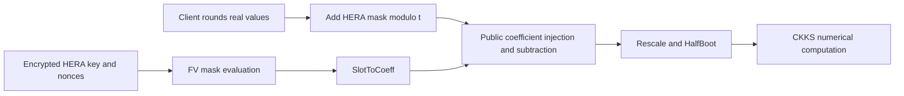

---
# Summary

## 1. Problem

Conventional transciphering recovers exact modular plaintexts under FV/BGV, whereas numerical applications need approximate CKKS slots. Encrypting directly with CKKS imposes substantial client computation and communication. This paper introduces **RtF**, a real-number-to-FV-to-CKKS conversion, and **HERA**, a word-oriented stream cipher tailored to its exact-arithmetic stage. Source: the local 46-page full version, especially §§3–5 and Appendices B–E; this is the HERA/RtF paper also developed in the thesis [[003 - On homomorphic encryption, transciphering frameworks, and he-friendly ciphers]].

## 2. Main Contribution

The client rounds and symmetrically encrypts real numbers. The server evaluates HERA in FV slots, moves the encrypted mask into polynomial coefficients, subtracts it from public ciphertext coefficients, and performs a shortened CKKS bootstrap. The resulting ciphertext contains approximate numerical slots and retains capacity for subsequent computation. This conversion depends on compatible FV/CKKS parameters and keys; it is not an arbitrary interchange between unrelated ciphertext formats.

HERA uses 16 prime-field words, a fixed inexpensive linear layer, coordinatewise cubes, and nonce-dependent multiplicative round-key masks. The paper recommends 4/5/6/7 rounds for its historical 80/128/192/256-bit symmetric targets when the prime modulus exceeds 2^16.

## 3. Main Techniques

**Coefficient injection:** FV evaluates many keystreams in SIMD slots, but the rounded messages enter as polynomial coefficients. `SlotToCoeff` reconciles these representations before subtraction. **HalfBoot:** ModRaise, SubSum, CoeffToSlot and EvalMod produce CKKS slots; omitting the final SlotToCoeff is intentional. **Randomized key schedule:** public XOF output multiplies each master-key coordinate, rather than merely adding round constants. **Fixed diffusion:** MixColumns and MixRows use the same small-entry 4×4 circulant matrix, avoiding distinct large plaintext matrices in every slot.

## 4. Threat Model and Assumptions

The server receives encrypted symmetric keys, nonces and symmetric ciphertexts, but no decryption secret. Confidentiality requires both the chosen HE parameters and HERA to be secure. HERA's analysis models the nonce XOF as a random oracle and permits adversarially chosen nonces, whose internal round masks consequently cannot be freely prescribed. Related-key and known-key attacks are excluded. The paper limits use per key to the birthday-scale 2^(λ/2) encryptions for λ-bit random nonces; nonce reuse must be prevented. This construction provides neither ciphertext authentication nor proof of correct server evaluation.

## 5. Important Qualifications

The algebraic analysis relies on expected dense monomial growth and semi-regularity assumptions for Gröbner-basis estimates. These are design arguments and attack estimates, not a reduction establishing HERA security. The LWE-like formulation in the linear-attack discussion is not an LWE security proof.

Before HalfBoot, rounding contributes at most 1/(2δ) per coefficient; correct FV decryption bounds the normalized evaluation error by another 1/(2δ). The resulting bound of 1/δ is **before** the approximate bootstrap. Table 1's HalfBoot precision is measured mean error, not a worst-case guarantee. Final precision cannot exceed the initial rounding precision log₂δ. Inverse-sine correction trades additional levels for reduced expansion.

The expansion formula log₂(t)/(p+1) excludes nonce transmission, encrypted-key setup and evaluation keys. A small expansion ratio does not imply small server latency or setup storage. Appendix E's tightly provisioned BGV ciphertexts have almost no post-transciphering capacity, unlike the main CKKS experiment.

## 6. Evaluation Setup

AMD Ryzen 7 2700X at 3.70 GHz, one thread, 64 GB RAM; Go 1.16.4/Lattigo for the server and C++17/GNU 7.5/AVX2 with XKCP SHAKE256 for the client. Code: [RtF implementation](https://github.com/KAIST-CryptLab/RtF-Transciphering). HE initialization and symmetric-key encryption are excluded as amortized setup.

Selected **Table 5** results, with N = 2^16 and the paper's 128-bit HE target:

| Symmetric parameter | CER | Client latency | Client throughput | Server offline / online latency | Server throughput | Precision |
|---|---:|---:|---:|---:|---:|---:|
| Par-128 | 1.54 | 1.599 µs | 21.73 MB/s | 128.7 / 19.00 s | 4.738 KB/s | 17.22 bits |
| Par-128a, inverse sine | 1.24 | 1.520 µs | 25.26 MB/s | 120.7 / 20.88 s | 5.077 KB/s | 19.13 bits |
| Par-128as, 16 slots | 1.23 | 1.520 µs | 25.26 MB/s | 84.02 / 14.31 s | 0.0019 KB/s | 19.35 bits |

Latency is measured until the **first** HE ciphertext is available; throughput includes all 16 outputs of row-wise packing. The small-slot variant reduces latency while sharply reducing throughput. Table 6 compares full-slot RtF at 147.68 s and 4.738 KB/s with a lower-precision LWE conversion at 89.61 s and 0.006 KB/s. Its additional 512-slot RtF case gives 117.71 s and 0.051 KB/s for a more comparable payload. The direct CKKS baseline needs no server conversion. The abstract's roughly 9,085× client latency and 17.8× throughput improvements refer to these particular direct-CKKS measurements, not universal speedups.

---
# Main Scheme

## Title

RtF conversion instantiated with HERA

### 1. Notation

Let t > 2^16 be prime with gcd(3,t−1)=1; k ∈ F_t^16; L = MixRows ∘ MixColumns; r the round count. Let a_i be nonzero-coordinate public XOF vectors and R_i(x)=x+k⊙a_i. Scaling δ maps bounded real messages to signed representatives modulo t. FV and CKKS share the ring and key pair.

### 2. Generate the HERA mask

Starting from ic=(1,2,…,16), evaluate

$$
z=R_r\circ L\circ\operatorname{Cube}\circ L\circ
(R_{r-1}\circ\operatorname{Cube}\circ L)\circ\cdots\circ
(R_1\circ\operatorname{Cube}\circ L)\circ R_0(ic).
$$

Each cube acts coordinatewise. The final extra linear layer is part of the design and must not be dropped. Nonce/counter encoding supplies separate XOF inputs for separate blocks.

### 3. Encrypt and convert

The client sends c=[round(δm)+z]_t and the public nonce. The server computes FV encryptions of z in slots, applies SlotToCoeff, forms the public coefficient polynomial C from c, and subtracts the encrypted mask from the trivial FV ciphertext (Δ_FV C,0). Rescale to level zero, then execute HalfBoot. Account for signed modular representatives, scaling and approximation error to interpret the resulting CKKS slots as m.

## Protocol

# Questions

- How much precision and post-conversion depth does the intended numerical workload require?
- Is full batching practical, or does its waiting time dominate the latency?
- Which subsequent cryptanalytic results affect the selected HERA parameters?

# Related Topics

- [[000 - Transciphering HE]]
- [[003 - On homomorphic encryption, transciphering frameworks, and he-friendly ciphers]]
- Exact-to-approximate conversion, CKKS bootstrapping, SIMD packing, randomized key schedules.
