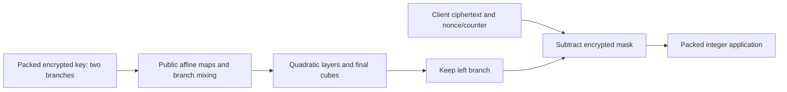

---
# Summary

## 1. Problem

A fast homomorphic symmetric decryption circuit does not necessarily yield an efficient application: integer arithmetic on Boolean ciphertexts may dominate the cost. **Pasta: A Case for Hybrid Homomorphic Encryption** evaluates the complete communication/computation tradeoff and proposes a prime-field stream cipher designed for packed BFV/BGV integer workloads. Source: local 43-page PDF, particularly §§4–9 and benchmark appendices B–C.

## 2. Main Contribution

Pasta combines two parallel branches, inexpensive triangular quadratic nonlinear layers, a final cube layer, nonce-dependent affine maps and truncation. Pasta-3 uses a 256-word key and outputs 128 field words; Pasta-4 uses a 64-word key and outputs 32 words. Both are proposed for a 128-bit symmetric target. Their ciphertext-ciphertext multiplication depths are respectively 4 and 5, with plaintext-ciphertext depths 6 and 8 in the packed implementation (Table 7).

The benchmarking framework compares symmetric decryption **and subsequent application evaluation**, using SEAL, HElib and TFHE. The result is workload dependent: Pasta-4 is often preferable for a small payload, while Pasta-3's shallower circuit can permit substantially smaller HE parameters for a deeper workload.

## 3. Main Techniques

Two t-word branches occupy the two rows of a packed HE plaintext. Parallel row operations evaluate both affine maps together; a row swap and additions implement branch mixing. Baby-step/giant-step diagonal matrix multiplication reduces rotations. Sequential matrices are generated from a companion-like matrix raised to the t-th power: they are invertible without rejection-testing a dense random matrix.

For all but the final nonlinear layer, each branch applies the simultaneous triangular map y₀=x₀, yᵢ=xᵢ+xᵢ₋₁². The final nonlinear layer cubes every coordinate. The higher final degree allows fewer rounds/smaller states than an all-quadratic construction. The permutation is truncated to its left half; there is **no key feed-forward addition** as in Rasta.

## 4. Threat Model and Assumptions

The server sees the encrypted symmetric key, public nonce/counter and symmetric ciphertext. Public affine layers are generated by SHAKE128 for each nonce/counter pair; pairs must not repeat. HE confidentiality and the proposed stream cipher's security are separate requirements. The paper's 128-bit symmetric target rests on its analysis of the concrete round/state choices, not on key length alone. This is a confidentiality construction; authentication and malicious-server result verification are additional problems.

## 5. Important Qualifications

Algebraic security estimates assume near-dense monomial representations and conjecture that introducing intermediate variables does not lower solving cost. The paper reports that naïve regular-system assumptions do not hold in its tests, and adapts its degree-of-regularity argument. This is not a proof ruling out every Gröbner-basis strategy. Public varying affine layers obstruct familiar fixed-permutation statistical attacks, but this rationale is not a general reduction to SHAKE.

The nonlinear map uses the **old** xᵢ₋₁ in every coordinate, not an in-place forward update. State words, output words and HE slots have different meanings. The field prime must satisfy p>2^16 and gcd(3,p−1)=1; application arithmetic is modulo p. Ordinary integer overflow avoidance needs an explicit range analysis. The paper's small-use-case comparison deliberately does not enforce identical overflow semantics between the binary and prime-field examples.

The abstract's “up to” speedups apply to selected use cases and parameter changes. Several HElib appendix rows fall below 128-bit estimated HE security and are explicitly marked; they must not be cited as matched 128-bit results. A 60-bit SEAL/Hera larger-workload row also lacks enough noise budget for successful completion.

## 6. Evaluation Setup

Intel Xeon E5-2699 v4, 2.2 GHz with turbo up to 3.6 GHz, 512 GB RAM; each benchmark has one thread. SEAL 3.6.2, HElib 2.1.0 and original gate-bootstrapping TFHE are used. Setup/evaluation-key provisioning is excluded from the repeated-use experiment.

Selected **Table 10, SEAL** measurements, using the smallest supported parameters that permit the workload at the stated 128-bit HE target:

| Field / cipher | One-block decryption | Larger workload decryption | Subsequent application |
|---|---:|---:|---:|
| 17-bit / Pasta-3 | 9.22 s | 86.2 s | 43.9 s |
| 17-bit / Pasta-4 | 4.19 s | 147.8 s | 43.8 s |
| 33-bit / Pasta-3 | 43.1 s | 86.3 s | 43.9 s |
| 33-bit / Masta-4 | 54.4 s | 568.5 s | 221.3 s |
| 60-bit / Pasta-3 | 58.3 s | 448.6 s | 220.8 s |

The larger workload has three public affine transformations of a 200-word vector, with coordinatewise squaring after the first two. One-block timings compare different output block sizes; they are not per-word throughput. In Table 1, repeating this workload 1,000 times reduces upload from about 7.4 GB for direct HE to 1.5 MB for Pasta-3, while increasing server runtime from 61,900 to 669,400 s and RAM from 2.24 to 23.0 GB. This quantifies the server cost of saving bandwidth. Table 15 also shows that Pasta is substantially slower than Hera on the plaintext client: at the 17-bit prime, Pasta-3 needs 17,041,380 cycles for 128 output words versus Hera's 60,391 cycles for 16 words. These are total block costs including affine generation, not matched-size latency.

---
# Main Scheme

## Title

Pasta's truncated two-branch permutation in packed BFV/BGV

### 1. Notation

Let k∈F_p^(2t), split into k_L,k_R. The public nonce/counter determines affine layers A_j. For each branch choose nonzero α₁,…,α_t, construct the shift matrix T with last row α and set M=T^t. Affine constants and matrices are public and branch specific.

### 2. Affine and nonlinear operations

Define

$$
A_j(x_L,x_R)=
\begin{pmatrix}2I&I\\I&2I\end{pmatrix}
\begin{pmatrix}M_{j,L}x_L+c_{j,L}\\M_{j,R}x_R+c_{j,R}\end{pmatrix}.
$$

The branch-mixing determinant is 3 per coordinate, nonzero for the allowed primes. Let S_F apply the triangular quadratic map independently to each branch, and S_C apply coordinatewise cubing. Then

$$
\pi(k)=A_r\circ S_C\circ A_{r-1}\circ S_F\circ\cdots\circ A_1\circ S_F\circ A_0(k),
\qquad z=\operatorname{left}_t(\pi(k)).
$$

There are r−1 quadratic layers and one cube layer; maximum algebraic degrees are 12 for Pasta-3 and 24 for Pasta-4.

### 3. Transcipher

The client sends c=m+z modulo p. The server evaluates the same public-layer circuit on the HE-encrypted key, keeps the left branch and computes Enc_HE(m)=c−Enc_HE(z). Its packed output can directly enter compatible field-arithmetic applications. Encrypted-key and rotation-key setup costs must be budgeted separately.

## Protocol

# Questions

- Does the intended workload make Pasta-3's lower depth more valuable than Pasta-4's smaller state?
- How much setup/key storage and nonce management does the device require?
- Are all intermediate application values within the intended signed range modulo p?

# Related Topics

- [[000 - Transciphering HE]]
- Packed BFV/BGV, Rasta, Masta, Hera, arithmetic-friendly ciphers, HE noise budgets.
