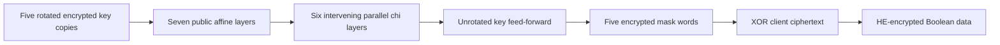

---
# Summary

## 1. Problem

Boolean HE-friendly ciphers often minimize AND depth but leave expensive packed linear transformations. **FASTA – a stream cipher for fast FHE evaluation**, by Carlos Cid, John Petter Indrøy and Håvard Raddum, designs the linear layer and state specifically around the odd-slot BGV instances supported by HElib. Source: local 34-page PDF, §§3–6 and Appendices A–C, including direct inspection of Figures 6–7 and the printed security equations.

## 2. Main Contribution

FASTA uses a **329-bit key**, a **1,645-bit state** arranged as five 329-bit words, and six nonlinear rounds. It generates 1,645 keystream bits per nonce/counter instance with AND depth six. Rotation/XOR diffusion replaces Rasta's general random binary matrix multiplications. The 329-bit word length fits exactly into the selected BGV instance's 329 slots, avoiding masks and dummy-slot handling.

## 3. Main Techniques

Each affine layer uses four column-parity-mixer iterations interleaved with word rotations. A mixer sums all five words, applies a short XOR-of-rotations map Θ, and XORs its result into every word. Carefully chosen rotations spread potential bit influence across the state while preserving invertibility. The layer is a 5×5 array of 329×329 circulant submatrices, rather than a uniformly sampled invertible 1,645×1,645 matrix.

The nonlinear layer applies χ independently to each word. Each packed χ evaluation needs one ciphertext multiplication and rotations by one and two slots. Its six rounds require 30 such packed multiplications across the five words, at depth six. A final affine layer and unrotated-key feed-forward complete the stream generator.

## 4. Threat Model and Assumptions

The HHE server sees the encrypted key, nonce/counter and symmetric ciphertext. The public XOF determines different affine layers for different instances. Related-key attacks are excluded. Repeating a nonce/counter repeats a mask and must be prevented. The paper permits at most 2^64/1645 generator calls per key, corresponding to at most 2^64 output bits. The historical target is 128-bit symmetric security together with a selected BGV instance estimated just above 128 bits.

The paper adapts Rasta's attack arguments; security does not automatically transfer from Rasta after replacing its matrix family. Authentication and malicious-server computation verification are not supplied.

## 5. Important Qualifications

“Balanced diffusion” means each input/output matrix entry is one with probability one half over the matrix family. The proposed family's approximate balance is supported by a 10,000-matrix experiment and heuristic reasoning, not a proof of independent random entries. Circulant structure creates exact dependencies. Appendix C's monomial-growth estimates assume independence beyond the dependencies explicitly considered. The Gröbner-basis discussion is qualitative rather than a complete concrete complexity bound.

**Numerical source discrepancy:** §5.2 prints Σᵢ₌₀⁶⁴ binom(329,i) ≈ 2^535, Σᵢ₌₀³³ binom(329,i) ≈ 2^276, and Σᵢ₌₀³³ binom(201,i) ≈ 2^252. Direct exact-integer summation instead gives approximately **2^230.09, 2^151.01 and 2^126.08**, respectively. The printed page was visually checked; this is not an extraction error. Powers such as 329^33 omit the factorial reduction inherent in binomial coefficients. The corrected counts still exceed the permitted equation budget, at most 5·2^64 ≈ 2^66.32, assuming the relevant monomials actually occur. This correction alone demonstrates neither a break nor a general security proof.

The BFV/BGVrns portability limitations are statements about the implementations and parameterization studied in this paper, not timeless limitations of all future libraries. No application workload is benchmarked after transciphering.

## 6. Evaluation Setup

MacBook Pro, 2.3 GHz Intel Core i5, 16 GB RAM. BGV uses cyclotomic index m=30,269, ring degree φ(m)=30,268, and 329 slots of extension degree 92; these quantities must not be conflated. HElib's `bits=500` parameter is selected for roughly 500 bits of capacity and just over 128-bit estimated security. The authors report consuming approximately 260 bits, leaving up to 240 for subsequent computation. This is a capacity observation, not an application correctness guarantee.

**Table 1, amortized seconds per output bit:**

| Implementation | χ cost | Linear cost | Total |
|---|---:|---:|---:|
| Published packed Rasta, HElib | 0.0956 | 1.0083 | 1.1039 |
| Authors' packed Rasta*, 329-bit block | 0.0166 | 0.2670 | 0.2836 |
| Authors' packed FASTA | 0.0166 | 0.0260 | 0.0427 |

Thus the headline roughly 25× improvement compares with the published packed Rasta implementation; the authors' better-fitting 329-bit Rasta variant gives a roughly 6.6× comparison. These are amortized rates, not time to the first bit. Multiplying 0.0427 by 1,645 gives about 70.24 seconds per full FASTA output block as a normalization, not an independently reported latency. The modified Rasta* is a benchmark adaptation and is not the original 351-bit parameter set. Code: [Simula-UiB/Fasta](https://github.com/Simula-UiB/Fasta). Thread count and repeated-run variation are not specified in the benchmark discussion.

---
# Main Scheme

## Title

FASTA's rotation-based six-round stream generator

### 1. Notation

Let K∈F₂^329 and wᵢ=rotᵢ(K), i=0,…,4. Each public affine layer A_j is determined by 1,708 XOF bits: 1,645 constant bits and 63 rotation-selection bits. Seven layers consume 11,956 XOF bits per instance.

### 2. Affine and nonlinear layers

In a mixer, compute u=w₀⊕⋯⊕w₄ and

$$
\Theta(u)=u\oplus\operatorname{rot}_{r_1}(u)
\oplus\operatorname{rot}_{r_2}(u)\oplus\operatorname{rot}_{r_3}(u),
\qquad w_i'=w_i\oplus\Theta(u).
$$

Here r₁∈{1,2,3}, r₂∈{4,5,6}, r₃=7+((2r₁+r₂+1) mod 3). Four mixers and the specified intervening rotations form the linear map; XOR its public constant afterwards. Appendix B maps the 63-bit selector modulo the finite mixed-radix family size; this is not exact uniform sampling of arbitrary matrices.

For each 329-bit word, indices wrap modulo 329:

$$
\chi(x)_j=x_j\oplus x_{j+2}\oplus x_{j+1}x_{j+2}.
$$

### 3. Generate and remove the mask

Starting from the five rotated key copies, apply A₀, χ, A₁, χ, …, A₅, χ, A₆. XOR **the unrotated K** into each resulting word and concatenate the five words. Encrypt c=m⊕z. Homomorphic execution follows the same circuit on five packed ciphertexts; public c is XORed with the encrypted mask to recover an HE encryption of m.

## Protocol

# Questions

- Does the intended workload benefit from Boolean slots and exactly this packing geometry?
- Can the circulant structure or small linear-map family improve attacks beyond the paper's heuristics?
- What is the actual subsequent application's capacity and latency after the measured mask generation?

# Related Topics

- [[000 - Transciphering HE]]
- Rasta, packed BGV, circulant matrices, column parity mixers, algebraic linearization.
