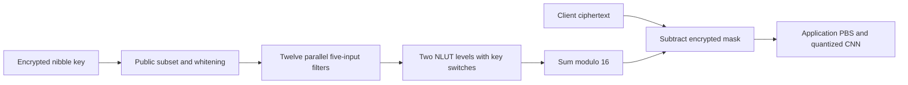

---
# Summary

## 1. Problem

Optimizing symmetric decryption alone can give outputs that are expensive to use in a numerical application. **Towards Case-Optimized Hybrid Homomorphic Encryption — Featuring the Elisabeth Stream Cipher** designs a small-integer stream cipher jointly with TFHE programmable bootstrapping and a quantized neural-network workload. Source: local 35-page version, §§3–5 and specification Appendix B.

## 2. Main Contribution

The **group filter permutator (GFP)** generalizes FiLIP's subset/permutation/whitening construction from bits to a group. Elisabeth-4 instantiates it over the additive group Z/16Z, with a 256-nibble (1,024-bit) secret key and a filter using 60 selected nibbles per four-bit output. Twelve independent five-input subfunctions are summed modulo 16. The cipher produces small-integer LWE ciphertexts directly, rather than requiring bit recomposition after a Boolean stream cipher.

The paper also evaluates the complete transciphering-plus-Fashion-MNIST inference pipeline, exposing a substantial bandwidth/server-time tradeoff and the cost of sharing application and transciphering parameters.

## 3. Main Techniques

Public pseudorandom selection chooses 60 distinct key positions, orders them and adds nibble whitening. Each five-input subfunction uses eight negacyclic lookup tables in two sequential PBS levels. Its fifth input is added directly to balance the output. The twelve subfunctions can run in parallel.

A native negacyclic table obeys S(x+8)=−S(x) modulo 16. Such tables are not required to be permutations. The eight fixed tables are derived reproducibly from a SHA-256 hash of a specified sentence. This process specifies the concrete functions; it does not prove their security.

PBS changes the LWE encryption key from the input key to the ring-extracted output key. Carefully placing key switches after sums reduces work. Two variants either use an additional reverse key-switch key for the fifth input or switch the other terms back to the input key.

## 4. Threat Model and Assumptions

The security analysis considers single-key recovery from known plaintext/ciphertext pairs and limits adversarial data to 2^64. It assumes unbiased public subset/permutation/whitening generation from an appropriate forward-secure PRNG, without exploitable extra structure. The server receives encrypted key entries and evaluation keys. Cipher security and LWE security are separate assumptions; the paper targets 128-bit HE security using an LWE estimator. “Four bits of message integrity” in its parameter discussion refers to arithmetic decoding correctness, **not authentication**. There is no malicious-server correctness proof.

## 5. Important Qualifications

**The 128-bit symmetric claim is heuristic.** Over Z/16Z the filter is not represented by an ordinary polynomial over that ring, but it still has a Boolean representation, and other algebraic representations remain possible. The binary analysis introduces **Beth-4**, replacing some modular additions with XOR, and assumes Elisabeth is at least as hard to attack. More carries/greater apparent nonlinearity do not establish a reduction between these ciphers.

Table 9's fast-algebraic-attack indicators for the 1,024-bit-key Beth variant include **108–114-bit** estimates, below 128. The authors argue these underestimate attacks on GFP and conjecture that the chosen Elisabeth parameters suffice; the 4,096-bit-key Beth rows exceed 128 for the listed strategies. Do not summarize this as a proven 128-bit lower bound, or silently substitute the larger key into the measured implementation.

**Later-source qualification:** the local [[041 - Towards Practical Transciphering for FHE with Setup Independent of the Plaintext Space]] §5.3, footnote 6, reports cryptanalysis reducing the original Elisabeth-4 security to about **2^88 work**, and distinguishes subsequent patched variants. The original implementation timings here describe the original cipher; they should not be presented as timings for a presently validated 128-bit variant. This is a report from that later supplied paper, not an independent reproduction of the attack.

Native four-bit transciphering is distinct from arbitrary four-bit application LUTs. The CNN reserves one bit for padding, leaving **three effective data bits** per pixel. Key sharing changes the parameters and runtime. The small setup-size and bandwidth numbers printed in Tables 5/§5.2 have unclear scale when compared with the figure axes and full evaluation-key components; they are not adopted here as independently validated storage estimates. Measure serialized artifacts before using those claims for deployment planning.

## 6. Evaluation Setup

Concrete/Rust on an AMD Ryzen Threadripper 3990X 64-core machine; the design was initially optimized for 48 cores. Standalone **Table 3** reports:

| Variant | Four-bit output latency | Normalized per-bit time |
|---|---:|---:|
| Two key-switch keys, parallel | 91.143 ms | 22.786 ms |
| Single key-switch key, parallel | 103.810 ms | 25.953 ms |
| Two keys, single thread | 1,485.0 ms | 371.25 ms |
| Single key, single thread | 1,648.6 ms | 412.15 ms |

These parallel latencies must not be compared as single-core results against other ciphers. For standalone evaluation, Table 2 uses ring dimension k=3 and polynomial degree 512, with input LWE dimension 784 or 863 depending on the switching variant.

For the CNN, Table 10 instead uses n=754, k=1, polynomial degree 2,048. The trained model on three-bit quantized Fashion-MNIST has clear accuracy **84.37%** and encrypted accuracy **84.18%** on the reported 10,000 inputs. Average end-to-end inference over 100 samples is **427.23 s**, versus **5.74 s** without transciphering; the implied transciphering time is about **537.62 ms per four-bit ciphertext** across 784 pixels. The alternative 71.46 s conversion estimate is 784×91.143 ms using separate optimized parameters; it is a projection, not the measured shared-key end-to-end run. Mask evaluation can be prepared offline if the public randomness is known.

Code: [Elisabeth](https://github.com/princess-elisabeth/Elisabeth) and [application](https://github.com/princess-elisabeth/elisabeth_usecase).

---
# Main Scheme

## Title

Elisabeth-4's group-filter mask and TFHE evaluation

### 1. Notation

K∈(Z/16Z)^256. For output i, public randomness selects ordered distinct indices Iᵢ,₀,…,Iᵢ,₅₉ and whitening wᵢ,j. Let xⱼ=K[Iᵢ,j]+wᵢ,j modulo 16. Partition these 60 inputs into twelve groups of five.

### 2. Evaluate the inner function

For a group (x₀,x₁,x₂,x₃,x₄), define, with indices among the first four reduced modulo four,

$$
y_j=S_{j+1}(x_j+x_{j+1}),\quad 0\le j<4,
$$

$$
g(x_0,\ldots,x_4)=x_4+
\sum_{j=0}^{3}S_{j+5}(x_j+y_{j+1}+y_{j+2})\pmod {16}.
$$

Each subfunction requires eight PBS evaluations; twelve groups therefore require **96 PBS evaluations per nibble**, arranged in two nonlinear levels. This is a circuit count, not a claim that only two bootstraps are executed in total.

### 3. Encrypt and transcipher

Sum the twelve g outputs to obtain zᵢ modulo 16. The client sends cᵢ=mᵢ+zᵢ. The server applies public selection and whitening to encrypted key entries, evaluates both LUT levels with the selected key-switch placement, and subtracts the encrypted mask from public cᵢ. Output-key identity depends on the switching variant. Application-specific PBS/padding may follow.

## Protocol

# Questions

- How robust are the concrete parameters against attacks beyond the Beth-based indicators?
- Is separate transciphering-key setup worth its latency improvement for the session length?
- What are the actual serialized key and ciphertext sizes in the chosen implementation?

# Related Topics

- [[000 - Transciphering HE]]
- FiLIP, group filter permutators, negacyclic LUTs, TFHE key switching, quantized inference.
