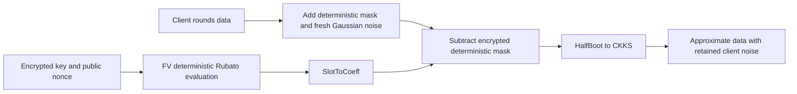

---
# Summary

## 1. Problem

Low-degree HE-friendly ciphers reduce server work but expose algebraic equations in the key. **Rubato: Noisy Ciphers for Approximate Homomorphic Encryption** proposes adding fresh client-side Gaussian noise to a low-degree stream generator, accepting an approximate recovered message in return for a cheaper transciphering circuit. Source: local 39-page full version, §§3–5 and Appendices B–F. The earlier thesis treatment is related, but the concrete parameters below are from this paper.

## 2. Main Contribution

Rubato combines HERA-style fixed diffusion and nonce-randomized round keys with triangular quadratic nonlinear maps, output truncation and additive noise. It operates over an odd prime field, with state sizes 16, 36 or 64 words and output lengths 12, 32 or 60. Its proposed 128-bit configurations use respectively five, three or two nonlinear rounds. Noise is intended to frustrate exact algebraic solving; it is part of the ciphertext construction, not an HE evaluation error that the server can remove.

## 3. Main Techniques

A public XOF produces nonzero-coordinate vectors aᵢ; the round-key addition is x↦x+k⊙aᵢ. Fixed row/column circulant maps use small integer entries to reduce HE cost. The nonlinear layer is the simultaneous triangular map F(x)=(x₁,x₂+x₁²,…,xₙ+xₙ₋₁²), which is bijective and has multiplication depth one. Truncation hides the last four state words. After deterministic generation and truncation, independently sampled discrete Gaussian noise is added to each output word.

RtF evaluates only the deterministic generator in FV, moves its result from slots to coefficients, subtracts it from the client ciphertext and converts to CKKS with HalfBoot. The client noise survives as part of the approximate plaintext. It is neither sampled by nor reproducible from the public XOF at the server.

## 4. Threat Model and Assumptions

The analysis considers the secret-key setting with adversarially selected nonces, models the XOF as a random oracle, and excludes known-key and related-key models. Nonce/counter pairs must not repeat. Cipher security, HE security, secure key/noise sampling and correct parameter selection are separate requirements. This is approximate confidentiality, not authenticated encryption or proof of correct cloud computation.

## 5. Important Qualifications

**Rubato is not an ordinary LWE instance.** Linearizing its monomials yields related secret coordinates and structured public coefficient vectors. §4.2 explicitly acknowledges that most of its LWE-attack estimates assume independently uniform coefficients, which Rubato does not supply, and that combined symmetric/LWE attacks are not explored. Consequently, adding Gaussian noise does not give a standard LWE reduction.

The Gröbner-basis/Arora–Ge estimates also rely on semi-regularity and degree-of-regularity modeling. Table 3's “128.1” or “129.6” attack-cost exponents are model estimates with limited margin, not certified lower bounds. Truncation raises the cost of backward/meet-in-the-middle formulations; §4.1.3 explicitly analyzes them rather than claiming they are impossible.

The distribution D_(αq) has variance (αq)²/(2π); the listed αq is **not** the standard deviation. Gaussian support is unbounded: expected precision and average experimental error do not establish a hard error bound for every ciphertext. Signed representatives, scaling and modular wraparound require a separate correctness budget. The paper's mean-precision discussion should not be converted into a worst-case guarantee.

## 6. Evaluation Setup

AMD Ryzen 7 2700X, 3.70 GHz, one thread, 64 GB RAM. Server: Go 1.16.4 with Lattigo RNS FV/CKKS. Client: C++17, GNU 7.5, AVX2, with AES-128-CTR/OpenSSL or SHAKE256/XKCP for public pseudorandom generation. Server comparisons use SHAKE256. HE/key setup is excluded as amortized; throughput covers all state-word outputs while latency stops at the first HE ciphertext.

Concrete **Table 2 / Table 6** 128-bit symmetric targets:

| Variant | State/output words | Rounds | ceil(log₂q) | αq | CER | Offline / online latency | Server throughput |
|---|---:|---:|---:|---:|---:|---:|---:|
| 128S | 16 / 12 | 5 | 26 | 10.5 | 1.31 | 50.78 / 20.28 s | 6.083 KB/s |
| 128M | 36 / 32 | 3 | 25 | 4.1 | 1.26 | 68.47 / 19.88 s | 6.666 KB/s |
| 128L | 64 / 60 | 2 | 25 | 4.1 | 1.26 | 86.34 / 20.09 s | 6.712 KB/s |

Average precision is 18.8/18.9/18.9 bits respectively. Appendix F uses N=2^16, final CKKS scale 2^45, seven remaining levels and largest modulus including special primes of 1,533 bits. Table 7 compares 128L at **4.585 µs client latency, 31.04 MB/s client throughput, 106.4 s server latency** with HERA at **1.520 µs, 25.26 MB/s and 141.58 s**. Rubato improves throughput while having higher client block latency and a larger output block. The reported 22.9%/32.2% throughput gains are these selected measurements, with expansion increasing from 1.24 to 1.26. Expansion excludes public nonce overhead and setup keys. The LWE-conversion comparator has different slot count and lower precision.

Code: [Rubato](https://github.com/KAIST-CryptLab/Rubato) and [RtF](https://github.com/KAIST-CryptLab/RtF-Transciphering).

---
# Main Scheme

## Title

Noisy Rubato mask followed by RtF conversion

### 1. Notation

Let n=v², v∈{4,6,8}, ℓ=n−4, and q be the selected odd prime. L=MixRows∘MixColumns; Rᵢ(x)=x+k⊙aᵢ. Let F denote the simultaneous triangular quadratic map and T_ℓ keep the first ℓ coordinates. Public initial state is ic=(1,…,n).

### 2. Deterministic generator and client noise

Define the deterministic truncated output

$$
z_0=T_\ell\circ R_r\circ L\circ F\circ L\circ
(R_{r-1}\circ F\circ L)\circ\cdots\circ(R_1\circ F\circ L)\circ R_0(ic).
$$

The final extra L layer and truncation are part of the specification. Independently sample eⱼ with probability proportional to exp(−πeⱼ²/(αq)²), and send

$$
c=[\operatorname{round}(\Delta m)+z_0+e]_q.
$$

### 3. Transcipher to approximate plaintext

The server computes Enc_FV(z₀), performs SlotToCoeff and public coefficient injection, then subtracts the deterministic mask. Before HalfBoot the message is round(Δm)+e modulo q. After suitable normalization, the CKKS plaintext approximates

$$
m+e/\Delta+\varepsilon_{\mathrm{round}}+\varepsilon_{\mathrm{HE/conversion}}.
$$

This expression assumes no unintended signed wraparound; the server does not recover the exact original integer encoding. The paper uses Δ=q/16 in its bounded-message experiments; other message ranges require corresponding scale/error analysis.

## Protocol

# Questions

- What joint attacks exploit both the structured polynomial generator and its small noise?
- What aggregate tail bound is needed for the full data volume and downstream computation?
- Does the application benefit more from the small variant's latency or the large variant's throughput?

# Related Topics

- [[000 - Transciphering HE]]
- HERA/RtF, Pasta, noisy algebraic systems, Arora–Ge attacks, approximate encoding.
