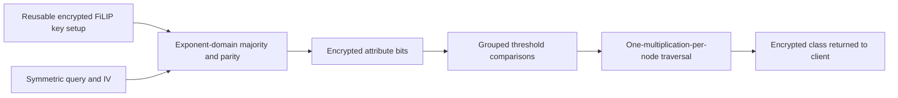

---
# Summary

## 1. Problem

Private decision-tree evaluation should hide a client's attributes and classification result while allowing a server to evaluate its model with a single query/response. **SortingHat**, by Cong, Das, Park and Pereira, optimizes plaintext-threshold comparison and tree traversal. Its **t-SortingHat** variant uses FiLIP transciphering to reduce recurring upload. Source: local 27-page PDF, §§3–7 and Appendix A.

## 2. Main Contribution

The paper presents three connected ideas: comparison using monomial encodings when one operand is public; grouped bitwise comparisons that reuse common threshold prefixes; and traversal requiring one encrypted multiplication per decision node. Separately, it evaluates FiLIP-144's majority filter by accumulating Hamming weight in a polynomial exponent, avoiding a large Boolean majority circuit.

These yield two distinct protocols. **SortingHat** receives special monomial encryptions and uses the fast polynomial comparison. **t-SortingHat** receives symmetric ciphertexts, converts them to ordinary encrypted bits, and uses grouped Boolean comparison. The latter does not inherit the former's fastest comparison representation.

## 3. Main Techniques

For an encrypted monomial X^M, multiplication by a public test polynomial puts the comparison bit in the constant coefficient. Sample extraction produces an LWE encryption. Multiple gadget-scaled input encryptions support conversion of the comparison output to RGSW for external-product traversal.

Grouped comparison recursively compares high and low substrings of one encrypted attribute against many public thresholds. Cached equality and greater-than results for identical substrings avoid repeated gates. For n thresholds and µ-bit attributes the stated asymptotic AND count is O(nµ/log n), in the relevant multi-threshold regime.

Traversal propagates an encrypted active-node indicator a to right child ac and left child a−ac. Exactly one leaf remains active for a well-formed binary tree. A public weighted sum of leaf indicators returns the class label.

## 4. Threat Model and Assumptions

The protocol explicitly targets an **honest-but-curious server**, which follows the computation but tries to infer client data. IND-CPA HE protects attributes, intermediate decisions and output, apart from exposed dimensions/metadata. The transciphering variant additionally assumes FiLIP-144's historical security target and correct public PRNG/IV handling. Circuit privacy is explicitly outside scope: the returned ciphertext is not proved to hide the server's model from a client with the decryption key. There is no proof enforcing server correctness or protecting against maliciously formed queries.

## 5. Important Qualifications

A polynomial comparison is constant in the number of compared bits only for a fixed ring dimension and the supported monomial range. Enlarging the input range changes representation/parameters or requires the more expensive extension. The fast experiment uses 11-bit attributes with N=2^11, whereas cited prior experiments use 12 or 16 bits.

Several specification lines contain indexing/variable slips: the prose equality recurrence must use the newly added bit m_(k−1), and HomSel's subtraction must use the **parent a**, rather than an undefined b. The equations below state the intended operations directly. Likewise, conversions of encrypted bits into X^k and X^(1−k) must both use the original encrypted bit, not overwrite it before computing its complement.

At plaintext modulus two, negacyclic coefficient signs coincide. For larger plaintext moduli, test-polynomial signs and boundary conventions need adjustment; blindly copying the binary polynomial is unsafe. Comparisons in different sections use either ≥ a threshold or > a value, so equality must be handled explicitly.

The 20,000× communication claim concerns recurring input ciphertext expansion, **excluding** substantial reusable encrypted-key setup. The nearly 400× FiLIP claim compares different libraries/parameters and CPUs. It is not an isolated algorithm speedup measured on identical hardware.

## 6. Evaluation Setup

AMD Ryzen 5 5600X, 3.70 GHz. SortingHat is Rust/Concrete; homomorphic FiLIP and grouped comparison are C++/FINAL with FFTW. SortingHat uses q=2^64, N=2,048 and the stated 128-bit target; FiLIP uses FINAL's parameter set with a transciphering-specific decomposition base 2^7. Code: [SortingHat](https://github.com/KULeuven-COSIC/SortingHat).

**Table 5:** FiLIP-144 conversion takes **2.62 ms per output bit** on one thread, with **200 MB** setup, versus the cited 1,018 ms and 800 MB baseline. The authors note CPU differences and uncertainty about the baseline's threading. Setup includes RGSW encryptions of all 2^14 key bits plus a small packed-RLWE supplement.

**Table 4:** SortingHat's heart tree takes 42.3 ms on one thread, while the 500-node artificial tree takes 4,787 ms. Six-thread numbers are amortized across independent queries, not single-query latency divided by six. **Table 6**, t-SortingHat's grouped comparison/traversal alone, takes 1.52 s for heart and 92.44 s for the artificial model on one thread. These exclude conversion: a 16-feature, 16-bit query adds 256×2.62 ms ≈ **670.72 ms**. These seconds must not be confused with Table 4's milliseconds.

---
# Main Scheme

## Title

Exponent-domain FiLIP majority and encrypted tree traversal

### 1. Notation

FiLIP-144 selects/whitens 144 key bits: x₁,…,x₈₁ for parity and y₁,…,y₆₃ for majority. Its mask is

$$
z=\bigoplus_{i=1}^{81}x_i\ \oplus\ [\sum_{i=1}^{63}y_i\ge32].
$$

### 2. Evaluate the majority without a Boolean adder

For a bit k and its original RGSW encryption B, form encryptions

$$
C=\operatorname{RGSW}(1)+(X-1)B,\qquad
\bar C=\operatorname{RGSW}(X)+(1-X)B.
$$

Their messages are X^k and X^(1−k), respectively. Select C or its complement according to public whitening. Starting from RLWE(1), take 63 external products to obtain RLWE(X^H), H=Σyᵢ≤63. Apply the public threshold test polynomial and extract coefficient zero. Add the 81 LWE bit encryptions with scale q/2, where addition implements parity. Adding (0,qc/2) for the public symmetric ciphertext bit removes the mask.

### 3. Compare and traverse

For high/low substrings, combine encrypted equality E and strict greater-than R as

$$
E=E_H E_L,\qquad R=R_H+E_H R_L.
$$

The two summands are mutually exclusive on valid bits. Cache repeated public threshold substrings. At a tree node with decision c and active indicator a, compute right=ac and left=a−right. Sum lab(leaf)·indicator(leaf) and return the encrypted label.

## Protocol

# Questions

- Does session length amortize the 200 MB setup?
- Are attributes within the monomial range, or is bitwise/grouped comparison necessary?
- What additional mechanism is needed for model privacy or malicious-server correctness?

# Related Topics

- [[000 - Transciphering HE]]
- FiLIP-144, FINAL, monomial encoding, private inference, external products, circuit privacy.
