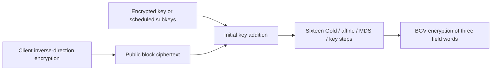

---
# Summary

## 1. Problem

A cipher optimized for MPC or proof systems can still require an expensive circuit under BGV. **Chaghri — A FHE-friendly Block Cipher**, by Ashur, Mahzoun and Toprakhisar, replaces costly inversion-based S-boxes with Gold power maps and sparse binary-linear affine maps that exploit Frobenius automorphisms. Source: local 12-page **CCS 2022 corrected publication**, especially §§3–6 and Appendix C.

## 2. Main Contribution

Chaghri has a three-word state over F_(2^63), hence a 189-bit block, and a historical 128-bit security target. Eight rounds each comprise two identical substitution/diffusion/key-addition steps. The direction called **decryption** is optimized for homomorphic execution; ordinary client encryption uses its inverse. This differs from stream generators where the same cheap direction runs on both sides.

The claimed full-state packed circuit has 16 ciphertext multiplications, 48 Frobenius automorphisms and 32 rotations. Its reported depth of 32 counts additional linear/plaintext-multiplication costs in the authors' implementation metric; it is not a ciphertext-multiplication depth of 32.

## 3. Main Techniques

For x∈F_(2^63), G(x)=x^(2^32+1)=x·Frob₃₂(x) uses one Frobenius operation and one multiplication. gcd(32,63)=1 and odd extension degree make the Gold map a permutation with the stated differential/linear properties. A sparse affine map B(x)=c₁x^256+c₂x⁴+c₃x+c₄ follows it, requiring two additional Frobenius operations and plaintext multiplications. Its linearized part is selected to be invertible.

An MDS 3×3 matrix mixes the three field words. Packing them into slots allows the nonlinear map to operate on all three words simultaneously, so the operation counts are **packed HE counts**, not scalar field multiplication counts. The key schedule repeatedly applies the decryption-style transformation to the master key with fixed constants instead of data-round keys.

## 4. Threat Model and Assumptions

Transciphering evaluates secret-key decryption with an HE-encrypted key or appropriate encrypted subkeys. Confidentiality depends on both Chaghri's concrete security and the BGV parameters. The paper estimates resistance to differential, linear, higher-order differential and algebraic attacks; it does not give a reduction to a standard hardness assumption. A block-cipher mode with appropriate uniqueness/randomization is needed for multiple messages. The primitive alone supplies no authentication, circuit privacy or malicious-server verification.

## 5. Important Qualifications

**Version matters:** §4.2's footnote explicitly acknowledges a practical higher-order differential attack on the earlier preprint with B(x)=α₁x⁸+α₂. The published version uses the three-term linearized map above to restore the intended degree growth. Do not label the local corrected version as the unmodified broken preprint, or reuse the old affine map in the scheme.

Gold exponent 2^32+1 has a large univariate field exponent but **Boolean algebraic degree two**. These are different metrics. Frobenius is F₂-linear and not an arbitrary cheap exponentiation oracle. §5.2.3 still calls B degree eight, which refers to the older sparse map and conflicts with the final specification's degree 256; Appendix C and Algorithm 2 specify the corrected B. The note follows those concrete formulas.

Wide-trail bounds apply to individual trails under the stated active-S-box reasoning, not automatically to all differential/linear hulls. Appendix B extrapolates Gröbner-basis cost from incomplete computations and modeled degree growth; a crashed computation reaching a degree is not a universal lower-bound proof for every formulation. Those estimates should be presented as the authors' rationale.

F_(2^63) output slots are suited to extension-field computation. Moving to ordinary bit or integer applications may require additional conversion. The paper does not measure such a complete downstream workload or general bit extraction.

## 6. Evaluation Setup

HElib/BGV with NTL; Ubuntu Server 18.04 LTS, 3 TB RAM and four Intel Xeon Gold 6136 processors at 3.00 GHz. Thread allocation and run-to-run variation are not specified in §6. The AES implementation is HElib's built-in AES-128 circuit, used without modification.

**Table 2:**

| Cipher | Data per evaluated block | Cyclotomic index | Estimated HE security | Rounds | Runtime | Normalized seconds/bit |
|---|---:|---:|---:|---:|---:|---:|
| AES | 128 bits | 53,261 | 141.924 bits | 10 | 97.84 s | 0.76 |
| Corrected Chaghri | 189 bits | 48,133 | 172.24 bits | 8 | 54.32 s | 0.28 |

The index specifies the cyclotomic polynomial and is not its degree. The roughly 63% lower time per bit uses rounded normalized values and different payload/HE parameters. Block latency improves by about 1.80×, while the normalized rate improves by about 2.66× using unrounded division. These are different comparisons. Expanded-key generation/provisioning and client encryption performance are not separately quantified here.

---
# Main Scheme

## Title

Corrected Chaghri decryption under packed BGV

### 1. Notation

The state S has three elements of F_(2^63); addition is field XOR and multiplication is extension-field multiplication. K₀,…,K₁₆ are the scheduled three-word subkeys. Let M be the specified MDS matrix and π=B∘G coordinatewise, with corrected B from Appendix C.

### 2. Decryption circuit

Start S=C+K₀. For j=1,…,16, perform

$$
S\leftarrow M\,\pi(S)+K_j,
\qquad
\pi(x)=c_1(x^{2^{32}+1})^{256}
+c_2(x^{2^{32}+1})^4+c_3x^{2^{32}+1}+c_4.
$$

Two such steps make one named round. After step 16, return P=S. All words of π use their old inputs simultaneously.

### 3. Encryption and homomorphic execution

Client encryption inverts these operations in reverse order: subtract/XOR the corresponding subkey, apply M⁻¹, apply B⁻¹ and then G⁻¹. G⁻¹ uses the exponent inverse of 2^32+1 modulo 2^63−1, mapping zero to zero. No decimal or malformed extracted inverse exponent is needed to specify it correctly.

The server evaluates the cheap decryption direction on public ciphertext and encrypted key material. A correct diagonal packed MDS implementation uses both distinct cyclic offsets, one and two, with the corresponding plaintext diagonals. Algorithm 3's repeated “rotate by one” line should not be copied as two identical offsets. The final field plaintext is still encrypted under BGV.

## Protocol

# Questions

- Does the implementation use the corrected published B map and constants?
- How much client work and key-schedule evaluation does the chosen deployment require?
- What conversion is needed between extension-field outputs and the intended application?

# Related Topics

- [[000 - Transciphering HE]]
- Marvellous/Vision, Gold functions, binary extension fields, Frobenius automorphisms, BGV packing.
