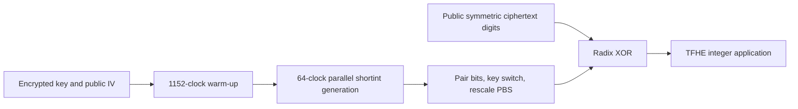

---
# Summary

## 1. Problem

Generic Boolean TFHE APIs bootstrap nearly every gate and can make a simple stream cipher appear unnecessarily expensive. **Trivial Transciphering With Trivium and TFHE**, by Balenbois, Orfila and Smart, revisits Trivium/Kreyvium using TFHE-rs short integers, leveled additions and parallel evaluation. Source: local 19-page PDF, especially §§2–5 and Tables 1–2.

## 2. Main Contribution

The implementation combines eight-bit-safe register scheduling with a **64-clock parallel window**, avoids bootstrapping individual XORs, and casts the resulting encrypted bits into the radix representation expected by TFHE integer applications. It shows that an established Boolean cipher can be competitive for TFHE without redesigning the symmetric primitive.

The optimized measurements are 529 bit/s for Trivium and 427 bit/s for Kreyvium after warm-up, with complete conversion of a 64-bit value taking 259 and 291 ms, respectively, on the heavily parallel benchmark machine. These rates describe different stages and must not be merged into a single throughput figure.

## 3. Main Techniques

Each state bit is encrypted as a short integer with one message bit, one carry bit and one padding/buffer bit: the full encoding modulus is eight. Small sums are formed with cheap LWE additions, then a PBS returns parity and clears carry. Its negacyclic LUT is valid for sums through **four**, because f(4)=0=−f(0), but not five, because f(5)=1 differs from −f(1)=7 modulo eight. Range analysis permits this extra reachable boundary without claiming arbitrary full-domain parity is a native negacyclic function.

Trivium's feedback delays permit 64 consecutive clocks to be computed from the old state concurrently. Within each clock the three feedback branches and output calculation also offer parallel work. Rayon schedules these jobs over the available worker pool. Casting combines adjacent encrypted bits, switches between parameter-set keys, and adjusts scale through PBS. A final radix XOR with the public symmetric ciphertext yields application-compatible encrypted integers.

## 4. Threat Model and Assumptions

The server has TFHE-encrypted symmetric keys and evaluation/casting keys, with public IV and ciphertext. Confidentiality depends on both TFHE and the chosen stream cipher. **Trivium's target is 80-bit symmetric security**, despite Table 1's 128-bit HE parameters; Kreyvium targets 128 bits. Historical claims about security margins or standardization in the introduction are the authors' assessment at publication, not a current cryptanalytic certification. IV/mask reuse must be avoided. There is no authentication or server-evaluation proof.

## 5. Important Qualifications

The stated 2^-40 computation-error parameter is a correctness target, not 40-bit cryptographic security. For a long stream or larger pipeline, its meaning and aggregate failure probability require accounting for all probabilistic operations; the paper does not supply an arbitrary-lifetime end-to-end bound.

Warm-up costs 1,152 clocks, and is required for a newly initialized key/**IV** stream. It can be prepared before ciphertext arrival when the IV is known, but cannot be amortized across unrelated fresh-IV streams without retaining their initialization cost.

The short-integer evaluation and application ciphertexts have distinct keys/parameters and scales. The paper sometimes overloads p as precision, message size or full encoding modulus; Table 1's message/carry sizes are the unambiguous choices. The output recurrence in §2.1's prose omits a tap compared with Figure 1; the standard six-tap output in Figure 1 is used below. More than one PBS can be necessary to reduce a six-term output parity while respecting the sum range.

## 6. Evaluation Setup

AWS m6i.metal, 128 virtual CPUs, 512 GB RAM, 3.5 GHz; SIMD/AVX optimizations and Rayon parallelism. Up to 64×4 jobs exist per processing window; this is not a claim of 256 physical cores. Results are averaged over 100 executions. Code uses [TFHE-rs](https://github.com/zama-ai/tfhe-rs).

**Table 2**, optimized variants:

| Cipher | Warm-up | Successive 64-bit keystream latency | Keystream-only throughput | Full 64-bit transciphering |
|---|---:|---:|---:|---:|
| Trivium | 2,259 ms | 121 ms | 529 bit/s | 259 ms |
| Kreyvium | 2,883 ms | 150 ms | 427 bit/s | 291 ms |

Latency is measured between the 30th and 31st 64-bit outputs after initialization. Throughput is measured for a minute without other computation. Complete transciphering includes mask generation and conversion/XOR, but the separate warm-up is not included in that recurring block number. The naïve FheUint8 versions take 980/1,043 ms for full conversion and 12,483/12,932 ms warm-up. FheBool casting was not implemented, so its full-conversion entry is unavailable.

Table 1 uses evaluation parameters n=684, GLWE k=3, N=512, message/carry moduli 2/2; application parameters n=742, k=1, N=2,048, message/carry moduli 4/4. Dedicated cross-key switching is required. The quoted two-orders-of-magnitude comparison with older work also reflects implementation, parameter and hardware differences.

---
# Main Scheme

## Title

Parallel Trivium generation, then shortint-to-radix casting

### 1. Notation

Let s₁,…,s₂₈₈ be the old Trivium state, initialized from an 80-bit key, 80-bit IV, zeros and three terminal ones. All sums below are XOR. Perform 1,152 initialization clocks without output.

### 2. One logical clock

$$
t_1=s_{66}+s_{93},\quad t_2=s_{162}+s_{177},\quad t_3=s_{243}+s_{288},\quad z=t_1+t_2+t_3.
$$

Feedback uses

$$
u_1=t_1+s_{91}s_{92}+s_{171},\quad
u_2=t_2+s_{175}s_{176}+s_{264},\quad
u_3=t_3+s_{286}s_{287}+s_{69}.
$$

Shift the three registers and insert u₃,u₁,u₂ into their respective heads. Kreyvium adds its rotating 128-bit key/IV taps and uses its own published initialization; it is not merely Trivium with a longer initial key.

### 3. Homomorphic schedule and output

Evaluate independent clocks in a 64-clock window using delayed old-state taps. Replace XOR chains with bounded integer sums and parity PBS; use PBS for AND and feedback cleanup. The paper reports eight PBS per Trivium output bit and ten for Kreyvium in its schedule, with ideal critical paths of two and three PBS, respectively; counts and parallel depth are different quantities.

Pair the encrypted bits into two-bit digits, apply the dedicated key switch and scale-adjusting PBS, then XOR the digits with a trivial radix encryption of public c=m⊕z. Return TFHE-rs integer ciphertexts under the application parameters.

## Protocol

# Questions

- Can fresh-IV warm-up be hidden offline for the intended session pattern?
- What aggregate correctness target is required for all outputs and later computation?
- How do latency and memory change with the actual core count?

# Related Topics

- [[000 - Transciphering HE]]
- Trivium, Kreyvium, TFHE-rs radix integers, programmable bootstrapping, bounded leveled arithmetic.
