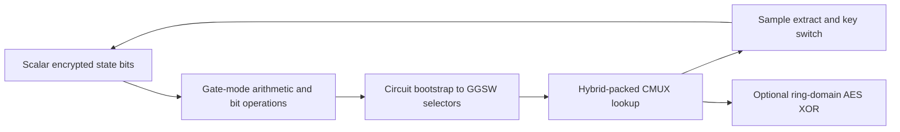

---
# Summary

## 1. Problem

Standard word-oriented stream ciphers mix Boolean operations, modular additions and byte lookup tables. Pure TFHE gate bootstrapping makes the tables expensive, while a single large-integer encoding can make the surrounding bit operations expensive. **Thunderbird**, Wei et al., TCHES 2024(3), combines two TFHE evaluation modes to handle each component in a suitable representation. Source: local 44-page publication, especially §§3–7 and Algorithms 3–5.

## 2. Main Contribution

The framework evaluates **SNOW 3G and ZUC** using gate bootstrapping for Boolean/arithmetic work and circuit-bootstrapped GGSW selectors for leveled lookup tables. It also evaluates AES using larger fused T-tables. A full-adder trick derives the sum bit linearly from the input sum and a single bootstrapped carry, reducing blind rotations where its increased output noise is acceptable.

The measured single-core generation costs are seven seconds per 32-bit SNOW 3G word and 9.5 seconds per 32-bit ZUC word, after initialization. These are not whole-session latencies.

## 3. Main Techniques

**Hybrid packing:** a byte-to-byte LUT fits into two 1,024-coefficient ring plaintexts. The high input bit selects one using CMUX; seven conditional rotations address the remaining byte index, followed by eight sample extractions/key switches. A byte-to-32-bit LUT needs eight ring plaintexts: three high bits select one via seven CMUX operations and five low bits rotate the 32-bit result into place. It uses twelve CMUX operations after selector conversion, while fusing operations that would otherwise require many gates.

**Circuit-bootstrap tuning:** PBSmanyLUT creates gadget-scaled scalar samples at level 2; public functional key switching and EvalSquareMult construct GGSW rows at the smaller level 1. This reduces conversion work and key requirements relative to keeping that step at level 2. “Levels” here denote parameter/key domains, not symmetric rounds or multiplicative depth.

**Arithmetic:** a one-blind-rotation full adder bootstraps the majority/carry, then derives the sum without a second bootstrap. For ZUC's recurrent LFSR additions the authors instead retain the two-rotation adder to control accumulating noise. Powers-of-two multiplication modulo 2^31−1 becomes a 31-bit rotation; an addition tree postpones end-around reduction.

## 4. Threat Model and Assumptions

The cloud receives encrypted keys and public symmetric ciphertext/IV, and homomorphically evaluates the standardized cipher. Confidentiality relies on the cipher and the chosen LWE/RLWE parameters. Table 2 uses the authors' at-least-128-bit HE target. Neither cipher authentication nor proof of correct evaluation follows from homomorphic confidentiality. Expanded AES round keys are provisioned encrypted, so the measured AES circuit excludes homomorphic key expansion.

## 5. Important Qualifications

**Encoding changes the usable output.** AES's fastest variant uses Boolean torus messages {0,1/2}, making XOR a ciphertext addition. §6 Remark 1 explicitly warns that these outputs support only a limited set of subsequent functions without further adaptation. The slower signed {−1/8,+1/8} version uses ordinary bootstrapped gates. The 46-second AES result must not be described as including arbitrary application-compatible conversion.

**Full-adder noise caveat:** the exact plaintext identity below is valid, but Theorem 1 prints a sum-variance term with coefficient two for the bootstrap variance. Scaling a noise by two produces coefficient **four** in its variance before covariance terms. Moreover, the carry result depends on the same input ciphertexts. The printed bound is not accepted here as an independently verified variance bound; neither independent fresh noise nor missing covariance can be assumed automatically. This does not invalidate the Boolean truth-table identity.

Table 6's single-thread Trivium/Kreyvium values are **estimates** made by multiplying a highly parallel implementation's time by its worker count, not measured single-thread runs. Cross-library comparisons also differ in payload, packing and precision. Predictions of millisecond multithreaded operation and a twofold SM4 improvement in §7.5 are proposals/projections, not experiments reported in this paper. No full-cipher lifetime failure bound is established by testing individual gates.

## 6. Evaluation Setup

TFHEpp, Intel Core i5-11500 at 2.70 GHz, 32 GB RAM, Ubuntu 20.04; **all reported tests use one core**. Full-adder tests average 1,000 executions. Table 2 uses scalar dimension n=635 with noise 2^-15; level-1 N=1,024, gadget base 2^6/length 3, noise 2^-25; level-2 N=2,048, base 2^9/length 4, noise 2^-44. Circuit bootstrap is reported at 36 ms: about 24 ms functional bootstrap plus 12 ms conversion.

**Table 5**, seconds:

| Cipher | Initialization, Thunderbird | Each 32-bit word | Gate-only initialization / word |
|---|---:|---:|---:|
| SNOW 3G | 217 | 7 | 12,160 / 367 |
| ZUC | 332 | 9.5 | 9,581 / 301 |

A fresh key/IV session must pay initialization even if it is scheduled offline. Per-bit normalization is 218.75 and 296.875 ms respectively. **Table 8** AES-128 block evaluation is 110 s with HomoXOR and 46 s with freeXOR, compared with the cited Fregata 86 s result; hardware and circuit differences remain relevant.

**Table 7** totals approximately **1,538 MB of evaluation keys**, mostly the 1,280 MB public switching key, separate from encrypted symmetric key material. AES packed expanded-key input uses two ring ciphertexts, reported as 16 KB, versus 3,492 KB of individual scalar key-bit encryptions without seeded compression. These setup savings do not make total setup only 16 KB.

---
# Main Scheme

## Title

Thunderbird's scalar-gate / GGSW-LUT / scalar-gate cycle

### 1. Notation

A TLWE bit has phase μ(b)=(2b−1)/8 for ordinary gates. TRLWE stores packed table coefficients; TRGSW stores selector bits. PBSmanyLUT, public functional key switching and EvalSquareMult convert a scalar bit to a GGSW selector under the specified parameter domains.

### 2. One-bootstrap full adder

For three encrypted bits a,b,c, let A be their ciphertext sum. Bootstrap its sign to obtain C encrypting carry maj(a,b,c). Then

$$
S=A-2C
$$

encrypts a⊕b⊕c under the signed encoding. Indeed A has phase (2h−3)/8 for Hamming weight h, and subtracting twice the signed carry leaves −1/8,+1/8,−1/8,+1/8 for h=0,1,2,3. The sum output retains input noise plus scaled bootstrap noise; this is why the trick is not used universally in recurrent additions.

### 3. Table evaluation and state update

Circuit-bootstrap the eight input bit ciphertexts. For a 32-bit-output LUT, select one of eight public ring tables with the high three bits; use five conditional rotations by multiples of 32 to address the remaining index. Extract 32 coefficients and key-switch back to level 0, unless a fused ring-domain AES XOR can follow directly. Update the cipher state using its specified rotations, additions and linear maps. For AES, fuse substitution/diffusion into T-tables in the first nine rounds; retain the special final round without MixColumns.

## Protocol

# Questions

- What independently justified error model covers the reused/derived full-adder outputs?
- Does the downstream application require conversion from the freeXOR encoding?
- Can the session length amortize both initialization and roughly 1.5 GB of evaluation-key setup?

# Related Topics

- [[000 - Transciphering HE]]
- Fregata, circuit bootstrapping, hybrid packing, SNOW 3G, ZUC, AES T-tables, TFHEpp.
