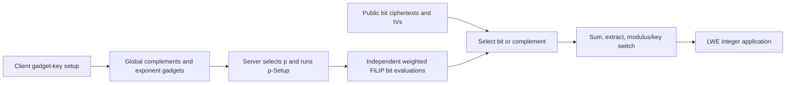

---
# Summary

## 1. Problem

Most HE-friendly ciphers tie encryption and setup to one plaintext domain, although later applications may require different integer precision. **Towards Practical Transciphering for FHE with Setup Independent of the Plaintext Space**, Méaux, Park and Pereira, lets the client upload bitwise FiLIP ciphertexts once and lets the server choose the output plaintext modulus afterwards. Source: local 27-page IACR Communications in Cryptology paper, §§3–6 and Algorithms 1–7.

## 2. Main Contribution

The expensive **client/global setup is independent of p**, the chosen integer message modulus. A separate **server-side p-Setup still depends on p**. The server evaluates FiLIP-144 bits directly at weighted integer scales and combines them into one LWE encryption modulo p, avoiding a separate bootstrapping conversion of every binary output.

For p=2^L, L mask-bit evaluations can run independently. The construction does not give unlimited precision for fixed parameters: larger p shrinks the decoding interval and may require a stronger HE parameter set. Its prototype uses FINAL with NTRU ring/gadget ciphertexts and an LWE output, rather than assuming every object is an RLWE/TFHE ciphertext.

## 3. Main Techniques

The identity XOR(a,b)=a+b−2ab remains valid for bits embedded in Z_p. A polynomial-weighted version carries the lookup test polynomial through the parity calculation **from the start**, avoiding multiplication of a noisy final accumulator by a dense test polynomial.

After obtaining parity b∈{0,1}, the server lifts it into an exponent X^b. The 63 threshold inputs then contribute even exponents, producing an encrypted test polynomial shifted by b+2H, where H is Hamming weight. One lookup function simultaneously computes parity XOR majority. Weighting the test polynomial by 2^j directly produces the j-th contribution to the reconstructed integer.

## 4. Threat Model and Assumptions

The server has gadget encryptions of FiLIP's 2^14 key bits and a switching key, and sees the public PRNG/IV and bit ciphertexts. FiLIP-144's historical symmetric target, NTRU/LWE hardness and the correctness model are separate assumptions. Client/global encrypted-key setup can be reused across supported p choices, with unique stream positions/IVs. The paper does not add authentication, circuit privacy or malicious-server verifiability.

## 5. Important Qualifications

**Speed and correctness must be paired.** Table 4 uses a Gaussian/central-limit heuristic for the final noise, although earlier analysis uses subgaussian parameters. Its tail estimates are model-based output-ciphertext failure probabilities, not measurements of extremely rare events or lifetime guarantees. A later application's PBS has its own correctness requirements.

The derivation deserves additional scrutiny before using its bounds as certified parameters: LiftExp is stated to multiply the noise parameter by two, and the exponent-selector ciphertexts also have enlarged noise, while the displayed Lemma 2 final calculation does not visibly carry all those factors through. Reused setup errors and covariance also require appropriate treatment. These notes retain the **reported** Table 4 values with that qualification, rather than claiming to independently prove them.

The appendix's XORSimple pseudocode omits the final addition of c₀ that its own correct displayed identity requires. Use c₀+(1−2c₀)⊡C₁, not just the external product. Algorithm 1's polynomial-weighted XOR includes the corresponding term correctly.

The paper also reports a later attack reducing original Elisabeth-4's claimed security to about 88 bits (§5.3 footnote), and distinguishes patched variants. This reinforces that the older Elisabeth timings do not establish a currently secure 128-bit design. This note attributes that report to the supplied paper; it is not a new independent cryptanalysis.

## 6. Evaluation Setup

One Intel Xeon Gold 6248R core at 3.00 GHz on a 500 GB RAM machine; FINAL/C++/FFTW proof of concept. Code: [plaintext-independent transciphering](https://github.com/hilder-vitor/source_transciphering_ptxt_independent). Both HE parameter sets target 128-bit estimated security. Set I uses N=1,024, Q=912,829 and five base-16 gadget digits; Set II uses N=2,048, Q=1,073,741,827 and eight base-16 digits.

**Tables 3–4**, selected measurements and reported heuristic failure bounds:

| Set / p | Client setup upload | Server p-Setup | Online integer conversion | Normalized per bit | Reported failure bound |
|---|---:|---:|---:|---:|---:|
| I / 8 | 215 MB | 3.74 s | 18.8 ms | 6.3 ms | 2^-30 |
| I / 16 | 215 MB | 5.26 s | 25.2 ms | 6.3 ms | 2^-8 |
| II / 16 | 1 GB | 14.7 s | 71 ms | 17.7 ms | 2^-13382 |
| II / 128 | 1 GB | 24.8 s | 117 ms | 16.7 ms | 2^-209 |
| II / 256 | 1 GB | 29.7 s | 137 ms | 17.1 ms | 2^-54 |

The small-set four-bit timing is therefore unsuitable as a negligible-error claim. Setup upload is expensive even though recurring data has essentially no symmetric expansion. The large-set three-bit conversion takes 54 ms.

§5.5's neural-network numbers are projections, not a rerun of the complete model. Its footnote states 784×18.8 ms+6 s=15 s, but direct arithmetic gives **20.7392 s**; the Set-II calculation 784×54 ms+6 s gives **48.336 s**, rather than the stated 43 s. The printed totals appear to omit the approximately six-second inference component. These corrected sums remain estimates and omit additional interface costs.

---
# Main Scheme

## Title

Weighted FiLIP evaluation with p-independent encrypted-key setup

### 1. Notation

Let k be the binary FiLIP key, Cᵢ its gadget encryptions, and p the selected output modulus. For each mask bit, whiten/select 81 parity inputs and 63 majority inputs. Let d=32 and

$$
F_d(u)=(u\bmod2)\oplus[\lfloor u/2\rfloor\ge d].
$$

Choose a negacyclic test polynomial T whose constant coefficient after multiplication by X^u is F_d(u) on the reachable range 0≤u≤127. Set Δ≈Q/p and uⱼ=2^jT.

### 2. Setup and weighted parity

Global setup creates gadget encryptions of kᵢ, 1−kᵢ, X^(2kᵢ) and X^(2(1−kᵢ)). For each p and j, server p-Setup creates ring encryptions of Δuⱼkᵢ and their complements. For bits a,b, evaluate the weighted parity update

$$
\operatorname{Enc}(\Delta ua)+\operatorname{Enc}(\Delta ub)
-2\operatorname{Enc}(\Delta ua)\boxdot\operatorname{Gadget}(b).
$$

### 3. Lift, lookup and compose

Lift the parity b by (X−1)Enc(Δuⱼb)+Enc_trivial(Δuⱼ), obtaining Enc(ΔuⱼX^b). External products with the 63 selected exponent gadgets produce Enc(ΔuⱼX^(b+2H)). Its constant coefficient is Δ2^j times the FiLIP mask bit.

If public symmetric ciphertext bit cⱼ is zero, retain that contribution; if it is one, replace it by Δ2^j minus the contribution. Sum over j, extract coefficient zero, modulus-switch and NTRU-to-LWE key-switch. This yields the encrypted integer modulo p; for non-power-of-two p, the source bit representation must encode a valid residue and reconstruction is interpreted modulo p.

## Protocol

# Questions

- Can the stated noise bounds be rederived with all scaling factors and reused errors included?
- Which maximum precision and aggregate error target determine the actual HE parameters?
- How many queries amortize the upload and server p-Setup storage?

# Related Topics

- [[000 - Transciphering HE]]
- FiLIP-144, SortingHat, FINAL/NTRU, plaintext-domain conversion, test-vector bootstrapping.
