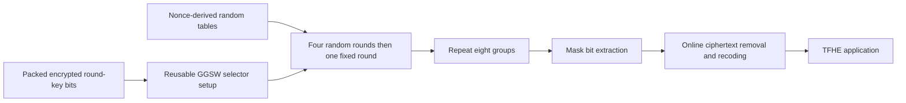

---
# Summary

## 1. Problem

TFHE can evaluate arbitrary small lookup tables efficiently, but evaluating many keyed S-box inputs independently wastes blind-rotation work. **FRAST: TFHE-Friendly Cipher Based on Random S-Boxes**, Cho et al., ToSC 2024(3), combines a shared-input Feistel structure with random public S-boxes and a reusable blind rotation. Source: local 43-page publication, §§3–6 and supplementary error/communication analysis E–F.

## 2. Main Contribution

FRAST uses a **256-bit master key** represented by 64 nibbles, a **128-bit output state** represented by 32 nibbles, and **40 rounds**. Every group of five rounds has four nonce-randomized negacyclic-S-box rounds followed by one fixed-S-box round: 32 random and eight fixed rounds in total. The proposed symmetric security target is 128 bits.

The HE contribution is **double blind rotation**: rotate once by a common encrypted state input, then complete many keyed evaluations using cheap conditional rotations controlled by precomputed GGSW round-key bits. A new without-padding PBS decomposition handles the non-negacyclic fixed S-box.

## 3. Main Techniques

Each round expands the first branch into the other 31 using S(x₁+rkⱼ), then contracts their updated sum back into branch one. This structure makes the input x₁ common across many S-box calls. The random S-box's first eight values are public XOF samples; its remaining eight are determined by S(x+8)=−S(x) modulo 16. These random functions need not be permutations: the additive Feistel structure still has an inverse.

The fixed S-box is the specified four-bit golden permutation, whose ordinary polynomial representation over Z/16Z is ruled out by a necessary condition. Fixed rounds provide algebraic complexity and periodic noise management. The key schedule applies powers of a fixed public invertible 64×64 matrix over Z/16Z; each product yields two consecutive round-key vectors.

For an arbitrary table f, split it into parts odd and even under the half-domain shift. The odd part is negacyclic; the even part ignores the most significant input bit and can be evaluated after clearing that bit. Recursive decomposition offers parallel variants. The halves are interpreted at the appropriate torus/extended scale: division by two is not inversion of two in Z/16Z.

## 4. Threat Model and Assumptions

The analysis allows chosen nonces in the secret-key model, excludes related/known-key models, and models the XOF as a random oracle. The attacker knows all public random tables but cannot freely choose their values. The stated usage bound is 2^64 blocks per key for 128-bit random nonces; this birthday-scale limit does not imply negligible collision probability at its endpoint. Use unique nonce/counter encodings in practice.

Cipher security and TFHE security are independent requirements. The construction does not supply authentication or malicious-server verification. Most encrypted round-key material is provisioned to support double blind rotation; its setup size is not determined by the 256-bit master key alone.

## 5. Important Qualifications

Algebraic analysis studies an **XOR/field-multiplication variant** and assumes dense monomial growth and independence in XL estimates. Replacing modular additions with XOR is an analytic heuristic, not a security reduction. Gröbner-basis toy experiments also fail to match a simple degree-of-regularity predictor; extrapolation is not a comprehensive attack lower bound. The linear analysis explicitly considers masks on public XOF outputs, compatible trails and weak random tables, rather than treating all random-round attacks as automatically impossible.

A common blind rotation creates **correlated output errors**. Supplement E includes quadratic growth terms for these shared errors, and distinguishes them from further key-selector noise under stated independence assumptions. The reported 2^-80.32 full-evaluation bound comes from its model and a 40-round union bound using a per-critical-step bound below 2^-85.64. A 1,000-run noise experiment supports scale estimates but cannot empirically establish such a rare tail probability.

The keystream-only speedups exclude online recoding and setup. Baseline Kreyvium/Elisabeth costs in Table 3 are largely constructed from gate timings/counts, rather than full end-to-end implementations. Original Elisabeth has later attacks; patched Elisabeth-b and Gabriel are separate rows. Claims are historical comparisons, not current security certification.

## 6. Evaluation Setup

Rust/TFHE-rs with SHAKE256 on Intel i5-13600K. The paper uses its eight E-cores for parallel setup; **keystream evaluation is one thread**. FRAST uses the library's PARAM_MESSAGE_2_CARRY_2 parameter set: LWE n=742, GLWE k=1, N=2,048, PBS base 2^23/length one; additional GLWE-to-GGSW parameters support encrypted round-key selectors. Code: [KAIST-CryptLab/FRAST](https://github.com/KAIST-CryptLab/FRAST).

**Table 3:** FRAST setup is 24.99 s with eight threads; a 128-bit keystream block takes **6,194 ms**, or **20.66 bit/s**, on one thread. Kreyvium's estimated row is 134.0 ms/bit and 7.465 bit/s, with 44.09 s four-thread warm-up. Original Elisabeth is 2,049 ms per nibble and 1.955 bit/s; patched variants are slower. The headline throughput ratios 2.768× and 10.57× use those rows.

Online conversion is separately estimated at **46.08 ms per two-bit message**, or 43.40 bit/s, using subtraction, PBS recoding and key switching. Communication overhead is estimated as **11.88 MB** for FRAST, excluding reusable application-default bootstrapping keys under its accounting convention; it is not necessarily the complete session key footprint. Kreyvium/Elisabeth rows use their own parameter sets and setup conventions.

---
# Main Scheme

## Title

FRAST's shared-input random-table Feistel round

### 1. Notation

All additions are modulo 16. State x=(x₁,…,x₃₂); round key rk^(i) has 32 nibbles. For i not divisible by five, independently generate S_erf and S_crf from the public nonce XOF under the negacyclic rule. At multiples of five use the fixed S-box from Table 1.

### 2. One round

$$
y_j=x_j+S_{\mathrm{erf}}(x_1+rk_j),\quad 2\le j\le32,
\qquad
y_1=x_1+S_{\mathrm{crf}}\left(\sum_{j=2}^{32}y_j+rk_1\right).
$$

The contraction uses **updated y₂,…,y₃₂**. The inverse first subtracts the contracting contribution to recover x₁, then subtracts each expanding contribution to recover the other old branches; S-box invertibility is unnecessary for this Feistel inversion.

### 3. Stream generation and homomorphic evaluation

Start from ic=(0,1,…,15,0,1,…,15), apply all 40 rounds and use the 32 output nibbles as mask z. Client encryption adds the mask modulo 16. The server evaluates the round circuit with encrypted round keys: share the common blind rotation across expanding calls, then apply up to four conditional rotations per key nibble. For fixed rounds use the specified without-padding decomposition and scaling. Contraction follows expansion; it cannot be computed independently of the updated branch sum.

After mask generation, extract bit encodings as required, subtract/XOR the public symmetric ciphertext in the matching representation, and perform the separate online encoding/parameter conversion for the application.

## Protocol

# Questions

- How robust is the XOR-variant algebraic analysis for actual modular-addition rounds?
- Which correlated-error assumptions remain valid when the same setup keys are reused?
- Does the application need the extra bit-extraction/online recoding stage?

# Related Topics

- [[000 - Transciphering HE]]
- Generalized Feistel networks, double blind rotation, WoP-PBS, TFHE-rs, random S-boxes.
