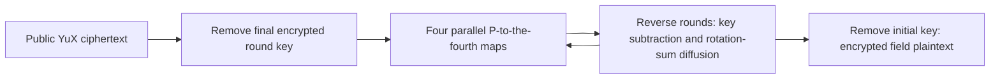

---
# Summary

## 1. Problem

Finite-field ciphers can benefit from BGV SIMD without using binary gates or expensive field inversion. **YuX: Finite Field Multiplication Based Block Ciphers for Efficient FHE Evaluation**, Liu et al., IEEE Transactions on Information Theory 70(5), 2024, builds a low-depth four-word permutation and a 16-word block-cipher family around it. Source: local 21-page publication; construction §III, specification §IV, security §VI and evaluation §VII. Tables II, V and VI were inspected as rendered pages because their entries are absent from text extraction.

## 2. Main Contribution

The nonlinear primitive is four iterations of a one-product feedback permutation over F_q^4, with **four field multiplications at depth two** when scheduled in pairs. The authors prove differential probability and squared linear correlation bounds of q^-2 for this four-word permutation. YuX uses four such S-boxes per layer and a circulant linear map optimized for the homomorphic **decryption** direction.

There are binary-extension versions Yu₂X-8 and Yu₂X-16, and a prime-field version Yu_pX-65537. Key/block sizes and security claims differ; a large key does not imply a matching security target.

## 3. Main Techniques

Let P(x₀,x₁,x₂,x₃)=(x₁,x₂,x₃,x₀+x₁x₂+x₃+α). Two successive applications need products x₁x₂ and x₂x₃, which can be computed simultaneously. Iterating that two-step circuit twice gives P⁴ at depth two. Encryption uses S=P^-4; decryption uses S⁻¹=P⁴, the cheap direction.

The decryption linear map M sums seven word rotations. In the fastest **16-ciphertext state-sliced** implementation, a word position has its own HE ciphertext, with different blocks in its SIMD slots. Word permutations therefore relabel ciphertexts, rather than performing costly slot rotations. One-ciphertext and four-ciphertext packings trade fewer state ciphertexts for extra rotations and lower batching throughput.

Round keys are expanded from the master key using the cipher's nonlinear building block. The implementation packs expanded round keys for transmission and rearranges them server-side; its reported data circuit must not be assumed to include homomorphic key expansion.

## 4. Threat Model and Assumptions

The paper considers a setting where decryption results remain encrypted, and explicitly excludes chosen-ciphertext attacks on the symmetric primitive. This restriction depends on the surrounding application not exposing a decryption oracle through returned results or client feedback. It is not a general CCA-security guarantee. Security also requires appropriate HE parameters and a secure multi-block encryption mode. Authentication and proof of correct computation are separate mechanisms; proposed MAC/PSI applications are high-level sketches, not a malicious-security theorem for the transciphering pipeline.

## 5. Important Qualifications

**Concrete targets:** Table II gives Yu₂X-8 at 12 rounds/128-bit target; Yu₂X-16 at 12 rounds for the FHE-specific setting and 14 rounds as another listed choice; Yu_pX-65537 at **nine rounds/118-bit target**, and **14 rounds/128-bit target**. Table VI also benchmarks a 12-round prime-field row labeled 128. These differing recommendations must not be collapsed into “all YuX timings are 128-bit secure.” §VII's “16 levels” for prime-field evaluation conflicts with its nine-round/18-level table; the table's 18 matches two levels per round.

Single-trail S-box bounds do not prove full-cipher security against hulls or every attack. Large-field integral limits are partly estimated from degree experiments. The Gröbner-basis cost relies on a regular-sequence assumption; counting more monomials than equations in one linearization does not rule out all algebraic strategies or key-recovery consequences of structure. These are the paper's security estimates, not independently certified bounds.

In prime fields subtraction differs from addition. Some displayed algebraic attack equations use characteristic-two signs/XOR in a supposedly general-field description. Use the actual P and P⁻¹ formulas below to define the scheme rather than copying those inconsistent equations. The key-schedule pseudocode also has overlapping indices where the prose defines disjoint four-word groups.

## 6. Evaluation Setup

HElib/BGV on Ubuntu with 256 GB RAM and a system described as 104 Intel Xeon Gold 6230R CPUs at 2.10 GHz. The paper does not make an unambiguous single-core allocation for these figures, so they are not labeled single-core here. Code: [YuX implementation](https://github.com/YuXenc/Transcipher-Yux).

Selected **Table VI**, state-sliced batch measurements:

| Cipher / rounds | Symmetric target in row | HE estimate | SIMD blocks | Batch evaluation | Throughput |
|---|---:|---:|---:|---:|---:|
| Yu₂X-8 / 12 | 128 bits | 139 bits | 960 | 70.33 s | 12.80 KB/min |
| Yu₂X-16 / 12, smaller ring | 128 bits | 135 bits | 512 | 77.86 s | 12.33 KB/min |
| Yu₂X-16 / 12, larger ring | 128 bits | 199 bits | 2,048 | 143.40 s | 26.78 KB/min |
| Yu₂X-16 / 14 | 128 bits | 150 bits | 2,048 | 203.14 s | 18.90 KB/min |
| Yu_pX-65537 / 9 | **118 bits** | 118 bits | 32,768 | 71.57 s | 858.46 KB/min |
| Yu_pX-65537 / 14 | 128 bits | 142 bits | 32,768 | 308.50 s | 199.16 KB/min |

These are batched decryption times and KB **per minute**, not per second or single-block latency. The headline roughly fivefold prime-field advantage compares the fast 118-bit row with the HERA row at 189.82 KB/min; the 14-round 128-bit row is much closer in throughput. Some comparator entries are estimates (FLIP), scaled from another paper (Chaghri) or have lower HE security. The paper's blanket comparison prose should not override these table qualifications. No downstream application depth/precision benchmark is provided.

---
# Main Scheme

## Title

YuX decryption from low-depth four-word feedback permutations

### 1. Notation

Work over F_q, with q=2^8, 2^16 or 65537 as selected. α=205 for the tabulated instances. A block has 16 field words. Let S=P^-4 act independently on four disjoint four-word groups, and define

$$
M(x)=\sum_{i\in\{0,3,4,8,9,12,14\}}\operatorname{rot}_i(x).
$$

Encryption diffusion is M⁻¹; decryption diffusion is M.

### 2. Low-depth nonlinear building block

$$
P(x_0,x_1,x_2,x_3)=(x_1,x_2,x_3,x_0+x_1x_2+x_3+\alpha),
$$

$$
P^{-1}(x_0,x_1,x_2,x_3)=(x_3-x_0x_1-x_2-\alpha,x_0,x_1,x_2).
$$

Compute P² via simultaneous products, then repeat, rather than inferring depth four from a naïve sequential source loop. Over characteristic two, minus equals plus; over the prime field it does not.

### 3. Encrypt and homomorphically decrypt

Encryption starts x=P_plain+rk₀, then r−1 rounds x=M⁻¹(SL(x))+rkᵢ; the final round omits diffusion and returns c=SL(x)+rk_r. Decryption starts x=SL⁻¹(c−rk_r). For i=r−1 down to one, set x=SL⁻¹(M(x−rkᵢ)); finally output x−rk₀. Here SL⁻¹ applies P⁴ to each four-word group.

Evaluate these steps on encrypted expanded keys and public ciphertext using the chosen state layout. Each S-box layer uses 16 scalar field multiplications at depth two; a 12-round decryption has 192 such products and depth 24 before considering other implementation costs.

## Protocol

# Questions

- Which round count and attack model justify the required concrete security target?
- How much post-decryption capacity remains for the intended application?
- Are batched throughput, key setup and actual worker allocation comparable to the chosen baseline?

# Related Topics

- [[000 - Transciphering HE]]
- YuS, field multiplication, state-sliced BGV, circulant diffusion, algebraic cryptanalysis.
