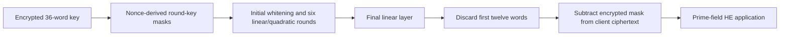

---
# Summary

## 1. Problem

Prime-field HE-friendly ciphers need low-depth invertible nonlinear maps without expensive packed diffusion. **YuS: A FHE-Friendly Stream Cipher Based on New Quadratic Permutations**, Li et al., IEEE Transactions on Information Theory 71(12), 2025, derives quadratic permutation families and uses a three-word instance in a 36-word stream generator. Source: local 18-page publication, especially Theorem 4, §§IV–VII and Appendix C. Benchmark Tables IV–VIII were visually inspected.

## 2. Main Contribution

The paper proves that quadratic permutations in two dimensions over an odd prime field have a maximal differential with probability one, motivating at least three dimensions. Its selected three-word permutation uses **two field products at depth one**, with differential probability 1/p and a characterized Walsh spectrum. YuS combines twelve copies, fixed binary-entry diffusion, nonce-randomized multiplicative round keys and truncation.

The recommended stream instances have **36 key/state words, 24 output words**, and five/six rounds for the historical 80/128-bit targets. Twelve state words are discarded at the output. The field prime satisfies p>2^16 and p≡2 modulo three.

## 3. Main Techniques

For S(x₀,x₁,x₂)=(x₀,x₀x₂+x₁,−x₀x₁+x₀x₂+x₂), x₀ is preserved and the last two coordinates are transformed by a 2×2 matrix with determinant x₀²+x₀+1. This determinant has no root for the selected odd primes, so the map is invertible. Products x₀x₁ and x₀x₂ are independent and computed in parallel.

A fixed 36×36 {0,1}-entry matrix mixes all words using additions. Four-Russians precomputation reduces the reported addition count per linear map from 876 to 412. A row-wise/state-sliced layout stores each coordinate in its own HE ciphertext and batches independent blocks in slots. This avoids general packed matrix-vector multiplication, at the cost of multiple ciphertexts per state.

Public SHAKE128 output supplies nonzero round masks aᵢ; each round key is k⊙aᵢ. Truncation follows an additional final linear map, preventing simple exposure of the twelve unchanged/low-degree S-box coordinates.

## 4. Threat Model and Assumptions

The claimed analysis is in the secret-key model and limits encrypted data per key to 2^(λ/2). It relies on appropriate public nonce/counter/XOF handling and separately on HE hardness. Neither related-key guarantees nor general chosen-ciphertext security are established. Cipher outputs are added to messages modulo p; this provides confidentiality rather than authentication or proof of correct server evaluation.

## 5. Important Qualifications

**The S-box has trivial linear trails.** Since its first coordinate is unchanged, its global maximum correlation is one for certain masks. The p² Walsh bound applies to the nontrivial-mask cases specified in Theorem 4; it is incorrect to summarize every mask as having squared correlation at most p^-2. Appendix C defines a specialized branch metric that counts nontrivially active S-boxes, not the conventional word branch number.

The security section says trail probabilities are “at least” p^-12floor(r/2) and p^-10, where its active-box reasoning intends **upper** bounds on individual trail probabilities. Those statements do not by themselves bound all hulls. Algebraic estimates rely on expected monomial density, semi-regular systems and independence for XL equations. Counting intermediate variables as underdetermined does not prove that all attack formulations fail. The five/six recommended rounds include margin beyond the listed four/five algebraic estimates; this remains a concrete design claim.

The printed inverse S-box expression has a malformed last numerator. Matrix inversion gives (y₀y₁+y₂)/(1+y₀+y₀²), as stated below. Do not copy the extracted y₁² expression. Reported HE noise budgets are **bits of capacity**: 133 versus four bits does not imply 33 times the application depth or a 33-fold reduction in error probability.

## 6. Evaluation Setup

One thread on Intel Core i5-12500H at 2.50 GHz, 13 GiB RAM and 18 GiB swap, WSL2 Ubuntu 22.04; C++17/GNU 11.4, HElib 2.3.0 and SEAL 4.1.2, without HEXL acceleration. SHAKE128 is used for all compared ciphers. HE initialization and symmetric-key encryption setup are excluded. Each batch has 16,384 or 32,768 independent blocks, rather than a single low-latency query. Source repository as printed: [YuS code](https://github.com/wfzcipher/YuS_2025_7z).

Selected **128-bit symmetric target** results at p=65,537:

| Backend / YuS parameters | HE security | Offline / online | Total | Throughput | Remaining noise budget |
|---|---:|---:|---:|---:|---:|
| HElib, N=32,768 | estimated 276.945 bits | 19.118 / 0.114 s | 19.233 s | 84.856 KiB/s | not in this table |
| SEAL, N=16,384, log₂q≈424 | target 128 bits | 8.822 / 0.010 s | 8.832 s | 92.392 KiB/s | 133 bits |
| SEAL, N=16,384, log₂q≈301 | **target 192 bits** | 7.600 / 0.010 s | 7.610 s | 107.229 KiB/s | 20 bits |

The starred/marked smaller-modulus SEAL row deliberately has higher estimated HE security and less remaining capacity; it is a distinct parameter choice. Under the first SEAL choice, HERA is slightly faster at 8.325 s but retains only four noise-budget bits in the comparison. HElib comparisons also have different HE estimates. Thus “fastest” depends on remaining functionality, batch size and parameter selection.

Table IV client costs include a 16,384-block stream: YuS at the 128-bit symmetric target reports **479 cycles/byte**, versus HERA's 501, Pasta's 5,433 and Pasta-v2's 3,175. The text's 5.6× claim should not replace the actual table ratio 3,175/479≈6.63. Bytes use the table's ceil(log₂p)-bit word accounting.

---
# Main Scheme

## Title

YuS quadratic substitution with truncated output

### 1. Notation

Let k∈F_p^36, r=6 for the proposed 128-bit instance, and L the specified fixed 36×36 matrix. Let Rᵢ(x)=x+k⊙aᵢ, with nonce/counter-derived nonzero aᵢ. SL applies S to each disjoint triple. T₁₂ discards the **first** twelve coordinates, retaining coordinates 12–35 in zero-based indexing.

### 2. Nonlinear permutation and inverse

$$
S(x_0,x_1,x_2)=(x_0,x_1+x_0x_2,x_2-x_0x_1+x_0x_2).
$$

With d=1+y₀+y₀², its inverse is

$$
S^{-1}(y_0,y_1,y_2)=
\left(y_0,\frac{(1+y_0)y_1-y_0y_2}{d},
\frac{y_0y_1+y_2}{d}\right).
$$

The stream generator evaluates S, not the rational inverse, so inversion is not part of its normal HE circuit.

### 3. Generate and remove the mask

From CV=(1,…,36), compute

$$
z=T_{12}\circ L\circ(R_r\circ SL\circ L)\circ\cdots\circ
(R_1\circ SL\circ L)\circ R_0(CV).
$$

The extra final L and its placement before truncation matter. Client sends c=m+z modulo p with nonce/counter information. Server evaluates the same circuit on encrypted key coordinates and subtracts Enc(z) from public c, obtaining encrypted field messages. Each nonlinear layer has 24 products at depth one; six layers have 144 products and ciphertext-multiplication depth six, distinct from the paper's weighted noise-depth metric 6.666.

## Protocol

# Questions

- Does a stronger algebraic model exploit the S-box's preserved first coordinate?
- What post-transciphering capacity does the application require?
- Is row-wise batching practical for the actual data volume and latency constraint?

# Related Topics

- [[000 - Transciphering HE]]
- YuX, Rubato, HERA, quadratic permutations, nontrivial linear trails, state-sliced packing.
