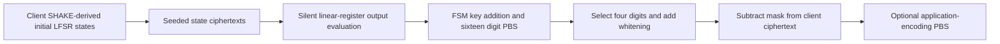

---
# Summary

## 1. Problem

TFHE-friendly stream ciphers must balance expensive nonlinear bootstrapping against the noise growth of cheap linear operations. **Transistor: a TFHE-friendly Stream Cipher**, Baudrin et al., CRYPTO 2025 full version, uses odd-prime messages, a small nonlinear FSM and two large linear registers. Source: local 54-page paper, §§3–6 and additional cryptanalysis Appendix D; the related thesis includes a shorter treatment.

## 2. Main Contribution

Transistor operates over **F₁₇** with a 16-digit nonlinear state, a 64-digit key-schedule LFSR and a 32-digit whitening LFSR. Each clock applies 16 digit S-boxes and emits four field digits: **four PBS per emitted digit**. Its main implementation has no homomorphic stream-cipher warm-up. The client derives and encrypts the full initial LFSR states, avoiding homomorphic SHAKE evaluation.

The proposed symmetric target is 128 bits, with at most **2^31 digits per IV** and **2^128 digits total per master key**. The paper proves a specific three-output balancedness property for an augmented FSM model and analyzes generic, correlation, distinguishing and algebraic attacks. These different claims have different scopes.

## 3. Main Techniques

**Odd modulus:** modified TFHE bootstrapping at p=17 permits arbitrary digit functions without the even-modulus padding constraint. **Silent LFSRs:** every output is computed as a public linear combination of the immutable encrypted initial state, rather than repeatedly feeding noisy encrypted outputs back. Centering coefficients in [−8,8] bounds the amplification independently of stream position, although errors across outputs are correlated through reused input ciphertexts.

**Noise-aware FSM:** an AES-inspired SubDigits/ShiftRows/MixColumns transformation introduces nonlinearity and diffusion. The 4×4 MDS matrix has small centered coefficients and row squared norm seven, limiting error amplification after PBS. The filter emits four selected state coordinates, masked by the independent whitening-register output. Each digit passes through a fresh PBS before substantial subsequent linear work.

## 4. Threat Model and Assumptions

A 128-bit master key and IV seed SHAKE128 on the **client**, producing 96 field digits by rejection sampling. These derived states, rather than just an encrypted 128-bit master key, are uploaded under TFHE. Reusing the same IV repeats the same stream and must be avoided. Security requires the PRF-like initialization assumption, the concrete cipher security arguments and LWE/GLWE hardness separately.

The server evaluates on encrypted state and sees public ciphertext/IV. The construction supplies confidentiality; no authentication or malicious-server evaluation proof is included. The source's uniform-state analytic models should not be confused with information-theoretic security of the entire 128-bit-key encryption scheme.

## 5. Important Qualifications

**Exact theorem scope:** for fixed injected K₁,K₂, the augmented mapping from a **uniform arbitrary FSM state X₀** to three four-digit outputs is balanced, with exactly p⁴ preimages per output triple. This supports the correlation analysis. It does not mean arbitrary observed ciphertexts reveal no information about every actual master-key bit, nor is it a proof of full 128-bit security. The real stream starts with zero FSM state and SHAKE-derived registers. The Appendix D ending's “three or four” independence wording is broader than the proved three-output theorem; four-output correlations are analyzed explicitly in §5.3.

The optimal four-output linear-trail squared correlation is bounded by 2^-35.98 under the stated model, with at most 2^8 optimal trails for a fixed output mask. The subsequent aggregate/correlation arguments make additional assumptions about weaker trails and statistical/channel behavior. They are not a universal bound on every attack. In Appendix A.3, the small-bias channel-capacity expansion also needs care: for distribution 1/p+ε, the second-order entropy deficit is (p/2)Σ ε² in natural units. Treat the paper's displayed capacity/data-length approximations as model estimates rather than exact information-theoretic thresholds for the correlated real stream.

**Algebraic margin:** Appendix D conjectures an ideal-degree lower estimate 15^16≈2^62.51 and invokes at-least-quadratic change-of-order cost. Squaring that number alone gives **2^125.02**, below 2^128. Additional constraints/degree growth may raise the cost, but this numeric argument alone does not establish the claimed 128-bit lower bound. No attack is demonstrated by this observation.

Per-PBS failure targets are not whole-stream failure bounds: four PBS per digit give a union bound of at most 4D·p_err over D digits, before conversion/other probabilistic steps. “No setup” means no homomorphic cipher warm-up, not no key generation, state wrapping or evaluation-key upload.

## 6. Evaluation Setup

Customized TFHE-rs with odd-modulus support on Intel Core i5-1245U, stated 4.4 GHz. The measured implementation does **not** exploit its possible 16-way S-box parallelism. Code: [CryptoExperts/Transistor](https://github.com/CryptoExperts/Transistor/).

**Tables 2–4:**

| Parameter choice | Estimated HE security | PBS time | Four-digit clock latency | Entropy-normalized throughput | Compressed evaluation keys |
|---|---:|---:|---:|---:|---:|
| p_err=2^-40 | ≥128 bits | 11.9 ms | 195 ms | 83.84 bit/s | KSK 49 KB, BSK 6.5 MB |
| p_err=2^-128 | ≥128 bits | 15.28 ms | 251 ms | 65.10 bit/s | KSK 82 KB, BSK 12.7 MB |

Both use q=2^64 and long dimension kN=2,048, but different k,N and switching parameters. Rates count log₂17 bits per digit. Encoding four payload bits per digit scales them by 4/log₂17≈0.979. A final conversion to a conventional nibble encoding adds **one PBS per digit**, excluded from the four-PBS mask cost.

A seeded wrapping of 96 initial-state ciphertexts is (128+96×64)/8=**784 bytes**, excluding evaluation keys; Table 5's 780-byte entry differs slightly. At the strict setting, total compressed evaluation-key provisioning is around 12.78 MB plus state wrapping, with unit conventions explaining some displayed totals. The claimed 16× speedup from parallelization is a projection, not a measured result.

Bandwidth requires an explicit serializer. The source's 17/16=1.0625 “expansion” is a ratio of alphabet cardinalities; ideal coding overhead over four payload bits is log₂17/4≈**1.0219**, while fixed five-bit digit serialization gives **1.25**, and byte storage gives two. Expansion-one/near-one figures in the field-symbol model must not be copied as unconditional bit-level file sizes.

---
# Main Scheme

## Title

Transistor's silent linear registers and nonlinear F₁₇ FSM

### 1. Notation

Let X₋₁=0∈F₁₇^16. K_t consists of sixteen consecutive outputs of the 64-digit key LFSR; W_t consists of four consecutive outputs of the 32-digit whitening LFSR. Let φ(X)=X[4,6,12,14] using the paper's **row-major zero-based** ordering.

The digit permutation is

$$
\pi=[1,12,6,11,14,3,15,5,10,9,13,16,7,8,0,2,4].
$$

MixColumns uses

$$
M=\begin{pmatrix}
2&1&1&1\\1&-1&1&-2\\1&1&-2&-1\\1&-2&-1&1
\end{pmatrix}\pmod {17}.
$$

### 2. Client initialization

Apply SHAKE128 to the master key, IV and specified domain byte. Discard output byte 255; otherwise emit floor(byte/15), uniformly producing a digit in 0,…,16. Fill the key LFSR first, then the whitening LFSR. Upload seeded TFHE encryptions of all 96 digits. The rare all-zero LFSR state is not a maximum-period nonzero state and should not be called maximum-period unconditionally.

### 3. Clock and encrypt

With SD applying π coordinatewise, the pre-filter state is

$$
X_t=SD\bigl(K_t+MC(SR(X_{t-1}))\bigr),\qquad
Z_t=\phi(X_t)+W_t.
$$

For t=0, MC(SR(X₋₁))=0. Apply SR/MC after emitting if implementing the operational ordering in §4.3; it is the same recurrence with consistent state naming. Client ciphertext is C_t=P_t+Z_t modulo 17.

### 4. Homomorphic evaluation

Compute each LFSR output directly from its public coefficient vector and immutable initial ciphertexts. Evaluate all sixteen digit PBS operations, select four outputs, add encrypted whitening digits and subtract the mask from public C_t. Apply the optional application-encoding PBS afterwards. The output keeps both ordinary PBS noise and the small retained whitening-state contribution.

## Protocol

# Questions

- What aggregate failure bound applies to the complete stream and application?
- How strong are the algebraic and multi-trail assumptions beyond the exact balancedness theorem?
- What digit serializer and conversion costs should be included in the deployment comparison?

# Related Topics

- [[000 - Transciphering HE]]
- Silent LFSRs, odd-modulus TFHE, AES-inspired FSMs, correlation attacks, seeded ciphertext compression.
