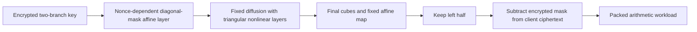

---
# Summary

## 1. Problem

Rasta-like ciphers vary public affine layers to obstruct attacks while keeping multiplicative depth low, but generating a new dense matrix in every round burdens the plaintext client. **Minimize the Randomness in Rasta-Like Designs: How Far Can We Go? — Application to Pasta**, Grassi et al., reduces this randomization in **Pasta-v2**. Source: local 31-page paper, §§3–7 and benchmark Appendix D.

## 2. Main Contribution

Only the **first affine layer** depends on the nonce/counter. Later layers use one fixed MDS matrix per branch, fixed round constants and the original two-branch mixing. The nonlinear layers, state sizes, truncation and round counts remain those of Pasta: three rounds/256 key words/128 output words, or four rounds/64 key words/32 output words, for the authors' 128-bit symmetric target.

A separate mathematical contribution proves the branch number of a Kronecker/interweaving construction from two MDS matrices. It gives branch number **t+2** for the fixed 2t-word Pasta-v2 diffusion, not the maximal 2t+1 of a full 2t×2t MDS matrix.

## 3. Main Techniques

The first-layer branch matrices are **fixed sequential matrices multiplied on the right by random nonzero diagonal matrices**. They are not newly sampled arbitrary invertible matrices. Public XOF output supplies the diagonal entries and first-layer additive constants. This retains key-coordinate randomization while avoiding repeated matrix construction.

Subsequent branch diffusion uses a fixed Cauchy matrix Mᵢⱼ=1/(xᵢ+yⱼ), with distinct x values, distinct y values and nonzero denominators. Both branches and all later rounds use that same matrix; their constants remain round/branch specific. Mixing by [[2I,I],[I,2I]] couples the branches. The first r−1 nonlinear layers are triangular quadratic maps; the last cubes every coordinate before final affine diffusion and left-half truncation.

Fixed matrices can also reduce server encoding work in HElib, although the HE arithmetic depth is unchanged. SEAL's encoding costs make the change less significant there.

## 4. Threat Model and Assumptions

The client/server confidentiality model exposes nonce/counter and affine-layer specifications but hides the symmetric key under HE. A secure XOF is assumed to prevent an attacker selecting arbitrary first-layer masks. Nonce/counter reuse must be prevented. The concrete cipher analysis and HE security are separate assumptions; no authentication or server-correctness proof is supplied.

## 5. Important Qualifications

The analysis assumes dense key-polynomial representations and uses degree/monomial-based algebraic estimates. Toy density measurements support this assumption but do not prove resistance to every Gröbner-basis or structured algebraic attack. Claiming that differential/cube attacks “cannot work” is limited to the discussed fixed-permutation attack strategies and public-randomization model; it is not a general theorem excluding all chosen-nonce attacks.

The first layer is essential: randomizing only a later layer allows the fixed preceding computation to be absorbed into an equivalent key/state, reducing the effective attacked rounds. Randomizing simple nonlinear coefficients can likewise permit a cheaper first-layer linearization. These are arguments about specific alternatives, not attacks on the final specified Pasta-v2.

**Benchmark inconsistency:** §6 says the HElib comparison uses at least 128-bit HE security, but Appendix D Table 5 lists the 33-bit Pasta-3/Pasta-v2-3 one-block rows at **125 bits**. Those rows are retained below with their actual estimate. Several deeper or 60-bit comparator rows are even lower and explicitly marked. A symmetric 128-bit target does not repair a lower HE estimate.

## 6. Evaluation Setup

Linux, AMD Ryzen 9 7900X at 4.7 GHz, one thread per benchmark. Plaintext block encryption averages 1,000 executions. Implementations extend the [hybrid HE framework](https://github.com/IAIK/hybrid-HE-framework). Table 2 uses p=8,088,322,049, a 33-bit prime, and reports total block cycles including nonce-dependent generation.

| Cipher | Total client cycles | Instance-generation cycles | HElib block conversion | Estimated HE security |
|---|---:|---:|---:|---:|
| Pasta-3 | 3,978,645 | 2,312,924 | 17.7 s | 125 bits |
| Pasta-v2-3 | 1,956,656 | 49,645 | 15.0 s | 125 bits |
| Pasta-4 | 351,994 | 250,693 | 21.4 s | 204 bits |
| Pasta-v2-4 | 169,632 | 14,353 | 18.2 s | 204 bits |

Thus the client gains are about 2.03×/2.08× for these rows, while HElib conversion improves about 15%. The abstract's “100% faster” means approximately twice the rate, not elimination of runtime. Blocks contain different numbers of output words between three- and four-round variants, so their block latencies are not matched-payload throughput.

At 17-bit p, HElib Pasta-v2-3 takes 12.3 s versus Pasta-3's 14.7 s at a matched 184-bit HE estimate. At the 33-bit larger arithmetic workload, the corresponding decryption/application times are **97.2/36.5 s** versus **112.3/38.1 s**, at 162-bit HE estimates. The workload has three 200-word affine transformations interleaved with squares. SEAL times are broadly comparable: 33-bit one-block Pasta-3/Pasta-v2-3 are 21.8/21.6 s. Setup encryption and conversion are separately reported; amortized evaluation-key provisioning and serialized session overhead are not included in those decryption times.

---
# Main Scheme

## Title

Pasta-v2 with one nonce-dependent affine layer

### 1. Notation

Let K=(K_L,K_R)∈F_p^(2t), p>2^16 with gcd(3,p−1)=1. Let D_L,D_R be nonce/counter-derived diagonal matrices with nonzero entries, and F_L,F_R fixed invertible sequential matrices. B=[[2I,I],[I,2I]] denotes branch mixing.

### 2. First and later affine layers

$$
A_{0,N,i}(x_L,x_R)=B
\begin{pmatrix}F_LD_Lx_L+c_{0,L}\\F_RD_Rx_R+c_{0,R}\end{pmatrix},
$$

where first-layer constants also depend on N,i. For j≥1, use

$$
A_j(x_L,x_R)=B
\begin{pmatrix}Mx_L+c_{j,L}\\Mx_R+c_{j,R}\end{pmatrix}
$$

with the fixed Cauchy M and fixed constants. The linear part is [[2,1],[1,2]]⊗M. Invertibility requires the selected primes to avoid the mixing matrix's determinant zero; the allowed primes satisfy this.

### 3. Generate and remove the stream

Apply A₀ to K, alternate the specified affine layers with r−1 simultaneous triangular quadratic layers, apply the final coordinatewise cube and A_r, then retain the left t words. Encrypt c=m+z modulo p. The server follows the same public-layer circuit on encrypted K and subtracts the encrypted stream from public c.

The random field-element count per block drops from 4t(r+1) to 4t. Fixed matrices/constants are still generated once during cipher instantiation; “one random layer” does not mean the design contains no fixed pseudorandom constants.

## Protocol

# Questions

- Does the implementation generate the first layer with the specified diagonal masks?
- Do selected benchmark rows meet the required HE security and remaining-depth targets?
- Which subsequent algebraic attacks exploit the repeated fixed diffusion?

# Related Topics

- [[000 - Transciphering HE]]
- Pasta, Dasta, randomized key schedules, Cauchy matrices, Kronecker products, BGV/BFV encoding.
