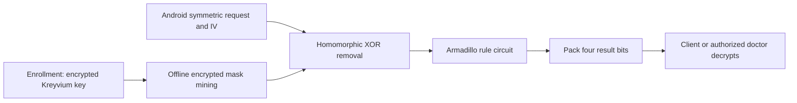

---
# Summary

## 1. Problem

Mobile clients can struggle with HE encryption cost and ciphertext expansion, even for simple private health-data processing. **Practical Privacy-Preserving Medical Diagnosis using Homomorphic Encryption**, Carpov, Nguyen, Sirdey, Costantino and Martinelli, IEEE CLOUD 2016, demonstrates an Android-to-cloud prototype that uses Kreyvium transciphering before a small encrypted rule computation. Source: local seven-page paper, especially §§III–V and Figures 2–3.

## 2. Main Contribution

The application shifts expensive HE work to the server, uploads ordinary stream-cipher ciphertexts for recurring requests, and returns one packed HE ciphertext. Its reported sub-four-second response is achieved by **precomputing the encrypted Kreyvium mask offline**, not by completing homomorphic Kreyvium generation within four seconds.

The computational example is an illustrative cardiac-risk **rule count**, not a trained medical classifier or clinically validated risk model. The paper demonstrates encrypted program execution and system integration; it does not establish diagnostic accuracy or patient outcomes.

## 3. Main Techniques

**Armadillo compilation:** C++ code is converted into a Boolean circuit, optimized with ABC, then executed by the HE runtime. Secret branches require circuit-style conditional selection and loops need public bounds. In the prototype, the backend is an in-house Fan–Vercauteren-style implementation, although the compiler also supports HElib.

**Keystream mining:** the cloud evaluates Kreyvium under encrypted key bits and stores the encrypted mask for a future request. Public IVs synchronize client/server masks. On receipt, cheap XORs convert the uploaded symmetric ciphertext to HE-encrypted medical inputs. The rule circuit then executes, and coefficient packing combines its four output bits into one ciphertext.

## 4. Threat Model and Assumptions

The paper explicitly assumes an **honest-but-curious cloud**: data confidentiality is protected, but the client trusts it to compute the intended program correctly. HTTPS, access credentials and deployment hardening complement HE; they do not prove algorithm correctness or eliminate traffic/metadata leakage. Security depends on the historical Kreyvium and HE parameter assumptions, key management and unique stream masks.

In the optional doctor-output variant, the patient uploads the symmetric key encrypted under the doctor's HE key. The doctor can decrypt results, but the **doctor and cloud must not collude**, since together they can decrypt the retained encrypted input data. This is key-domain delegation, not fine-grained cryptographic enforcement that a doctor can learn only one approved result.

## 5. Important Qualifications

The initial IV is zero, then incremented on both sides after each computation. A zero IV is not itself mask reuse; retry/crash/concurrency handling must prevent reuse of a key/IV pair. The prototype stores a backlog sufficient for **one future computation**, so burst throughput is constrained by replenishment. Offline work remains real server work.

The source's broad statements that HE “only” supports Boolean operations describe the selected backend/encoding, not all HE schemes. Likewise, secret-input privacy does not establish server-model privacy, side-channel protection, malicious security or a clinical safety guarantee.

The abstract's timing excludes first enrollment and offline mask generation. Cryptographic “128-bit security” is the authors' parameter target; the paper does not provide enough detailed modulus/ring/noise information here for an independent modern estimate or a formal complete-pipeline failure bound. The rule count has no reported validation cohort or clinical calibration.

## 6. Evaluation Setup

One cloud VM with eight cores, 16 GB RAM and 300 GB storage; Ubuntu Server 14.04, Java/JBoss 7.1 REST APIs and an Android Java application. CPU model and detailed active threading are not specified. This is the historical prototype configuration, not a recommendation to deploy those software versions today.

The paper allocates **20 multiplication levels**: twelve for its selected Kreyvium evaluation and eight for the rule circuit. This depth is for the specific mask length/workload, not arbitrary-length Kreyvium output. Each bit ciphertext is about **250 kB**; the 128 encrypted symmetric-key bits total about **32 MB** at registration, without key packing. Repeated request payloads have no stream-cipher expansion, while the returned packed result still occupies approximately 250 kB.

The rule computation takes about **3.2 s**; sending, evaluating, receiving and decrypting an already-prepared query takes **less than four seconds**. Offline Kreyvium evaluation takes about **eight minutes** on the tested system. The paper does not report statistical variation, sustained multiuser load or a measured replenishment rate for concurrent sessions.

---
# Main Scheme

## Title

Precomputed Kreyvium masks for an encrypted rule-count service

### 1. Notation

Let k be the client's Kreyvium key and (pk,sk) its HE key pair. Let z=Kreyvium(k,IV) be the request-length binary mask. Let x encode the submitted fields and c=x⊕z. The cloud holds Enc_HE(k), not k or sk.

### 2. Enrollment and offline work

Upload 128 HE-encrypted key bits once. Client and server agree on the initial IV and advance it consistently for subsequent requests. Before data arrival, the server evaluates Enc_HE(z) and stores it against the corresponding IV. Distinct requests consume distinct masks.

### 3. Online computation

Compute

$$
\operatorname{Enc}_{HE}(x)=c\oplus\operatorname{Eval}_{HE}(\operatorname{Kreyvium},\operatorname{Enc}_{HE}(k),IV).
$$

The illustrative score is a sum of indicator bits for age/sex thresholds, family history, smoking, diabetes, blood pressure, low HDL, weight relative to height, low activity and sex-dependent alcohol thresholds. The two age tests and two alcohol tests are mutually exclusive for the represented sex field, giving the stated range 0–9 despite eleven listed conditions. These are the paper's example rules, not clinical advice.

### 4. Return a packed result

Evaluate the compiled Boolean score circuit. Pack its four output bits into polynomial coefficients zero through three, return one HE ciphertext, and decrypt locally. In the doctor variant, use the doctor's HE key domain from enrollment onward and retain the explicit non-collusion assumption.

## Protocol

# Questions

- How is IV state persisted across retries and concurrent requests?
- Can offline mask production sustain the intended request rate?
- What additional validation and result-integrity mechanism would a real application need?

# Related Topics

- [[000 - Transciphering HE]]
- Kreyvium, Armadillo, offline preprocessing, coefficient packing, private cloud computation.
