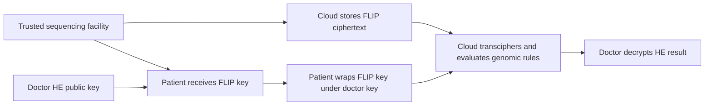

---
# Summary

## 1. Problem

Genomic data is large, sensitive and reused by different authorized medical teams. **Practical Personalized Genomics in the Encrypted Domain**, Singh, Sirdey and Carpov, FMEC 2018, proposes storing stream-cipher-encrypted genomes in a cloud and converting requested data into a doctor's HE domain. Source: local eight-page paper, especially §IV and Tables IV–VII.

## 2. Main Contribution

A sequencing facility encrypts genomic data with FLIP; the patient retains the symmetric key. To permit a medical team to compute, the patient encrypts that key under the team's HE public key. The cloud evaluates FLIP decryption homomorphically and then genomic rule circuits without seeing plaintext. The experiments compare BGV/HElib and FV/Armadillo on ABO and HLA rule computations.

The useful architectural idea is **deferred conversion into a recipient's HE domain**, with compact symmetric storage beforehand. This is an application/prototype study, not a new cipher, HE scheme or formal authorization mechanism.

## 3. Main Techniques

The genomic computations are Boolean circuits over variant/genotype representations. Public rule descriptions specify chromosome positions, reference/alternate alleles and genotype predicates. AND/XOR gates evaluate the rule logic under HE. The FLIP circuit has the stated multiplication depth four; its budget is added to the application circuit's depth when selecting HE parameters.

ABO-1 comprises 15 rules, ABO-2 has 16 and the HLA experiment has 1,274. Table IV reports respectively 100/58, 3,156/20,132 and 13,481/7,040 AND/XOR counts. Gate **count** does not determine multiplication **depth** by itself; the dependency graph matters. The reported HLA depth differs between the two compiled backends, demonstrating the role of circuit construction/optimization.

## 4. Threat Model and Assumptions

The sequencing facility is trusted: it sees the biological sample, plaintext sequence and symmetric key. The cloud is intended to process encrypted content without the recipient's secret HE key. The patient authorizes a recipient by wrapping the FLIP key under that recipient's public key. This assumes authentic recipient keys, correct patient decisions and suitable stream-cipher nonce/position management.

The paper does not provide a formal malicious-security or collusion theorem. A doctor with the HE secret key and a cooperating cloud that holds Enc_HE(k) can recover the symmetric key or decrypt retained input ciphertexts; the mechanism does not cryptographically restrict the doctor to one approved output. PDP/PEP policy checks are administrative access controls, not a replacement for this trust boundary. Public query scope, dataset identity and traffic can remain visible.

## 5. Important Qualifications

**Transciphering expands data into HE ciphertexts.** Several paragraphs describe the homomorphic FLIP output as “compressed ciphertext bits” sent back to the doctor. The stated protocol does not give an additional mechanism that compresses an HE result back into an ordinary FLIP ciphertext. The safe conclusion is reduced symmetric **storage/upload before conversion**; a smaller HE result response requires packing or another specified output mechanism and is not established here.

The computational comparison is also difficult to interpret. Table V measures direct-HE application evaluation under its original depth, Table VI uses enlarged parameters including four additional levels, and Table VII is labeled FLIP transciphering evaluation with those enlarged depths. The text compares VI against VII as if their measured tasks are interchangeable, without sufficiently specifying their boundaries. Do not add/subtract these tables to invent an end-to-end runtime, or conclude that adding homomorphic decryption inherently makes the same HE application faster.

FLIP's exact security-revised parameter set is not documented clearly enough here to independently establish the combined 128-bit target. The original FLIP family had cryptanalytic revisions; a named cipher and a 128-bit HE parameter do not resolve that ambiguity. No clinical validation or genotype-inference accuracy study is supplied by the runtime experiment.

## 6. Evaluation Setup

Ubuntu 14.04 virtual machine on Windows 7; Intel Core i5-5300U at 2.30 GHz, 16 GB RAM. FV/Armadillo measurements explicitly omit parallelism and batching; some BGV ABO results/parameters are reused from a cited previous study. The source states 2,504 patients for each genomic study, but batching and attribution differ across imported and new measurements; treat table rows as the stated experiment, not automatically per-patient latency.

Selected **HLA** values, seconds:

| Table / stated task | BGV | FV | Depth |
|---|---:|---:|---:|
| V: direct-HE rule evaluation | 2,047 | 563 | 7 / 6 |
| VI: rule evaluation at parameters with FLIP depth added | 7,554 | 1,947 | 11 / 10 |
| VII: labeled FLIP transciphering evaluation | 2,468.91 | 731.132 | 11 / 10 |

For ABO-1, Table VII gives 6.76 s BGV and 0.467 s FV. Table VI gives 27 s and five seconds, while original-depth Table V gives three and one seconds. These different baselines explain why the headline “transciphering faster than HE” needs qualification. Full communication sizes, exact cipher parameters and reproducible source code are not supplied in the main evaluation.

---
# Main Scheme

## Title

Patient-authorized FLIP-to-HE conversion of stored genomic data

### 1. Notation

Let M be the genome representation, k_F the FLIP key, c_F=Enc_FLIP(k_F,M), and (pk_D,sk_D) the doctor's HE key pair. Let f be the requested public rule computation.

### 2. Sequence and store

The trusted sequencing facility generates k_F, sequences the sample and sends c_F to the cloud. It securely delivers k_F to the patient. The cloud stores compact symmetric ciphertext plus the public stream metadata needed to reproduce its mask.

### 3. Authorize and convert

The patient verifies pk_D and sends Enc_HE(pk_D,k_F). The cloud computes

$$
C_M=\operatorname{Eval}_{HE}
(\operatorname{Dec}_{FLIP},\operatorname{Enc}_{HE}(k_F),c_F),
\qquad C_f=\operatorname{Eval}_{HE}(f,C_M).
$$

For a stream cipher, the first operation generates the encrypted mask and XORs it with public stored ciphertext. Encryption randomness, stream position and no-reuse rules are required even though the application protocol omits their detailed specification.

### 4. Return the result

The doctor receives C_f and decrypts using sk_D. Its representation remains an **HE ciphertext**, unless a separate output-packing/compression operation is specified. A different recipient normally requires a new patient-approved wrapped key under the new public key.

## Protocol

# Questions

- What exactly is included in each timing table's evaluation task?
- Which FLIP parameter set and nonce/position format were implemented?
- How are recipient keys authenticated and authorization/collusion assumptions enforced?

# Related Topics

- [[000 - Transciphering HE]]
- FLIP, Armadillo, BGV/FV, recipient-domain conversion, encrypted genomic rules, access control.
