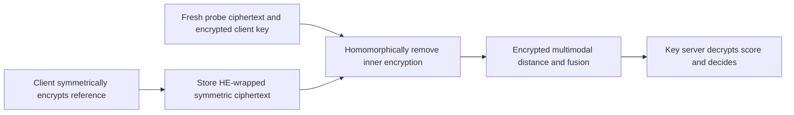

---
# Summary

## 1. Problem

A stolen biometric database encrypted only under HE can be decrypted if the matching HE secret key is also compromised. **MT-PRO: Multibiometric Template Protection Based On Homomorphic Transciphering**, Bauspieß et al., WIFS 2023, adds a client-held symmetric key around reference templates and removes that layer only inside an HE computation during verification. Source: local six-page paper, especially §IV-F–I, Table II and §V-B.

## 2. Main Contribution

The reference database stores **HE encryption of a symmetric ciphertext**, rather than HE encryption of a clear biometric template. A snapshot attacker with the database and HE secret key obtains only the inner symmetric ciphertext, provided it does not also obtain the symmetric key or its transient HE encryption. The protocol supports concatenated feature vectors of different lengths and score-level fusion.

This is a narrower compromise-resilience claim than general security after full server compromise. Its security improvement depends on which artifacts the attacker can collect and when.

## 3. Main Techniques

At enrollment, the client symmetrically encrypts the reference r to c_r. The computation server HE-encrypts c_r and stores that ciphertext. At verification, the client sends a symmetric ciphertext c_p of its fresh probe and Enc_HE(k). The server wraps c_p under HE, homomorphically removes both symmetric layers and evaluates encrypted distances. A separate key server decrypts the distance scores and decides acceptance.

The implementation uses the HERA/RtF framework with CKKS output, via Lattigo. The paper's shorthand “HERA and CKKS” encompasses the conversion framework; HERA is not directly an approximate floating-point cipher. Coefficient/slot packing, masking and public subvector boundaries permit separate comparisons on concatenated modalities without mixing their score regions.

## 4. Threat Model and Assumptions

The baseline has computation and key servers in a semi-honest, non-colluding architecture. MT-PRO additionally considers an **offline stored-database snapshot plus the HE secret key**, but explicitly assumes that the computation server is **not corrupted during verification**. If the attacker obtains Enc_HE(k) while also possessing the HE secret key, it can recover k and decrypt the database. Capturing post-transciphering Enc_HE(r) likewise defeats the intended storage-layer protection.

Thus temporary artifacts, logs and retained verification inputs matter. The protocol does not remove the need for runtime separation or turn an HE secret-key leak into an unconditional harmless event. It does not establish malicious-client/server security, liveness, replay prevention or proof of correct matching.

## 5. Important Qualifications

The abstract's “no accuracy loss” describes the demonstrated biometric pipeline. CKKS is approximate; it does not mathematically preserve every threshold decision for arbitrarily close scores. The paper supplies a DET curve, not a proof of exact numerical identity or a worst-case error-to-threshold margin bound.

The source attributes post-quantum protection broadly to RLWE. The **inner symmetric cipher has its own security assumption**: HERA's concrete security does not reduce to RLWE simply because it is used inside a lattice HE framework. Similarly, encryption alone does not establish all template-unlinkability properties for metadata, identifiers and access patterns.

The device-key and static-user-key choices can decrypt a stored enrollment with the same key later. The proposed ephemeral session-key option explicitly does **not** provide that storage protection unchanged, because enrollment and verification keys differ. The conclusion's phrase “freshly derived password key” must not be read as a fresh independent key that automatically decrypts the old record. Password-derived keys also inherit their actual entropy and derivation assumptions.

The paper says only specially designed ciphers can be used for transciphering; this is an efficiency motivation, not a correctness restriction. Standard ciphers can also be evaluated homomorphically at different costs.

## 6. Evaluation Setup

Debian GNU/Linux 11, AMD EPYC system described as 32×2.8 GHz, 128 GB RAM; thread allocation is not stated precisely. The framework's parameters have a stated 128-bit target. Code: [dasec/MT-PRO](https://github.com/dasec/MT-PRO).

Public MCYT fingerprint and CASIA Iris Thousand embeddings have 512 real coordinates per modality. A 256-coordinate fingerprint variant demonstrates unequal-length fusion. Cosine distance and average/weighted score fusion are evaluated; binary Hamming matching is described as another possible instantiation.

**Table II** reports 0.42 s symmetric template encryption, 0.21 s HE template wrapping, 3.40 s user-key encryption, **107.64 s template transciphering**, **66.40 s HE comparison**, and 0.17 s score decryption. Enrollment totals **0.63 s**; verification is reported as **330.22 s**, versus **66.78 s** for the HE-only baseline. The row multiplicities and other overhead do not fully reconcile the verification total from the displayed components; retain the reported total rather than inventing an exact decomposition. These multi-minute measurements are a prototype result, not interactive authentication latency.

---
# Main Scheme

## Title

Double-encrypted template storage with transient homomorphic key wrapping

### 1. Notation

Let (pk,sk) be the HE key pair held across computation/key-server roles. Let k be a stable client symmetric key, r a reference and p a probe. Symmetric encryption includes its required public nonce/stream metadata; enrollment and probe encryption must use distinct masks.

### 2. Enrollment

Client computes c_r=SymEnc(k,r). Server stores

$$
D_r=\operatorname{Enc}_{HE}(pk,c_r).
$$

A database+sk snapshot reveals c_r but, under the model, does not reveal k or r.

### 3. Verification

Client sends c_p=SymEnc(k,p) and K=Enc_HE(pk,k). Server evaluates

$$
R=\operatorname{Eval}_{HE}(\operatorname{SymDec},K,D_r),\quad
P=\operatorname{Eval}_{HE}(\operatorname{SymDec},K,\operatorname{Enc}_{HE}(c_p)),
$$

then evaluates the compatible packed distance/masking/fusion circuit to obtain an HE-encrypted score. Concrete RtF scaling/representation conversion is needed beneath this high-level notation.

### 4. Decide and manage artifacts

The key server decrypts the score and applies the threshold. The security claim requires the attacker not to have the transient K, R or P alongside sk. Symmetric-key rotation requires reference re-encryption; merely refreshing an HE ciphertext does not change the inner key.

## Protocol

# Questions

- Which transient artifacts can a snapshot or later server compromise recover?
- How are symmetric masks, key rotation and password derivation specified?
- What numerical margin protects threshold decisions under CKKS approximation?

# Related Topics

- [[000 - Transciphering HE]]
- HERA/RtF, CKKS, biometric template protection, compromise models, transient encrypted keys.
