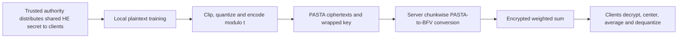

---
# Summary

## 1. Problem

Encrypted federated averaging can impose large uploads and expensive client HE encryption. **Federated Learning: An approach with Hybrid Homomorphic Encryption**, Correia et al., arXiv:2509.03427v1, 3 September 2025, prototypes PASTA-to-BFV conversion inside Flower. Source: local 19-page version, §§4–6 and Algorithms 1–3.

## 2. Main Contribution

Clients train in plaintext, quantize model weights, encrypt them with PASTA and send an HE-encrypted PASTA key. The server converts each chunk into BFV, sums sample-weighted updates and sends the encrypted aggregate to clients. Clients perform signed decoding, averaging and dequantization. The result saves client upload and modestly reduces client runtime, while making server processing dramatically more expensive.

This is a proof of concept under a **trusted authority and honest-client model**. It is not a threshold secure-aggregation construction resistant to a colluding or malicious client.

## 3. Main Techniques

The prototype joins Flower/Python orchestration to the C++ hybrid-HE framework through pybind11. PASTA uses the same prime-field domain as BFV, so the server can evaluate its mask and subtract it directly. Chunking bounds memory use and amortizes one homomorphic cipher evaluation over a block of parameters.

Floating model values are clipped and scaled to signed eight-bit integers. The server performs integer-weighted sums; division by the total sample weight is deferred to clients because ordinary BFV arithmetic does not implement the desired real division directly. All participants use one common HE key domain.

## 4. Threat Model and Assumptions

The TPA generates the HE key pair/evaluation keys and per-client symmetric keys. **Every client receives the same HE secret key.** The server gets only public/evaluation keys. The paper assumes trusted setup, honest clients, an honest-but-curious server, no client/server collusion and external adversaries unable to inject poisoned data or disrupt transmission.

Any client obtaining another client's uploaded wrapped key can decrypt it using the shared HE secret key. Server/client collusion therefore defeats update confidentiality, as the paper explicitly acknowledges. Encryption also does not prevent inference from legitimately released aggregate models, poisoning, malicious aggregation, false sample counts or manipulated client evaluation metrics.

## 5. Important Qualifications

**Signed quantization needs careful implementation.** The prose uses 128/α while Algorithms 2–3 use **127/α**; the latter avoids mapping +α to the unrepresentable int8 value 128. A generic cast from a negative integer to uint64 is not the same as reduction modulo the plaintext prime t=65,537. For example, uint64(−1)=2^64−1 reduces to zero modulo 65,537, whereas the correct field encoding is 65,536. The note specifies signed modular encoding; the source pseudocode does not demonstrate it correctly by itself.

For signed recovery, the weighted aggregate must stay within **(−t/2,t/2)**, not merely have magnitude below t. The selected 4×63×127=32,004 bound is below t/2, but actual sample-weight conventions must match the implementation. The paper alternately describes nᵢ as sample count and number of batches. Uniform batch counts do not resolve unequal-client weighting in general.

BFV is exact modulo t when decoding succeeds. Its noise is not ordinary small numerical perturbation of weights; attributing accuracy loss to “HESD noise” requires evidence of failures or another conversion error. Quantization/clipping, training randomness and differing participation are plausible separate sources. The BFV experiment suffers memory-induced client dropouts from round three, weakening a controlled accuracy/runtime comparison.

Table 1 calls PASTA's key/block sizes 256/128 “bits”, but the referenced Pasta-3 specification has **256 key words and 128 output words**. The exact instantiated cipher parameters need verification in code before using those labels as serialized bit sizes.

## 6. Evaluation Setup

Google Colab T4 High-RAM, 51 GB system RAM/15 GB GPU memory; the homomorphic work runs on an Intel Xeon CPU at 2.20 GHz, not automatically on the T4. MNIST is partitioned IID across twelve clients; four train per round, all twelve evaluate; ten rounds and ten local epochs, batch size 64. The roughly 8,000-parameter CNN is trained in plaintext. HHE uses SEAL-backed BFV via C++; the direct-BFV baseline uses TenSEAL, so implementation differences also matter. Plaintext modulus is 65,537, polynomial degree 16,384 and the stated HE target 128 bits.

Figure 7 gives average client totals **12.53394 s HHE versus 17.86406 s BFV**; training alone is 10.70805 s. HHE encryption/decryption are 0.32867/0.42206 s versus 3.18009/2.90076 s. The server needs **1,451 s per client's update**, or **5,804.2174 s per four-client round**, versus **0.0929 s** for direct BFV aggregation. The roughly 62,478× round ratio compares full conversion-plus-aggregation against aggregation alone. It is not per-client throughput and does not imply all backend operations slow equally.

The source reports over 2,000× less recurring upload but unchanged encrypted download, yielding about half the total communication. Setup/key transfer and serialization must be matched before extrapolating that ratio. Training curves give about **97.6% HHE versus 98.93% plaintext**; final Table 2 instead gives **97.39% versus 99.00%**, with direct BFV 98.21%. These are distinct reported evaluations, not one interchangeable final accuracy.

---
# Main Scheme

## Title

Quantized PASTA-to-BFV federated averaging

### 1. Notation

Let t=65,537, clipping α=5 and scale s=127/α. Client i has local weights wᵢ, aggregation weight nᵢ and symmetric key kᵢ. All clients share HE secret sk under the paper's trust model; server has pk and evaluation keys.

### 2. Quantize and encrypt

For each coordinate, compute qᵢ=round(s·clip(wᵢ,−α,α)), then encode qᵢ modulo t, explicitly mapping negative values to their residues. Encrypt chunks with PASTA under distinct public nonce/counter positions; upload the ciphertexts and Enc_BFV(kᵢ). Reusable key setup can be amortized, although the prototype describes sending a wrapped key with updates.

### 3. Convert and aggregate

Server homomorphically decrypts each PASTA chunk to BFV and computes

$$
C=\sum_i n_i\operatorname{Enc}_{BFV}(q_i)
=\operatorname{Enc}_{BFV}\left(\sum_i n_iq_i\pmod t\right).
$$

No division occurs at this step. Require a proven signed-range bound on each true integer sum.

### 4. Decode and distribute

Clients decrypt, center residues larger than t/2 by subtracting t, then compute

$$
w_{\mathrm{new}}\approx\frac{\operatorname{center}_t(\operatorname{Dec}(C))}{s\sum_i n_i}.
$$

Update the local model and evaluate it locally; accuracy/loss metrics are sent back in clear under the described workflow. A production protocol needs explicit authentication and aggregation validation beyond these arithmetic steps.

## Protocol

# Questions

- Does the implementation reduce negative values modulo t before unsigned serialization?
- Are aggregation weights counts of examples or batches, and is the signed bound enforced?
- Can a controlled experiment compare identical participation, quantization and HE backends?

# Related Topics

- [[000 - Transciphering HE]]
- PASTA, BFV, federated averaging, shared-key trust models, integer quantization, Flower.
