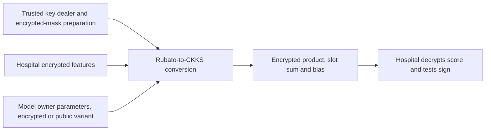

---
# Summary

## 1. Problem

Direct CKKS encryption can impose high client computation and communication for private numerical inference. **HEALED: Hybrid Homomorphic Encryption for Analysis of Large-Scale Encrypted Data**, Dias et al., ICISSP 2026, adapts Rubato/RtF to a hospital/model-owner deployment and a linear SVM. Source: local eight-page paper, particularly §§4–6 and Tables 1–4.

## 2. Main Contribution

Patient features and model parameters can be symmetrically encrypted by different parties, converted into a common CKKS domain by the cloud, and used in an encrypted linear score computation. A trusted setup authority distributes keys and prepares encrypted masks. The hospital decrypts the final **score** and classifies by its sign locally; the cloud does not homomorphically evaluate the sign function.

The paper explores parameter choices and reports substantial per-capacity-unit client savings, alongside high server cost. It is a small-dataset inference prototype; it does not experimentally demonstrate large-scale training or a full large-volume deployment.

## 3. Main Techniques

RtF evaluates Rubato's deterministic mask under FV/BFV, transforms slot masks into coefficient masks, removes the symmetric encryption by subtraction and applies HalfBoot to produce CKKS slots. Rubato's client-side noise remains part of the approximate plaintext, as do rounding and conversion errors.

For an encrypted feature vector x, encrypted weights w and bias b, the server computes a ciphertext-ciphertext product, relinearizes, sums slots through rotations and adds the bias. Ciphertext capacity is padded to fit the framework, with N from 2^14 to 2^16. Padding does not create additional real patient observations.

## 4. Threat Model and Assumptions

All parties are honest-but-curious, follow the protocol and do not collude; the TTP is fully trusted. The hospital receives the HE secret key and its symmetric key; the model owner receives its own symmetric key. The computation server receives evaluation keys and encrypted setup material. Authenticated confidential channels are assumed for plaintext setup communication, though the conclusion lists their implementation as future work.

Model confidentiality from the hospital relies on it **not obtaining model ciphertexts** under the shared HE key. A hospital/server collusion would decrypt them. Returning real-valued SVM scores can also disclose model information across chosen queries; IND-CPA encryption alone is not a model-extraction or circuit-privacy guarantee. No malicious evaluation or result-integrity proof is given.

## 5. Important Qualifications

**Accuracy is not a cryptographic benefit established here.** The paper reports 97.48–97.90% for successful HHE setups versus 95.43% plaintext and 94.21% CKKS baseline, but does not establish a matched fixed-model/fixed-test causal experiment showing that encryption improves a classifier. Different runs/splits and approximate arithmetic can affect these results. CKKS also does not implement linear arithmetic “without precision loss” as the baseline prose states. The score's distance from zero is the relevant numerical decision margin.

**Security/correctness differ:** low-QP rows have the claimed 128-bit security but fail the needed bootstrapping/functionality. Higher QP restores accuracy at reduced security; this short paper does not provide exact modulus/security estimates sufficient to certify every successful row at 128 bits. Do not combine the low-QP security target with high-QP accuracy as one validated configuration.

**Capacity-normalized costs:** Tables 3–4 compare the baseline's thirty actual features with HHE ciphertext capacity N, largely filled by zero padding. Dividing by unused capacity can make per-feature costs/sizes appear far smaller without an experimentally filled batch. The authors explicitly state that larger sample-count/batch experiments were not conducted. Headline savings therefore need occupied-slot, per-patient and end-to-end measurements.

The most accurate tested N=2^16 setup uses **plaintext model parameters**; its encrypted-parameter version was not evaluated due to runtime constraints. Its performance cannot substantiate simultaneous fully encrypted model privacy at the same settings.

## 6. Evaluation Setup

Go/RtF-Rubato implementation versus an OpenFHE CKKS baseline, on an Apple M3 MacBook Air with 16 GB RAM. Breast Cancer Wisconsin Diagnostic has 569 samples/30 features, with an 80/20 split and scaling to [−1,1]; the baseline also describes ten-fold cross-validation. These protocols are not documented well enough to infer identical held-out samples across all rows.

Selected reported values:

| Quantity | Baseline | HEALED / qualification |
|---|---:|---:|
| Accuracy | 95.43% plaintext, 94.21% CKKS | 97.48% at 14-High; 97.90% at 16-High-Plain |
| Hospital encrypted data, normalized per feature | 33,380.12 bytes | 7.64 bytes |
| Hospital encryption, normalized per feature | 102.67 µs | 1.668 µs at 16-High-Plain |
| Hospital result decryption, normalized per feature | 292.33 µs | 3.808 µs at 16-High-Plain |

The successful larger setup is reported at about **22 minutes per batch** and approximately **120 GB memory**, despite the stated 16 GB physical machine. The paper does not explain peak-resident versus virtual/swapped-memory accounting; retain this as an unresolved resource-reporting ambiguity. Client-side key storage increases by 2.31×. The low-QP rows' fast timings accompany failed inference and must not be advertised as usable performance.

---
# Main Scheme

## Title

Rubato/RtF input conversion followed by encrypted linear SVM scoring

### 1. Notation

Let k_h,k_m be hospital/model symmetric keys, x the scaled feature vector, and θ=(w,b) the trained SVM. Let K_h,K_m be FV-encrypted keys under a compatible RtF/CKKS key domain. The hospital alone receives the HE decryption secret in the specified data-processing roles, while the trusted TTP generated it.

### 2. Prepare and encrypt

The TTP prepares encrypted deterministic mask polynomials for the public nonces/counters. The hospital and model owner encrypt their numerical data using the selected Rubato encoding, including its rounding/noise rules. Distinct streams and nonce positions must be assigned to patient and model data.

### 3. Convert to CKKS

For each input domain, form public symmetric coefficient polynomials, subtract the encrypted deterministic mask, and apply compatible scaling and HalfBoot. This yields approximate CKKS ciphertexts C_x,C_w,C_b. The optional plaintext-parameter variant instead leaves w,b public to the computing server.

### 4. Score and decide

Compute

$$
C_s=\operatorname{InnerSum}(\operatorname{Relin}(C_w\cdot C_x))+C_b.
$$

The hospital decrypts to s≈⟨w,x⟩+b and tests s<0 according to the model's label convention. Correct classification requires the combined conversion/inference error to remain below the true score's distance from the decision boundary. No clinical validity guarantee follows from that arithmetic condition.

## Protocol

# Questions

- What are exact HE security estimates for each accurate high-QP setup?
- How do occupied-slot/per-patient costs compare without normalizing by zero padding?
- Can fixed-model, fixed-test experiments explain the reported accuracy increase?

# Related Topics

- [[000 - Transciphering HE]]
- Rubato/RtF, CKKS linear inference, encrypted models, capacity-normalized benchmarks, SVM margins.
