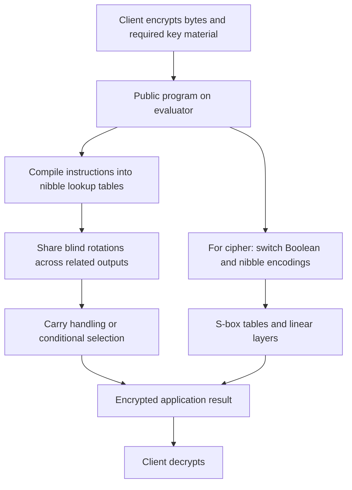

---
# Summary

## 1. Problem

Daphné Trama's 2025 Université Paris-Saclay thesis studies how to evaluate ordinary programs and block ciphers efficiently with TFHE. Its three main contributions are full lookup-table evaluation of AES, the Hippogryph framework combining Boolean and larger plaintext encodings, and a roughly fifty-instruction byte-oriented homomorphic instruction set. Chapter 6 applies these tools to several block ciphers.

This is a synthesis with overlapping material already covered by the individual full-LUT and Hippogryph papers. Its additional value is the unified explanation, byte instruction set, application examples, and comparative cipher study. Citations below use the thesis's **printed page numbers**, generally one less than the PDF page number.

## 2. Main Contribution

- Chapter 4, pp. 69–93: evaluate AES using table-driven TFHE operations, then reduce expensive XOR work by switching between Boolean and nibble encodings.
- Chapter 5, pp. 95–124: implement arithmetic, comparisons, bitwise operations, shifts, rotations, conditional selection, and custom public tables on encrypted bytes. Signed and fixed-point extensions are discussed.
- Chapter 6, pp. 125–140: investigate AES, CLEFIA, PRESENT, PRINCE, SIMON, and SKINNY; compare full-LUT measurements with estimates for an encoding-switching approach.

“Universal instruction set” means that public programs can be expressed using the provided operations. It does not establish a complete processor with private instruction fetch, hidden memory access, or encrypted program control.

## 3. Main Techniques

An unsigned byte is represented as two encrypted nibbles, $x=16h+\ell$. A one-nibble public table can use a simple programmable bootstrap. A byte-indexed table is evaluated as a tree over the two nibbles. Shared blind rotations reduce the cost when several tables use the same encrypted inputs.

For the basis-16 implementation, `LUTeval` maps two encrypted nibbles through a public $256\times4$-bit table using 2 blind rotations (BR) and 1 key switch (KS). `MVLUTeval` shares work across $k$ outputs, costing $k+1$ BR and $k$ KS in the stated construction. Two output nibbles therefore cost 3 BR and 2 KS.

Hippogryph uses Boolean ciphertexts for XOR-heavy linear circuits and nibble ciphertexts for S-box evaluation. Nibbles use an odd plaintext modulus, 17, allowing recomposition from unpadded Boolean ciphertexts through negacyclic PBS and affine transformations. A decomposer combines bit extraction and encoding switching; a recomposer casts individual bits to weighted values and adds them.

The byte instruction set treats carry propagation explicitly. For example, addition evaluates the low-nibble sum and carry together, then adds the carry to the high-nibble sum. Public immediate operands allow substantially cheaper instructions than two encrypted operands. `ADDZ` is specialized for the case where at least one input encrypts zero; conditional duplication guarantees that condition when `ADDZ` is used to assemble a conditional selection.

## 4. Threat Model and Assumptions

The server evaluates a public circuit on encrypted data and, for transciphering, encrypted symmetric key material. Security relies on the selected TFHE parameters and the underlying symmetric cipher. The work does not supply general malicious-server correctness verification, authentication of ciphertext inputs, or hidden program execution.

The thesis includes different parameter sets with different bootstrap failure targets. These are not interchangeable: a per-bootstrap failure probability is not an end-to-end cipher failure probability. Giving the evaluator encrypted round keys can also move key expansion outside the timed circuit.

## 5. Important Qualifications

**Measurements and forecasts must be separated.** In Table 4.5, the 28.73-second AES result for a 16-thread Intel server is an extrapolation. The listed measurements include 270 seconds on an Intel laptop with one thread, 54.31 seconds with six threads, and 36.39 seconds on an AMD EPYC system with sixteen threads. Chapter 4's newer Hippogryph implementation reports about 32 seconds on one core and 4.6 seconds on six cores at its faster failure target; the stricter parameter set is much slower.

Chapter 6's Hippogryph results are **estimates with older/common building-block timings**, not reruns of the newer backend. Table 6.1 reports full-LUT / estimated Hippogryph seconds, normalized to 128 output bits: AES 260 / 84; PRINCE 210 / 70; PRESENT 408 / 179; SKINNY-128 480 / 335; SKINNY-64 298 / 180; CLEFIA 353 / 77. A 64-bit cipher needs two executions for this normalization. These figures compare evaluation cost, not equal cryptographic security across every selected variant.

The chapter's prose and summary table disagree on several operation counts and, in places, normalization; the timing table should not be presented as independently validated gate accounting. For example, the PRINCE prose gives 720 KS for a complete execution while Table 6.1 prints 1220. Its hypothetical ten-round “Unicorn” cipher is a cost illustration, not a security-analyzed proposal.

Byte arithmetic requires explicit overflow conventions; unsigned addition here is modulo 256. Division formulas require a **nonzero divisor**. Signed and fixed-point representations do not automatically provide arbitrary precision or real-number arithmetic. An encrypted branch is implemented by computing/selecting values, rather than branching the host processor on a secret bit.

## 6. Evaluation Setup

Chapter 5 uses the TFHE library on an Intel Core i7-12700H with 64 GiB RAM, Ubuntu 22.04.2, single-threaded instruction timings. Table 5.3 reports approximately: immediate XOR 69 ms; encrypted/encrypted XOR 278 ms; immediate addition 137 ms; encrypted addition 493 ms; multiplication 725 ms; division 7711 ms; remainder 7584 ms; conditional selection 694 ms; generic byte lookup 229 ms. Operand types and output semantics matter when comparing these numbers.

The basis-16 table primitives are measured at about 29 ms for `SimpleBoot`, 130 ms for `LUTeval`, and 230 ms for a two-output `MVLUTeval`. Basis 16 is the best tested decomposition for these byte-table workloads, not a theorem for all functions or parameters.

Application examples include bubble sort, maximum/average, conditional assignment, and sums of squares. Five-element bubble sort takes 15.22 seconds; ten elements take 68.47 seconds. A two-input fixed-point neuron takes 15.42 seconds with a sigmoid and 6.67 seconds with a Heaviside output. These are small operator demonstrations, not a complete neural-network accuracy or deployment benchmark.

---
# Main Scheme

## Title

Byte-oriented TFHE evaluation with shared lookup tables and encoding switches

### 1. Notation

- $[x]$: TFHE encryption of a plaintext value.
- $C_x=([h],[\ell])$: an encrypted byte with $x=16h+\ell$.
- BR / KS: blind rotation / key switch.
- `SimpleBoot`, `LUTeval`, `MVLUTeval`: public table primitives.
- $E_2$, $E_{17}$: Boolean and nibble encodings used by Hippogryph.

### 2. Client input and public program

The client creates TFHE keys and encrypts inputs as nibble pairs. The evaluator receives the public instruction sequence and evaluation keys. In a transciphering application the client additionally supplies encrypted symmetric key material and compact symmetric ciphertexts with their required public mode information.

### 3. Addition with carry

For $x=16h+\ell$ and $y=16h'+\ell'$, evaluate public tables to obtain

$$
s=(h+h')\bmod16,\qquad u=(\ell+\ell')\bmod16,
\qquad c=\left\lfloor\frac{\ell+\ell'}{16}\right\rfloor.
$$

Then output $([ (s+c)\bmod16 ],[u])$. The low sum and carry share a multi-value table evaluation. This illustrates how a byte instruction is compiled from nibble primitives without decrypting carries.

### 4. Conditional selection

For an encrypted Boolean $b$, compute $bx$ and $(1-b)y$ using conditional-duplication tables. Add these with `ADDZ`, which is valid because one selected value is zero:

$$
\operatorname{CSEL}(b,x,y)=bx+(1-b)y.
$$

The Boolean precondition is essential. Arbitrary nibble values are not valid selectors.

### 5. Cipher evaluation and output

A table-driven cipher replaces S-boxes and fixed field multiplications by public tables and evaluates XORs with the chosen representation. In Hippogryph, recompose Boolean bits into nibbles before the S-box, evaluate its table, decompose back to bits, and execute the linear Boolean layer with cheap ciphertext additions. Repeat the actual cipher rounds, retain mode/round-key conventions, and return ciphertexts in the application's required encoding.

The client decrypts the final TFHE result. Representation switches and ciphertext packing needed by the next application are part of the overall cost; they cannot always be discarded after timing the cipher core.

## Protocol

# Questions

- Which program operations justify nibble encoding, and which are cheaper in the Boolean representation?
- Does a claimed cipher timing include key expansion, packing, output conversion, and all mode operations?
- What end-to-end failure bound follows from the number of bootstraps actually executed?
- Can the chapter 6 operation counts be reconciled against the implementation before using them in a new cost model?
- Are division-by-zero, signed overflow, and fixed-point rounding defined for the intended program?

# Related Topics

[[000 - Transciphering HE]]; TFHE; full lookup tables; Hippogryph; programmable bootstrapping; homomorphic instruction sets; ciphertext representation switching; public control flow.
