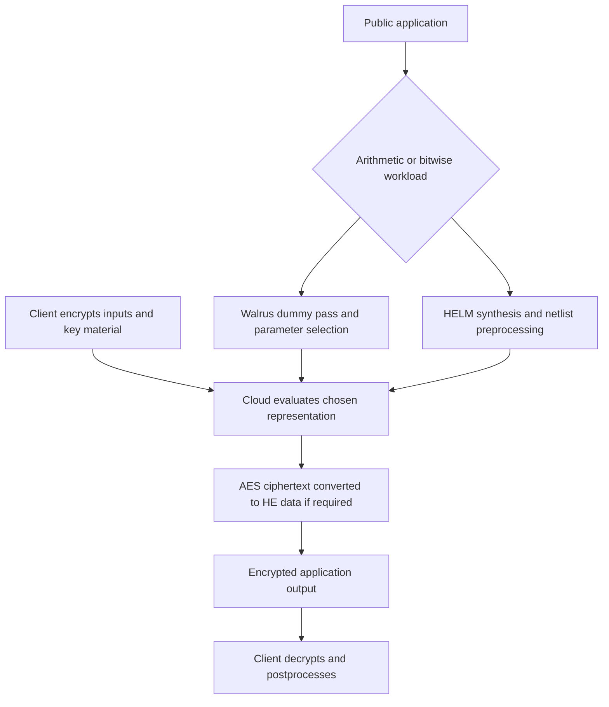

---
# Summary

## 1. Problem

Charles Gouert and Nektarios Georgios Tsoutsos present a tutorial on turning applications into homomorphic computations. The main obstacle is usability: users must choose a computational representation, fit a circuit within a noise budget, select secure parameters, and organize parallel execution. This is a software methodology paper rather than a new symmetric cipher or a new transciphering security construction.

The tutorial develops two paths: **Walrus**, a C++ front end to SEAL for leveled arithmetic, and **HELM**, a Rust tool for evaluating synthesized hardware descriptions with Boolean or small-word FHE. AES-128 decryption is the transciphering case study.

## 2. Main Contribution

Walrus separates circuit analysis from encrypted execution. A first pass on dummy values records arithmetic dependencies and estimated noise growth; parameter selection then chooses from supported configurations subject to depth, precision, and batching requirements. A second pass performs actual encrypted computation.

HELM starts from synthesizable Verilog, uses Yosys/ABC for logic synthesis and optimization, preprocesses the resulting netlist, and evaluates it with supported FHE primitives. Gates at the same circuit level can execute in parallel. The tutorial explains gate, two-input lookup-table, and arithmetic modes, as well as the practical constraints of sequential designs.

Worked examples include a shallow square-activation neural network, AES decryption with and without homomorphic key scheduling, and an arithmetic chi-squared benchmark evaluated through both frameworks.

## 3. Main Techniques

Walrus models the critical noise path, not just the total count of multiplications. It supports arithmetic between ciphertexts and between ciphertexts and public constants. SIMD batching amortizes a common computation over independent examples. Some modulus alignment still requires explicit programmer intervention, as shown in the network example.

HELM's preprocessing resolves aliased wires, handles public constants and direct wire copies, and removes hardware metadata that is unnecessary for its evaluator. Yosys optimizations reduce redundant operations before expensive homomorphic evaluation. Gate and LUT modes require compatible, separately synthesized netlists; the described version cannot freely mix them.

For transciphering, the server evaluates AES decryption using encrypted key material and the supplied AES ciphertext. The result is an HE encryption of the data, ready for subsequent processing. Supplying encrypted round keys shifts key scheduling to the client, trading setup communication for lower server latency.

## 4. Threat Model and Assumptions

The cloud is not given the HE secret key. Confidentiality depends on the selected HE scheme and parameters, secure key distribution, and the symmetric encryption configuration. The tutorial does not establish a malicious-server verification protocol, authenticated transciphering interface, or circuit-private model service.

HELM's local CSV/command-line input and automatic decryption interfaces are demonstration tooling. In a deployment, input encryption and output decryption belong at the authorized client; a server must not receive plaintext inputs or secret keys merely because the tutorial combines steps in one executable.

## 5. Important Qualifications

The text's approximate fourteen-level limit is a statement about the considered SEAL configurations and workload, not a mathematical limit of SEAL or leveled HE. Likewise, empirically finding parameters that decrypt correctly on sample inputs is not a proof of an acceptably small failure probability for every permitted input.

The paper says reverse conversion to an ordinary AES ciphertext is impossible in its described workflow. Read this as a limitation of that protocol/interface, rather than a general impossibility theorem for every interactive or cryptographically augmented conversion protocol.

The AES discussion describes a no-key-scheduling interface with ten 128-bit round-key inputs, totaling 1280 encrypted bits. Canonical AES-128 derives eleven 128-bit round-key states including the initial key. A faithful implementation must inspect the actual netlist interface and account for its initial/final key handling; the tutorial's ten-input description should not replace the AES specification.

The sequential-circuit example's cycle bounds are also illustrative, not verified. With threshold 27, an 8-bit input of 255 needs four right shifts to become at most 27, rather than the stated one. Loading, checking, and output states add cycles beyond the number of divisions. A correct bound must be derived from the actual state machine.

A public worst-case execution bound and oblivious selection can avoid data-dependent stopping. The tutorial's warning about a client decrypting arbitrary “ready” ciphertexts highlights a real decryption-oracle risk, but does not prove that fixed iteration counts are the only possible secure protocol design.

## 6. Evaluation Setup

The AES study uses an AWS c5.12xlarge machine at 12, 24, and 48 CPU threads. Figure 11 compares circuits with and without key scheduling. Scaling is strong from 12 to 24 threads and weaker at 48 because narrow circuit levels limit parallelism. These are circuit-evaluation measurements, not total network, enrollment, and client costs.

The tutorial also discusses HELM GPU execution using an NVIDIA A100. GPU support in the described system is for gate circuits; the best cited gains apply to wide circuits and should not be assumed for every AES implementation.

Walrus's network examples use layer dimensions 50–25–50 through 400–200–400, with selected polynomial degrees 8192 through 32768. The output is a vector of scores; the client performs the final class selection. The text calls latency divided by batch size “throughput”; that quantity is **amortized time per inference**, whose reciprocal is a throughput rate.

For the chi-squared workload, Walrus uses BGV with degree 8192 at a stated 128-bit security target. HELM's configurations target 128 bits and use degrees 1024 or 2048. Its gate/LUT circuits contain over 3700 gates / nearly 3500 LUTs. Walrus is single-threaded while HELM variants are parallelized, yet the shallow arithmetic workload favors Walrus. This does not establish a universal winner across circuit types.

---
# Main Scheme

## Title

Compile, parameterize, and evaluate an AES-to-HE application

### 1. Notation

- $k$: AES key; $c=\operatorname{AES.Enc}_k(m)$: symmetric ciphertext under the specified mode.
- $(pk,sk,evk)$: HE key material.
- $[x]=\operatorname{HE.Enc}_{pk}(x)$.
- $\mathcal D$: public synthesized AES decryption circuit.
- $F$: the subsequent public application circuit.

### 2. Choose the computational path

Use Walrus's arithmetic circuit model for shallow arithmetic with useful SIMD occupancy. Use HELM's synthesized gate/LUT path for suitable bitwise computations such as AES. Choosing a path requires considering depth, word width, parallel circuit width, and output representation.

### 3. Prepare and verify the circuit

Compile the intended AES circuit with Yosys and a technology map containing only supported primitives. Run ordinary circuit simulation against known inputs before HE evaluation. Select a fixed execution bound for sequential circuits and account for all state transitions. Choose whether the client or server performs key expansion.

### 4. Encrypt and upload

The client generates HE keys, sends the evaluator the required public/evaluation keys, and uploads $c$ with $[k]$ or the circuit's complete encrypted round-key inputs. Mode information, IVs, and padding conventions must match the chosen AES circuit; the tutorial's block example alone is not a full authenticated message format.

### 5. Evaluate and return

The evaluator computes

$$
[m]=\operatorname{HE.Eval}_{evk}(\mathcal D,[k],c),\qquad
[F(m)]=\operatorname{HE.Eval}_{evk}(F,[m]).
$$

Public ciphertext bits can be represented as public constants in the HE circuit. Schedule independent gates in parallel while respecting dependencies. The client decrypts the final result and performs any intentionally omitted cleartext postprocessing.

## Protocol

# Questions

- Does the compiled circuit match the actual AES mode, key schedule, and bit ordering?
- What noise margin and failure bound justify the automatically selected parameters beyond sample tests?
- What is the true sequential execution bound, including control states?
- Do batching and circuit width provide enough useful parallelism for the selected hardware?
- Is the reported metric latency, amortized time, or a throughput rate?

# Related Topics

[[000 - Transciphering HE]]; HELM; Walrus; SEAL; Yosys; Boolean FHE; automatic parameter selection; AES key scheduling; oblivious control flow.
