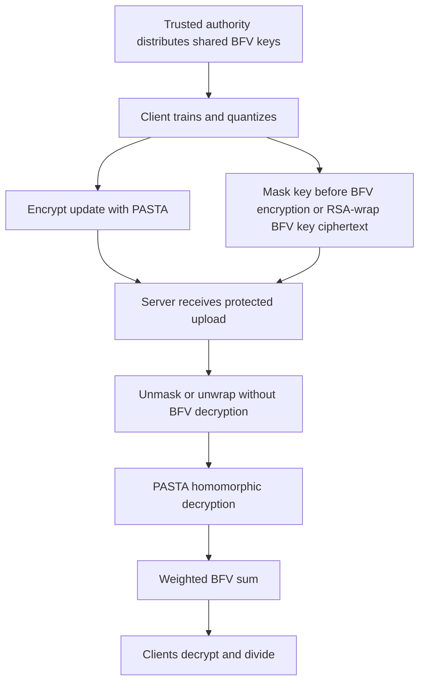

---
# Summary

## 1. Problem

Costa et al., arXiv:2603.26417v1 (27 March 2026), extend a Flower-based PASTA/BFV federated-learning prototype. In the earlier design, every client holds the same BFV secret key. A client intercepting another client's BFV-encrypted PASTA key can therefore decrypt it and recover that client's symmetrically encrypted model update.

The paper proposes two alternative protections for the **uploaded symmetric-key ciphertext**: additive masking before BFV encryption, or an outer RSA encryption of the serialized BFV ciphertext. Neither changes the underlying shared BFV key architecture.

## 2. Main Contribution

The masking variant sends $[k_i+M_i]$ instead of $[k_i]$, with a client-specific secret mask distributed to the client and server by the trusted setup authority. The server removes the mask homomorphically.

The RSA variant encrypts $k_i$ under BFV, serializes that ciphertext, splits it into RSA-sized chunks, and encrypts each chunk using the server's certified RSA public key. Only the server unwraps the BFV ciphertext and uses it for PASTA transciphering.

The implementation extends the earlier PASTA/BFV and Flower integration and measures client cost, server cost, communication, and MNIST model quality. It addresses an interception weakness of the earlier interface; it does not introduce threshold or multi-key HE.

## 3. Main Techniques

Both variants leave the expensive pipeline unchanged after key recovery: homomorphically decrypt each PASTA-encrypted update, weight the resulting BFV ciphertext by its client weight, sum, and send the encrypted numerator to authorized clients. Clients decrypt, divide by the public total weight, and dequantize.

Masking uses the additive plaintext group of BFV: subtraction of a public-to-the-server mask converts an encryption of $k_i+M_i$ into an encryption of $k_i$. A uniformly random mask over the **same finite plaintext group**, hidden from the intercepting client, provides the intended hiding even though that client possesses the HE secret key.

RSA wrapping operates on an already encrypted, roughly 1.8 MB object. BFV encryption does not make that object fit into a single RSA plaintext. The actual implementation therefore requires thousands of RSA encryptions per uploaded key. Chunk ordering, serialization, and reconstruction are part of correctness.

## 4. Threat Model and Assumptions

Section 4.1 assumes trusted setup, an honest-but-curious server, clients that follow the protocol but may intercept traffic, and **no server–client collusion**. The TPA distributes one BFV key pair to all clients, distinct PASTA keys, and, for masking, client-specific masks to both client and server. The server holds the RSA secret key in the wrapping variant.

This protects a specific intercepted message under these assumptions. A colluding client and server can combine the shared BFV secret key with unwrapped/unmasked key ciphertexts or transciphered individual updates. A malicious server can also send an individual update in place of an aggregate unless an additional mechanism constrains decryption; such a mechanism is not provided here.

“Malicious clients” in the abstract therefore means a narrower interception capability than arbitrary Byzantine behavior. The paper does not establish protection against poisoning, malformed ciphertexts, replay, arbitrary chosen-ciphertext queries, or unrestricted collusion.

## 5. Important Qualifications

The masking argument should not rely on BFV IND-CPA against another client: that client already has the BFV secret key. Hiding follows from the unknown random mask, with an appropriate distribution and lifecycle. Distribution and reuse rules need to match this argument.

Section 5 says server-side masks are stored only encrypted, while Algorithms 1–2 and the workflow require the server to subtract a known mask. The document does not fully explain the storage/unwrapping interface. This should be resolved before using the implementation as a key-management specification.

RSA semantic security requires an appropriate randomized encoding; the RSA assumption alone is not enough for textbook RSA. The reported plaintext capacities are consistent with OAEP using a 32-byte hash, but the notes do not treat this numerical inference as a verified padding implementation. Independent encrypted chunks also do not automatically authenticate their complete ordering or prevent replacement.

The paper's blanket 128-bit overall-security claim is conditional on the concrete components and protocol interfaces. RSA wrapping also adds a classical-security dependency. It is not a proof that arbitrary adversarial FL executions are secure.

The parameter table calls PASTA's key and block sizes 256/128 “bits.” For the referenced PASTA-3 construction those dimensions are **field elements**, not a 256-bit key and 128-bit block. Quantized signed updates also need centered modular decoding: ensuring a positive product is below 65537 is insufficient when signed sums must stay within approximately half that modulus. The inherited quantization and integer-casting details are not independently verified by this paper's benchmarks.

## 6. Evaluation Setup

Google Colab T4 High-RAM provides an Intel Xeon at 2.20 GHz, 51 GB system RAM, and a 15 GB T4 GPU. Training uses MNIST with IID partitioning, 12 clients, 4 training clients per round, 12 evaluation clients, 10 rounds, 10 local epochs, batch size 64, and an approximately 8000-parameter CNN. BFV uses plaintext modulus 65537 and polynomial degree 16384 at a stated 128-bit target. The T4 accelerates training; the paper does not demonstrate GPU-accelerated transciphering.

Table 3 gives final accuracies: baseline 97.39%, RSA-3072 98.04%, RSA-4096 97.28%, masking 98.35%. These differences do not show that cryptographic wrapping improves learning; controlled repetition/confidence intervals are not supplied.

Client training-phase times are 11.88486 seconds baseline, 12.37625 RSA-3072, 12.38298 RSA-4096, and 11.95498 masking. Mask preparation takes 0.01845 seconds at initialization and is excluded from the phase totals. RSA key wrapping adds about 0.35–0.38 seconds per measured client phase.

Server HESD takes approximately 1400–1451 seconds **per client**. RSA unwrapping adds 12.0 / 19.3 seconds per client; unmasking adds 0.0014 seconds. Four-client aggregation-phase totals are about 5601–5837 seconds. Lower total times for some variants reflect differing measured HESD times, not acceleration of PASTA by masking or RSA.

Client upload is reported around 1.79 MB for masking/baseline, with 1.31× / 1.22× expansion for RSA-3072 / RSA-4096. The reply remains BFV-encrypted and unchanged by these wrappers. Code availability is promised upon publication; the cited PASTA and Flower frameworks alone do not reproduce the new integration.

---
# Main Scheme

## Title

Protecting a shared-BFV transciphering key upload with masking or RSA wrapping

### 1. Notation

- $[x]=\operatorname{BFV.Enc}_{pk}(x)$, with common $sk$ held by all clients.
- $k_i,M_i$: client $i$'s PASTA key and additive mask, represented in the BFV plaintext group.
- $c_i=\operatorname{PASTA.Enc}_{k_i}(q_i)$: encrypted quantized update.
- $(pk_R,sk_R)$: server RSA key pair.
- $a_i$: public aggregation weight; $A=\sum_i a_i$.

### 2. Trusted setup

The TPA securely distributes BFV keys to the authorized roles and distinct PASTA keys to clients. For masking, it also distributes $M_i$ privately to client $i$ and the server. For RSA, clients obtain an authenticated server public key. The shared BFV secret key is retained by clients, not the server.

### 3. Prepare a protected key upload

Choose one variant:

$$
u_i=[k_i+M_i]
$$

or serialize $[k_i]$ into chunks $b_{i,j}$ and send $u_{i,j}=\operatorname{RSA.Enc}_{pk_R}(b_{i,j})$. The client uploads the protected key object, $c_i$, and aggregation metadata.

### 4. Recover the usable encrypted key

The server computes $[k_i]=u_i-M_i$, or RSA-decrypts and reconstructs the serialized BFV ciphertext. The server obtains an **encrypted** PASTA key; it does not need its plaintext under the stated noncollusion model.

### 5. Transcipher, aggregate, and decode

Compute

$$
[q_i]=\operatorname{BFV.Eval}(\operatorname{PASTA.Dec},[k_i],c_i),
\qquad [S]=\sum_i a_i[q_i].
$$

Return $[S]$ and the public normalization metadata. Clients decrypt using centered modular decoding, divide by $A$, and undo quantization. A correctness argument must bound signed $S$ before modular reduction; the wrapper does not resolve overflow in the underlying FL scheme.

## Protocol

# Questions

- What exact mask distribution, storage format, and renewal rule are implemented?
- Are RSA padding, complete-message integrity, and chunk ordering explicitly enforced?
- Can a client access any individual BFV update after the server has transciphered it?
- What prevents a malicious server from substituting an individual ciphertext for an aggregate?
- Does centered signed aggregation avoid wraparound for every accepted model update and weight?

# Related Topics

[[000 - Transciphering HE]]; PASTA; BFV; federated learning; key wrapping; shared-key limitations; trusted setup; modular quantization.
