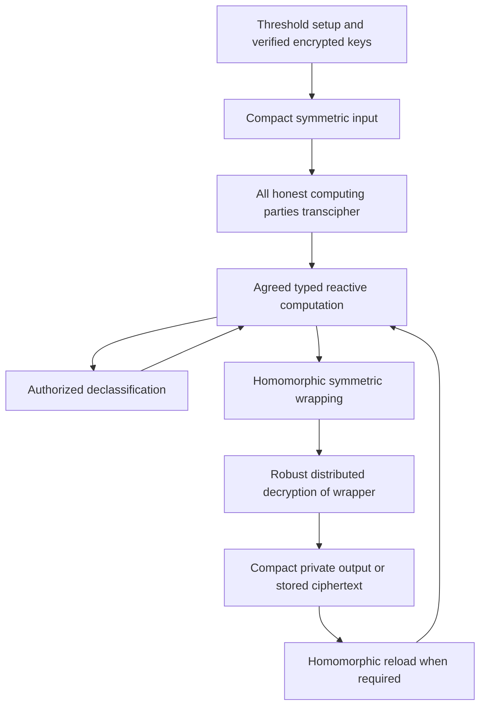

---
# Summary

## 1. Problem

Nigel P. Smart's *Practical and Efficient FHE-based MPC*, in the supplied August 2024 update, asks how FHE can support **reactive**, actively secure MPC with compact input/output and storage. Ordinary homomorphic circuit evaluation alone does not provide robust distributed decryption, valid malicious inputs, agreed program execution, or safe release of selected intermediate values.

The paper combines threshold FHE, proofs of plaintext knowledge, symmetric transciphering, and a typed public programming model. The update adds encrypted PRF evaluation and a PRF-assisted input mechanism.

## 2. Main Contribution

The protocol executes an **F-Circuit** with public values, sensitive HE-encrypted values, and compact symmetrically encrypted stored values. It supports private input/output, addition and multiplication, `Declassify`, conversion in both directions between HE and symmetric representations, and an encrypted PRF operation.

Theorem 1 claims UC realization of the ideal F-Circuit functionality in the random-oracle model and a distributed-key-generation/decryption hybrid model. The theorem is conditional on the paper's IND-KEY property for FHE, IND-CPA security of the symmetric cipher, secure LWR-based PRF behavior, and appropriate zero-knowledge proofs with negligible knowledge-soundness error. Pairing/vector-commitment proof instantiations additionally use the algebraic group model.

## 3. Main Techniques

Input parties, output parties, and computing parties are distinct sets. Computing parties hold shares of one FHE secret key and each maintain/evaluate the agreed ciphertext state. They do not each receive the complete HE secret key.

A one-time proof of knowledge accompanies an encrypted symmetric key. Later compact symmetric inputs can be interpreted through this verified key without a new HE proof for every data item. This uses the explicit condition that every accepted symmetric ciphertext represents some valid message; a more restrictive symmetric format would need extra validation/proofs.

Compact output is possible because computing parties first evaluate symmetric **encryption** on the HE-encrypted result, then jointly decrypt only this new outer HE ciphertext. The released value is still protected by the recipient's symmetric key. The same technique stores data under a jointly generated hidden storage key.

`Declassify` jointly decrypts an explicitly designated value so later public control flow can depend on it. The PRF input variant instead creates an encrypted pseudorandom pad, privately gives its plaintext to the input party, and subtracts the encrypted pad from the public masked input.

## 4. Threat Model and Assumptions

The adversary is **static** and actively corrupts at most $t<C/3$ computing parties, where $C$ is their number; it may corrupt any number of input/output parties. The protocol is synchronous and assumes authentic channels and Byzantine reliable broadcast. Some variants additionally require private channels to input/output parties. Guaranteed output delivery relies on these availability, threshold, and communication assumptions.

The paper mentions a theoretical route to $t<C/2$ with a different, less efficient robust decryption protocol. That extension is not the instantiated protocol. Its guarantees must not be transferred to dishonest-majority MPC or a single malicious cloud server.

A compiler and participating parties must agree on an appropriate, well-typed program. If that program explicitly declassifies an input, the ideal functionality permits that leakage. UC security of execution does not prove that the application reveals only an acceptable amount of information.

## 5. Important Qualifications

Section 6.2 explicitly calls its argument a **proof sketch** and omits detailed accumulation of extraction/simulation errors. These notes describe the claimed theorem and assumptions; they do not constitute an independent proof certification.

IND-KEY is the paper's fake-public-key/meaningless-encryption assumption, rather than merely the usual statement of IND-CPA. Instantiating the result requires the properties actually used in the reduction, compatible key sharing, and the chosen proof system. A generic assertion that “all FHE is secure” is insufficient.

Nonce/counter uniqueness is essential for the additive stream/CTR symmetric construction. Input, output, storage, PRF, and session uses need consistent separation. A ciphertext proof establishes a valid known plaintext/randomness relation; it does not prove a user's input is truthful or within every application-specific range.

The pseudocode contains transcription inconsistencies: Figure 6 tests `varid = Enc/Sym` where the intended selector is `variant`, and the ideal output interface refers to an input-party set where the intended role is an output party. Section 6.1.1 also briefly writes forward `Sym` in a conversion-to-HE example whose surrounding algorithm correctly uses `Sym^{-1}`. Use the typed semantics and the main algorithms, not these inconsistent identifiers, when implementing.

`Declassify` is a controlled protocol operation executed on agreed state. It is not permission to decrypt arbitrary attacker-supplied ciphertexts outside the program. Compact output similarly decrypts an agreed symmetric wrapping, rather than exposing the original plaintext to the computing parties.

## 6. Evaluation Setup

This is a protocol and security-model paper, not an end-to-end implementation benchmark. Its practical argument cites component timings from other works, including distributed decryption, PASTA transciphering, and TFHE stream-cipher implementations. Those numbers use different schemes, parameters, hardware, and parallelism and cannot be summed into a measured runtime for this protocol.

The paper discusses efficient realizations with BGV/BFV, TFHE, and approximate CKKS. Exact ring semantics in the abstract functionality do not automatically resolve CKKS approximation, precision, and comparison issues. An implementation must specify those separately. Proof size, reliable-broadcast traffic, joint key generation, and replicated evaluator computation remain real costs despite compact steady-state client inputs.

---
# Main Scheme

## Title

Robust reactive threshold-FHE computation with compact symmetric input, output, and storage

### 1. Notation

- $\mathcal I,\mathcal O,\mathcal C$: input, output, and computing party sets.
- $[x]=\operatorname{Enc}_{pk}(x)$: threshold-FHE ciphertext.
- $\operatorname{DD}(c,U)$: robust distributed decryption delivering the plaintext to authorized set $U$.
- $\operatorname{Sym}_k(m;sid,cnt)$ and $\operatorname{Sym}^{-1}$: nonce/counter-based symmetric encryption and decryption.
- $k_{in,i},k_{out,i},k_0$: input, output, and joint storage keys.

### 2. Setup and key admission

Generate/share the HE secret key through the assumed secure functionality. Parties submit encrypted symmetric keys with proofs of knowledge of valid plaintexts and encryption randomness. Replace invalid submissions with agreed defaults. Sum the computing parties' admitted key contributions to obtain $[k_0]$. Initialize consistent counters.

### 3. Compact input

Input party $i$ broadcasts $c=\operatorname{Sym}_{k_{in,i}}(x;sid,cnt)$. Computing parties evaluate

$$
[x]=\operatorname{Eval}(\operatorname{Sym}^{-1},[k_{in,i}],c,sid,cnt).
$$

All follow the same accepted input and increment the corresponding counter. Alternatively, direct HE input requires its plaintext-knowledge proof. PRF-assisted input uses a privately delivered pad $r$, public $v=x+r$, and $[x]=v-[r]$.

### 4. Reactive computation

Evaluate the agreed typed instructions. Sensitive registers remain encrypted; public arithmetic and program-counter changes operate on public values. `Declassify` calls $\operatorname{DD}([x],\mathcal C)$ and intentionally makes $x$ available for the specified public behavior.

### 5. Compact private output

For recipient $i$, compute

$$
[c]=\operatorname{Eval}(\operatorname{Sym},[x],[k_{out,i}],sid,cnt),
\qquad c=\operatorname{DD}([c],\mathcal C).
$$

Deliver the agreed $c$ over authentic channels. Recipient $i$ decrypts it locally. Computing parties see a symmetric ciphertext, not $x$. Direct private distributed-decryption output instead requires the specified private channels.

### 6. Storage conversion

Use the same wrapping/decryption pattern with $k_0$ to store $(cnt,c)$. To reload, homomorphically evaluate symmetric decryption using $[k_0]$ and the stored counter. Loading is local HE computation; writing compact storage requires interaction for distributed decryption. Stored symmetric registers cannot directly participate in arithmetic before reloading.

## Protocol

# Questions

- Which concrete distributed-key/decryption protocol realizes the hybrid functionality with the required robustness?
- What declassifications does the compiled program permit, and are they acceptable for the application?
- How are sessions, roles, and counters separated and persisted across restart?
- Which proof system satisfies the required knowledge and soundness properties without parameter slack?
- What complete cost results after including broadcast, proofs, joint decryption, and replicated evaluation?

# Related Topics

[[000 - Transciphering HE]]; threshold FHE; UC security; reactive MPC; guaranteed output delivery; declassification; encrypted PRFs; compact encrypted storage.
